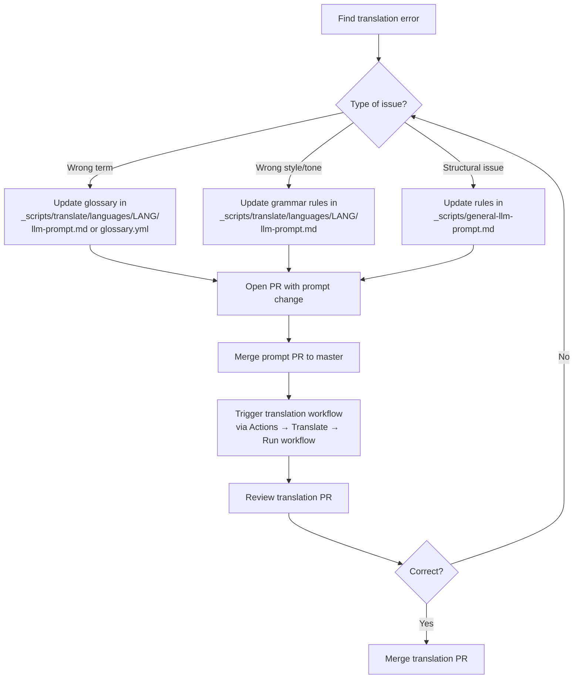
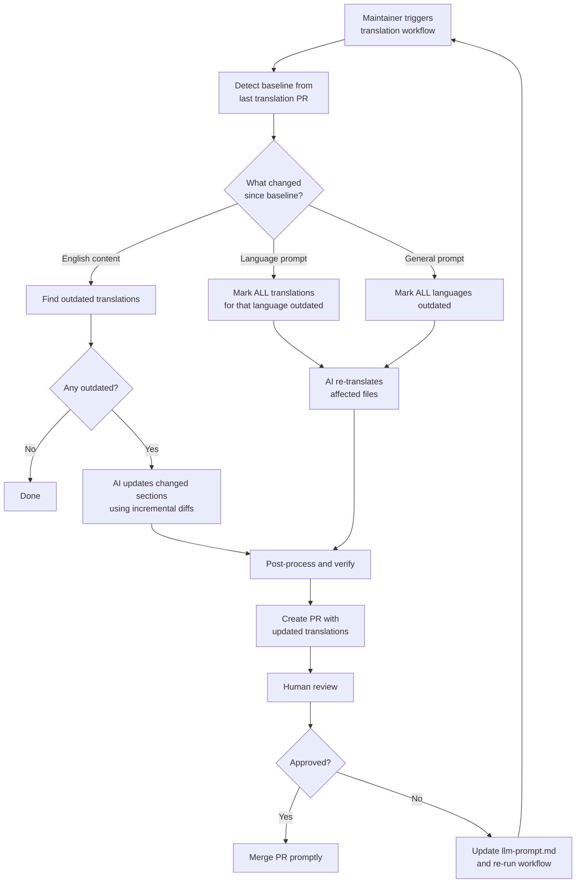
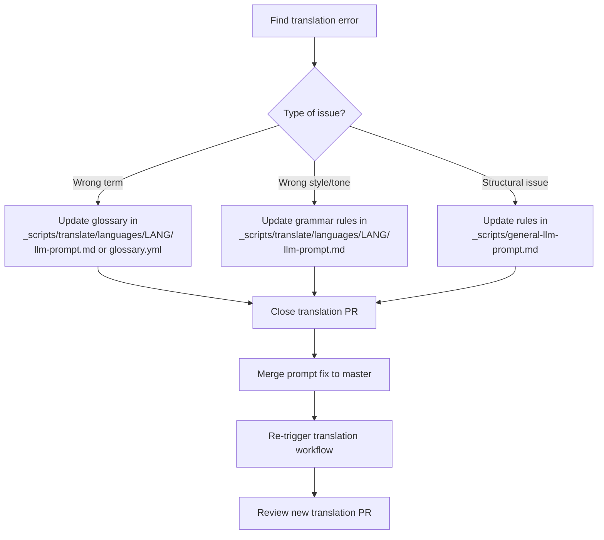

# Translation Guide

This document describes how translations work for the Nextflow training materials.

<!-- prettier-ignore-start -->
> [!WARNING]
> **All translations are generated and maintained by AI.**
> Do not submit manual translations - they will be overwritten the next time the translation workflow runs.
> Instead, improve the translation prompts to fix issues permanently.
<!-- prettier-ignore-end -->

## Overview

Translations are managed through a combination of:

1. **LLM prompts** that define translation rules and glossaries
2. **GitHub Actions** that regenerate translations when triggered
3. **Human review** to catch errors and improve prompts

The key insight: **to fix a translation, fix the prompt** - not the translated file.

### Contents

- [How to Improve Existing Translations](#how-to-improve-existing-translations)
- [Understanding the Translation Prompts](#understanding-the-translation-prompts)
- [What the Translation Sees](#what-the-translation-sees)
- [How Translation Updates Work](#how-translation-updates-work)
- [Reviewing Translation PRs](#reviewing-translation-prs)
- [How to Add a Missing Course](#how-to-add-a-missing-course)
- [How to Add a New Language](#how-to-add-a-new-language)
- [Directory Structure](#directory-structure)
- [CLI Reference (For Maintainers)](#cli-reference-for-maintainers)

---

## How to Improve Existing Translations

Found a translation error or want to suggest an improvement? Here's how to fix it the right way.



> [!NOTE]
> The translation workflow can only run on branches in the main repository, not on forks.
> If you'd like to contribute translation improvements and need write access, please open an issue to request it.

### The Right Way: Update the Prompt

The **only** sustainable way to fix translations is to improve the LLM prompts:

1. **For language-specific issues** (terminology, tone, grammar):

   - Edit `_scripts/translate/languages/<lang>/llm-prompt.md`
   - Add glossary terms, clarify rules, provide examples

2. **For structural issues** (code blocks, MDX syntax, links):

   - Edit `_scripts/general-llm-prompt.md`
   - Add rules with before/after examples

3. **Merge the prompt change** to `master`

4. **Trigger the translation workflow** via GitHub Actions:

   - Go to **Actions** → **Translate** → **Run workflow**
   - Select language and mode (`normal`)
   - The workflow detects that prompts changed and re-translates all files for that language

5. **Review the translation PR** created by the workflow

### Why Not Edit Translations Directly?

- Direct edits are **overwritten** when English content changes
- There's no way to track why a translation differs from the AI output
- Future maintainers won't know which changes were intentional
- The same error will reappear in new content

### Reporting Issues

If you find errors but can't fix the prompts yourself:

1. Open a GitHub issue
2. Include: language, file path, current text, expected text
3. Explain why the current translation is wrong
4. A maintainer will update the prompt and re-run

---

## Understanding the Translation Prompts

The translation system uses two types of prompts:

### General Prompt (`_scripts/general-llm-prompt.md`)

Contains rules that apply to ALL languages:

- What to translate vs keep in English
- Code block handling (never translate syntax, always translate comments)
- Formatting preservation (frontmatter, MDX components, links, anchors)
- Technical term lists (Nextflow keywords, operators, directives)
- Validation requirements

### Language-Specific Prompts (`_scripts/translate/languages/<lang>/llm-prompt.md`)

Contains rules specific to each language:

- Grammar and tone (formal/informal)
- Terms that get translated (with exact translations)
- Aside and collapsible titles
- Common expressions
- Language-specific mistakes to avoid

### Prompt Precedence

When prompts conflict, **language-specific rules override general rules**. This allows languages to customize behavior (e.g., French keeps "workflow" in English even though it could theoretically be translated).

### Contributing Prompt Improvements

If you're a native speaker and want to improve translation quality:

1. **Read the current prompt** for your language in `_scripts/translate/languages/<lang>/llm-prompt.md`
2. **Identify the issue type**:
   - Wrong term → Add/update entry in "Terms to Translate"
   - Wrong tone → Clarify in "Grammar & Tone" section
   - Repeated error → Add to "Common Mistakes" section
3. **Provide examples** showing wrong vs correct translations
4. **Test your change** by running the translation workflow
5. **Submit a PR** with both prompt change and sample output

Good prompt improvements include:

- Adding missing glossary terms
- Clarifying ambiguous rules with examples
- Adding common mistakes that keep occurring
- Regional spelling/grammar preferences

---

## What the Translation Sees

English pages are MDX files under `docs/src/content/docs/`.
Each translation is the same file at the same relative path under `docs/src/content/docs/<lang>/`.
A translation must keep the MDX structure intact, or the site build fails.

| Element                  | English source                                                        | In the translation                                                                     |
| ------------------------ | --------------------------------------------------------------------- | -------------------------------------------------------------------------------------- |
| Frontmatter              | `title:`, `description:`, `additional_information:` text              | Translate the values; keep keys and `page_type`, `index_type`, `tableOfContents` as is |
| Code includes            | `import x from '...?raw';` after the frontmatter, `<Code code={x} />` | Keep the `<Code>` tag; the import path is one `../` deeper                             |
| Images                   | ``                                      | Translate the alt text; the path points into the English tree (images are not copied)  |
| Asides                   | `:::tip[Title]` ... `:::`                                             | Translate the title and body; keep the markers                                         |
| Collapsibles             | `<details class="exercise">`, `<summary>Title</summary>`              | Translate the summary and body; keep the tags and class                                |
| Components               | `<CodeWalkthrough>`, `<Quiz id="...">`, `<LinkButton href="...">`     | Keep tags and attributes; translate text between the tags                              |
| Code blocks              | ` ```nextflow {2} title="main.nf" `                                   | Keep the code and the fence meta; translate code comments                              |
| Command output           | `# [!output]` and the lines after it, inside a `bash` block           | Keep unchanged                                                                         |
| Annotations              | `// [!annotate] Explanation`                                          | Translate the explanation; keep the marker                                             |
| Inline code highlighting | `` `channel.of(1){:nextflow}` ``                                      | Keep unchanged                                                                         |
| Headings and anchors     | `## 1. Title {#custom-id}`                                            | Translate the title; keep the number and `{#custom-id}`                                |
| Links                    | `[text](../hello_nextflow/01_hello_world.mdx#anchor)`                 | Translate the text; keep the target                                                    |
| MDX comments and escapes | `{/* ... */}`, `\{`, `\}`, `&lt;`                                     | Keep unchanged                                                                         |

Walkthrough `step="..."` values, code tab `label="..."` values and `<TabItem label>` values are translated.
Post-processing sets them from `tab_labels` in `glossary.yml` (such as Before and After) and restores every other fence attribute from English.
Image paths and `?raw` imports need no attention: post-processing points them at the English files.

Pages that have no translation yet show the English page, with a notice that it is not available in that language.

---

## How Translation Updates Work

Translation runs are triggered manually via the GitHub Actions workflow (**Actions** → **Translate** → **Run workflow**), typically ahead of a new release of the training materials (but can be done at any time).
The workflow detects what has changed since the last translation run and updates accordingly:

1. **English source files changed** → Outdated translations are updated
2. **Language-specific prompt changed** → That language's translations are re-translated
3. **General prompt changed** → All languages are re-translated



### Key Points

- Translation runs are **triggered manually**, not automatically on push
- Runs are typically done **ahead of a new release**, but can be triggered at any time
- The AI makes **minimal changes**, updating only sections that changed in English
- When prompts change, all translations for the affected language(s) are re-translated
- Translations preserve line-by-line structure for easy diff review
- Each run creates a single PR containing updates for all affected languages
- The system uses the last merged translation PR's commit SHA as the baseline for change detection
- `baseline: <commit SHA>` in `_scripts/translate/translate_config.yml` replaces it while the last translation PR's commit is older; `--since <commit>` on `translate` and `sync` overrides both for one run
- **Translation PRs should be merged promptly** to avoid them stacking up or becoming outdated

### Excluding Directories from Translation

To prevent specific directories under `docs/src/content/docs/` from being translated, add them to `_scripts/translate/translate_config.yml`:

```yaml
exclude_dirs:
  - example_docs_set
  - archive
```

Each entry is the name of a top-level directory under `docs/src/content/docs/`.

Excluded directories are skipped during sync (both new and outdated detection) and are not flagged as orphaned.
Pages in excluded directories still appear on translated sites, showing the English content.

---

## Reviewing Translation PRs

When reviewing a translation PR, follow these guidelines:

### What to Check

1. **Technical accuracy**

   - Are Nextflow concepts correctly explained?
   - Are code examples unchanged (only comments translated)?
   - Are technical terms used consistently with the glossary?

2. **Formatting preservation**

   - Does the PR's docs build pass? A broken MDX tag, brace or frontmatter key fails it
   - Are code blocks intact, including their fence meta and `# [!output]` sections?
   - Are asides (`:::note`), collapsibles (`<details>`) and components correctly structured?
   - Are heading anchors preserved (`{#anchor-name}`)?
   - Are links working (targets unchanged, only link text translated)? The links validator checks this in the build

3. **Language quality**
   - Is the tone appropriate (formal/informal per language)?
   - Are translations natural and readable?
   - Are there any obvious errors or awkward phrasings?

### How to Handle Issues

<!-- prettier-ignore-start -->
> [!CAUTION]
> **Do NOT suggest changes directly to translation PRs.**
> Direct edits will be overwritten the next time the translation workflow runs.
> Instead, update the translation prompts and re-run the translation.
<!-- prettier-ignore-end -->

When you find an issue during review:



#### Workflow for Fixing Issues

1. **Close the translation PR** (the translations will be regenerated)

2. **Merge the prompt fix to master**:

   - Language-specific issues → edit `_scripts/translate/languages/<lang>/llm-prompt.md`
   - General formatting issues → edit `_scripts/general-llm-prompt.md`

3. **Re-trigger the translation workflow**:

   - Go to **Actions** → **Translate** → **Run workflow**
   - Select the language and `normal` mode
   - The workflow creates a new PR with updated translations

4. **Review the new translation PR** to verify the fix

#### Example: Fixing a Wrong Term

If "workflow" is incorrectly translated as "flujo" instead of "flujo de trabajo" in Spanish:

1. Close the current translation PR
2. Edit `_scripts/translate/languages/es/llm-prompt.md` and add or update the glossary entry:

   | English  | Spanish                        |
   | -------- | ------------------------------ |
   | workflow | flujo de trabajo (NOT "flujo") |

3. Merge the prompt change to master
4. Re-trigger the translation workflow
5. Verify the fix in the new translation PR

### Approving PRs

Once you've verified the translation quality:

1. Check that CI passes (build succeeds)
2. Approve the PR
3. Merge (squash merge recommended)

---

## How to Add a Missing Course

If a language exists but is missing content (e.g., Portuguese has `hello_nextflow/` but not `nf4_science/`):

### Using GitHub Actions (Recommended)

1. Go to **Actions** → **Translate** → **Run workflow**
2. Select language (e.g., `pt`)
3. Select mode: `normal`
4. The workflow detects missing translations and creates a PR

### Using the CLI (Requires API Key)

For maintainers with `ANTHROPIC_API_KEY` access:

```bash
cd _scripts

# Translate one file at a time (path relative to docs/src/content/docs/)
uv run python -m translate translate nf4_science/index.mdx --lang pt

# Or sync all (update outdated + add missing + remove orphaned)
uv run python -m translate sync pt
```

### After Translation

1. Review the generated translations
2. Check if any prompt updates are needed
3. Submit a PR

---

## How to Add a New Language

### Step 1: Register the Language

1. Run the `new-lang` command from `_scripts/`.
   It creates the prompt and glossary stubs in `_scripts/translate/languages/<lang>/`, copies `en.json` to `docs/src/content/i18n/<lang>.json` and adds the language to `_scripts/translate/language_names.yml`:

   ```bash
   cd _scripts
   uv run python -m translate new-lang sv --name Svenska
   ```

2. Add the locale to `allLocales` in `docs/src/locales.mjs`, with the language's own name as the label:

   ```js
   export const allLocales = {
     root: { label: "English", lang: "en" },
     // ...
     sv: { label: "Svenska" },
   };
   ```

3. Translate the values in `docs/src/content/i18n/<lang>.json`; Starlight translates its own UI strings for most languages.
4. Add the code to `LOCALES` in `.github/check_headings.py`, so the heading check skips the translated pages
5. Optionally, add a translation for each sidebar group label in `docs/src/sidebar.mjs` (the `translations` maps). Page entries use the translated page titles automatically

### Step 2: Customize the Translation Prompt

Create `_scripts/translate/languages/<lang>/llm-prompt.md` to define:

1. **Grammar preferences**

   - Formal or informal tone
   - Regional spelling conventions
   - Specific grammar rules

2. **Glossary**

   - Terms to keep in English
   - Terms to translate (with exact translations)
   - Common mistakes to avoid

3. **Aside and collapsible titles**
   - Translations for Note, Tip, Warning, Exercise, Solution

See existing language prompts for examples (e.g., `_scripts/translate/languages/pt/llm-prompt.md`).

### Step 3: Create the Post-Processing Glossary

Create `_scripts/translate/languages/<lang>/glossary.yml` with deterministic translations that are enforced by post-processing (independent of LLM output), such as the AI translation notice and common titles (Command output, Directory contents, ...).
See `_scripts/translate/languages/pt/glossary.yml` for an example.
These translations are applied deterministically during post-processing and override whatever the LLM produces, ensuring consistency across all files.

The keys are:

- `translation_notice`: `text` (the notice on every page) and `homepage.title` / `homepage.body` (the aside on the home page)
- `tab_labels`: walkthrough `step` and tab `label` values, such as `Before` and `After`
- `admonition_titles`: the default title of each aside and collapsible type
- `admonition_title_glossary`: exact English aside and `<summary>` titles, such as `Command output`

### Step 4: Generate Initial Translations

Use GitHub Actions:

1. Go to **Actions** → **Translate** → **Run workflow**
2. Select the new language
3. Select mode: `normal`

### Step 5: Review and Iterate

1. Review the PR with generated translations
2. Update `llm-prompt.md` to fix any issues
3. Re-run translations as needed
4. Merge when satisfied

---

## Directory Structure

```
docs/
├── astro.config.mjs        # Site config
└── src/
    ├── locales.mjs         # The `allLocales` list
    ├── sidebar.mjs         # Navigation; group labels have per-language `translations`
    └── content/
        ├── docs/           # English pages (.mdx), the source
        │   ├── hello_nextflow/
        │   ├── ...
        │   ├── pt/         # Portuguese pages, same relative paths
        │   ├── es/         # Spanish
        │   └── ...
        └── i18n/
            ├── en.json     # UI strings
            ├── pt.json
            └── ...

_scripts/
├── pyproject.toml          # Package metadata and dependencies
├── general-llm-prompt.md   # Shared translation rules
└── translate/              # Translation CLI package (python -m translate)
    ├── language_names.yml  # Language codes and names
    ├── translate_config.yml# Translation scope config (exclude dirs, etc.)
    ├── languages/
    │   ├── pt/
    │   │   ├── llm-prompt.md   # Translation rules (LLM guidance)
    │   │   └── glossary.yml    # Post-processing glossary (deterministic fixes)
    │   └── ...
    ├── cli.py              # CLI commands
    ├── core.py             # Translation orchestration
    ├── postprocess.py      # Translation post-processing and glossary enforcement
    ├── verify.py           # Translation verification
    └── ...                 # API calls, git helpers, paths, prompts, progress
```

## CLI Reference (For Maintainers)

> [!NOTE]
> The CLI requires `ANTHROPIC_API_KEY` for translation commands.
> Community contributors should use GitHub Actions instead.

All commands run from `_scripts/` directory:

```bash
cd _scripts
```

### Translation Commands

```bash
# Sync all translations (update outdated + add missing + remove orphaned)
uv run python -m translate sync <lang>

# Sync with lower parallelism (default: 50 concurrent translations)
uv run python -m translate sync <lang> --parallel 10

# Sync with filter pattern
uv run python -m translate sync <lang> --include hello_nextflow

# Translate a single file
uv run python -m translate translate <path> --lang <lang>
```

### Preview Translations (No API key required)

The site builds every language together:

```bash
cd docs
npm run dev   # then open http://localhost:4321/<lang>/
```

---

## References

- [FastAPI Translation System](https://github.com/fastapi/fastapi/tree/master/scripts) - Inspiration for this implementation
- [Portuguese Glossary](https://docs.google.com/spreadsheets/d/1HUa3BO2kwukhX4EXQ-1blXeP5iueUdM23OwDRpfarDg/edit)
