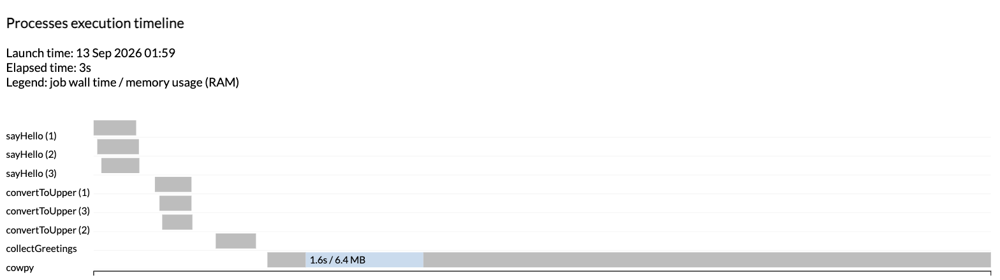

# Part 1: Run Nextflow

In this part, we introduce the core concepts of running Nextflow pipelines.
We run a complete multi-step pipeline on a single input first, then scale it up to multiple inputs processed in parallel.

This course focuses on running pipelines, so it does not cover the code behind them.
To learn how this pipeline is written, see [Hello Nextflow](../hello_nextflow/index.md).

---

## 1. Run the pipeline on a single input

The workflow `main.nf` takes greetings listed in a CSV file and runs them through four steps.

<figure class="excalidraw">
--8<-- "docs/en/docs/hello_nextflow/img/hello_pipeline_complete.svg"
</figure>

`sayHello` writes each greeting to a file, `convertToUpper` converts the text to uppercase, `collectGreetings` merges all results into one file, and `cowpy` generates ASCII art from the merged output using a containerized tool.
Nextflow wires these steps together with channels: the output of one process becomes the input of the next, so the whole chain runs automatically as data becomes available, without you having to orchestrate each step by hand.

For this first run, the input file `data/single-greeting.csv` contains a single greeting.

### 1.1. Launch the workflow

Run the following command in your terminal.

```bash
nextflow run main.nf --input data/single-greeting.csv
```

!!! tip

    The `cowpy` step runs in a Docker container.
    If you are running the course on your own machine without Docker, add `-profile conda` to every `nextflow run` command in this course to use Conda instead.
    [Part 2](./02_configure_pipeline.md#14-profiles) explains how profiles work.

??? success "Command output"

    ```console hl_lines="6 7 8 9"
    N E X T F L O W   ~  version 26.04.4

    Launching `main.nf` [angry_hoover] revision: ce74f81996

    executor >  local (4)
    [37/389926] sayHello (1)       | 1 of 1 ✔
    [b4/e2daac] convertToUpper (1) | 1 of 1 ✔
    [61/30b1af] collectGreetings   | 1 of 1 ✔
    [24/5fad08] cowpy              | 1 of 1 ✔

    Outputs:

      /workspaces/training/nextflow-run/results

      first_output:
        - batch/intermediates/Hello-output.txt

      uppercased:
        - batch/intermediates/UPPER-Hello-output.txt

      collected: batch/intermediates/COLLECTED-batch-output.txt

      batch_report: batch/batch-report.txt

      cowpy_art: batch/cowpy-COLLECTED-batch-output.txt
    ```

The key lines in the output are the process status lines, one per step:

```console
[37/389926] sayHello (1)       | 1 of 1 ✔
[b4/e2daac] convertToUpper (1) | 1 of 1 ✔
[61/30b1af] collectGreetings   | 1 of 1 ✔
[24/5fad08] cowpy              | 1 of 1 ✔
```

Each of the four processes ran successfully once.
The prefix in brackets, such as `[37/389926]`, is a truncated path to the task's working directory; more on that in [1.3](#13-explore-the-work-directory).
The `Outputs:` block that follows lists every file the pipeline published, grouped under labels defined by the pipeline author.

With a single input, `collectGreetings` has only one file to merge, so this step doesn't do much yet.
It becomes useful in [section 2](#2-run-the-pipeline-on-multiple-inputs), when the pipeline processes several greetings.

Parameters such as `--input` use two dashes, to distinguish them from Nextflow's own command-line options, which use one dash (for example `-resume`, used in section 2).

### 1.2. Find the outputs

This workflow is configured to publish its outputs to a `results` directory:

```console title="results/"
results
└── batch
    ├── batch-report.txt
    ├── cowpy-COLLECTED-batch-output.txt
    └── intermediates
        ├── COLLECTED-batch-output.txt
        ├── Hello-output.txt
        └── UPPER-Hello-output.txt
```

The pipeline author chose to publish the final outputs at the top level and the intermediate files in a subdirectory.
The top-level directory is named after the `batch` parameter, which defaults to `batch`; you'll see it change in later exercises.

Open `cowpy-COLLECTED-batch-output.txt` to see the ASCII art.

??? abstract "File contents"

    ```console title="results/batch/cowpy-COLLECTED-batch-output.txt"
     _______
    < HELLO >
     -------
      \                                  ,+*^^*+___+++_
       \                           ,*^^^^              )
        \                       _+*                     ^**+_
         \                    +^       _ _++*+_+++_,         )
                  _+^^*+_    (     ,+*^ ^          \+_        )
                 {       )  (    ,(    ,_+--+--,      ^)      ^\
                { (\@)    } f   ,(  ,+-^ __*_*_  ^^\_   ^\       )
               {:;-/    (_+*-+^^^^^+*+*<_ _++_)_    )    )      /
              ( /  (    (        ,___    ^*+_+* )   <    <      \
               U _/     )    *--<  ) ^\-----++__)   )    )       )
                (      )  _(^)^^))  )  )\^^^^^))^*+/    /       /
              (      /  (_))_^)) )  )  ))^^^^^))^^^)__/     +^^
             (     ,/    (^))^))  )  ) ))^^^^^^^))^^)       _)
              *+__+*       (_))^)  ) ) ))^^^^^^))^^^^^)____*^
              \             \_)^)_)) ))^^^^^^^^^^))^^^^)
               (_             ^\__^^^^^^^^^^^^))^^^^^^^)
                 ^\___            ^\__^^^^^^))^^^^^^^^)\\
                      ^^^^^\uuu/^^\uuu/^^^^\^\^\^\^\^\^\^\
                         ___) >____) >___   ^\_\_\_\_\_\_\)
                        ^^^//\\_^^//\\_^       ^(\_\_\_\)
                          ^^^ ^^ ^^^ ^
    ```

The `character` parameter defaults to `turkey` in `nextflow.config`, which is why the ASCII art shows a turkey.

!!! note

    The `cowpy` step runs inside a Docker container rather than relying on software installed locally.
    A container packages an application together with everything it needs to run, so you don't have to install and manage dependencies yourself, and the pipeline behaves the same way on any machine that can run the container.

### 1.3. Explore the `work/` directory

Behind the scenes, Nextflow creates a unique task directory for every process call inside a directory named `work/`.
The hash shown in the console output is the path to that directory.
For example, the `sayHello` task ran in `work/37/389926...`:

```bash
ls -a work/37/389926*
```

Inside you will find the output file along with several hidden log files:

- **`.command.sh`**: the exact command Nextflow ran
- **`.command.out`** / **`.command.err`**: stdout and stderr from the process
- **`.command.log`**: combined log output
- **`.exitcode`**: the process exit code

The `.command.sh` file is especially useful when debugging; it shows precisely what was executed:

```console title="work/37/389926.../.command.sh"
#!/bin/bash -ue
echo 'Hello' > 'Hello-output.txt'
```

Each of the four tasks has its own directory.
When one step uses the output of another, Nextflow places a symbolic link to the upstream file in the downstream task's directory.
For example, the `convertToUpper` task directory contains a link to the file produced by `sayHello`, next to its own output:

```console title="work/b4/e2daac.../"
Hello-output.txt -> /workspaces/training/nextflow-run/work/37/389926.../Hello-output.txt
UPPER-Hello-output.txt
```

You can follow the greeting through every step of the pipeline this way.

### Takeaway

You know how to run a Nextflow pipeline and find its outputs, and you know that each step is executed in its own task directory under `work/`.

### What's next?

Run the same pipeline on multiple inputs, and reuse the work that is already done.

---

## 2. Run the pipeline on multiple inputs

Real pipelines usually process many pieces of data, not just one.
The file `data/greetings.csv` contains three greetings, including the `Hello` greeting from the first run.

### 2.1. Run the workflow with `-resume`

Run the pipeline on the new input file, and add `-resume` to the command line:

```bash
nextflow run main.nf --input data/greetings.csv -resume
```

??? success "Command output"

    ```console hl_lines="6 7 8 9"
    N E X T F L O W   ~  version 26.04.4

    Launching `main.nf` [tender_allen] revision: ce74f81996

    executor >  local (6)
    [c4/642d20] sayHello (3)       | 3 of 3, cached: 1 ✔
    [7b/4dcc18] convertToUpper (3) | 3 of 3, cached: 1 ✔
    [49/d09e85] collectGreetings   | 1 of 1 ✔
    [71/6b5c76] cowpy              | 1 of 1 ✔

    Outputs:

      /workspaces/training/nextflow-run/results

      first_output:
        - batch/intermediates/Hello-output.txt
        - batch/intermediates/Bonjour-output.txt
        - batch/intermediates/Hola-output.txt

      uppercased:
        - batch/intermediates/UPPER-Hello-output.txt
        - batch/intermediates/UPPER-Bonjour-output.txt
        - batch/intermediates/UPPER-Hola-output.txt

      collected: batch/intermediates/COLLECTED-batch-output.txt

      batch_report: batch/batch-report.txt

      cowpy_art: batch/cowpy-COLLECTED-batch-output.txt
    ```

`sayHello` and `convertToUpper` each ran once per input (3 of 3), but one of those tasks was `cached`.
That is the `Hello` greeting: Nextflow recognized that it had already processed this exact input in the previous run, and reused the results instead of running the task again.
Only the two new greetings were processed.

`collectGreetings` and `cowpy` each ran once (1 of 1), and neither was cached, because their input changed: there are now three greetings to merge instead of one.
Nextflow reuses a task only when its inputs are identical to those of a previous run.

This fan-out-then-fan-in shape, several parallel tasks feeding into a smaller number of downstream tasks, is common in real pipelines.
Nextflow doesn't wait for an entire step to finish before starting the next one.
The `sayHello` tasks run in parallel as soon as your machine has the resources to do so, and as soon as one `sayHello` output is ready, the matching `convertToUpper` task can start.
`collectGreetings` and `cowpy` do have to wait, since each of them depends on every upstream result being available first.

The `-resume` capability is especially valuable in long pipelines.
If a run is interrupted by a system error, or you add new samples to an analysis, you can pick up where you left off without repeating the steps that already completed.

### 2.2. Find the outputs

The `results` directory now contains outputs for all three greetings:

```console title="results/"
results
└── batch
    ├── batch-report.txt
    ├── cowpy-COLLECTED-batch-output.txt
    └── intermediates
        ├── Bonjour-output.txt
        ├── COLLECTED-batch-output.txt
        ├── Hello-output.txt
        ├── Hola-output.txt
        ├── UPPER-Bonjour-output.txt
        ├── UPPER-Hello-output.txt
        └── UPPER-Hola-output.txt
```

The final outputs from the first run were overwritten, since this run writes files with the same names.
The ASCII art now includes all three greetings, merged by `collectGreetings`:

??? abstract "File contents"

    ```console title="results/batch/cowpy-COLLECTED-batch-output.txt"
     _________
    / HELLO   \
    | BONJOUR |
    \ HOLA    /
     ---------
      \                                  ,+*^^*+___+++_
       \                           ,*^^^^              )
        \                       _+*                     ^**+_
         \                    +^       _ _++*+_+++_,         )
                  _+^^*+_    (     ,+*^ ^          \+_        )
                 {       )  (    ,(    ,_+--+--,      ^)      ^\
                { (\@)    } f   ,(  ,+-^ __*_*_  ^^\_   ^\       )
               {:;-/    (_+*-+^^^^^+*+*<_ _++_)_    )    )      /
              ( /  (    (        ,___    ^*+_+* )   <    <      \
               U _/     )    *--<  ) ^\-----++__)   )    )       )
                (      )  _(^)^^))  )  )\^^^^^))^*+/    /       /
              (      /  (_))_^)) )  )  ))^^^^^))^^^)__/     +^^
             (     ,/    (^))^))  )  ) ))^^^^^^^))^^)       _)
              *+__+*       (_))^)  ) ) ))^^^^^^))^^^^^)____*^
              \             \_)^)_)) ))^^^^^^^^^^))^^^^)
               (_             ^\__^^^^^^^^^^^^))^^^^^^^)
                 ^\___            ^\__^^^^^^))^^^^^^^^)\\
                      ^^^^^\uuu/^^\uuu/^^^^\^\^\^\^\^\^\^\
                         ___) >____) >___   ^\_\_\_\_\_\_\)
                        ^^^//\\_^^//\\_^       ^(\_\_\_\)
                          ^^^ ^^ ^^^ ^
    ```

The `batch-report.txt` file confirms the count: `Number of greetings processed: 3`.

### 2.3. Explore the task directories

Just like the tasks you explored in [1.3](#13-explore-the-work-directory), each task in this run gets its own directory under `work/`, completely isolated from the others.
Each `sayHello` task directory contains only the output for its own greeting, and its `.command.sh` only ever contains the command for that one greeting.

This isolation is what makes parallel execution safe: tasks running at the same time never share a working directory, so nothing one task writes can collide with or overwrite what another task writes, even if they happen to produce files with the same name.
It's also what lets `-resume` cache and reuse individual tasks independently: each task's inputs, outputs, and logs live entirely inside its own directory.

`collectGreetings` shows how this works across steps and across runs.
It depends on the outputs of all three `convertToUpper` tasks, which live in three different task directories, so Nextflow places links to those files in `collectGreetings`'s own directory:

```console title="work/49/d09e85.../"
COLLECTED-batch-output.txt
UPPER-Bonjour-output.txt -> /workspaces/training/nextflow-run/work/3d/84f6a0.../UPPER-Bonjour-output.txt
UPPER-Hello-output.txt   -> /workspaces/training/nextflow-run/work/b4/e2daac.../UPPER-Hello-output.txt
UPPER-Hola-output.txt    -> /workspaces/training/nextflow-run/work/7b/4dcc18.../UPPER-Hola-output.txt
batch-report.txt
```

The link for `UPPER-Hello-output.txt` points to `work/b4/e2daac...`: the `convertToUpper` task directory from the first run, which this run reused.

### 2.4. Run the workflow again with `-ansi-log false`

By default, Nextflow condenses the output to a single summary line per process.
To see each process call listed individually, run the same command again with `-ansi-log false`:

```bash
nextflow run main.nf --input data/greetings.csv -resume -ansi-log false
```

??? success "Command output"

    ```console
    N E X T F L O W  ~  version 26.04.4
    Launching `main.nf` [cheesy_kimura] - revision: ce74f81996
    [05/f5306b] Cached process > sayHello (2)
    [c4/642d20] Cached process > sayHello (3)
    [37/389926] Cached process > sayHello (1)
    [7b/4dcc18] Cached process > convertToUpper (1)
    [3d/84f6a0] Cached process > convertToUpper (2)
    [b4/e2daac] Cached process > convertToUpper (3)
    [49/d09e85] Cached process > collectGreetings
    [71/6b5c76] Cached process > cowpy

    Outputs:

      /workspaces/training/nextflow-run/results

      first_output:
        - batch/intermediates/Bonjour-output.txt
        - batch/intermediates/Hola-output.txt
        - batch/intermediates/Hello-output.txt

      uppercased:
        - batch/intermediates/UPPER-Hola-output.txt
        - batch/intermediates/UPPER-Bonjour-output.txt
        - batch/intermediates/UPPER-Hello-output.txt

      collected: batch/intermediates/COLLECTED-batch-output.txt

      batch_report: batch/batch-report.txt

      cowpy_art: batch/cowpy-COLLECTED-batch-output.txt
    ```

This shows all 8 process calls and the task directory for each one.
Since nothing changed since the previous run, every task was cached.
The `sayHello` task at `[37/389926]` is the one from the very first run.

### 2.5. Generate an execution timeline

To see how the tasks were scheduled, add `-with-timeline` to the command.
Leave out `-resume` this time, so that every task runs instead of being retrieved from the cache:

```bash
nextflow run main.nf --input data/greetings.csv -with-timeline
```

??? success "Command output"

    ```console hl_lines="6 7 8 9"
    N E X T F L O W   ~  version 26.04.4

    Launching `main.nf` [jolly_noyce] revision: ce74f81996

    executor >  local (8)
    [86/b36db0] sayHello (1)       | 3 of 3 ✔
    [dd/ab5042] convertToUpper (3) | 3 of 3 ✔
    [c0/a425c6] collectGreetings   | 1 of 1 ✔
    [b7/b79993] cowpy              | 1 of 1 ✔

    Outputs:

      /workspaces/training/nextflow-run/results

      first_output:
        - batch/intermediates/Hola-output.txt
        - batch/intermediates/Hello-output.txt
        - batch/intermediates/Bonjour-output.txt

      uppercased:
        - batch/intermediates/UPPER-Hola-output.txt
        - batch/intermediates/UPPER-Hello-output.txt
        - batch/intermediates/UPPER-Bonjour-output.txt

      collected: batch/intermediates/COLLECTED-batch-output.txt

      batch_report: batch/batch-report.txt

      cowpy_art: batch/cowpy-COLLECTED-batch-output.txt
    ```

All 8 tasks ran, with no `cached` count.

Nextflow writes the timeline to a file named `timeline-<timestamp>.html` in the working directory.
Open it in a browser to see a bar for every task, positioned and sized by when it ran and how long it took:



The timeline makes the fan-out-then-fan-in shape described in [2.1](#21-run-the-workflow-with-resume) visible at a glance: the three `sayHello` tasks run in parallel, then the three `convertToUpper` tasks, then `collectGreetings` and `cowpy` run one after the other since each depends on everything before it.
Nextflow parallelized these tasks automatically; nothing in the command asked it to.

### Takeaway

You know how to run a pipeline on multiple inputs processed in parallel, how to use `-resume` to avoid repeating completed work, and how Nextflow keeps each task isolated in its own directory.
You also know how to see how tasks were scheduled with `-with-timeline`.

### What's next?

Head on to [Part 2](./02_configure_pipeline.md), where you'll learn how to configure pipeline behavior using `nextflow.config`.

---

## Summary

In this part you learned to:

- Run a Nextflow pipeline and find its outputs
- Explore the `work/` directory, its log files, and how steps pass files to each other
- Run the pipeline on multiple inputs processed in parallel
- Use `-resume` to skip completed work when adding new inputs
- Display each task individually with `-ansi-log false`
- Visualize how tasks ran in parallel with `-with-timeline`
