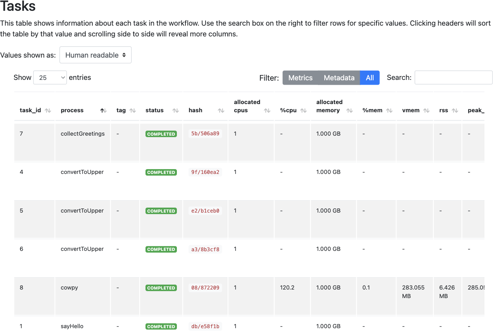

# Part 2: Configure the pipeline

In [Part 1](./01_run_nextflow.md), you ran a complete multi-step pipeline that processes multiple inputs in parallel using containers.
Now we're going to look at how to configure pipeline behavior using `nextflow.config`: first by examining the configuration file we already gave you, then by configuring the compute infrastructure, then by supplying pipeline parameters, and finally by controlling how and where outputs get published.

---

## 1. Examine the main configuration file

Nextflow automatically picks up `nextflow.config` from the working directory and applies its settings to every run.

We provide you with a configuration file that covers four areas: software packaging, process settings, pipeline parameters, and execution profiles.

??? full-code "nextflow.config"

    ```groovy title="nextflow.config" linenums="1"
    /*
     * Software packaging
     */
    docker.enabled = true

    /*
     * Process settings
     */
    process {
        cpus = 1
        memory = 1.GB
    }

    /*
     * Pipeline parameters
     */
    params {
        input = 'data/greetings.csv'
        batch = 'batch'
        character = 'turkey'
    }

    /*
     * Profiles
     */
    profiles {
        test {
            params.input = 'data/greetings.csv'
            params.batch = 'test'
            params.character = 'tux'
        }
        conda {
            docker.enabled = false
            conda.enabled = true
        }
    }
    ```

Let's go through each one, then put profiles to use by running the pipeline with one.

### 1.1. Software packaging

Software packaging is how Nextflow supplies the actual tools your processes need, whether that's a container image, a Conda environment, or something else.

```groovy title="nextflow.config" linenums="1"
/*
 * Software packaging
 */
docker.enabled = true
```

This line enables Docker for every process.
Any process that declares a `container` directive runs inside the specified image.

### 1.2. Process settings

Remember that a process is a single step in your pipeline, like `sayHello` or `cowpy`.
Nextflow lets you configure a number of things about how each one actually runs: how much CPU and memory it gets, which container or Conda environment it uses, and more.

```groovy title="nextflow.config" linenums="6"
/*
 * Process settings
 */
process {
    cpus = 1
    memory = 1.GB
}
```

This caps every process at a single CPU and 1 GB of memory.

Nextflow also lets you set different values for individual named processes or groups of processes; you'll learn how in [Part 2: Manage compute resources and failures](../config_exec/02_resources_and_retries.md#12-set-resource-allocations-for-a-specific-process) of the [Configure Execution](../config_exec/index.md) course.

### 1.3. Pipeline parameters

Parameters are the pipeline's command-line inputs, the same `--input`, `--batch` and `--character` flags you've already been setting directly on the command line.
Setting defaults for them here means you don't have to type them out every time, though as you'll see later in this part, there are a couple of other ways to supply them too.

```groovy title="nextflow.config" linenums="14"
/*
 * Pipeline parameters
 */
params {
    input = 'data/greetings.csv'
    batch = 'batch'
    character = 'turkey'
}
```

These defaults kick in whenever a parameter isn't supplied on the command line, so running `nextflow run main.nf` with no flags still works.

### 1.4. Profiles

Profiles let you bundle up a set of settings under a single name, so you can switch between whole configurations with one flag instead of changing values by hand every time.

```groovy title="nextflow.config" linenums="23"
/*
 * Profiles
 */
profiles {
    test {
        params.input = 'data/greetings.csv'
        params.batch = 'test'
        params.character = 'tux'
    }
    conda {
        docker.enabled = false
        conda.enabled = true
    }
}
```

The `test` profile overrides three parameters to run the pipeline with a small, well-defined input set; every nf-core pipeline ships with one of these for quick validation, and it's a convention worth following in your own pipelines too.

The `conda` profile switches software packaging from Docker to Conda.

You activate a profile by passing `-profile <name>` on the command line.

Let's put the `test` profile to use.

```bash
nextflow run main.nf -profile test
```

??? success "Command output"

    ```console hl_lines="6 7 8 9"
    N E X T F L O W   ~  version 26.04.4

    Launching `main.nf` [reverent_heisenberg] revision: ce74f81996

    executor >  local (8)
    [3d/8a12c7] sayHello (3)       | 3 of 3 ✔
    [e7/e0934f] convertToUpper (2) | 3 of 3 ✔
    [1d/616569] collectGreetings   | 1 of 1 ✔
    [44/7d46cf] cowpy              | 1 of 1 ✔

    Outputs:

      /workspaces/training/nextflow-run/results

      first_output:
        - test/intermediates/Bonjour-output.txt
        - test/intermediates/Hello-output.txt
        - test/intermediates/Hola-output.txt

      uppercased:
        - test/intermediates/UPPER-Bonjour-output.txt
        - test/intermediates/UPPER-Hello-output.txt
        - test/intermediates/UPPER-Hola-output.txt

      collected: test/intermediates/COLLECTED-test-output.txt

      batch_report: test/test-report.txt

      cowpy_art: test/cowpy-COLLECTED-test-output.txt
    ```

The pipeline runs with `batch = 'test'` and `character = 'tux'`.
Check `results/test/`: the batch name is now part of the directory path itself, and the ASCII art features the tux penguin instead of a turkey.

!!! note

    You can activate several profiles at once, and use `nextflow config -profile <name>,<name>` to see the fully resolved result before running anything.
    Combining profiles, and how Nextflow resolves conflicts between them, is covered in depth in [Part 3: Use profiles to switch configurations](../config_exec/03_profiles.md) of the [Configure Execution](../config_exec/index.md) course.

### Takeaway

You know what the most common elements of a `nextflow.config` file do, and how to activate a profile.

### What's next?

Learn how to adapt the compute infrastructure settings for a particular run, and how to check how the pipeline used its resources.

---

## 2. Configure the compute infrastructure

Some configuration describes the environment the pipeline runs in rather than the analysis itself: how much CPU and memory each task gets, how software is supplied, and which system executes the tasks.
These settings typically change from one machine to the next, while the pipeline and its parameters stay the same.

In this section, you'll generate an execution report to see how the pipeline used its resources, adapt the infrastructure settings with a run-specific configuration file, and compare the two reports.

### 2.1. Generate an execution report

Add `-with-report` to any `nextflow run` command to generate an HTML report after the pipeline completes:

```bash
nextflow run main.nf -with-report
```

??? success "Command output"

    ```console hl_lines="6 7 8 9"
    N E X T F L O W   ~  version 26.04.4

    Launching `main.nf` [intergalactic_dalembert] revision: ce74f81996

    executor >  local (8)
    [34/23f10f] sayHello (2)       | 3 of 3 ✔
    [af/cab69d] convertToUpper (3) | 3 of 3 ✔
    [9e/d73afb] collectGreetings   | 1 of 1 ✔
    [3c/392db0] cowpy              | 1 of 1 ✔

    Outputs:

      /workspaces/training/nextflow-run/results

      first_output:
        - batch/intermediates/Bonjour-output.txt
        - batch/intermediates/Hello-output.txt
        - batch/intermediates/Hola-output.txt

      uppercased:
        - batch/intermediates/UPPER-Bonjour-output.txt
        - batch/intermediates/UPPER-Hello-output.txt
        - batch/intermediates/UPPER-Hola-output.txt

      collected: batch/intermediates/COLLECTED-batch-output.txt

      batch_report: batch/batch-report.txt

      cowpy_art: batch/cowpy-COLLECTED-batch-output.txt
    ```

Nextflow writes the report to a file named `report-<timestamp>.html` in the working directory.
Open it in a browser to see an execution summary, a table of every task with its status and runtime, and resource usage charts broken down by process.

The **Tasks** tab lists every task the pipeline ran, with its process name, status, and resource usage:



Find the `allocated cpus` and `allocated memory` columns.
Every task was allocated 1 CPU and 1 GB of memory: the values set in the `process` block of `nextflow.config`, which you examined in [1.2](#12-process-settings).

The report is especially useful when a pipeline takes longer than expected or a task fails: the task table shows exactly where time was spent and which tasks succeeded or failed.
Comparing what each task was allocated with what it actually used is also how you work out sensible resource settings for a pipeline.

### 2.2. Use a run-specific configuration file

Say you're moving the pipeline to a machine that doesn't have Docker, and you want to give every process more room to work with.
Create a new configuration file with just the overrides you need:

```groovy title="custom.config" linenums="1"
process {
    cpus = 2
    memory = 2.GB
}

docker.enabled = false
conda.enabled = true
```

Pass it alongside your main pipeline with `-c`, and generate a report again:

```bash
nextflow run main.nf -c custom.config -with-report
```

??? success "Command output"

    ```console hl_lines="6 7 8 9"
    N E X T F L O W   ~  version 26.04.4

    Launching `main.nf` [exotic_cray] revision: ce74f81996

    executor >  local (8)
    [77/e02315] sayHello (1)       | 3 of 3 ✔
    [a6/ccf44b] convertToUpper (3) | 3 of 3 ✔
    [56/fd1296] collectGreetings   | 1 of 1 ✔
    [2c/205a94] cowpy              | 1 of 1 ✔

    Outputs:

      /workspaces/training/nextflow-run/results

      first_output:
        - batch/intermediates/Bonjour-output.txt
        - batch/intermediates/Hello-output.txt
        - batch/intermediates/Hola-output.txt

      uppercased:
        - batch/intermediates/UPPER-Bonjour-output.txt
        - batch/intermediates/UPPER-Hello-output.txt
        - batch/intermediates/UPPER-Hola-output.txt

      collected: batch/intermediates/COLLECTED-batch-output.txt

      batch_report: batch/batch-report.txt

      cowpy_art: batch/cowpy-COLLECTED-batch-output.txt
    ```

Nextflow merges `custom.config` on top of the pipeline's own `nextflow.config`, so every process now gets 2 CPUs and 2 GB of memory instead of the defaults, and runs through Conda instead of Docker.
`cowpy` is the only process with a Conda package declared alongside its container, so it's the one you'll see Nextflow actually build an environment for:

```console
Creating env using conda: conda-forge::cowpy==1.1.5 [cache /path/to/work/conda/env-898314d566668b6587ad714ae06b8520]
```

Open the new report, which has a later timestamp in its file name, and compare its **Tasks** tab with the first one:

- `allocated cpus` is now 2 and `allocated memory` is now 2 GB for every task.
- The `container` column is empty for `cowpy`, since it ran in a Conda environment instead of a Docker container.

The other numbers, such as run times and memory used, will differ slightly between the two runs, but not in any meaningful way.
These toy tasks take a fraction of a second and a few megabytes of memory, so they have far more resources than they need either way.
With real data, the same comparison shows whether tasks are starved of resources or are reserving much more than they use.

A small file that only overrides resource allocation and packaging, without touching pipeline parameters, is exactly the pattern nf-core pipelines expect from institutional configs.
Browse the [nf-core/configs](https://github.com/nf-core/configs) repository for real-world examples.

That gives you a disposable way to adapt a pipeline to a new environment without touching your normal configuration.

### 2.3. Choose where tasks run

So far, every task has run on the machine you launched Nextflow from.
The console output tells you as much: `executor > local (8)` means that the **local executor** ran 8 tasks.

An executor is the system that Nextflow submits tasks to.
Besides the local executor, Nextflow supports HPC schedulers such as Slurm, PBS and LSF, and cloud batch services such as AWS Batch, Google Cloud Batch and Azure Batch.
With one of these, Nextflow submits each task as a separate job, monitors it, and collects its outputs, while the overall workflow logic stays the same.

Like the other infrastructure settings in this section, the executor is set in configuration, not in the pipeline code.
It is a process setting, like `cpus` and `memory`: setting it in the `process` scope applies it to every process in the pipeline, and it can also be set differently for individual processes.
There is no separate pipeline-wide executor setting.

Since the executor depends on the system you're running on, it usually goes in a profile, alongside other settings specific to that system.
For example, a profile for a Slurm cluster could look like this:

```groovy title="nextflow.config"
profiles {
    slurm {
        process.executor = 'slurm'
        process.queue = 'short'
    }
}
```

With a profile like this for each system you use, the same pipeline runs unchanged on your laptop, a cluster or the cloud: you only change the `-profile` value.
Many institutions provide a ready-made profile for their cluster; nf-core collects them in the [nf-core/configs](https://github.com/nf-core/configs) repository mentioned in [2.2](#22-use-a-run-specific-configuration-file).

For hands-on examples, see [Part 1: Adapt to your compute environment](../config_exec/01_packaging_and_execution.md#2-select-an-execution-platform) of the [Configure Execution](../config_exec/index.md) course.

### Takeaway

You know how to generate an execution report with `-with-report`, how to adapt resource allocation and software packaging with a run-specific configuration file, and how the executor determines where tasks run.

### What's next?

Learn how to supply and share pipeline parameters.

---

## 3. Configure pipeline parameters

Parameters describe the analysis itself: which inputs to process and how.
You've already set them on the command line and seen their defaults in `nextflow.config`.
This section covers a more shareable way to supply them, what happens when the same parameter is set in more than one place, and what happens when a value is invalid.

### 3.1. Use a parameter file

Say you need to share an exact set of run parameters with a collaborator, or record them for a publication.

Nextflow allows you to supply [parameter files](https://nextflow.io/docs/latest/config.html#parameter-file) in YAML or JSON format, which are a simpler way to distribute an exact, reproducible set of values.

A parameter file called `test-params.yaml` is already provided in your working directory:

```yaml title="test-params.yaml" linenums="1"
input: "data/greetings.csv"
batch: "yaml"
character: "stegosaurus"
```

The syntax uses colons (`:`) instead of the equal signs (`=`) used in `nextflow.config`, since this file is plain YAML rather than Groovy.

!!! info

    A JSON version, `test-params.json`, is also provided. Feel free to try it on your own; the syntax for passing it is identical.

Pass the file with `-params-file`:

```bash
nextflow run main.nf -params-file test-params.yaml
```

??? success "Command output"

    ```console
    N E X T F L O W   ~  version 26.04.4

    Launching `main.nf` [sharp_faraday] revision: ce74f81996

    executor >  local (8)
    [1c/9ff63e] sayHello (1)       | 3 of 3 ✔
    [3b/bb5691] convertToUpper (2) | 3 of 3 ✔
    [cd/2c1f6e] collectGreetings   | 1 of 1 ✔
    [89/c333bc] cowpy              | 1 of 1 ✔

    Outputs:

      /workspaces/training/nextflow-run/results

      first_output:
        - yaml/intermediates/Bonjour-output.txt
        - yaml/intermediates/Hello-output.txt
        - yaml/intermediates/Hola-output.txt

      uppercased:
        - yaml/intermediates/UPPER-Bonjour-output.txt
        - yaml/intermediates/UPPER-Hello-output.txt
        - yaml/intermediates/UPPER-Hola-output.txt

      collected: yaml/intermediates/COLLECTED-yaml-output.txt

      batch_report: yaml/yaml-report.txt

      cowpy_art: yaml/cowpy-COLLECTED-yaml-output.txt
    ```

??? abstract "File contents"

    ```console title="results/yaml/cowpy-COLLECTED-yaml-output.txt"
     _________
    / BONJOUR \
    | HOLA    |
    \ HELLO   /
     ---------
    \                             .       .
     \                           / `.   .' "
      \                  .---.  <    > <    >  .---.
       \                 |    \  \ - ~ ~ - /  /    |
             _____          ..-~             ~-..-~
            |     |   \~~~\.'                    `./~~~/
           ---------   \__/                        \__/
          .'  O    \     /               /       \  "
         (_____,    `._.'               |         }  \/~~~/
          `----.          /       }     |        /    \__/
                `-.      |       /      |       /      `. ,~~|
                    ~-.__|      /_ - ~ ^|      /- _      `..-'
                        |     /        |     /     ~-.     `-. _  _  _
                        |_____|        |_____|         ~ - . _ _ _ _ _>
    ```

A parameter file is especially valuable once a pipeline has more than a handful of parameters: it lets you supply them all at once, without a sprawling command line or any change to the workflow script, and it's easy to distribute alongside your results.

### 3.2. Understand which value takes precedence

You can now set parameters in several places: defaults in `nextflow.config`, a profile, a parameter file, and the command line.
When the same parameter is set in more than one place, Nextflow applies a fixed order of precedence.
Values on the command line override values in a parameter file, which override values in configuration files.

Run the pipeline with the same parameter file as before, and also set `--character` on the command line:

```bash
nextflow run main.nf -params-file test-params.yaml --character tux
```

??? success "Command output"

    ```console hl_lines="6 7 8 9"
    N E X T F L O W   ~  version 26.04.4

    Launching `main.nf` [fervent_banach] revision: ce74f81996

    executor >  local (8)
    [5a/7abca5] sayHello (1)       | 3 of 3 ✔
    [c8/acbc88] convertToUpper (3) | 3 of 3 ✔
    [24/8cf0a6] collectGreetings   | 1 of 1 ✔
    [11/977dc4] cowpy              | 1 of 1 ✔

    Outputs:

      /workspaces/training/nextflow-run/results

      first_output:
        - yaml/intermediates/Bonjour-output.txt
        - yaml/intermediates/Hello-output.txt
        - yaml/intermediates/Hola-output.txt

      uppercased:
        - yaml/intermediates/UPPER-Bonjour-output.txt
        - yaml/intermediates/UPPER-Hello-output.txt
        - yaml/intermediates/UPPER-Hola-output.txt

      collected: yaml/intermediates/COLLECTED-yaml-output.txt

      batch_report: yaml/yaml-report.txt

      cowpy_art: yaml/cowpy-COLLECTED-yaml-output.txt
    ```

The outputs are still written under `yaml/`, because `batch` was only set in the parameter file.
The ASCII art now shows the tux penguin instead of the stegosaurus, because the command-line value of `character` overrides the one in the parameter file:

??? abstract "File contents"

    ```console title="results/yaml/cowpy-COLLECTED-yaml-output.txt"
     _________
    / BONJOUR \
    | HOLA    |
    \ HELLO   /
     ---------
       \
        \
            .--.
           |o_o |
           |:_/ |
          //   \ \
         (|     | )
        /'\_   _/`\
        \___)=(___/
    ```

This makes it easy to reuse a parameter file and adjust a single value for one run, without editing the file.
See [Configuration](https://nextflow.io/docs/latest/config.html) in the Nextflow reference for the complete order of precedence.

Parameters and infrastructure settings are configured separately for a reason.
Keep parameters in parameter files or on the command line, and keep configuration files passed with `-c` for infrastructure settings like the ones in [section 2](#2-configure-the-compute-infrastructure).
nf-core pipelines follow this rule strictly: their [documentation](https://nf-co.re/docs/running/configuration/configuration-options#custom-configuration-files) warns that parameters set in a custom configuration file will not override the pipeline's defaults, and recommends `-params-file` instead.

### 3.3. Catch invalid parameter values

The pipeline declares the type of each parameter, such as a file path for `input`.
Nextflow uses these declarations to check the values you supply before it runs anything.

Try running the pipeline with an input file that doesn't exist:

```bash
nextflow run main.nf --input data/nonexistent.csv
```

??? failure "Command output"

    ```console
    N E X T F L O W   ~  version 26.04.4

    Launching `main.nf` [sleepy_shannon] revision: ce74f81996

    Input file 'data/nonexistent.csv' does not exist
    ```

The run stops immediately, with a message that names the problem, and no tasks are executed.
Catching an invalid value at launch is much cheaper than discovering it partway through a long run.
When a run fails like this, check the parameter values in your command, parameter file and configuration before anything else.

Pipelines can go further, for example by rejecting unknown parameter names or checking the contents of a samplesheet.
nf-core pipelines do this with a parameter schema; see [Parameter validation](../nfcore_use/02_configure_execution.md#13-parameter-validation) in the [Use nf-core](../nfcore_use/index.md) course to see it in action.

### Takeaway

You know how to supply parameters with a parameter file, which value takes precedence when a parameter is set in several places, and how Nextflow reports invalid parameter values.

### What's next?

Learn how to control how and where your pipeline's outputs get published.

---

## 4. Manage pipeline outputs

This pipeline publishes its outputs with workflow outputs, Nextflow's current system for publishing.
In this system, the pipeline author declares the outputs in an `output` block in the workflow script, and defines how they are organized within an output directory.

As a user, you control where that output directory is created and what it's called, and how files get published (copied or symlinked) when the author hasn't fixed the mode.
You can't reorganize the outputs within the directory from configuration.
Only the pipeline author can make parts of the organization adjustable, by building parameters into the output paths.
This pipeline does that with the `batch` parameter, which names the top-level subdirectory: that's why the outputs landed under `test/` and `yaml/` earlier in this part.

### 4.1. Customize the output directory

By default, Nextflow publishes outputs under `results/`.
Point it elsewhere with `-output-dir` (or its short form, `-o`):

```bash
nextflow run main.nf -output-dir outputs
```

??? success "Command output"

    ```console hl_lines="6 7 8 9"
    N E X T F L O W   ~  version 26.04.4

    Launching `main.nf` [serene_kimura] revision: ce74f81996

    executor >  local (8)
    [31/df5c15] sayHello (3)       | 3 of 3 ✔
    [08/8bb2e5] convertToUpper (1) | 3 of 3 ✔
    [e5/5814da] collectGreetings   | 1 of 1 ✔
    [cf/8ab8c6] cowpy              | 1 of 1 ✔

    Outputs:

      /workspaces/training/nextflow-run/outputs

      first_output:
        - batch/intermediates/Bonjour-output.txt
        - batch/intermediates/Hello-output.txt
        - batch/intermediates/Hola-output.txt

      uppercased:
        - batch/intermediates/UPPER-Bonjour-output.txt
        - batch/intermediates/UPPER-Hello-output.txt
        - batch/intermediates/UPPER-Hola-output.txt

      collected: batch/intermediates/COLLECTED-batch-output.txt

      batch_report: batch/batch-report.txt

      cowpy_art: batch/cowpy-COLLECTED-batch-output.txt
    ```

??? abstract "Directory contents"

    ```console
    outputs/batch
    ├── batch-report.txt
    ├── cowpy-COLLECTED-batch-output.txt
    └── intermediates
        ├── Bonjour-output.txt
        ├── COLLECTED-batch-output.txt
        ├── Hello-output.txt
        ├── Hola-output.txt
        ├── UPPER-Bonjour-output.txt
        ├── UPPER-Hello-output.txt
        └── UPPER-Hola-output.txt
    ```

The outputs now land under `outputs/batch/` instead of the built-in `results/batch/` default.
The pipeline's own code still decides the structure within that base directory, like the `batch/` and `intermediates/` subdirectories; `-output-dir` only controls where that structure starts.

`-output-dir` is really just a command-line shortcut for the `outputDir` configuration option, so it can go anywhere configuration can: directly in `nextflow.config`, inside a profile, or in a `-c` overlay file like the one you used earlier in this part.
For example, this snippet shows the same setting placed directly in `nextflow.config` instead of passed on the command line:

```groovy title="nextflow.config"
outputDir = 'outputs'
```

See [Configuration file](https://nextflow.io/docs/latest/config.html) in the Nextflow reference for the full list of places a configuration option like this can live.

### 4.2. Choose how outputs get published

By default, Nextflow publishes outputs as symlinks that point to the locations of the outputs under `work/`, not real copies:

```console
$ ls -l results/batch/intermediates/Hello-output.txt
lrwxr-xr-x  ...  Hello-output.txt -> /workspaces/training/nextflow-run/work/b7/b8c4d1.../Hello-output.txt
```

Pipeline authors can set the 'publish mode' to either `'copy'` or `'move'` for each individual output in the `output` block.
They typically do this for the final outputs of the pipeline, while leaving the default `'symlink'` behavior set for intermediate files that can be deleted once the full pipeline has been run.

That avoids duplicating data on disk, but it means you can't delete the task directories under `work/` without breaking the link, losing the ability to use `-resume`.
If you want all output files to be properly copied instead, set [`workflow.output.mode`](https://nextflow.io/docs/latest/reference/config.html#workflow) to `'copy'` in your pipeline configuration. (Unlike `-output-dir`, there's no command-line flag for this; it's config-only.)

Try setting it in `nextflow.config`:

=== "After"

    ```groovy title="nextflow.config" hl_lines="7"
    params {
        input = 'data/greetings.csv'
        batch = 'batch'
        character = 'turkey'
    }

    workflow.output.mode = 'copy'
    ```

=== "Before"

    ```groovy title="nextflow.config"
    params {
        input = 'data/greetings.csv'
        batch = 'batch'
        character = 'turkey'
    }
    ```

Then run the pipeline, changing the batch name so that you can see the difference in the outputs:

```bash
nextflow run main.nf --batch withmode
```

??? success "Command output"

    ```console hl_lines="6 7 8 9"
    N E X T F L O W   ~  version 26.04.4

    Launching `main.nf` [angry_noether] revision: ce74f81996

    executor >  local (8)
    [41/2b478d] sayHello (3)       | 3 of 3 ✔
    [bf/dd2840] convertToUpper (2) | 3 of 3 ✔
    [ea/364e97] collectGreetings   | 1 of 1 ✔
    [10/76fe7b] cowpy              | 1 of 1 ✔

    Outputs:

      /workspaces/training/nextflow-run/results

      first_output:
        - withmode/intermediates/Bonjour-output.txt
        - withmode/intermediates/Hello-output.txt
        - withmode/intermediates/Hola-output.txt

      uppercased:
        - withmode/intermediates/UPPER-Bonjour-output.txt
        - withmode/intermediates/UPPER-Hello-output.txt
        - withmode/intermediates/UPPER-Hola-output.txt

      collected: withmode/intermediates/COLLECTED-withmode-output.txt

      batch_report: withmode/withmode-report.txt

      cowpy_art: withmode/cowpy-COLLECTED-withmode-output.txt
    ```

Have a look at one of the output files like before:

```console
$ ls -l results/withmode/intermediates/Hello-output.txt
-rw-r--r--  ...  Hello-output.txt
```

Now it's a real, independent file that will stay available even if `work/` gets cleaned up.

!!! warning

    The `workflow.output.mode` setting only fills in a default for outputs that don't already have a mode set in the pipeline code.
    It cannot override a mode the author hardcoded, no matter what you set it to.

### 4.3. Recognize pipelines that use `publishDir`

Many existing pipelines publish their outputs with an older mechanism instead: the [`publishDir`](https://docs.seqera.io/nextflow/reference/process/directives/publish-dir) process directive.
In that system, each process declares its own destination directory and publish mode, rather than the workflow declaring all outputs in one place.
You can tell which system a pipeline uses by looking for an `output` block in the main workflow script; if there isn't one, it uses `publishDir`.

The settings covered in this section work differently for these pipelines:

- **Output directory**: the destination is usually built from a pipeline parameter, typically `--outdir` in nf-core pipelines, rather than from `-output-dir`.
- **Publish mode**: the mode is set per process. `workflow.output.mode` does not apply, so pipelines often provide a parameter for it instead; nf-core pipelines use `--publish_dir_mode`.
- **Organization**: unlike workflow outputs, `publishDir` settings can be overridden from configuration, so you can change where an individual process publishes its files.

For example, this configuration would publish the outputs of a process named `FASTQC` to a directory of your choice, as copies:

```groovy title="custom.config"
process {
    withName: 'FASTQC' {
        publishDir = [path: 'my_results/qc', mode: 'copy']
    }
}
```

A setting like this replaces the process's publishing settings entirely, so you need to include every option you want to keep.
nf-core pipelines that use this mechanism define their output organization the same way, in a `conf/modules.config` file; see the one in [nf-core/demo](https://github.com/nf-core/demo/blob/master/conf/modules.config) for an example.
Check the pipeline's documentation before changing these settings, since downstream tools or reports may expect files in their default locations.

### Takeaway

You know how to customize the base output directory and choose between copied and symlinked outputs, both without touching the pipeline's code.
You also know how outputs are handled in pipelines that use the older `publishDir` mechanism.

### What's next?

Head on to [Part 3](./03_manage_executions.md), where you'll learn how to inspect the history of past runs and clean up old work directories.
Part 3 is optional; if time is short, skip ahead to [Part 4](./04_remote_repositories.md).

---

## Summary

In this part you learned to:

- Configure pipeline behavior using `nextflow.config` and profiles
- Generate an execution report and adapt resource allocation and software packaging with a run-specific configuration file
- Understand how the executor determines where tasks run
- Supply parameters with a parameter file, and understand which value takes precedence
- Recognize when Nextflow rejects an invalid parameter value
- Customize the output directory and choose between copied and symlinked outputs
- Recognize pipelines that use `publishDir`, and how their outputs are configured
