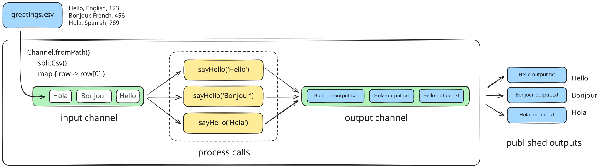
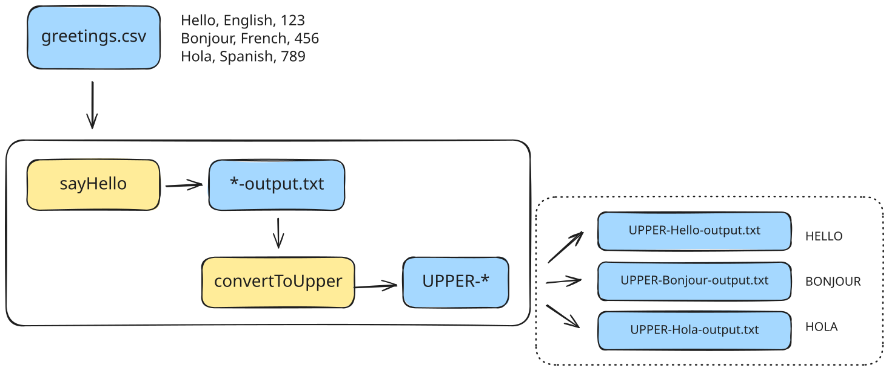
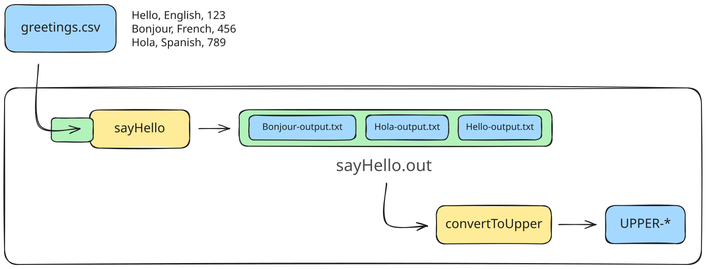
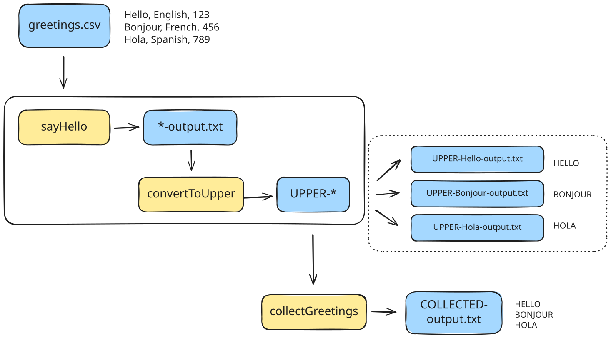
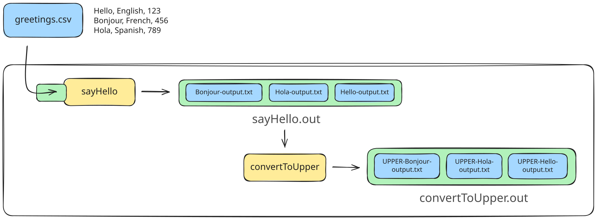
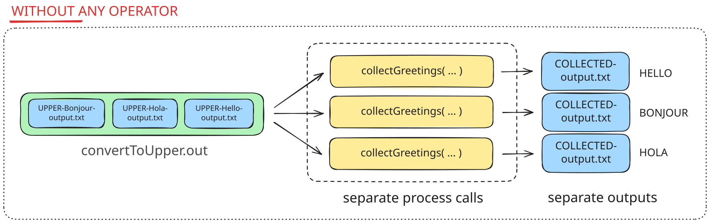
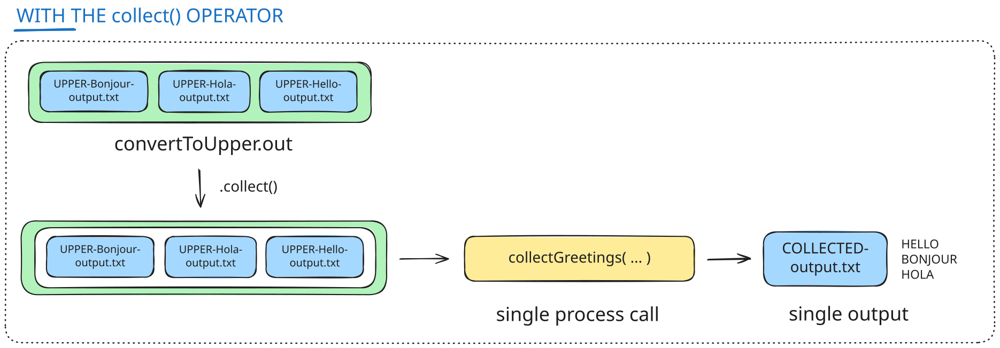
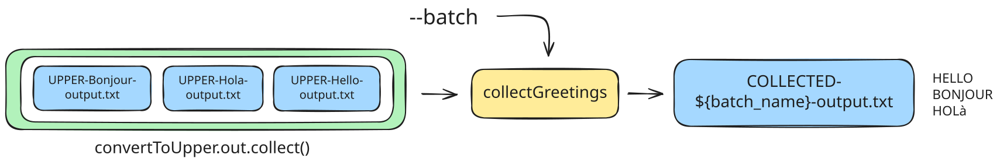
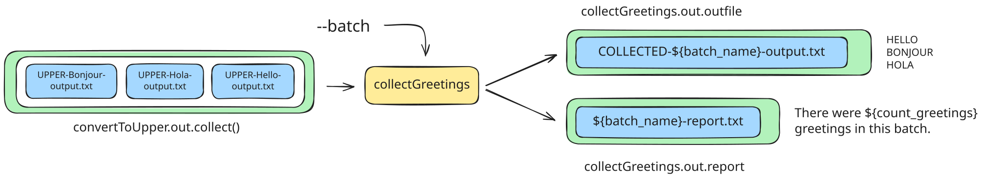
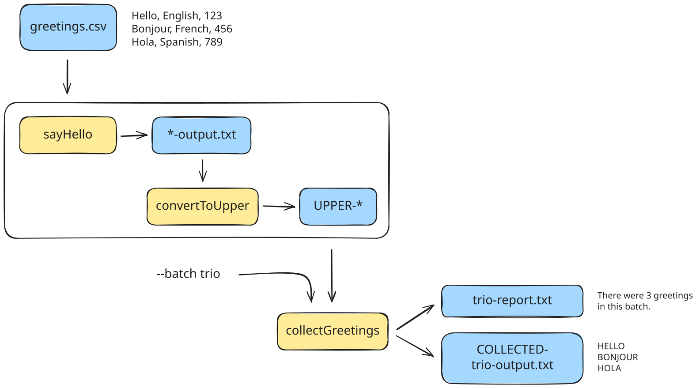

<span class="ai-translation-notice">Traducción asistida por IA - [más información y sugerencias](https://github.com/nextflow-io/training/blob/master/TRANSLATING.md)</span>

<figure>
<div class="video-wrapper">
  <iframe width="560" height="315" src="https://www.youtube.com/embed/_aO56V3iXGI?si=Irl9nAQniDyICp2b&amp;list=PLPZ8WHdZGxmWKozQuzr27jyMGqp9kElVK&amp;cc_load_policy=1&amp;cc_lang_pref=es" title="YouTube video player" frameborder="0" allow="accelerometer; autoplay; clipboard-write; encrypted-media; gyroscope; picture-in-picture; web-share" referrerpolicy="strict-origin-when-cross-origin" allowfullscreen></iframe>
</div>
<figcaption>

Vea [la lista de reproducción completa](https://youtube.com/playlist?list=PLPZ8WHdZGxmWKozQuzr27jyMGqp9kElVK&si=eF7cLR62goy-lc6n) en el canal de YouTube de Nextflow.

📗 La transcripción del video está disponible [aquí](./transcripts/03_hello_workflow.mdx).

</figcaption>
</figure>

La mayoría de los workflows del mundo real involucran más de un paso.
En este módulo de capacitación, aprenderá cómo conectar procesos juntos en un workflow de múltiples pasos.

Esto le enseñará la manera de Nextflow de lograr lo siguiente:

1. Hacer que los datos fluyan de un proceso al siguiente
2. Recopilar salidas de múltiples llamadas de proceso en una única llamada de proceso
3. Pasar parámetros adicionales a un proceso
4. Manejar múltiples salidas que salen de un proceso

Para demostrar, continuaremos construyendo sobre el ejemplo Hello World agnóstico de dominio de las Partes 1 y 2.
Esta vez, vamos a hacer los siguientes cambios a nuestro workflow para reflejar mejor cómo las personas construyen workflows reales:

1. Agregar un segundo paso que convierte el saludo a mayúsculas.
2. Agregar un tercer paso que recopila todos los saludos transformados y los escribe en un único archivo.
3. Agregar un parámetro para nombrar el archivo de salida final y pasarlo como entrada secundaria al paso de recopilación.
4. Hacer que el paso de recopilación también reporte una estadística simple sobre lo que fue procesado.

<details class="info">
<summary>Cómo comenzar desde esta sección</summary>

Esta sección del curso asume que ha completado las Partes 1-2 del curso [Hello Nextflow](./index.mdx), pero si se siente cómodo con los conceptos básicos cubiertos en esas secciones, puede comenzar desde aquí sin hacer nada especial.

</details>

---

## 0. Calentamiento: Ejecutar `hello-workflow.nf`

Vamos a usar el script de workflow `hello-workflow.nf` como punto de partida.
Es equivalente al script producido al trabajar en la Parte 2 de este curso de capacitación, excepto que hemos eliminado las declaraciones `view()` y cambiado el destino de salida:

```nextflow {3} title="hello-workflow.nf" showLineNumbers startLineNumber=37
output {
    first_output {
        path 'hello_workflow'
        mode 'copy'
    }
}
```

Este diagrama resume la operación actual del workflow.
Debería verse familiar, excepto que ahora estamos mostrando explícitamente que las salidas del proceso están empaquetadas en un canal, al igual que las entradas.
Vamos a poner ese canal de salida a buen uso en un minuto.



Solo para asegurarse de que todo funciona, ejecute el script una vez antes de hacer cualquier cambio:

```bash
nextflow run hello-workflow.nf
# [!output]
N E X T F L O W   ~  version 26.04.4

Launching `hello-workflow.nf` [admiring_lamarr] revision: 4d4053520d

executor >  local (3)
[b1/5826b5] sayHello (2) | 3 of 3 ✔

Outputs:

  /workspaces/training/hello-nextflow/results

  first_output:
    - hello_workflow/Bonjour-output.txt
    - hello_workflow/Hello-output.txt
    - hello_workflow/Hola-output.txt
```

Como anteriormente, encontrará los archivos de salida en la ubicación especificada en el bloque `output`.
Para este capítulo, está bajo `results/hello_workflow/`.

<details class="abstract">
<summary>Contenido del directorio</summary>

```console
results/hello_workflow
├── Bonjour-output.txt
├── Hello-output.txt
└── Hola-output.txt
```

</details>

Si eso funcionó para usted, está listo para aprender cómo ensamblar un workflow de múltiples pasos.

---

## 1. Agregar un segundo paso al workflow

Vamos a agregar un paso para convertir cada saludo a mayúsculas.



Para ese fin, necesitamos hacer tres cosas:

- Definir el comando que vamos a usar para hacer la conversión a mayúsculas.
- Escribir un nuevo proceso que envuelva el comando de mayúsculas.
- Llamar al nuevo proceso en el bloque workflow y configurarlo para tomar la salida del proceso `sayHello()` como entrada.

### 1.1. Definir el comando de mayúsculas y probarlo en la terminal

Para hacer la conversión de los saludos a mayúsculas, vamos a usar una herramienta clásica de UNIX llamada `tr` para 'reemplazo de texto', con la siguiente sintaxis:

```bash title="Syntax"
tr '[a-z]' '[A-Z]'
```

Este es un reemplazo de texto de una línea muy ingenuo que no tiene en cuenta las letras acentuadas, pero hará un trabajo suficientemente bueno para demostrar los conceptos de Nextflow y eso es lo que importa.

Para probarlo, podemos ejecutar el comando `echo 'Hello World'` y canalizar su salida al comando `tr`:

```bash
echo 'Hello World' | tr '[a-z]' '[A-Z]' > UPPER-output.txt
```

La salida es un archivo de texto llamado `UPPER-output.txt` que contiene la versión en mayúsculas de la cadena `Hello World`.

<details class="abstract">
<summary>Contenido del archivo</summary>

```console title="UPPER-output.txt"
HELLO WORLD
```

</details>

Eso es básicamente lo que vamos a intentar hacer con nuestro workflow.

### 1.2. Escribir el paso de mayúsculas como un proceso de Nextflow

Podemos modelar nuestro nuevo proceso basándonos en el primero, ya que queremos usar todos los mismos componentes.

Agregue la siguiente definición de proceso al script de workflow, justo debajo del primero:

```nextflow title="hello-workflow.nf" showLineNumbers startLineNumber=20
/*
 * Usar una herramienta de reemplazo de texto para convertir el saludo a mayúsculas
 */
process convertToUpper {

    input:
    path input_file

    output:
    path "UPPER-${input_file}"

    script:
    """
    cat ${input_file} | tr '[a-z]' '[A-Z]' > UPPER-${input_file}
    """
}
```

En este, componemos el segundo nombre de archivo de salida basado en el nombre de archivo de entrada, similar a lo que hicimos originalmente para la salida del primer proceso.

### 1.3. Agregar una llamada al nuevo proceso en el bloque workflow

Ahora necesitamos decirle a Nextflow que realmente llame al proceso que acabamos de definir.

En el bloque workflow, haga el siguiente cambio de código:

<CodeWalkthrough>

```nextflow title="hello-workflow.nf" showLineNumbers startLineNumber=44 step="Antes"
workflow {

    main:
    // crear un canal para entradas desde un archivo CSV
    greeting_ch = channel.fromPath(params.input)
                        .splitCsv()
                        .map { line -> line[0] }
    // emitir un saludo
    sayHello(greeting_ch)

    publish:
    first_output = sayHello.out
}
```

```nextflow {10-11} title="hello-workflow.nf" showLineNumbers startLineNumber=44 step="Después"
workflow {

    main:
    // crear un canal para entradas desde un archivo CSV
    greeting_ch = channel.fromPath(params.input)
                        .splitCsv()
                        .map { line -> line[0] }
    // emitir un saludo
    sayHello(greeting_ch)
    // convertir el saludo a mayúsculas
    convertToUpper()

    publish:
    first_output = sayHello.out
}
```

</CodeWalkthrough>

Esto aún no es funcional porque no hemos especificado qué debe ser la entrada al proceso `convertToUpper()`.

### 1.4. Pasar la salida del primer proceso al segundo proceso

Ahora necesitamos hacer que la salida del proceso `sayHello()` fluya hacia el proceso `convertToUpper()`.

Convenientemente, Nextflow empaqueta automáticamente la salida de un proceso en un canal, como se muestra en el diagrama en la sección de calentamiento.
Podemos referirnos al canal de salida de un proceso como `<process>.out`.

Así que la salida del proceso `sayHello` es un canal llamado `sayHello.out`, que podemos conectar directamente a la llamada a `convertToUpper()`.



En el bloque workflow, haga el siguiente cambio de código:

<CodeWalkthrough>

```nextflow {2} title="hello-workflow.nf" showLineNumbers startLineNumber=53 step="Antes"
    // convertir el saludo a mayúsculas
    convertToUpper()
```

```nextflow {2} title="hello-workflow.nf" showLineNumbers startLineNumber=53 step="Después"
    // convertir el saludo a mayúsculas
    convertToUpper(sayHello.out)
```

</CodeWalkthrough>

Para un caso simple como este (una salida a una entrada), ¡eso es todo lo que necesitamos hacer para conectar dos procesos!

### 1.5. Configurar la publicación de salida del workflow

Finalmente, actualicemos las salidas del workflow para publicar también los resultados del segundo proceso.

#### 1.5.1. Actualizar la sección `publish:` del bloque `workflow`

En el bloque `workflow`, haga el siguiente cambio de código:

<CodeWalkthrough>

```nextflow title="hello-workflow.nf" showLineNumbers startLineNumber=56 step="Antes"
    publish:
    first_output = sayHello.out
}
```

```nextflow {3} title="hello-workflow.nf" showLineNumbers startLineNumber=56 step="Después"
    publish:
    first_output = sayHello.out
    uppercased = convertToUpper.out
}
```

</CodeWalkthrough>

La lógica es la misma que anteriormente.

#### 1.5.2. Actualizar el bloque `output`

En el bloque `output`, haga el siguiente cambio de código:

<CodeWalkthrough>

```nextflow title="hello-workflow.nf" showLineNumbers startLineNumber=61 step="Antes"
output {
    first_output {
        path 'hello_workflow'
        mode 'copy'
    }
}
```

```nextflow {6-9} title="hello-workflow.nf" showLineNumbers startLineNumber=61 step="Después"
output {
    first_output {
        path 'hello_workflow'
        mode 'copy'
    }
    uppercased {
        path 'hello_workflow'
        mode 'copy'
    }
}
```

</CodeWalkthrough>

Una vez más, la lógica es la misma que antes.

Esto le muestra que puede controlar la configuración de salida a un nivel muy granular, para cada salida individual.
Siéntase libre de intentar cambiar las rutas o el modo de publicación para uno de los procesos para ver qué sucede.

Por supuesto, eso significa que estamos repitiendo alguna información aquí, lo que podría volverse inconveniente si quisiéramos actualizar la ubicación para todas las salidas de la misma manera.
Más adelante en el curso, aprenderá cómo configurar estos ajustes para múltiples salidas de manera estructurada.

### 1.6. Ejecutar el workflow con `-resume`

Probemos esto usando la bandera `-resume`, ya que hemos ejecutado exitosamente el primer paso del workflow.

```bash
nextflow run hello-workflow.nf -resume
# [!output]
N E X T F L O W   ~  version 26.04.4

Launching `hello-workflow.nf` [high_cantor] revision: d746983511

executor >  local (3)
[ab/816321] sayHello (3)       | 3 of 3, cached: 3 ✔
[e0/ecf81b] convertToUpper (3) | 3 of 3 ✔

Outputs:

  /workspaces/training/hello-nextflow/results

  first_output:
    - hello_workflow/Hello-output.txt
    - hello_workflow/Hola-output.txt
    - hello_workflow/Bonjour-output.txt
  uppercased:
    - hello_workflow/UPPER-Hola-output.txt
    - hello_workflow/UPPER-Hello-output.txt
    - hello_workflow/UPPER-Bonjour-output.txt
```

Ahora hay una línea extra en la salida de la consola que corresponde al nuevo proceso que acabamos de agregar.

Encontrará las salidas en el directorio `results/hello_workflow` como se establece en el bloque `output`.

<details class="abstract">
<summary>Contenido del directorio</summary>

```console
results/hello_workflow/
├── Bonjour-output.txt
├── Hello-output.txt
├── Hola-output.txt
├── UPPER-Bonjour-output.txt
├── UPPER-Hello-output.txt
└── UPPER-Hola-output.txt
```

</details>

¡Eso es conveniente! Pero aún vale la pena echar un vistazo dentro del directorio de trabajo de una de las llamadas al segundo proceso.

<details class="abstract">
<summary>Contenido del directorio</summary>

```console
work/e0/ecf81b4cacc648b9b994218d5b29d7/
├── Hola-output.txt -> /workspaces/training/hello-nextflow/work/ab/81632178cd37e9e815959278808819/Hola-output.txt
└── UPPER-Hola-output.txt
```

</details>

Note que hay dos archivos `*-output`: la salida del primer proceso así como la salida del segundo.

La salida del primer proceso está allí porque Nextflow la **preparó** (staged) allí para tener todo lo necesario para la ejecución dentro del mismo subdirectorio.

Sin embargo, en realidad es un enlace simbólico que apunta al archivo original en el subdirectorio de la primera llamada de proceso.
Por defecto, cuando se ejecuta en una sola máquina como estamos haciendo aquí, Nextflow usa enlaces simbólicos en lugar de copias para preparar archivos de entrada e intermedios.

Ahora, antes de continuar, piense en cómo todo lo que hicimos fue conectar la salida de `sayHello` a la entrada de `convertToUpper` y los dos procesos pudieron ejecutarse en serie.
Nextflow hizo el trabajo duro de manejar archivos de entrada y salida individuales y pasarlos entre los dos comandos por nosotros.

Esta es una de las razones por las que los canales de Nextflow son tan poderosos: se encargan del trabajo tedioso involucrado en conectar pasos del workflow.

### Conclusión

Sabe cómo encadenar procesos proporcionando la salida de un paso como entrada al siguiente paso.

### ¿Qué sigue?

Aprender cómo recopilar salidas de llamadas de proceso por lotes y alimentarlas en un único proceso.

---

## 2. Agregar un tercer paso para recopilar todos los saludos

Cuando usamos un proceso para aplicar una transformación a cada uno de los elementos en un canal, como estamos haciendo aquí con los múltiples saludos, a veces queremos recopilar elementos del canal de salida de ese proceso y alimentarlos en otro proceso que realiza algún tipo de análisis o suma.

Para demostrar, agregaremos un nuevo paso a nuestro pipeline que recopila todos los saludos en mayúsculas producidos por el proceso `convertToUpper` y los escribe en un único archivo.



Sin arruinar la sorpresa, esto va a involucrar un operador muy útil.

### 2.1. Definir el comando de recopilación y probarlo en la terminal

El paso de recopilación que queremos agregar a nuestro workflow usará el comando `cat` para concatenar múltiples saludos en mayúsculas en un único archivo.

Ejecutemos el comando por sí solo en la terminal para verificar que funciona como se espera, tal como hemos hecho anteriormente.

Ejecute lo siguiente en su terminal:

```bash
echo 'Hello' | tr '[a-z]' '[A-Z]' > UPPER-Hello-output.txt
echo 'Bonjour' | tr '[a-z]' '[A-Z]' > UPPER-Bonjour-output.txt
echo 'Hola' | tr '[a-z]' '[A-Z]' > UPPER-Hola-output.txt
cat UPPER-Hello-output.txt UPPER-Bonjour-output.txt UPPER-Hola-output.txt > COLLECTED-output.txt
```

La salida es un archivo de texto llamado `COLLECTED-output.txt` que contiene las versiones en mayúsculas de los saludos originales.

<details class="abstract">
<summary>Contenido del archivo</summary>

```console title="COLLECTED-output.txt"
HELLO
BONJOUR
HOLA
```

</details>

Ese es el resultado que queremos lograr con nuestro workflow.

### 2.2. Crear un nuevo proceso para hacer el paso de recopilación

Creemos un nuevo proceso y llamémoslo `collectGreetings()`.
Podemos comenzar a escribirlo basándonos en lo que hemos visto antes.

#### 2.2.1. Escribir las partes 'obvias' del proceso

Agregue la siguiente definición de proceso al script de workflow:

```nextflow title="hello-workflow.nf" showLineNumbers startLineNumber=37
/*
 * Recopilar saludos en mayúsculas en un único archivo de salida
 */
process collectGreetings {

    input:
    ???

    output:
    path "COLLECTED-output.txt"

    script:
    """
    cat ??? > 'COLLECTED-output.txt'
    """
}
```

Esto es lo que podemos escribir con confianza basándonos en lo que ha aprendido hasta ahora.
¡Pero esto no es funcional!
Deja fuera la(s) definición(es) de entrada y la primera mitad del comando script porque necesitamos descubrir cómo escribir eso.

#### 2.2.2. Definir entradas a `collectGreetings()`

Necesitamos recopilar los saludos de todas las llamadas al proceso `convertToUpper()`.
¿Qué sabemos que podemos obtener del paso anterior en el workflow?

El canal producido por `convertToUpper()` contendrá las rutas a los archivos individuales que contienen los saludos en mayúsculas.
Eso equivale a un slot de entrada; llamémoslo `input_files` por simplicidad.

En el bloque process, haga el siguiente cambio de código:

<CodeWalkthrough>

```nextflow {2} title="hello-workflow.nf" showLineNumbers startLineNumber=42 step="Antes"
      input:
      ???
```

```nextflow {2} title="hello-workflow.nf" showLineNumbers startLineNumber=42 step="Después"
      input:
      path input_files
```

</CodeWalkthrough>

Note que usamos el prefijo `path` aunque esperamos que esto contenga múltiples archivos.

#### 2.2.3. Componer el comando de concatenación

Aquí es donde las cosas podrían ponerse un poco complicadas, porque necesitamos poder manejar un número arbitrario de archivos de entrada.
Específicamente, no podemos escribir el comando por adelantado, así que necesitamos decirle a Nextflow cómo componerlo en tiempo de ejecución basándose en qué entradas fluyen hacia el proceso.

En otras palabras, si tenemos un canal de entrada que contiene el elemento `[file1.txt, file2.txt, file3.txt]`, necesitamos que Nextflow lo convierta en `cat file1.txt file2.txt file3.txt`.

Afortunadamente, Nextflow está bastante feliz de hacer eso por nosotros si simplemente escribimos `cat ${input_files}` en el comando script.

En el bloque process, haga el siguiente cambio de código:

<CodeWalkthrough>

```nextflow title="hello-workflow.nf" showLineNumbers startLineNumber=54 step="Antes"
    script:
    """
    cat ??? > 'COLLECTED-output.txt'
    """
```

```nextflow {3} title="hello-workflow.nf" showLineNumbers startLineNumber=54 step="Después"
    script:
    """
    cat ${input_files} > 'COLLECTED-output.txt'
    """
```

</CodeWalkthrough>

En teoría esto debería manejar cualquier número arbitrario de archivos de entrada.

:::tip[Consejo]
Algunas herramientas de línea de comandos requieren proporcionar un argumento (como `-input`) para cada archivo de entrada.
En ese caso, tendríamos que hacer un poco de trabajo extra para componer el comando.
Puede ver un ejemplo de esto en el curso de capacitación [Nextflow para Genómica](../nf4_science/genomics/index.mdx).
:::

### 2.3. Agregar el paso de recopilación al workflow

Ahora deberíamos solo necesitar llamar al proceso de recopilación sobre la salida del paso de mayúsculas.
Ese también es un canal, llamado `convertToUpper.out`.



#### 2.3.1. Conectar las llamadas de proceso

En el bloque workflow, haga el siguiente cambio de código:

<CodeWalkthrough>

```nextflow title="hello-workflow.nf" showLineNumbers startLineNumber=75 step="Antes"
    // convertir el saludo a mayúsculas
    convertToUpper(sayHello.out)
}
```

```nextflow {4,5} title="hello-workflow.nf" showLineNumbers startLineNumber=75 step="Después"
    // convertir el saludo a mayúsculas
    convertToUpper(sayHello.out)

    // recopilar todos los saludos en un archivo
    collectGreetings(convertToUpper.out)
}
```

</CodeWalkthrough>

Esto conecta la salida de `convertToUpper()` a la entrada de `collectGreetings()`.

#### 2.3.2. Actualizar la sección `publish:`

En el bloque `workflow`, haga el siguiente cambio de código:

<CodeWalkthrough>

```nextflow title="hello-workflow.nf" showLineNumbers startLineNumber=76 step="Antes"
    publish:
    first_output = sayHello.out
    uppercased = convertToUpper.out
}
```

```nextflow {4} title="hello-workflow.nf" showLineNumbers startLineNumber=76 step="Después"
    publish:
    first_output = sayHello.out
    uppercased = convertToUpper.out
    collected = collectGreetings.out
}
```

</CodeWalkthrough>

#### 2.3.3. Actualizar el bloque `output`

En el bloque `output`, haga el siguiente cambio de código:

<CodeWalkthrough>

```nextflow title="hello-workflow.nf" showLineNumbers startLineNumber=82 step="Antes"
output {
    first_output {
        path 'hello_workflow'
        mode 'copy'
    }
    uppercased {
        path 'hello_workflow'
        mode 'copy'
    }
}
```

```nextflow {10-13} title="hello-workflow.nf" showLineNumbers startLineNumber=82 step="Después"
output {
    first_output {
        path 'hello_workflow'
        mode 'copy'
    }
    uppercased {
        path 'hello_workflow'
        mode 'copy'
    }
    collected {
        path 'hello_workflow'
        mode 'copy'
    }
}
```

</CodeWalkthrough>

#### 2.3.4. Ejecutar el workflow con `-resume`

Probémoslo.

```bash
nextflow run hello-workflow.nf -resume
# [!output]
N E X T F L O W   ~  version 26.04.4

Launching `hello-workflow.nf` [mad_gilbert] revision: 6acfd5e28d

executor >  local (3)
[79/33b2f0] sayHello (2)         | 3 of 3, cached: 3 ✔
[99/79394f] convertToUpper (3)   | 3 of 3, cached: 3 ✔
[47/50fe4a] collectGreetings (1) | 3 of 3 ✔ # [!code highlight]

Outputs:

  /workspaces/training/hello-nextflow/results

  first_output:
    - hello_workflow/Hello-output.txt
    - hello_workflow/Bonjour-output.txt
    - hello_workflow/Hola-output.txt
  uppercased:
    - hello_workflow/UPPER-Hello-output.txt
    - hello_workflow/UPPER-Bonjour-output.txt
    - hello_workflow/UPPER-Hola-output.txt
  collected:
    - hello_workflow/COLLECTED-output.txt
    - hello_workflow/COLLECTED-output.txt
    - hello_workflow/COLLECTED-output.txt
```

Se ejecuta exitosamente, incluyendo el tercer paso.

Sin embargo, mire el número de llamadas para `collectGreetings()` en la última línea.
Solo esperábamos una, pero hay tres.

Ahora eche un vistazo al contenido del archivo de salida final.

<details class="abstract">
<summary>Contenido del archivo</summary>

```console title="results/hello_workflow/COLLECTED-output.txt"
HOLA
```

</details>

Oh no. El paso de recopilación se ejecutó individualmente en cada saludo, lo cual NO es lo que queríamos.



Necesitamos hacer algo para decirle a Nextflow explícitamente que queremos que ese tercer paso se ejecute en todos los elementos en el canal producido por `convertToUpper()`.

### 2.4. Usar un operador para recopilar los saludos en una única entrada

Sí, una vez más la respuesta a nuestro problema es un operador.

Específicamente, vamos a usar el operador aptamente llamado [`collect()`](https://nextflow.io/docs/latest/reference/operator.html#collect).

#### 2.4.1. Agregar el operador `collect()`

Esta vez va a verse un poco diferente porque no estamos agregando el operador en el contexto de una channel factory; lo estamos agregando a un canal de salida.

Tomamos el `convertToUpper.out` y agregamos el operador `collect()`, lo que nos da `convertToUpper.out.collect()`.
Podemos conectar eso directamente a la llamada del proceso `collectGreetings()`.

En el bloque workflow, haga el siguiente cambio de código:

<CodeWalkthrough>

```nextflow {2} title="hello-workflow.nf" showLineNumbers startLineNumber=73 step="Antes"
    // recopilar todos los saludos en un archivo
    collectGreetings(convertToUpper.out)
}
```

```nextflow {2} title="hello-workflow.nf" showLineNumbers startLineNumber=73 step="Después"
    // recopilar todos los saludos en un archivo
    collectGreetings(convertToUpper.out.collect())
}
```

</CodeWalkthrough>

#### 2.4.2. Agregar algunas declaraciones `view()`

También incluyamos un par de declaraciones `view()` para visualizar los estados antes y después del contenido del canal.

<CodeWalkthrough>

```nextflow title="hello-workflow.nf" showLineNumbers startLineNumber=73 step="Antes"
    // recopilar todos los saludos en un archivo
    collectGreetings(convertToUpper.out.collect())
}
```

```nextflow {4-6} title="hello-workflow.nf" showLineNumbers startLineNumber=73 step="Después"
    // recopilar todos los saludos en un archivo
    collectGreetings(convertToUpper.out.collect())

    // declaraciones view opcionales
    convertToUpper.out.view { contents -> "Before collect: $contents" }
    convertToUpper.out.collect().view { contents -> "After collect: $contents" }
}
```

</CodeWalkthrough>

Las declaraciones `view()` pueden ir donde quiera; las pusimos justo después de la llamada para legibilidad.

#### 2.4.3. Ejecutar el workflow nuevamente con `-resume`

Probémoslo:

```bash
nextflow run hello-workflow.nf -resume
# [!output]
N E X T F L O W   ~  version 26.04.4

Launching `hello-workflow.nf` [soggy_franklin] revision: bc8e1b2726

executor >  local (1)
[d6/cdf466] sayHello (1)       | 3 of 3, cached: 3 ✔
[99/79394f] convertToUpper (2) | 3 of 3, cached: 3 ✔
[1e/83586c] collectGreetings   | 1 of 1 ✔
Before collect: /workspaces/training/hello-nextflow/work/b3/d52708edba8b864024589285cb3445/UPPER-Bonjour-output.txt
Before collect: /workspaces/training/hello-nextflow/work/99/79394f549e3040dfc2440f69ede1fc/UPPER-Hello-output.txt
Before collect: /workspaces/training/hello-nextflow/work/aa/56bfe7cf00239dc5badc1d04b60ac4/UPPER-Hola-output.txt
After collect: [/workspaces/training/hello-nextflow/work/b3/d52708edba8b864024589285cb3445/UPPER-Bonjour-output.txt, /workspaces/training/hello-nextflow/work/99/79394f549e3040dfc2440f69ede1fc/UPPER-Hello-output.txt, /workspaces/training/hello-nextflow/work/aa/56bfe7cf00239dc5badc1d04b60ac4/UPPER-Hola-output.txt]

Outputs:

  /workspaces/training/hello-nextflow/results

  first_output:
    - hello_workflow/Hello-output.txt
    - hello_workflow/Bonjour-output.txt
    - hello_workflow/Hola-output.txt
  uppercased:
    - hello_workflow/UPPER-Bonjour-output.txt
    - hello_workflow/UPPER-Hello-output.txt
    - hello_workflow/UPPER-Hola-output.txt
  collected: hello_workflow/COLLECTED-output.txt
```

Se ejecuta exitosamente, aunque la salida del log puede verse un poco más desordenada que esto (la limpiamos para legibilidad).

¡Esta vez el tercer paso solo fue llamado una vez!
Mirando la salida de las declaraciones `view()`, vemos lo siguiente:

- Tres declaraciones `Before collect:`, una para cada saludo: en ese punto las rutas de archivo son elementos individuales en el canal.
- Una única declaración `After collect:`: las tres rutas de archivo ahora están empaquetadas en un único elemento.

Podemos resumir eso con el siguiente diagrama:



Finalmente, puede echar un vistazo al contenido del archivo de salida para satisfacerse de que todo funcionó correctamente.

<details class="abstract">
<summary>Contenido del archivo</summary>

```console title="results/hello_workflow/COLLECTED-output.txt"
BONJOUR
HELLO
HOLA
```

</details>

Esta vez tenemos los tres saludos en el archivo de salida final. ¡Éxito!

:::note[Nota]
Si ejecuta esto varias veces sin `-resume`, verá que el orden de los saludos cambia de una ejecución a la siguiente.
Esto le muestra que el orden en que los elementos fluyen a través de las llamadas de proceso no está garantizado que sea consistente.
:::

#### 2.4.4. Eliminar las declaraciones `view()` para legibilidad

Antes de pasar a la siguiente sección, le recomendamos que elimine las declaraciones `view()` para evitar saturar la salida de la consola.

<CodeWalkthrough>

```nextflow {4-6} title="hello-workflow.nf" showLineNumbers startLineNumber=73 step="Antes"
    // recopilar todos los saludos en un archivo
    collectGreetings(convertToUpper.out.collect())

    // declaraciones view opcionales
    convertToUpper.out.view { contents -> "Before collect: $contents" }
    convertToUpper.out.collect().view { contents -> "After collect: $contents" }
```

```nextflow title="hello-workflow.nf" showLineNumbers startLineNumber=73 step="Después"
    // recopilar todos los saludos en un archivo
    collectGreetings(convertToUpper.out.collect())
```

</CodeWalkthrough>

Esto es básicamente la operación inversa del punto 2.4.2.

### Conclusión

Sabe cómo recopilar salidas de un lote de llamadas de proceso y alimentarlas en un análisis conjunto o paso de suma.

Para recapitular, esto es lo que ha construido hasta ahora:


### ¿Qué sigue?

Aprender cómo pasar más de una entrada a un proceso.

---

## 3. Pasar parámetros adicionales a un proceso

Queremos poder nombrar el archivo de salida final con algo específico para poder procesar lotes subsiguientes de saludos sin sobrescribir los resultados finales.

Para ese fin, vamos a hacer los siguientes refinamientos al workflow:

- Modificar el proceso recopilador para aceptar un nombre definido por el usuario para el archivo de salida (`batch_name`)
- Agregar un parámetro de línea de comandos al workflow (`--batch`) y pasarlo al proceso recopilador



### 3.1. Modificar el proceso recopilador

Vamos a necesitar declarar la entrada adicional e integrarla en el nombre del archivo de salida.

#### 3.1.1. Declarar la entrada adicional

Buenas noticias: podemos declarar tantas variables de entrada como queramos en la definición del proceso.
Llamemos a esta `batch_name`.

En el bloque process, haga el siguiente cambio de código:

<CodeWalkthrough>

```nextflow title="hello-workflow.nf" showLineNumbers startLineNumber=42 step="Antes"
    input:
    path input_files
```

```nextflow {3} title="hello-workflow.nf" showLineNumbers startLineNumber=42 step="Después"
    input:
    path input_files
    val batch_name
```

</CodeWalkthrough>

Puede configurar sus procesos para esperar tantas entradas como quiera.
Ahora mismo, todas estas están configuradas como entradas requeridas; _debe_ proporcionar un valor para que el workflow funcione.

Aprenderá cómo gestionar entradas requeridas vs. opcionales más adelante en su viaje con Nextflow.

#### 3.1.2. Usar la variable `batch_name` en el nombre del archivo de salida

Podemos insertar la variable en el nombre del archivo de salida de la misma manera que hemos compuesto nombres de archivo dinámicos antes.

En el bloque process, haga el siguiente cambio de código:

<CodeWalkthrough>

```nextflow {2,6} title="hello-workflow.nf" showLineNumbers startLineNumber=46 step="Antes"
    output:
    path "COLLECTED-output.txt"

    script:
    """
    cat ${input_files} > 'COLLECTED-output.txt'
    """
```

```nextflow {2,6} title="hello-workflow.nf" showLineNumbers startLineNumber=46 step="Después"
    output:
    path "COLLECTED-${batch_name}-output.txt"

    script:
    """
    cat ${input_files} > 'COLLECTED-${batch_name}-output.txt'
    """
```

</CodeWalkthrough>

Esto configura el proceso para usar el valor `batch_name` para generar un nombre de archivo específico para la salida final del workflow.

### 3.2. Agregar un parámetro de línea de comandos `batch`

Ahora necesitamos una forma de suministrar el valor para `batch_name` y alimentarlo a la llamada del proceso.

#### 3.2.1. Usar `params` para configurar el parámetro

Ya sabe cómo usar el sistema `params` para declarar parámetros CLI.
Usemos eso para declarar un parámetro `batch` (con un valor predeterminado porque somos perezosos).

En la sección de parámetros del pipeline, haga los siguientes cambios de código:

<CodeWalkthrough>

```nextflow title="hello-workflow.nf" showLineNumbers startLineNumber=55 step="Antes"
/*
 * Parámetros del pipeline
 */
params {
    input: Path = 'data/greetings.csv'
}
```

```nextflow {6} title="hello-workflow.nf" showLineNumbers startLineNumber=55 step="Después"
/*
 * Parámetros del pipeline
 */
params {
    input: Path = 'data/greetings.csv'
    batch: String = 'batch'
}
```

</CodeWalkthrough>

Al igual que demostramos para `--input`, puede sobrescribir ese valor predeterminado especificando un valor con `--batch` en la línea de comandos.

#### 3.2.2. Pasar el parámetro `batch` al proceso

Para proporcionar el valor del parámetro al proceso, necesitamos agregarlo en la llamada del proceso.

En el bloque workflow, haga el siguiente cambio de código:

<CodeWalkthrough>

```nextflow {2} title="hello-workflow.nf" showLineNumbers startLineNumber=74 step="Antes"
    // recopilar todos los saludos en un archivo
    collectGreetings(convertToUpper.out.collect())
```

```nextflow {2} title="hello-workflow.nf" showLineNumbers startLineNumber=74 step="Después"
    // recopilar todos los saludos en un archivo
    collectGreetings(convertToUpper.out.collect(), params.batch)
```

</CodeWalkthrough>

Verá que para proporcionar múltiples entradas a un proceso, simplemente las lista en los paréntesis de la llamada, separadas por comas.

:::caution[Advertencia]
DEBE proporcionar las entradas al proceso en el MISMO ORDEN EXACTO en que están listadas en el bloque de definición de entrada del proceso.
:::

### 3.3. Ejecutar el workflow

Intentemos ejecutar esto con un nombre de lote en la línea de comandos.

```bash
nextflow run hello-workflow.nf -resume --batch trio
# [!output]
N E X T F L O W   ~  version 26.04.4

Launching `hello-workflow.nf` [confident_rutherford] revision: bc58af409c

executor >  local (1)
[79/33b2f0] sayHello (2)       | 3 of 3, cached: 3 ✔
[99/79394f] convertToUpper (2) | 3 of 3, cached: 3 ✔
[b5/f19efe] collectGreetings   | 1 of 1 ✔

Outputs:

  /workspaces/training/hello-nextflow/results

  first_output:
    - hello_workflow/Bonjour-output.txt
    - hello_workflow/Hello-output.txt
    - hello_workflow/Hola-output.txt
  uppercased:
    - hello_workflow/UPPER-Bonjour-output.txt
    - hello_workflow/UPPER-Hola-output.txt
    - hello_workflow/UPPER-Hello-output.txt
  collected: hello_workflow/COLLECTED-trio-output.txt
```

Se ejecuta exitosamente y produce la salida deseada:

<details class="abstract">
<summary>Contenido del archivo</summary>

```console title="results/hello_workflow/COLLECTED-trio-output.txt"
HELLO
BONJOUR
HOLA
```

</details>

Ahora, mientras especifiquemos el parámetro apropiadamente, las ejecuciones subsiguientes en otros lotes de entradas no sobrescribirán los resultados anteriores.

### Conclusión

Sabe cómo pasar más de una entrada a un proceso.

### ¿Qué sigue?

Aprender cómo emitir múltiples salidas y manejarlas convenientemente.

---

## 4. Agregar una salida al paso recopilador

Hasta ahora hemos estado usando procesos que solo producían una salida cada uno.
Pudimos acceder a sus salidas respectivas muy convenientemente usando la sintaxis `<process>.out`, que usamos tanto en el contexto de pasar una salida al siguiente proceso (ej. `convertToUpper(sayHello.out)`) como en el contexto de la sección `publish:` (ej. `first_output = sayHello.out`).

¿Qué sucede cuando un proceso produce más de una?
¿Cómo manejamos las múltiples salidas?
¿Podemos seleccionar y usar una salida específica?

¡Todas excelentes preguntas, y la respuesta corta es sí podemos!

Las múltiples salidas serán empaquetadas en canales separados.
Podemos elegir dar nombres a esos canales de salida, lo que hace fácil referirnos a ellos individualmente más tarde, o podemos referirnos a ellos por índice.

Para propósitos de demostración, digamos que queremos contar el número de saludos que se están recopilando para un lote dado de entradas y reportarlo en un archivo.

### 4.1. Modificar el proceso para contar y producir el número de saludos

Esto requerirá dos cambios clave en la definición del proceso: necesitamos una forma de contar los saludos y escribir un archivo de reporte, luego necesitamos agregar ese archivo de reporte al bloque `output` del proceso.

#### 4.1.1. Contar el número de saludos recopilados

Convenientemente, Nextflow nos permite agregar código arbitrario en el bloque `script:` de la definición del proceso, lo cual es muy útil para hacer cosas como esta.

Eso significa que podemos usar la función incorporada `size()` de Nextflow para obtener el número de archivos en el array `input_files`, y escribir el resultado en un archivo con un comando `echo`.

En el bloque del proceso `collectGreetings`, haga los siguientes cambios de código:

<CodeWalkthrough>

```nextflow title="hello-workflow.nf" showLineNumbers startLineNumber=55 step="Antes"
    script:
    """
    cat ${input_files} > 'COLLECTED-${batch_name}-output.txt'
    """
```

```nextflow {2,5} title="hello-workflow.nf" showLineNumbers startLineNumber=55 step="Después"
    script:
    count_greetings = input_files.size()
    """
    cat ${input_files} > 'COLLECTED-${batch_name}-output.txt'
    echo 'There were ${count_greetings} greetings in this batch.' > '${batch_name}-report.txt'
    """
```

</CodeWalkthrough>

La variable `count_greetings` será computada en tiempo de ejecución.

#### 4.1.2. Emitir el archivo de reporte y nombrar las salidas

En principio todo lo que necesitamos hacer es agregar el archivo de reporte al bloque `output:`.

Sin embargo, mientras estamos en ello, también vamos a agregar algunas etiquetas `emit:` a nuestras declaraciones de salida. Estas nos permitirán seleccionar las salidas por nombre en lugar de tener que usar índices posicionales.

En el bloque process, haga el siguiente cambio de código:

<CodeWalkthrough>

```nextflow title="hello-workflow.nf" showLineNumbers startLineNumber=46 step="Antes"
    output:
    path "COLLECTED-${batch_name}-output.txt"
```

```nextflow {2,3} title="hello-workflow.nf" showLineNumbers startLineNumber=46 step="Después"
    output:
    path "COLLECTED-${batch_name}-output.txt", emit: outfile
    path "${batch_name}-report.txt", emit: report
```

</CodeWalkthrough>

Las etiquetas `emit:` son opcionales, y podríamos haber agregado una etiqueta a solo una de las salidas.
Pero como dice el dicho, ¿por qué no ambas?

:::tip[Consejo]
Si no nombra las salidas de un proceso usando `emit:`, aún puede acceder a ellas individualmente usando su respectivo índice (basado en cero).
Por ejemplo, usaría `<process>.out[0]` para obtener la primera salida, `<process>.out[1]` para obtener la segunda salida, y así sucesivamente.

Preferimos nombrar las salidas porque de otra manera, es demasiado fácil tomar el índice incorrecto por error, especialmente cuando el proceso produce muchas salidas.
:::

### 4.2. Actualizar las salidas del workflow

Ahora que tenemos dos salidas saliendo del proceso `collectGreetings`, la salida `collectGreetings.out` contiene dos canales:

- `collectGreetings.out.outfile` contiene el archivo de salida final
- `collectGreetings.out.report` contiene el archivo de reporte



Necesitamos actualizar las salidas del workflow en consecuencia.

#### 4.2.1. Actualizar la sección `publish:`

En el bloque `workflow`, haga el siguiente cambio de código:

<CodeWalkthrough>

```nextflow {4} title="hello-workflow.nf" showLineNumbers startLineNumber=80 step="Antes"
    publish:
    first_output = sayHello.out
    uppercased = convertToUpper.out
    collected = collectGreetings.out
```

```nextflow {4,5} title="hello-workflow.nf" showLineNumbers startLineNumber=80 step="Después"
    publish:
    first_output = sayHello.out
    uppercased = convertToUpper.out
    collected = collectGreetings.out.outfile
    batch_report = collectGreetings.out.report
```

</CodeWalkthrough>

Como puede ver, referirse a salidas específicas de proceso ahora es trivial.
Cuando vayamos a agregar un paso más a nuestro pipeline en la Parte 5 (Contenedores), podremos referirnos fácilmente a `collectGreetings.out.outfile` y pasarlo al nuevo proceso (spoiler: el nuevo proceso se llama `cowpy`).

Pero por ahora, terminemos de actualizar las salidas a nivel de workflow.

#### 4.2.2. Actualizar el bloque `output`

En el bloque `output`, haga el siguiente cambio de código:

<CodeWalkthrough>

```nextflow title="hello-workflow.nf" showLineNumbers startLineNumber=80 step="Antes"
output {
    first_output {
        path 'hello_workflow'
        mode 'copy'
    }
    uppercased {
        path 'hello_workflow'
        mode 'copy'
    }
    collected {
        path 'hello_workflow'
        mode 'copy'
    }
}
```

```nextflow {14-17} title="hello-workflow.nf" showLineNumbers startLineNumber=86 step="Después"
output {
    first_output {
        path 'hello_workflow'
        mode 'copy'
    }
    uppercased {
        path 'hello_workflow'
        mode 'copy'
    }
    collected {
        path 'hello_workflow'
        mode 'copy'
    }
    batch_report {
        path 'hello_workflow'
        mode 'copy'
    }
}
```

</CodeWalkthrough>

No necesitamos actualizar la definición de salida `collected` ya que ese nombre no ha cambiado.
Solo necesitamos agregar la nueva salida.

### 4.3. Ejecutar el workflow

Intentemos ejecutar esto con el lote actual de saludos.

```bash
nextflow run hello-workflow.nf -resume --batch trio
# [!output]
N E X T F L O W   ~  version 26.04.4

Launching `hello-workflow.nf` [ecstatic_wilson] revision: c80285f8c8

executor >  local (1)
[c5/4c6ca9] sayHello (3)       | 3 of 3, cached: 3 ✔
[0e/6cbc59] convertToUpper (3) | 3 of 3, cached: 3 ✔
[02/61ead2] collectGreetings   | 1 of 1 ✔

Outputs:

  /workspaces/training/hello-nextflow/results

  first_output:
    - hello_workflow/Bonjour-output.txt
    - hello_workflow/Hello-output.txt
    - hello_workflow/Hola-output.txt
  uppercased:
    - hello_workflow/UPPER-Bonjour-output.txt
    - hello_workflow/UPPER-Hola-output.txt
    - hello_workflow/UPPER-Hello-output.txt
  collected: hello_workflow/COLLECTED-trio-output.txt
  batch_report: hello_workflow/trio-report.txt
```

Si mira en el directorio `results/hello_workflow/`, encontrará el nuevo archivo de reporte, `trio-report.txt`.
Ábralo para verificar que el workflow reportó correctamente el conteo de saludos que fueron procesados.

<details class="abstract">
<summary>Contenido del archivo</summary>

```txt title="trio-report.txt"
There were 3 greetings in this batch.
```

</details>



Siéntase libre de agregar más saludos al CSV y probar qué sucede.

### Conclusión

Sabe cómo hacer que un proceso emita múltiples salidas nombradas y cómo manejarlas apropiadamente a nivel de workflow.

Más generalmente, entiende los principios clave involucrados en conectar procesos juntos de maneras comunes.

### ¿Qué sigue?

Tome un descanso extra largo, se lo ha ganado.

Cuando esté listo, continúe con [**Parte 4: Hello Modules**](./04_hello_modules.mdx) para aprender cómo modularizar su código para mejor mantenibilidad y eficiencia de código.

---

## Cuestionario

<Quiz id="quiz-1">

¿Cómo accede a la salida de un proceso en el bloque workflow?
- [ ] `process.output`
- [ ] `output.processName`
- [x] `processName.out`
- [ ] `get(processName)`

Aprenda más: [1.4. Pasar la salida del primer proceso al segundo proceso](#14-pasar-la-salida-del-primer-proceso-al-segundo-proceso)

</Quiz>

<Quiz id="quiz-2">

¿Qué determina el orden de ejecución de procesos en Nextflow?
- [ ] El orden en que los procesos están escritos en el bloque workflow
- [ ] Orden alfabético por nombre de proceso
- [x] Dependencias de datos entre procesos
- [ ] Orden aleatorio para ejecución paralela

Aprenda más: [1.4. Pasar la salida del primer proceso al segundo proceso](#14-pasar-la-salida-del-primer-proceso-al-segundo-proceso)

</Quiz>

<Quiz id="quiz-3">

¿Qué operador debería reemplazar `???` para reunir todas las salidas en una única lista para el proceso downstream?

```nextflow {4}
workflow {
    greetings_ch = Channel.of('Hello', 'Bonjour', 'Hola')
    SAYHELLO(greetings_ch)
    GATHER_ALL(SAYHELLO.out.???)
}
```

- [ ] `flatten()`
- [x] `collect()`
- [ ] `mix()`
- [ ] `join()`

Aprenda más: [2.4. Usar un operador para recopilar los saludos en una única entrada](#24-usar-un-operador-para-recopilar-los-saludos-en-una-única-entrada)

</Quiz>

<Quiz id="quiz-4">

¿Cuándo debería usar el operador `collect()`?
- [ ] Cuando quiere procesar elementos en paralelo
- [ ] Cuando necesita filtrar el contenido del canal
- [x] Cuando un proceso downstream necesita todos los elementos de un proceso upstream
- [ ] Cuando quiere dividir datos a través de múltiples procesos

Aprenda más: [2.4. Usar un operador para recopilar los saludos en una única entrada](#24-usar-un-operador-para-recopilar-los-saludos-en-una-única-entrada)

</Quiz>

<Quiz id="quiz-5">

¿Cómo accede a una salida nombrada de un proceso?
- [ ] `processName.outputName`
- [ ] `processName.get(outputName)`
- [x] `processName.out.outputName`
- [ ] `output.processName.outputName`

Aprenda más: [4.1.2. Emitir el archivo de reporte y nombrar las salidas](#412-emitir-el-archivo-de-reporte-y-nombrar-las-salidas)

</Quiz>

<Quiz id="quiz-6">

¿Cuál es la sintaxis correcta para nombrar una salida en un proceso?
- [ ] `name: outputName`
- [ ] `output: outputName`
- [x] `emit: outputName`
- [ ] `label: outputName`

Aprenda más: [4.1.2. Emitir el archivo de reporte y nombrar las salidas](#412-emitir-el-archivo-de-reporte-y-nombrar-las-salidas)

</Quiz>

<Quiz id="quiz-7">

Cuando proporciona múltiples entradas a un proceso, ¿qué debe ser verdad?
- [ ] Todas las entradas deben ser del mismo tipo
- [ ] Las entradas deben proporcionarse en orden alfabético
- [x] El orden de las entradas debe coincidir con el orden definido en el bloque input
- [ ] Solo se pueden proporcionar dos entradas a la vez

Aprenda más: [3. Pasar parámetros adicionales a un proceso](#3-pasar-parámetros-adicionales-a-un-proceso)

</Quiz>
