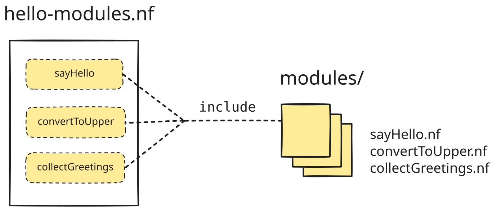

<span class="ai-translation-notice">Traducción asistida por IA - [más información y sugerencias](https://github.com/nextflow-io/training/blob/master/TRANSLATING.md)</span>

<figure>
<div class="video-wrapper">
  <iframe width="560" height="315" src="https://www.youtube.com/embed/43Ot-f0iOME?si=y8lAedhEHWaTV4zd&amp;list=PLPZ8WHdZGxmWKozQuzr27jyMGqp9kElVK&amp;cc_load_policy=1" title="YouTube video player" frameborder="0" allow="accelerometer; autoplay; clipboard-write; encrypted-media; gyroscope; picture-in-picture; web-share" referrerpolicy="strict-origin-when-cross-origin" allowfullscreen></iframe>
</div>
<figcaption>

Vea [la lista de reproducción completa](https://youtube.com/playlist?list=PLPZ8WHdZGxmWKozQuzr27jyMGqp9kElVK&si=eF7cLR62goy-lc6n) en el canal de YouTube de Nextflow.

📗 La transcripción del video está disponible [aquí](./transcripts/04_hello_modules.mdx).

</figcaption>
</figure>

Esta sección cubre cómo organizar el código de su workflow para hacer el desarrollo y mantenimiento de su pipeline más eficiente y sostenible.
Específicamente, vamos a demostrar cómo usar [**módulos**](https://nextflow.io/docs/latest/module.html).

En Nextflow, un **módulo** es un archivo de código independiente, que a menudo encapsula una única definición de proceso.
Para usar un módulo en un workflow, solo agrega una declaración `include` de una línea a su archivo de código de workflow; luego puede integrar el proceso en el workflow de la misma manera que normalmente lo haría.
Eso hace posible reutilizar definiciones de proceso en múltiples workflows sin producir múltiples copias del código.

Cuando comenzamos a desarrollar nuestro workflow, escribimos todo en un único archivo de código.
Ahora vamos a mover los procesos a módulos individuales.



Esto hará nuestro código más compartible, flexible y mantenible.

<details class="info">
<summary>Cómo comenzar desde esta sección</summary>

Esta sección del curso asume que ha completado las Partes 1-3 del curso [Hello Nextflow](./index.mdx), pero si se siente cómodo con los conceptos básicos cubiertos en esas secciones, puede comenzar desde aquí sin hacer nada especial.

</details>

---

## 0. Calentamiento: Ejecutar `hello-modules.nf`

Vamos a usar el script de workflow `hello-modules.nf` como punto de partida.
Es equivalente al script producido al trabajar en la Parte 3 de este curso de capacitación, excepto que hemos cambiado los destinos de salida:

```nextflow {3,7,11,15} title="hello-modules.nf" showLineNumbers startLineNumber=37
output {
    first_output {
        path 'hello_modules'
        mode 'copy'
    }
    uppercased {
        path 'hello_modules'
        mode 'copy'
    }
    collected {
        path 'hello_modules'
        mode 'copy'
    }
    batch_report {
        path 'hello_modules'
        mode 'copy'
    }
}
```

Solo para asegurarse de que todo funciona, ejecute el script una vez antes de hacer cualquier cambio:

```bash
nextflow run hello-modules.nf
# [!output]
N E X T F L O W   ~  version 26.04.4

Launching `hello-modules.nf` [hopeful_avogadro] revision: b09af1237d

executor >  local (7)
[0f/8795c9] sayHello (3)       | 3 of 3 ✔
[6a/eb2510] convertToUpper (3) | 3 of 3 ✔
[af/479117] collectGreetings   | 1 of 1 ✔

Outputs:

  /workspaces/training/hello-nextflow/results

  first_output:
    - hello_modules/Hola-output.txt
    - hello_modules/Bonjour-output.txt
    - hello_modules/Hello-output.txt
  uppercased:
    - hello_modules/UPPER-Hola-output.txt
    - hello_modules/UPPER-Bonjour-output.txt
    - hello_modules/UPPER-Hello-output.txt
  collected: hello_modules/COLLECTED-batch-output.txt
  batch_report: hello_modules/batch-report.txt
```

Como anteriormente, encontrará los archivos de salida en el directorio especificado en el bloque `output` (aquí, `results/hello_modules/`).

<details class="abstract">
<summary>Contenido del directorio</summary>

```console
results/hello_modules/
├── Bonjour-output.txt
├── COLLECTED-batch-output.txt
├── Hello-output.txt
├── Hola-output.txt
├── batch-report.txt
├── UPPER-Bonjour-output.txt
├── UPPER-Hello-output.txt
└── UPPER-Hola-output.txt
```

</details>

Si eso funcionó para usted, está listo para aprender cómo modularizar el código de su workflow.

---

## 1. Crear un directorio para almacenar módulos

Es una buena práctica almacenar sus módulos en un directorio específico.
Puede llamar a ese directorio como quiera, pero la convención es llamarlo `modules/`.

```bash
mkdir modules
```

---

## 2. Crear un módulo para `sayHello()`

En su forma más simple, convertir un proceso existente en un módulo es poco más que una operación de copiar y pegar.
Vamos a crear un archivo stub para el módulo, copiar el código relevante y luego eliminarlo del archivo de workflow principal.

Luego todo lo que necesitaremos hacer es agregar una declaración `include` para que Nextflow sepa que debe traer el código relevante en tiempo de ejecución.

### 2.1. Crear un archivo stub para el nuevo módulo

Creemos un archivo vacío para el módulo llamado `sayHello.nf`.

```bash
touch modules/sayHello.nf
```

Esto nos da un lugar para poner el código del proceso.

### 2.2. Mover el código del proceso `sayHello` al archivo del módulo

Copie toda la definición del proceso desde el archivo de workflow al archivo del módulo.

```nextflow title="modules/sayHello.nf" showLineNumbers
/*
 * Usar echo para imprimir 'Hello World!' a un archivo
 */
process sayHello {

    input:
    val greeting

    output:
    path "${greeting}-output.txt"

    script:
    """
    echo '${greeting}' > '${greeting}-output.txt'
    """
}
```

Una vez hecho eso, elimine la definición del proceso del archivo de workflow.

### 2.3. Agregar una declaración de importación antes del bloque workflow

La sintaxis para incluir un proceso desde un módulo es bastante sencilla:

```nextflow title="Syntax: include declaration"
include { <PROCESS_NAME> } from '<path_to_module>'
```

Insertemos eso arriba del bloque `params` y completémoslo apropiadamente.

<CodeWalkthrough>

```nextflow title="hello-modules.nf" showLineNumbers startLineNumber=44 step="Antes"
/*
* Parámetros del pipeline
*/
params {
    input: Path = 'data/greetings.csv'
    batch: String = 'batch'
}
```

```nextflow {1,2} title="hello-modules.nf" showLineNumbers startLineNumber=44 step="Después"
// Incluir módulos
include { sayHello } from './modules/sayHello.nf'

/*
* Parámetros del pipeline
*/
params {
    input: Path = 'data/greetings.csv'
    batch: String = 'batch'
}
```

</CodeWalkthrough>

Verá que hemos completado el nombre del proceso, `sayHello`, y la ruta al archivo que contiene el código del módulo, `./modules/sayHello.nf`.

### 2.4. Ejecutar el workflow

Estamos ejecutando el workflow con esencialmente el mismo código y entradas que antes, así que ejecutemos con la bandera `-resume` y veamos qué sucede.

```bash
nextflow run hello-modules.nf -resume
# [!output]
N E X T F L O W   ~  version 26.04.4

Launching `hello-modules.nf` [romantic_poisson] revision: 96edfa9ad3

[f6/cc0107] sayHello (1)       | 3 of 3, cached: 3 ✔
[3c/4058ba] convertToUpper (2) | 3 of 3, cached: 3 ✔
[1a/bc5901] collectGreetings   | 1 of 1, cached: 1 ✔

Outputs:

  /workspaces/training/hello-nextflow/results

  first_output:
    - hello_modules/Hello-output.txt
    - hello_modules/Bonjour-output.txt
    - hello_modules/Hola-output.txt
  uppercased:
    - hello_modules/UPPER-Hola-output.txt
    - hello_modules/UPPER-Bonjour-output.txt
    - hello_modules/UPPER-Hello-output.txt
  collected: hello_modules/COLLECTED-batch-output.txt
  batch_report: hello_modules/batch-report.txt
```

Esto debería ejecutarse muy rápidamente porque todo está en caché.
Siéntase libre de verificar las salidas publicadas.

Nextflow reconoció que sigue siendo el mismo trabajo por hacer, incluso si el código está dividido en múltiples archivos.

### Conclusión

Sabe cómo extraer un proceso en un módulo local y sabe que hacer esto no rompe la capacidad de reanudar del workflow.

### ¿Qué sigue?

Practicar haciendo más módulos.
Una vez que ha hecho uno, puede hacer un millón más...
Pero por ahora hagamos solo dos más.

---

## 3. Modularizar el proceso `convertToUpper()`

### 3.1. Crear un archivo stub para el nuevo módulo

Cree un archivo vacío para el módulo llamado `convertToUpper.nf`.

```bash
touch modules/convertToUpper.nf
```

### 3.2. Mover el código del proceso `convertToUpper` al archivo del módulo

Copie toda la definición del proceso desde el archivo de workflow al archivo del módulo.

```nextflow title="modules/convertToUpper.nf" showLineNumbers
/*
 * Usar una herramienta de reemplazo de texto para convertir el saludo a mayúsculas
 */
process convertToUpper {

    input:
    path input_file

    output:
    path "UPPER-${input_file}"

    script:
    """
    cat ${input_file} | tr '[a-z]' '[A-Z]' > UPPER-${input_file}
    """
}
```

Una vez hecho eso, elimine la definición del proceso del archivo de workflow.

### 3.3. Agregar una declaración de importación antes del bloque `params`

Inserte la declaración de importación arriba del bloque `params` y complétela apropiadamente.

<CodeWalkthrough>

```nextflow title="hello-modules.nf" showLineNumbers startLineNumber=23 step="Antes"
// Incluir módulos
include { sayHello } from './modules/sayHello.nf'

/*
* Parámetros del pipeline
*/
params {
    input: Path = 'data/greetings.csv'
    batch: String = 'batch'
}
```

```nextflow {3} title="hello-modules.nf" showLineNumbers startLineNumber=23 step="Después"
// Incluir módulos
include { sayHello } from './modules/sayHello.nf'
include { convertToUpper } from './modules/convertToUpper.nf'

/*
* Parámetros del pipeline
*/
params {
    input: Path = 'data/greetings.csv'
    batch: String = 'batch'
}
```

</CodeWalkthrough>

Esto debería empezar a verse muy familiar.

### 3.4. Ejecutar el workflow nuevamente

Ejecute esto con la bandera `-resume`.

```bash
nextflow run hello-modules.nf -resume
# [!output]
N E X T F L O W   ~  version 26.04.4

Launching `hello-modules.nf` [nauseous_heisenberg] revision: a04a9f2da0

[c9/763d42] sayHello (3)       | 3 of 3, cached: 3 ✔
[60/bc6831] convertToUpper (3) | 3 of 3, cached: 3 ✔
[1a/bc5901] collectGreetings   | 1 of 1, cached: 1 ✔

Outputs:

  /workspaces/training/hello-nextflow/results

  first_output:
    - hello_modules/Hola-output.txt
    - hello_modules/Hello-output.txt
    - hello_modules/Bonjour-output.txt
  uppercased:
    - hello_modules/UPPER-Bonjour-output.txt
    - hello_modules/UPPER-Hello-output.txt
    - hello_modules/UPPER-Hola-output.txt
  collected: hello_modules/COLLECTED-batch-output.txt
  batch_report: hello_modules/batch-report.txt
```

Esto debería seguir produciendo la misma salida que anteriormente.

¡Dos listos, uno más por hacer!

---

## 4. Modularizar el proceso `collectGreetings()`

### 4.1. Crear un archivo stub para el nuevo módulo

Cree un archivo vacío para el módulo llamado `collectGreetings.nf`.

```bash
touch modules/collectGreetings.nf
```

### 4.2. Mover el código del proceso `collectGreetings` al archivo del módulo

Copie toda la definición del proceso desde el archivo de workflow al archivo del módulo.

```nextflow title="modules/collectGreetings.nf" showLineNumbers
/*
 * Recopilar saludos en mayúsculas en un único archivo de salida
 */
process collectGreetings {

    input:
    path input_files
    val batch_name

    output:
    path "COLLECTED-${batch_name}-output.txt", emit: outfile
    path "${batch_name}-report.txt", emit: report

    script:
    count_greetings = input_files.size()
    """
    cat ${input_files} > 'COLLECTED-${batch_name}-output.txt'
    echo 'There were ${count_greetings} greetings in this batch.' > '${batch_name}-report.txt'
    """
}
```

Una vez hecho eso, elimine la definición del proceso del archivo de workflow.

### 4.3. Agregar una declaración de importación antes del bloque `params`

Inserte la declaración de importación arriba del bloque `params` y complétela apropiadamente.

<CodeWalkthrough>

```nextflow title="hello-modules.nf" showLineNumbers startLineNumber=3 step="Antes"
// Incluir módulos
include { sayHello } from './modules/sayHello.nf'
include { convertToUpper } from './modules/convertToUpper.nf'

/*
* Parámetros del pipeline
*/
params {
    input: Path = 'data/greetings.csv'
    batch: String = 'batch'
}
```

```nextflow {4} title="hello-modules.nf" showLineNumbers startLineNumber=3 step="Después"
// Incluir módulos
include { sayHello } from './modules/sayHello.nf'
include { convertToUpper } from './modules/convertToUpper.nf'
include { collectGreetings } from './modules/collectGreetings.nf'

/*
* Parámetros del pipeline
*/
params {
    input: Path = 'data/greetings.csv'
    batch: String = 'batch'
}
```

</CodeWalkthrough>

¡El último!

### 4.4. Ejecutar el workflow

Ejecute esto con la bandera `-resume`.

```bash
nextflow run hello-modules.nf -resume
# [!output]
N E X T F L O W   ~  version 26.04.4

Launching `hello-modules.nf` [friendly_coulomb] revision: 7aa2b9bc0f

[f6/cc0107] sayHello (1)       | 3 of 3, cached: 3 ✔
[3c/4058ba] convertToUpper (2) | 3 of 3, cached: 3 ✔
[1a/bc5901] collectGreetings   | 1 of 1, cached: 1 ✔

Outputs:

  /workspaces/training/hello-nextflow/results

  first_output:
    - hello_modules/Hello-output.txt
    - hello_modules/Bonjour-output.txt
    - hello_modules/Hola-output.txt
  uppercased:
    - hello_modules/UPPER-Bonjour-output.txt
    - hello_modules/UPPER-Hello-output.txt
    - hello_modules/UPPER-Hola-output.txt
  collected: hello_modules/COLLECTED-batch-output.txt
  batch_report: hello_modules/batch-report.txt
```

Esto debería seguir produciendo la misma salida que anteriormente.

### Conclusión

Sabe cómo modularizar múltiples procesos en un workflow.

¡Felicitaciones, ha hecho todo este trabajo y absolutamente nada ha cambiado en cómo funciona el pipeline!

Bromas aparte, ahora su código es más modular, y si decide escribir otro pipeline que llame a uno de esos procesos, solo necesita escribir una corta declaración `include` para usar el módulo relevante.
Esto es mejor que copiar y pegar el código, porque si más tarde decide mejorar el módulo, todos sus pipelines heredarán las mejoras.

### ¿Qué sigue?

Tome un pequeño descanso si lo desea.

Cuando esté listo, continúe con [**Parte 5: Hello Containers**](./05_hello_containers.mdx) para aprender cómo usar contenedores para gestionar dependencias de software de manera más conveniente y reproducible.

---

## Cuestionario

<Quiz id="quiz-1">

¿Qué es un módulo en Nextflow?
- [ ] Un archivo de configuración
- [x] Un archivo independiente que puede contener definiciones de proceso
- [ ] Una definición de workflow
- [ ] Un operador de canal

Aprenda más: [2. Crear un módulo para `sayHello()`](#2-crear-un-módulo-para-sayhello)

</Quiz>

<Quiz id="quiz-2">

¿Qué convención se usa típicamente para almacenar archivos de módulos?
- [ ] En el mismo directorio que el workflow
- [ ] En un directorio `bin/`
- [x] En un directorio `modules/`
- [ ] En un directorio `lib/`

Aprenda más: [1. Crear un directorio para almacenar módulos](#1-crear-un-directorio-para-almacenar-módulos)

</Quiz>

<Quiz id="quiz-3">

¿Cuál es la sintaxis correcta para usar un módulo?

- [ ] `import { SAYHELLO } from './modules/sayhello.nf'{:nextflow}`
- [ ] `require { SAYHELLO } from './modules/sayhello.nf'{:nextflow}`
- [x] `include { SAYHELLO } from './modules/sayhello.nf'{:nextflow}`
- [ ] `load { SAYHELLO } from './modules/sayhello.nf'{:nextflow}`

Aprenda más: [2.3. Agregar una declaración de importación](#23-agregar-una-declaración-de-importación-antes-del-bloque-workflow)

</Quiz>

<Quiz id="quiz-4">

¿Qué sucede con la funcionalidad `-resume` cuando se usan módulos?
- [ ] Ya no funciona
- [ ] Requiere configuración adicional
- [x] Funciona igual que antes
- [ ] Solo funciona para módulos locales

</Quiz>

<Quiz id="quiz-5">

¿Cuáles son los beneficios de usar módulos? (Seleccione todos los que apliquen)
- [x] Reutilización de código entre workflows
- [x] Mantenimiento más fácil
- [x] Mejor organización del código del workflow
- [ ] Velocidad de ejecución más rápida

</Quiz>
