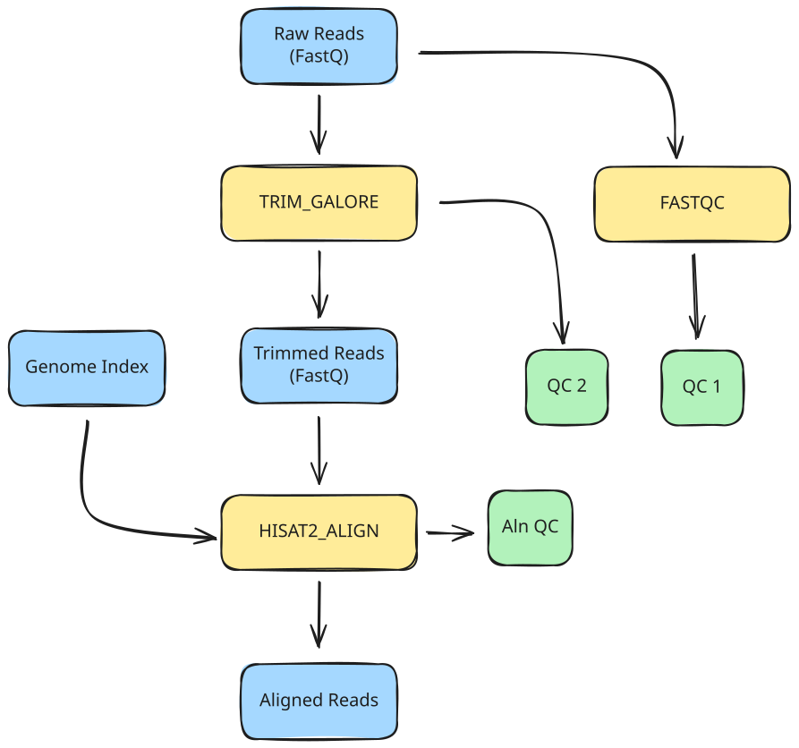

<span class="ai-translation-notice">Traducción asistida por IA - [más información y sugerencias](https://github.com/nextflow-io/training/blob/master/TRANSLATING.md)</span>

En esta parte del curso, vamos a escribir el flujo de trabajo más simple posible que envuelva todos los comandos que ejecutamos en la Parte 1 para automatizar su ejecución, y nos enfocaremos en procesar una muestra a la vez.

:::caution[Requisito previo]
Debe completar la [Parte 1: Descripción del método](./01_method.mdx) antes de comenzar esta lección.
Específicamente, trabajar en la sección 1.2.3 crea el archivo de índice del genoma (`data/genome_index.tar.gz`) requerido para el paso de alineamiento en esta lección.
:::

## Asignación

En esta parte del curso, vamos a desarrollar un flujo de trabajo que hace lo siguiente:

1. Ejecutar control de calidad (FastQC) en las lecturas de entrada
2. Recortar adaptadores y ejecutar control de calidad posterior al recorte (Trim Galore)
3. Alinear las lecturas recortadas a un genoma de referencia (HISAT2)



Esto automatiza los pasos de la primera sección de la [Parte 1: Descripción del método](./01_method.mdx#1-procesamiento-de-muestra-única), donde ejecutó estos comandos manualmente en sus contenedores.

Como punto de partida, le proporcionamos un archivo de flujo de trabajo, `rnaseq.nf`, que describe las partes principales del flujo de trabajo, así como cuatro archivos de módulo en el directorio `modules/` (`fastqc.nf`, `trim_galore.nf`, `hisat2_align.nf` y `multiqc.nf`) que describen la estructura de cada proceso.

<details class="full-code">
<summary>Archivos de esqueleto</summary>

```nextflow title="rnaseq.nf"
#!/usr/bin/env nextflow

// Module INCLUDE statements

/*
 * Pipeline parameters
 */

// Primary input

workflow {

    main:
    // Create input channel

    // Call processes

    publish:
    // Declare outputs to publish
}

output {
    // Configure publish targets
}
```

```nextflow title="modules/fastqc.nf"
#!/usr/bin/env nextflow

/*
 * Run FastQC on input reads
 */
process FASTQC {

    container

    input:

    output:

    script:
    """

    """
}
```

```nextflow title="modules/trim_galore.nf"
#!/usr/bin/env nextflow

/*
 * Trim adapters and run post-trimming QC
 */
process TRIM_GALORE {

    container

    input:

    output:

    script:
    """

    """
}
```

```nextflow title="modules/hisat2_align.nf"
#!/usr/bin/env nextflow

/*
 * Align reads to a reference genome
 */
process HISAT2_ALIGN {

    container

    input:

    output:

    script:
    """

    """
}
```

```nextflow title="modules/multiqc.nf"
#!/usr/bin/env nextflow

/*
 * Aggregate QC reports with MultiQC
 */
process MULTIQC {

    container

    input:

    output:

    script:
    """

    """
}
```

</details>

Estos archivos no son funcionales; su propósito es solo servir como esqueletos para que los complete con las partes interesantes del código.

## Plan de la lección

Para hacer el proceso de desarrollo más educativo, lo hemos dividido en tres etapas:

1. **Escribir un flujo de trabajo de una sola etapa que ejecute el paso de control de calidad inicial.**
   Esto cubre la configuración de un parámetro CLI, la creación de un canal de entrada, la escritura de un módulo de proceso y la configuración de publicación de salida.
2. **Agregar recorte de adaptadores y control de calidad posterior al recorte.**
   Esto introduce el encadenamiento de procesos conectando la salida de un proceso con la entrada de otro.
3. **Agregar alineamiento al genoma de referencia.**
   Esto cubre el manejo de entradas de referencia adicionales y el trabajo con archivos comprimidos.

Cada paso se enfoca en un aspecto específico del desarrollo de flujos de trabajo.

:::tip[Consejo]
Asegúrese de estar en el directorio de trabajo correcto:
`cd /workspaces/training/nf4-science/rnaseq`
:::

---

## 1. Escribir un flujo de trabajo de una sola etapa que ejecute el control de calidad inicial

Este primer paso se enfoca en lo básico: cargar un archivo FASTQ y ejecutar control de calidad en él.

Recuerde el comando `fastqc` de la [Parte 1](01_method.mdx):

```bash
fastqc <reads>
```

El comando toma un archivo FASTQ como entrada y produce un informe de control de calidad como un archivo `.zip` y un resumen `.html`.
El URI del contenedor era `community.wave.seqera.io/library/trim-galore:0.6.10--1bf8ca4e1967cd18`.

Vamos a tomar esta información y envolverla en Nextflow en tres etapas:

1. Configurar la entrada
2. Escribir el proceso de control de calidad y llamarlo en el flujo de trabajo
3. Configurar el manejo de salida

### 1.1. Configurar la entrada

Necesitamos declarar un parámetro de entrada, crear un perfil de prueba para proporcionar un valor predeterminado conveniente y crear un canal de entrada.

#### 1.1.1. Agregar una declaración de parámetro de entrada

En `rnaseq.nf`, bajo la sección `Pipeline parameters`, declare un parámetro llamado `reads` con el tipo `Path`.

<CodeWalkthrough>

```nextflow title="rnaseq.nf" showLineNumbers startLineNumber=5 step="Antes"
/*
 * Pipeline parameters
 */

// Entrada principal
```

```nextflow {4-7} title="rnaseq.nf" showLineNumbers startLineNumber=5 step="Después"
/*
 * Pipeline parameters
 */
params {
    // Entrada principal
    input: Path
}
```

</CodeWalkthrough>

Eso configura el parámetro CLI, pero no queremos escribir la ruta del archivo cada vez que ejecutamos el flujo de trabajo durante el desarrollo.
Hay múltiples opciones para proporcionar un valor predeterminado; aquí usamos un perfil de prueba.

#### 1.1.2. Crear un perfil de prueba con un valor predeterminado en `nextflow.config`

Un perfil de prueba proporciona valores predeterminados convenientes para probar un flujo de trabajo sin especificar entradas en la línea de comandos.
Esta es una convención común en el ecosistema Nextflow (consulte [Hello Config](../../hello_nextflow/06_hello_config.mdx) para más detalles).

Agregue un bloque `profiles` a `nextflow.config` con un perfil `test` que establezca el parámetro `reads` en uno de los archivos FASTQ de prueba.

<CodeWalkthrough>

```nextflow title="nextflow.config" showLineNumbers step="Antes"
docker.enabled = true
```

```nextflow {3-7} title="nextflow.config" showLineNumbers step="Después"
docker.enabled = true

profiles {
    test {
        params.input = "${projectDir}/data/reads/ENCSR000COQ1_1.fastq.gz"
    }
}
```

</CodeWalkthrough>

Aquí, estamos usando `${projectDir}{:nextflow}`, una variable integrada de Nextflow que apunta al directorio donde se encuentra el script del flujo de trabajo.
Esto facilita la referencia a archivos de datos y otros recursos sin codificar rutas absolutas.

El parámetro ahora tiene un valor predeterminado conveniente. A continuación, necesitamos crear un canal a partir de él.

#### 1.1.3. Configurar el canal de entrada

En el bloque workflow, cree un canal de entrada a partir del valor del parámetro usando la fábrica de canal `.fromPath` (como se usa en [Hello Channels](../../hello_nextflow/02_hello_channels.mdx)).

<CodeWalkthrough>

```nextflow title="rnaseq.nf" showLineNumbers startLineNumber=13 step="Antes"
workflow {

    main:
    // Crear canal de entrada

    // Llamar procesos

    publish:
    // Declarar salidas a publicar
}
```

```nextflow {4-5} title="rnaseq.nf" showLineNumbers startLineNumber=13 step="Después"
workflow {

    main:
    // Crear canal de entrada desde una ruta de archivo
    read_ch = channel.fromPath(params.input)

    // Llamar procesos

    publish:
    // Declarar salidas a publicar
}
```

</CodeWalkthrough>

A continuación, necesitaremos crear el proceso para ejecutar control de calidad en esta entrada.

### 1.2. Escribir el proceso de control de calidad y llamarlo en el flujo de trabajo

Necesitamos completar la definición del proceso en el archivo de módulo, importarlo al flujo de trabajo usando una declaración include y llamarlo en la entrada.

#### 1.2.1. Completar el módulo para el proceso de control de calidad

Abra `modules/fastqc.nf` y examine el esquema de la definición del proceso.
Debería reconocer los elementos estructurales principales; si no, considere leer [Hello Nextflow](../../hello_nextflow/01_hello_world.mdx) para refrescar la memoria.

Adelante, complete la definición del proceso por su cuenta usando la información proporcionada anteriormente, luego verifique su trabajo contra la solución en la pestaña "Después" a continuación.

<CodeWalkthrough>

```nextflow title="modules/fastqc.nf" showLineNumbers step="Antes"
#!/usr/bin/env nextflow

/*
 * Ejecutar FastQC en las lecturas de entrada
 */
process FASTQC {

    container

    input:

    output:

    script:
    """

    """
}
```

```nextflow {8,11,14,15,19} title="modules/fastqc.nf" showLineNumbers step="Después"
#!/usr/bin/env nextflow

/*
 * Ejecutar FastQC en las lecturas de entrada
 */
process FASTQC {

    container "community.wave.seqera.io/library/trim-galore:0.6.10--1bf8ca4e1967cd18"

    input:
    path reads

    output:
    path "${reads.simpleName}_fastqc.zip", emit: zip
    path "${reads.simpleName}_fastqc.html", emit: html

    script:
    """
    fastqc ${reads}
    """
}
```

</CodeWalkthrough>

El accesor `simpleName` elimina todas las extensiones del nombre del archivo, por lo que `ENCSR000COQ1_1.fastq.gz` se convierte en `ENCSR000COQ1_1`.
Usamos la sintaxis `emit:` para asignar nombres a cada canal de salida, lo que será útil para conectar las salidas al bloque publish.

Una vez que haya completado esto, el proceso está completo.
Para usarlo en el flujo de trabajo, necesitará importar el módulo y agregar una llamada al proceso.

#### 1.2.2. Incluir el módulo

En `rnaseq.nf`, agregue una declaración `include` para hacer que el proceso esté disponible para el flujo de trabajo:

<CodeWalkthrough>

```nextflow title="rnaseq.nf" showLineNumbers startLineNumber=3 step="Antes"
// Declaraciones INCLUDE de módulos
```

```nextflow {2} title="rnaseq.nf" showLineNumbers startLineNumber=3 step="Después"
// Declaraciones INCLUDE de módulos
include { FASTQC } from './modules/fastqc.nf'
```

</CodeWalkthrough>

El proceso ahora está disponible en el ámbito del flujo de trabajo.

#### 1.2.3. Llamar al proceso de control de calidad en la entrada

Agregue una llamada a `FASTQC` en el bloque workflow, pasando el canal de entrada como argumento.

<CodeWalkthrough>

```nextflow title="rnaseq.nf" showLineNumbers startLineNumber=14 step="Antes"
workflow {

    main:
    // Crear canal de entrada desde una ruta de archivo
    read_ch = channel.fromPath(params.input)

    // Llamar procesos

    publish:
    // Declarar salidas a publicar
}
```

```nextflow {7-8} title="rnaseq.nf" showLineNumbers startLineNumber=14 step="Después"
workflow {

    main:
    // Crear canal de entrada desde una ruta de archivo
    read_ch = channel.fromPath(params.input)

    // Control de calidad inicial
    FASTQC(read_ch)

    publish:
    // Declarar salidas a publicar
}
```

</CodeWalkthrough>

El flujo de trabajo ahora carga la entrada y ejecuta el proceso de control de calidad en ella.
A continuación, necesitamos configurar cómo se publica la salida.

### 1.3. Configurar el manejo de salida

Necesitamos declarar qué salidas de proceso publicar y especificar dónde deben ir.

#### 1.3.1. Declarar salidas en la sección `publish:`

La sección `publish:` dentro del bloque workflow declara qué salidas de proceso deben publicarse.
Asigne las salidas de `FASTQC` a destinos nombrados.

<CodeWalkthrough>

```nextflow title="rnaseq.nf" showLineNumbers startLineNumber=23 step="Antes"
    publish:
    // Declarar salidas a publicar
}
```

```nextflow {2-3} title="rnaseq.nf" showLineNumbers startLineNumber=23 step="Después"
    publish:
    fastqc_zip = FASTQC.out.zip
    fastqc_html = FASTQC.out.html
}
```

</CodeWalkthrough>

A continuación, necesitaremos decirle a Nextflow dónde poner las salidas publicadas.

#### 1.3.2. Configurar los destinos de salida en el bloque `output {}`

El bloque `output {}` se encuentra fuera del flujo de trabajo y especifica dónde se publica cada destino nombrado.
Configure ambos destinos para publicar en un subdirectorio `fastqc/`.

<CodeWalkthrough>

```nextflow title="rnaseq.nf" showLineNumbers startLineNumber=28 step="Antes"
output {
    // Configurar destinos de publicación
}
```

```nextflow {2-7} title="rnaseq.nf" showLineNumbers startLineNumber=28 step="Después"
output {
    fastqc_zip {
        path 'fastqc'
    }
    fastqc_html {
        path 'fastqc'
    }
}
```

</CodeWalkthrough>

:::note[Nota]
Por defecto, Nextflow publica archivos de salida como enlaces simbólicos, lo que evita duplicación innecesaria.
Aunque los archivos de datos que estamos usando aquí son muy pequeños, en genómica pueden volverse muy grandes.
Los enlaces simbólicos se romperán cuando limpie su directorio `work`, por lo que para flujos de trabajo de producción es posible que desee anular el modo de publicación predeterminado a `'copy'`.
:::

### 1.4. Ejecutar el flujo de trabajo

En este punto, tenemos un flujo de trabajo de control de calidad de un paso que debería ser completamente funcional.

Ejecutamos con `-profile test` para usar el valor predeterminado configurado en el perfil de prueba, evitando la necesidad de escribir la ruta en la línea de comandos.

```bash
nextflow run rnaseq.nf -profile test
# [!output]
 N E X T F L O W   ~  version 26.04.4

Launching `rnaseq.nf` [fabulous_engelbart] revision: 859d80cde8

executor >  local (1)
[4e/36fb3d] FASTQC (1) | 1 of 1 ✔

Outputs:

  /workspaces/training/nf4-science/rnaseq/results

  fastqc_zip:
    - fastqc/ENCSR000COQ1_1_fastqc.zip

  fastqc_html:
    - fastqc/ENCSR000COQ1_1_fastqc.html
```

Esto debería ejecutarse muy rápidamente si trabajó en la Parte 1 y ya ha descargado el contenedor.
Si la omitió, Nextflow descargará el contenedor por usted; no tiene que hacer nada para que suceda, pero es posible que deba esperar hasta un minuto.

Puede verificar las salidas en el directorio de resultados.

```bash
ls results/fastqc
```

```console title="Output"
ENCSR000COQ1_1_fastqc.html  ENCSR000COQ1_1_fastqc.zip
```

Los informes de control de calidad para la muestra ahora están publicados en el subdirectorio `fastqc/`.

### Conclusión

Sabe cómo crear un módulo que contiene un proceso, importarlo a un flujo de trabajo, llamarlo con un canal de entrada y publicar los resultados usando el bloque de salida a nivel de flujo de trabajo.

### ¿Qué sigue?

Agregue recorte de adaptadores con control de calidad posterior al recorte como un segundo paso en el flujo de trabajo.

---

## 2. Agregar recorte de adaptadores y control de calidad posterior al recorte

Ahora que tenemos el control de calidad inicial en su lugar, podemos agregar el paso de recorte de adaptadores con su control de calidad posterior al recorte integrado.

Recuerde el comando `trim_galore` de la [Parte 1](01_method.mdx):

```bash
trim_galore --fastqc <reads>
```

El comando recorta adaptadores de un archivo FASTQ y ejecuta FastQC en la salida recortada.
Produce lecturas recortadas, un informe de recorte e informes FastQC para las lecturas recortadas.
El URI del contenedor era `community.wave.seqera.io/library/trim-galore:0.6.10--1bf8ca4e1967cd18`.

Solo necesitamos escribir la definición del proceso, importarlo, llamarlo en el workflow y actualizar el manejo de salida.

### 2.1. Escribir el proceso de recorte y llamarlo en el workflow

Como antes, necesitamos completar la definición del proceso, importar el módulo y agregar la llamada al proceso.

#### 2.1.1. Completar el módulo para el proceso de recorte

Abra `modules/trim_galore.nf` y examine el esquema de la definición del proceso.

Adelante, complete la definición del proceso por su cuenta usando la información proporcionada anteriormente, luego verifique su trabajo contra la solución en la pestaña "Después" a continuación.

<CodeWalkthrough>

```nextflow title="modules/trim_galore.nf" showLineNumbers step="Antes"
#!/usr/bin/env nextflow

/*
 * Trim adapters and run post-trimming QC
 */
process TRIM_GALORE {

    container

    input:

    output:

    script:
    """

    """
}
```

```nextflow {8,11,14,15,16,20} title="modules/trim_galore.nf" showLineNumbers step="Después"
#!/usr/bin/env nextflow

/*
 * Trim adapters and run post-trimming QC
 */
process TRIM_GALORE {

    container "community.wave.seqera.io/library/trim-galore:0.6.10--1bf8ca4e1967cd18"

    input:
    path reads

    output:
    path "${reads.simpleName}_trimmed.fq.gz", emit: trimmed_reads
    path "${reads}_trimming_report.txt", emit: trimming_reports
    path "${reads.simpleName}_trimmed_fastqc.{zip,html}", emit: fastqc_reports

    script:
    """
    trim_galore --fastqc ${reads}
    """
}
```

</CodeWalkthrough>

Este proceso tiene tres salidas nombradas: las lecturas recortadas que alimentan el paso de alineamiento, el informe de recorte y los informes FastQC posteriores al recorte.
La bandera `--fastqc` le dice a Trim Galore que ejecute automáticamente FastQC en la salida recortada.

#### 2.1.2. Incluir el módulo

Actualice `rnaseq.nf` para importar el nuevo módulo:

<CodeWalkthrough>

```nextflow title="rnaseq.nf" showLineNumbers startLineNumber=3 step="Antes"
// Declaraciones INCLUDE de módulos
include { FASTQC } from './modules/fastqc.nf'
```

```nextflow {3} title="rnaseq.nf" showLineNumbers startLineNumber=3 step="Después"
// Declaraciones INCLUDE de módulos
include { FASTQC } from './modules/fastqc.nf'
include { TRIM_GALORE } from './modules/trim_galore.nf'
```

</CodeWalkthrough>

A continuación, agregaremos la llamada al proceso al workflow.

#### 2.1.3. Llamar al proceso de recorte en la entrada

Agregue la llamada al proceso en el bloque workflow:

<CodeWalkthrough>

```nextflow title="rnaseq.nf" showLineNumbers startLineNumber=15 step="Antes"
workflow {

    main:
    // Crear canal de entrada desde una ruta de archivo
    read_ch = channel.fromPath(params.input)

    // Control de calidad inicial
    FASTQC(read_ch)

    publish:
    fastqc_zip = FASTQC.out.zip
    fastqc_html = FASTQC.out.html
}
```

```nextflow {10-11} title="rnaseq.nf" showLineNumbers startLineNumber=15 step="Después"
workflow {

    main:
    // Crear canal de entrada desde una ruta de archivo
    read_ch = channel.fromPath(params.input)

    // Control de calidad inicial
    FASTQC(read_ch)

    // Recorte de adaptadores y control de calidad posterior al recorte
    TRIM_GALORE(read_ch)

    publish:
    fastqc_zip = FASTQC.out.zip
    fastqc_html = FASTQC.out.html
}
```

</CodeWalkthrough>

El proceso de recorte ahora está conectado al workflow.

### 2.2. Actualizar el manejo de salida

Necesitamos agregar las salidas de recorte a la declaración de publicación y configurar dónde van.

#### 2.2.1. Agregar destinos de publicación para las salidas de recorte

Agregue las salidas de recorte a la sección `publish:`:

<CodeWalkthrough>

```nextflow title="rnaseq.nf" showLineNumbers startLineNumber=27 step="Antes"
    publish:
    fastqc_zip = FASTQC.out.zip
    fastqc_html = FASTQC.out.html
}
```

```nextflow {4-6} title="rnaseq.nf" showLineNumbers startLineNumber=27 step="Después"
    publish:
    fastqc_zip = FASTQC.out.zip
    fastqc_html = FASTQC.out.html
    trimmed_reads = TRIM_GALORE.out.trimmed_reads
    trimming_reports = TRIM_GALORE.out.trimming_reports
    trimming_fastqc = TRIM_GALORE.out.fastqc_reports
}
```

</CodeWalkthrough>

A continuación, necesitaremos decirle a Nextflow dónde poner estas salidas.

#### 2.2.2. Configurar los nuevos destinos de salida

Agregue entradas para los destinos de recorte en el bloque `output {}`, publicándolos en un subdirectorio `trimming/`:

<CodeWalkthrough>

```nextflow title="rnaseq.nf" showLineNumbers startLineNumber=35 step="Antes"
output {
    fastqc_zip {
        path 'fastqc'
    }
    fastqc_html {
        path 'fastqc'
    }
}
```

```nextflow {8-16} title="rnaseq.nf" showLineNumbers startLineNumber=35 step="Después"
output {
    fastqc_zip {
        path 'fastqc'
    }
    fastqc_html {
        path 'fastqc'
    }
    trimmed_reads {
        path 'trimming'
    }
    trimming_reports {
        path 'trimming'
    }
    trimming_fastqc {
        path 'trimming'
    }
}
```

</CodeWalkthrough>

La configuración de salida está completa.

### 2.3. Ejecutar el workflow

El workflow ahora incluye tanto el control de calidad inicial como el recorte de adaptadores.

```bash
nextflow run rnaseq.nf -profile test
# [!output]
 N E X T F L O W   ~  version 26.04.4

Launching `rnaseq.nf` [stupefied_volhard] revision: faaf310b2f

executor >  local (2)
[a3/ac9284] FASTQC (1)      | 1 of 1 ✔
[55/c4d983] TRIM_GALORE (1) | 1 of 1 ✔

Outputs:

  /workspaces/training/nf4-science/rnaseq/results

  fastqc_zip:
    - fastqc/ENCSR000COQ1_1_fastqc.zip

  fastqc_html:
    - fastqc/ENCSR000COQ1_1_fastqc.html

  trimmed_reads:
    - trimming/ENCSR000COQ1_1_trimmed.fq.gz

  trimming_reports:
    - trimming/ENCSR000COQ1_1.fastq.gz_trimming_report.txt

  trimming_fastqc:
    - [trimming/ENCSR000COQ1_1_trimmed_fastqc.html, trimming/ENCSR000COQ1_1_trimmed_fastqc.zip]
```

Esto también debería ejecutarse muy rápidamente, ya que estamos ejecutando en un archivo de entrada tan pequeño.

Puede encontrar las salidas de recorte en el directorio de resultados.

```bash
ls results/trimming
```

```console title="Output"
ENCSR000COQ1_1.fastq.gz_trimming_report.txt  ENCSR000COQ1_1_trimmed_fastqc.zip
ENCSR000COQ1_1_trimmed_fastqc.html           ENCSR000COQ1_1_trimmed.fq.gz
```

Las salidas de recorte y los informes de control de calidad posterior al recorte ahora están en el subdirectorio `trimming/`.

### Conclusión

Sabe cómo agregar un segundo paso de procesamiento que se ejecuta independientemente en la misma entrada, produciendo múltiples salidas nombradas.

### ¿Qué sigue?

Agregue el paso de alineamiento que se encadena a partir de la salida de lecturas recortadas.

---

## 3. Agregar alineamiento al genoma de referencia

Finalmente podemos agregar el paso de alineamiento del genoma usando HISAT2.

Recuerde el comando de alineamiento de la [Parte 1](01_method.mdx):

```bash
hisat2 -x <genome_index> -U <reads> \
    --new-summary --summary-file <reads>.hisat2.log | \
    samtools view -bS -o <reads>.bam
```

El comando alinea lecturas a un genoma de referencia y convierte la salida a formato BAM.
Requiere un archivo de índice del genoma preconstruido y produce un archivo BAM y un registro de resumen de alineamiento.
El URI del contenedor era `community.wave.seqera.io/library/hisat2_samtools:5e49f68a37dc010e`.

Este proceso requiere una entrada adicional (el archivo de índice del genoma), por lo que necesitamos configurar eso primero, luego escribir y conectar el proceso.

### 3.1. Configurar las entradas

Necesitamos declarar un parámetro para el archivo de índice del genoma.

#### 3.1.1. Agregar un parámetro para el índice del genoma

Agregue una declaración de parámetro para el archivo de índice del genoma en `rnaseq.nf`:

<CodeWalkthrough>

```nextflow title="rnaseq.nf" showLineNumbers startLineNumber=11 step="Antes"
params {
    // Entrada principal
    input: Path
}
```

```nextflow {5-6} title="rnaseq.nf" showLineNumbers startLineNumber=11 step="Después"
params {
    // Entrada principal
    input: Path

    // Archivo de índice del genoma de referencia
    hisat2_index_zip: Path
}
```

</CodeWalkthrough>

#### 3.1.2. Agregar el índice del genoma predeterminado al perfil de prueba

Tal como hicimos para `reads` en la sección 1.1.2, agregue un valor predeterminado para el índice del genoma al perfil de prueba en `nextflow.config`:

<CodeWalkthrough>

```nextflow title="nextflow.config" showLineNumbers step="Antes"
docker.enabled = true

profiles {
    test {
        params.input = "${projectDir}/data/reads/ENCSR000COQ1_1.fastq.gz"
    }
}
```

```nextflow {6} title="nextflow.config" showLineNumbers step="Después"
docker.enabled = true

profiles {
    test {
        params.input = "${projectDir}/data/reads/ENCSR000COQ1_1.fastq.gz"
        params.hisat2_index_zip = "${projectDir}/data/genome_index.tar.gz"
    }
}
```

</CodeWalkthrough>

El parámetro está listo; ahora podemos crear el proceso de alineamiento.

### 3.2. Escribir el proceso de alineamiento y llamarlo en el workflow

Como antes, necesitamos completar la definición del proceso, importar el módulo y agregar la llamada al proceso.

#### 3.2.1. Completar el módulo para el proceso de alineamiento

Abra `modules/hisat2_align.nf` y examine el esquema de la definición del proceso.

Adelante, complete la definición del proceso por su cuenta usando la información proporcionada anteriormente, luego verifique su trabajo contra la solución en la pestaña "Después" a continuación.

<CodeWalkthrough>

```nextflow title="modules/hisat2_align.nf" showLineNumbers step="Antes"
#!/usr/bin/env nextflow

/*
 * Alinear lecturas a un genoma de referencia
 */
process HISAT2_ALIGN {

    container

    input:

    output:

    script:
    """

    """
}
```

```nextflow {8,11,12,15,16,20,21,22,23} title="modules/hisat2_align.nf" showLineNumbers step="Después"
#!/usr/bin/env nextflow

/*
 * Alinear lecturas a un genoma de referencia
 */
process HISAT2_ALIGN {

    container "community.wave.seqera.io/library/hisat2_samtools:5e49f68a37dc010e"

    input:
    path reads
    path index_zip

    output:
    path "${reads.simpleName}.bam", emit: bam
    path "${reads.simpleName}.hisat2.log", emit: log

    script:
    """
    tar -xzvf ${index_zip}
    hisat2 -x ${index_zip.simpleName} -U ${reads} \
        --new-summary --summary-file ${reads.simpleName}.hisat2.log | \
        samtools view -bS -o ${reads.simpleName}.bam
    """
}
```

</CodeWalkthrough>

Este proceso toma dos entradas: las lecturas y el archivo de índice del genoma.
El bloque script primero extrae el índice del archivo, luego ejecuta el alineamiento HISAT2 canalizado a `samtools view` para convertir la salida a formato BAM.
El accesor `simpleName` en `index_zip` extrae el nombre base del archivo (`genome_index`) para usar como prefijo del índice.

#### 3.2.2. Incluir el módulo

Actualice `rnaseq.nf` para importar el nuevo módulo:

<CodeWalkthrough>

```nextflow title="rnaseq.nf" showLineNumbers startLineNumber=3 step="Antes"
// Declaraciones INCLUDE de módulos
include { FASTQC } from './modules/fastqc.nf'
include { TRIM_GALORE } from './modules/trim_galore.nf'
```

```nextflow {4} title="rnaseq.nf" showLineNumbers startLineNumber=3 step="Después"
// Declaraciones INCLUDE de módulos
include { FASTQC } from './modules/fastqc.nf'
include { TRIM_GALORE } from './modules/trim_galore.nf'
include { HISAT2_ALIGN } from './modules/hisat2_align.nf'
```

</CodeWalkthrough>

A continuación, agregaremos la llamada al proceso al workflow.

#### 3.2.3. Llamar al proceso de alineamiento

Las lecturas recortadas están en el canal `TRIM_GALORE.out.trimmed_reads` de salida del paso anterior.
Usamos `file(params.hisat2_index_zip){:nextflow}` para proporcionar el archivo de índice del genoma.

<CodeWalkthrough>

```nextflow title="rnaseq.nf" showLineNumbers startLineNumber=19 step="Antes"
workflow {

    main:
    // Crear canal de entrada desde una ruta de archivo
    read_ch = channel.fromPath(params.input)

    // Control de calidad inicial
    FASTQC(read_ch)

    // Recorte de adaptadores y control de calidad posterior al recorte
    TRIM_GALORE(read_ch)
```

```nextflow {13-14} title="rnaseq.nf" showLineNumbers startLineNumber=19 step="Después"
workflow {

    main:
    // Crear canal de entrada desde una ruta de archivo
    read_ch = channel.fromPath(params.input)

    // Control de calidad inicial
    FASTQC(read_ch)

    // Recorte de adaptadores y control de calidad posterior al recorte
    TRIM_GALORE(read_ch)

    // Alineamiento al genoma de referencia
    HISAT2_ALIGN(TRIM_GALORE.out.trimmed_reads, file(params.hisat2_index_zip))
```

</CodeWalkthrough>

El proceso de alineamiento ahora está conectado al workflow.

### 3.3. Actualizar el manejo de salida

Necesitamos agregar las salidas de alineamiento a la declaración de publicación y configurar dónde van.

#### 3.3.1. Agregar destinos de publicación para las salidas de alineamiento

Agregue las salidas de alineamiento a la sección `publish:`:

<CodeWalkthrough>

```nextflow title="rnaseq.nf" showLineNumbers startLineNumber=34 step="Antes"
    publish:
    fastqc_zip = FASTQC.out.zip
    fastqc_html = FASTQC.out.html
    trimmed_reads = TRIM_GALORE.out.trimmed_reads
    trimming_reports = TRIM_GALORE.out.trimming_reports
    trimming_fastqc = TRIM_GALORE.out.fastqc_reports
}
```

```nextflow {7-8} title="rnaseq.nf" showLineNumbers startLineNumber=34 step="Después"
    publish:
    fastqc_zip = FASTQC.out.zip
    fastqc_html = FASTQC.out.html
    trimmed_reads = TRIM_GALORE.out.trimmed_reads
    trimming_reports = TRIM_GALORE.out.trimming_reports
    trimming_fastqc = TRIM_GALORE.out.fastqc_reports
    bam = HISAT2_ALIGN.out.bam
    align_log = HISAT2_ALIGN.out.log
}
```

</CodeWalkthrough>

A continuación, necesitaremos decirle a Nextflow dónde poner estas salidas.

#### 3.3.2. Configurar los nuevos destinos de salida

Agregue entradas para los destinos de alineamiento en el bloque `output {}`, publicándolos en un subdirectorio `align/`:

<CodeWalkthrough>

```nextflow title="rnaseq.nf" showLineNumbers startLineNumber=44 step="Antes"
output {
    fastqc_zip {
        path 'fastqc'
    }
    fastqc_html {
        path 'fastqc'
    }
    trimmed_reads {
        path 'trimming'
    }
    trimming_reports {
        path 'trimming'
    }
    trimming_fastqc {
        path 'trimming'
    }
}
```

```nextflow {17-22} title="rnaseq.nf" showLineNumbers startLineNumber=44 step="Después"
output {
    fastqc_zip {
        path 'fastqc'
    }
    fastqc_html {
        path 'fastqc'
    }
    trimmed_reads {
        path 'trimming'
    }
    trimming_reports {
        path 'trimming'
    }
    trimming_fastqc {
        path 'trimming'
    }
    bam {
        path 'align'
    }
    align_log {
        path 'align'
    }
}
```

</CodeWalkthrough>

La configuración de salida está completa.

### 3.4. Ejecutar el workflow

El workflow ahora incluye los tres pasos de procesamiento: control de calidad, recorte y alineamiento.

```bash
nextflow run rnaseq.nf -profile test
# [!output]
 N E X T F L O W   ~  version 26.04.4

Launching `rnaseq.nf` [nauseous_allen] revision: 45d77a9709

executor >  local (3)
[57/b3c2cb] FASTQC (1)       | 1 of 1 ✔
[98/451aef] TRIM_GALORE (1)  | 1 of 1 ✔
[78/7cf2c3] HISAT2_ALIGN (1) | 1 of 1 ✔

Outputs:

  /workspaces/training/nf4-science/rnaseq/results

  fastqc_zip:
    - fastqc/ENCSR000COQ1_1_fastqc.zip

  fastqc_html:
    - fastqc/ENCSR000COQ1_1_fastqc.html

  trimmed_reads:
    - trimming/ENCSR000COQ1_1_trimmed.fq.gz

  trimming_reports:
    - trimming/ENCSR000COQ1_1.fastq.gz_trimming_report.txt

  trimming_fastqc:
    - [trimming/ENCSR000COQ1_1_trimmed_fastqc.html, trimming/ENCSR000COQ1_1_trimmed_fastqc.zip]

  bam:
    - align/ENCSR000COQ1_1_trimmed.bam

  align_log:
    - align/ENCSR000COQ1_1_trimmed.hisat2.log
```

Puede encontrar las salidas de alineamiento en el directorio de resultados.

```bash
ls results/align
```

```console title="Output"
ENCSR000COQ1_1_trimmed.bam  ENCSR000COQ1_1_trimmed.hisat2.log
```

Esto completa el procesamiento básico que necesitamos aplicar a cada muestra.

_Agregaremos la agregación de informes MultiQC en la Parte 3, después de que hayamos modificado el workflow para aceptar múltiples muestras a la vez._

---

### Conclusión

Sabe cómo envolver todos los pasos principales para procesar muestras de RNAseq de extremo simple individualmente.

### ¿Qué sigue?

¡Tome un descanso! Eso fue mucho.

Cuando se sienta renovado, diríjase a la [Parte 3](./03_multi-sample.mdx), donde aprenderá cómo modificar el workflow para procesar múltiples muestras en paralelo, agregar informes de control de calidad en todos los pasos para todas las muestras y habilitar la ejecución del workflow en datos de RNAseq de extremo pareado.
