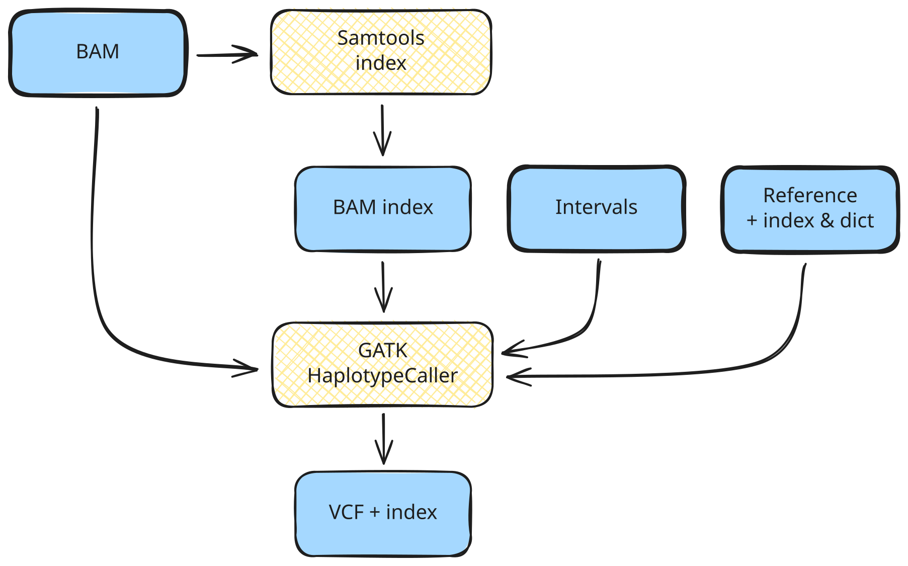

<span class="ai-translation-notice">Traduction assistée par IA - [en savoir plus et suggérer des améliorations](https://github.com/nextflow-io/training/blob/master/TRANSLATING.md)</span>

Dans la Partie 1, vous avez testé les commandes Samtools et GATK manuellement dans leurs conteneurs respectifs.
Ensuite, nous allons encapsuler ces mêmes commandes dans un workflow Nextflow.

## Objectif

Dans cette partie du cours, nous allons développer un workflow qui effectue les opérations suivantes :

1. Générer un fichier d'index pour chaque fichier BAM d'entrée en utilisant [Samtools](https://www.htslib.org/)
2. Exécuter GATK HaplotypeCaller sur chaque fichier BAM d'entrée pour générer des appels de variants par échantillon au format VCF (Variant Call Format)



Cela automatise les étapes de la première section de la [Partie 1 : Vue d'ensemble de la méthode](./01_method.mdx#1-appel-de-variants-par-échantillon), où vous avez exécuté ces commandes manuellement dans leurs conteneurs.

Comme point de départ, nous vous fournissons un fichier de workflow, `genomics.nf`, qui décrit les principales parties du workflow, ainsi que deux fichiers de modules, `samtools_index.nf` et `gatk_haplotypecaller.nf`, qui décrivent la structure de chaque processus.

<details class="full-code">
<summary>Fichiers squelettes</summary>

```nextflow title="genomics.nf"
#!/usr/bin/env nextflow

// Instructions INCLUDE de modules

/*
 * Pipeline parameters
 */

// Entrée principale

workflow {

    main:
    // Créer le canal d'entrée

    // Appeler les processus

    publish:
    // Déclarer les sorties à publier
}

output {
    // Configurer les cibles de publication
}
```

```nextflow title="modules/samtools_index.nf"
#!/usr/bin/env nextflow

/*
 * Générer un fichier d'index BAM
 */
process SAMTOOLS_INDEX {

    container

    input:

    output:

    script:
    """

    """
}
```

```nextflow title="modules/gatk_haplotypecaller.nf"
#!/usr/bin/env nextflow

/*
 * Appeler les variants avec GATK HaplotypeCaller
 */
process GATK_HAPLOTYPECALLER {

    container

    input:

    output:

    script:
    """

    """
}
```

</details>

Ces fichiers ne sont pas fonctionnels ; leur objectif est simplement de servir de squelettes que vous compléterez avec les parties intéressantes du code.

## Plan de la leçon

Afin de rendre le processus de développement plus pédagogique, nous avons divisé cela en quatre étapes :

1. **Écrire un workflow à une seule étape qui exécute Samtools index sur un fichier BAM.**
   Cela couvre la création d'un module, son importation et son appel dans un workflow.
2. **Ajouter un second processus pour exécuter GATK HaplotypeCaller sur le fichier BAM indexé.**
   Cela introduit le chaînage des sorties de processus vers les entrées et la gestion des fichiers accessoires.
3. **Adapter le workflow pour qu'il s'exécute sur un lot d'échantillons.**
   Cela couvre l'exécution parallèle et introduit les tuples pour garder les fichiers associés ensemble.
4. **Faire en sorte que le workflow accepte un fichier texte contenant un lot de fichiers d'entrée.**
   Cela démontre un modèle courant pour fournir des entrées en masse.

Chaque étape se concentre sur un aspect spécifique du développement de workflow.

:::tip[Astuce]
Assurez-vous d'être dans le bon répertoire de travail :
`cd /workspaces/training/nf4-science/genomics`
:::

---

## 1. Écrire un workflow à une seule étape qui exécute Samtools index sur un fichier BAM

Cette première étape se concentre sur les bases : charger un fichier BAM et générer un index pour celui-ci.

Rappelez-vous la commande `samtools index` de la [Partie 1](01_method.mdx) :

```bash
samtools index '<input_bam>'
```

La commande prend un fichier BAM en entrée et produit un fichier d'index `.bai` à côté de celui-ci.
L'URI du conteneur était `community.wave.seqera.io/library/samtools:1.20--b5dfbd93de237464`.

Nous allons prendre ces informations et les encapsuler dans Nextflow en trois étapes :

1. Configurer l'entrée
2. Écrire le processus d'indexation et l'appeler dans le workflow
3. Configurer la gestion de la sortie

### 1.1. Configurer l'entrée

Nous devons déclarer un paramètre d'entrée, créer un profil de test pour fournir une valeur par défaut pratique, et créer un canal d'entrée.

#### 1.1.1. Ajouter une déclaration de paramètre d'entrée

Dans le fichier de workflow principal `genomics.nf`, sous la section `Pipeline parameters`, déclarez un paramètre CLI appelé `input`.

<CodeWalkthrough>

```nextflow title="genomics.nf" showLineNumbers startLineNumber=5 step="Avant"
/*
 * Pipeline parameters
 */

// Entrée principale
```

```nextflow {4-7} title="genomics.nf" showLineNumbers startLineNumber=5 step="Après"
/*
 * Pipeline parameters
 */
params {
    // Entrée principale
    input: Path
}
```

</CodeWalkthrough>

Cela configure le paramètre CLI, mais nous ne voulons pas taper le chemin du fichier à chaque fois que nous exécutons le workflow pendant le développement.
Il existe plusieurs options pour fournir une valeur par défaut ; ici nous utilisons un profil de test.

#### 1.1.2. Créer un profil de test avec une valeur par défaut dans `nextflow.config`

Un profil de test fournit des valeurs par défaut pratiques pour essayer un workflow sans spécifier d'entrées sur la ligne de commande.
C'est une convention courante dans l'écosystème Nextflow (voir [Hello Config](../../hello_nextflow/06_hello_config.mdx) pour plus de détails).

Ajoutez un bloc `profiles` à `nextflow.config` avec un profil `test` qui définit le paramètre `input` sur l'un des fichiers BAM de test.

<CodeWalkthrough>

```nextflow title="nextflow.config" showLineNumbers step="Avant"
docker.enabled = true
```

```nextflow {3-7} title="nextflow.config" showLineNumbers step="Après"
docker.enabled = true

profiles {
    test {
        params.input = "${projectDir}/data/bam/reads_mother.bam"
    }
}
```

</CodeWalkthrough>

Ici, nous utilisons `${projectDir}`, une variable Nextflow intégrée qui pointe vers le répertoire où se trouve le script de workflow.
Cela facilite la référence aux fichiers de données et autres ressources sans coder en dur des chemins absolus.

#### 1.1.3. Configurer le canal d'entrée

Dans le bloc workflow, créez un canal d'entrée à partir de la valeur du paramètre en utilisant la fabrique de canaux `.fromPath` (comme utilisée dans [Hello Channels](../../hello_nextflow/02_hello_channels.mdx)).

<CodeWalkthrough>

```nextflow title="genomics.nf" showLineNumbers startLineNumber=13 step="Avant"
workflow {

    main:
    // Créer le canal d'entrée
```

```nextflow {4-5} title="genomics.nf" showLineNumbers startLineNumber=13 step="Après"
workflow {

    main:
    // Créer le canal d'entrée (fichier unique via paramètre CLI)
    reads_ch = channel.fromPath(params.input)
```

</CodeWalkthrough>

Ensuite, nous devrons créer le processus pour exécuter l'indexation sur cette entrée.

### 1.2. Écrire le processus d'indexation et l'appeler dans le workflow

Nous devons écrire la définition du processus dans le fichier de module, l'importer dans le workflow en utilisant une instruction include, et l'appeler sur l'entrée.

#### 1.2.1. Compléter le module pour le processus d'indexation

Ouvrez `modules/samtools_index.nf` et examinez le squelette de la définition du processus.
Vous devriez reconnaître les principaux éléments structurels ; sinon, envisagez de lire [Hello Nextflow](../../hello_nextflow/01_hello_world.mdx) pour un rappel.

Complétez la définition du processus par vous-même en utilisant les informations fournies ci-dessus, puis vérifiez votre travail par rapport à la solution dans l'onglet "Après" ci-dessous.

<CodeWalkthrough>

```nextflow title="modules/samtools_index.nf" showLineNumbers step="Avant"
#!/usr/bin/env nextflow

/*
 * Générer un fichier d'index BAM
 */
process SAMTOOLS_INDEX {

    container

    input:

    output:

    script:
    """

    """
}
```

```nextflow {8,11,14,18} title="modules/samtools_index.nf" showLineNumbers step="Après"
#!/usr/bin/env nextflow

/*
 * Générer un fichier d'index BAM
 */
process SAMTOOLS_INDEX {

    container 'community.wave.seqera.io/library/samtools:1.20--b5dfbd93de237464'

    input:
    path input_bam

    output:
    path "${input_bam}.bai"

    script:
    """
    samtools index '$input_bam'
    """
}
```

</CodeWalkthrough>

Une fois que vous avez terminé cela, le processus est complet.
Pour l'utiliser dans le workflow, vous devrez importer le module et ajouter un appel de processus.

#### 1.2.2. Inclure le module

Dans `genomics.nf`, ajoutez une instruction `include` pour rendre le processus disponible au workflow :

<CodeWalkthrough>

```nextflow title="genomics.nf" showLineNumbers startLineNumber=3 step="Avant"
// Instructions INCLUDE de modules
```

```nextflow {2} title="genomics.nf" showLineNumbers startLineNumber=3 step="Après"
// Instructions INCLUDE de modules
include { SAMTOOLS_INDEX } from './modules/samtools_index.nf'
```

</CodeWalkthrough>

Le processus est maintenant disponible dans la portée du workflow.

#### 1.2.3. Appeler le processus d'indexation sur l'entrée

Maintenant, ajoutons un appel à `SAMTOOLS_INDEX` dans le bloc workflow, en passant le canal d'entrée comme argument.

<CodeWalkthrough>

```nextflow title="genomics.nf" showLineNumbers startLineNumber=14 step="Avant"
workflow {

    main:
    // Créer le canal d'entrée (fichier unique via paramètre CLI)
    reads_ch = channel.fromPath(params.input)

    // Appeler les processus
```

```nextflow {7-8} title="genomics.nf" showLineNumbers startLineNumber=14 step="Après"
workflow {

    main:
    // Créer le canal d'entrée (fichier unique via paramètre CLI)
    reads_ch = channel.fromPath(params.input)

    // Créer le fichier d'index pour le fichier BAM d'entrée
    SAMTOOLS_INDEX(reads_ch)
```

</CodeWalkthrough>

Le workflow charge maintenant l'entrée et exécute le processus d'indexation dessus.
Ensuite, nous devons configurer comment la sortie est publiée.

### 1.3. Configurer la gestion de la sortie

Nous devons déclarer quelles sorties de processus publier et spécifier où elles doivent aller.

#### 1.3.1. Déclarer une sortie dans la section `publish:`

La section `publish:` à l'intérieur du bloc workflow déclare quelles sorties de processus doivent être publiées.
Assignez la sortie de `SAMTOOLS_INDEX` à une cible nommée appelée `bam_index`.

<CodeWalkthrough>

```nextflow title="genomics.nf" showLineNumbers startLineNumber=22 step="Avant"
    publish:
    // Déclarer les sorties à publier
}
```

```nextflow {2} title="genomics.nf" showLineNumbers startLineNumber=22 step="Après"
    publish:
    bam_index = SAMTOOLS_INDEX.out
}
```

</CodeWalkthrough>

Ensuite, nous devrons dire à Nextflow où mettre la sortie publiée.

#### 1.3.2. Configurer la cible de sortie dans le bloc `output {}`

Le bloc `output {}` se situe en dehors du workflow et spécifie où chaque cible nommée est publiée.
Ajoutons une cible pour `bam_index` qui publie dans un sous-répertoire `bam/`.

<CodeWalkthrough>

```nextflow title="genomics.nf" showLineNumbers startLineNumber=26 step="Avant"
output {
    // Configurer les cibles de publication
}
```

```nextflow {2-4} title="genomics.nf" showLineNumbers startLineNumber=26 step="Après"
output {
    bam_index {
        path 'bam'
    }
}
```

</CodeWalkthrough>

:::note[Note]
Par défaut, Nextflow publie les fichiers de sortie sous forme de liens symboliques, ce qui évite une duplication inutile.
Même si les fichiers de données que nous utilisons ici sont très petits, en génomique ils peuvent devenir très volumineux.
Les liens symboliques seront rompus lorsque vous nettoierez votre répertoire `work`, donc pour les workflows de production vous voudrez peut-être remplacer le mode de publication par défaut par `'copy'`.
:::

### 1.4. Exécuter le workflow

À ce stade, nous avons un workflow d'indexation en une étape qui devrait être entièrement fonctionnel. Testons qu'il fonctionne !

Nous pouvons l'exécuter avec `-profile test` pour utiliser la valeur par défaut configurée dans le profil de test et éviter d'avoir à écrire le chemin sur la ligne de commande.

```bash
nextflow run genomics.nf -profile test
# [!output]
 N E X T F L O W   ~  version 26.04.4

Launching `genomics.nf` [elegant_ochoa] revision: fd242ec7cf

executor >  local (1)
[ad/b2c9bf] SAMTOOLS_INDEX (1) | 1 of 1 ✔

Outputs:

  /workspaces/training/nf4-science/genomics/results

  bam_index:
    - bam/reads_mother.bam.bai
```

Vous pouvez vérifier que le fichier d'index a été généré correctement en regardant dans le répertoire de travail ou dans le répertoire de résultats.

<details class="abstract">
<summary>Contenu du répertoire de travail</summary>

```console
work/ad/b2c9bf4af404ef7cf63e0aa3887f65
├── reads_mother.bam -> /workspaces/training/nf4-science/genomics/data/bam/reads_mother.bam
└── reads_mother.bam.bai
```

</details>

<details class="abstract">
<summary>Contenu du répertoire de résultats</summary>

```console
results/
└── bam/
    └── reads_mother.bam.bai -> ...
```

</details>

Le voilà !

### À retenir

Vous savez comment créer un module contenant un processus, l'importer dans un workflow, l'appeler avec un canal d'entrée et publier les résultats.

### Et ensuite ?

Ajouter une seconde étape qui prend la sortie du processus d'indexation et l'utilise pour exécuter l'appel de variants.

---

## 2. Ajouter un second processus pour exécuter GATK HaplotypeCaller sur le fichier BAM indexé

Maintenant que nous avons un index pour notre fichier d'entrée, nous pouvons passer à la configuration de l'étape d'appel de variants.

Rappelez-vous la commande `gatk HaplotypeCaller` de la [Partie 1](01_method.mdx) :

```bash
gatk HaplotypeCaller \
        -R /data/ref/ref.fasta \
        -I /data/bam/reads_mother.bam \
        -O reads_mother.vcf \
        -L /data/ref/intervals.bed
```

La commande prend un fichier BAM (`-I`), un génome de référence (`-R`) et un fichier d'intervalles (`-L`), et produit un fichier VCF (`-O`) ainsi que son index.
L'outil s'attend également à ce que l'index BAM, l'index de référence et le dictionnaire de référence soient co-localisés avec leurs fichiers respectifs.
L'URI du conteneur était `community.wave.seqera.io/library/gatk4:4.5.0.0--730ee8817e436867`.

Nous suivons les trois mêmes étapes qu'auparavant :

1. Configurer les entrées
2. Écrire le processus d'appel de variants et l'appeler dans le workflow
3. Configurer la gestion de la sortie

### 2.1. Configurer les entrées

L'étape d'appel de variants nécessite plusieurs fichiers d'entrée supplémentaires.
Nous devons déclarer des paramètres pour eux, ajouter des valeurs par défaut au profil de test et créer des variables pour les charger.

#### 2.1.1. Ajouter des déclarations de paramètres pour les entrées accessoires

Puisque notre nouveau processus attend plusieurs fichiers supplémentaires à fournir, ajoutez des déclarations de paramètres pour eux dans `genomics.nf` sous la section `Pipeline parameters` :

<CodeWalkthrough>

```nextflow title="genomics.nf" showLineNumbers startLineNumber=9 step="Avant"
params {
    // Entrée principale
    input: Path
}
```

```nextflow {5-9} title="genomics.nf" showLineNumbers startLineNumber=9 step="Après"
params {
    // Entrée principale
    input: Path

    // Fichiers accessoires
    reference: Path
    reference_index: Path
    reference_dict: Path
    intervals: Path
}
```

</CodeWalkthrough>

Comme auparavant, nous fournirons des valeurs par défaut via le profil de test plutôt qu'en ligne.

#### 2.1.2. Ajouter les valeurs par défaut des fichiers accessoires au profil de test

Tout comme nous l'avons fait pour `input` dans la section 1.1.2, ajoutez des valeurs par défaut pour les fichiers accessoires au profil de test dans `nextflow.config` :

<CodeWalkthrough>

```nextflow title="nextflow.config" showLineNumbers startLineNumber=4 step="Avant"
test {
    params.input = "${projectDir}/data/bam/reads_mother.bam"
}
```

```nextflow {3-6} title="nextflow.config" showLineNumbers startLineNumber=4 step="Après"
test {
    params.input = "${projectDir}/data/bam/reads_mother.bam"
    params.reference = "${projectDir}/data/ref/ref.fasta"
    params.reference_index = "${projectDir}/data/ref/ref.fasta.fai"
    params.reference_dict = "${projectDir}/data/ref/ref.dict"
    params.intervals = "${projectDir}/data/ref/intervals.bed"
}
```

</CodeWalkthrough>

Ensuite, nous devrons créer des variables qui chargent ces chemins de fichiers pour une utilisation dans le workflow.

#### 2.1.3. Créer des variables pour les fichiers accessoires

Ajoutez des variables pour les chemins des fichiers accessoires à l'intérieur du bloc workflow :

<CodeWalkthrough>

```nextflow title="genomics.nf" showLineNumbers startLineNumber=21 step="Avant"
workflow {

    main:
    // Créer le canal d'entrée (fichier unique via paramètre CLI)
    reads_ch = channel.fromPath(params.input)

    // Créer le fichier d'index pour le fichier BAM d'entrée
    SAMTOOLS_INDEX(reads_ch)
```

```nextflow {7-11} title="genomics.nf" showLineNumbers startLineNumber=21 step="Après"
workflow {

    main:
    // Créer le canal d'entrée (fichier unique via paramètre CLI)
    reads_ch = channel.fromPath(params.input)

    // Charger les chemins de fichiers pour les fichiers accessoires (référence et intervalles)
    ref_file        = file(params.reference)
    ref_index_file  = file(params.reference_index)
    ref_dict_file   = file(params.reference_dict)
    intervals_file  = file(params.intervals)

    // Créer le fichier d'index pour le fichier BAM d'entrée
    SAMTOOLS_INDEX(reads_ch)
```

</CodeWalkthrough>

La syntaxe `file()` indique explicitement à Nextflow de gérer ces entrées comme des chemins de fichiers.
Vous pouvez en apprendre plus à ce sujet dans la Quête secondaire [Working with files](../../side_quests/working_with_files/index.mdx).

### 2.2. Écrire le processus d'appel de variants et l'appeler dans le workflow

Nous devons écrire la définition du processus dans le fichier de module, l'importer dans le workflow en utilisant une instruction include, et l'appeler sur les lectures d'entrée plus la sortie de l'étape d'indexation et les fichiers accessoires.

#### 2.2.1. Compléter le module pour le processus d'appel de variants

Ouvrez `modules/gatk_haplotypecaller.nf` et examinez le squelette de la définition du processus.

Complétez la définition du processus par vous-même en utilisant les informations fournies ci-dessus, puis vérifiez votre travail par rapport à la solution dans l'onglet "Après" ci-dessous.

<CodeWalkthrough>

```nextflow title="modules/gatk_haplotypecaller.nf" showLineNumbers step="Avant"
#!/usr/bin/env nextflow

/*
 * Appeler les variants avec GATK HaplotypeCaller
 */
process GATK_HAPLOTYPECALLER {

    container

    input:

    output:

    script:
    """

    """
}
```

```nextflow {8,11-16,19-20,24-28} title="modules/gatk_haplotypecaller.nf" showLineNumbers step="Après"
#!/usr/bin/env nextflow

/*
 * Appeler les variants avec GATK HaplotypeCaller
 */
process GATK_HAPLOTYPECALLER {

    container "community.wave.seqera.io/library/gatk4:4.5.0.0--730ee8817e436867"

    input:
    path input_bam
    path input_bam_index
    path ref_fasta
    path ref_index
    path ref_dict
    path interval_list

    output:
    path "${input_bam}.vcf"     , emit: vcf
    path "${input_bam}.vcf.idx" , emit: idx

    script:
    """
    gatk HaplotypeCaller \
        -R ${ref_fasta} \
        -I ${input_bam} \
        -O ${input_bam}.vcf \
        -L ${interval_list}
    """
}
```

</CodeWalkthrough>

Vous remarquerez que ce processus a plus d'entrées que la commande GATK elle-même n'en nécessite.
GATK sait chercher le fichier d'index BAM et les fichiers accessoires du génome de référence en fonction de conventions de nommage, mais Nextflow est indépendant du domaine et ne connaît pas ces conventions.
Nous devons les lister explicitement pour que Nextflow les place dans le répertoire de travail au moment de l'exécution ; sinon GATK générera une erreur concernant des fichiers manquants.

De même, nous listons explicitement le fichier d'index du VCF de sortie (`"${input_bam}.vcf.idx"`) pour que Nextflow en garde la trace pour les étapes suivantes.
Nous utilisons la syntaxe `emit:` pour assigner un nom à chaque canal de sortie, ce qui deviendra utile lorsque nous connecterons les sorties dans le bloc publish.

Une fois que vous avez terminé cela, le processus est complet.
Pour l'utiliser dans le workflow, vous devrez importer le module et ajouter un appel de processus.

#### 2.2.2. Importer le nouveau module

Mettez à jour `genomics.nf` pour importer le nouveau module :

<CodeWalkthrough>

```nextflow title="genomics.nf" showLineNumbers startLineNumber=3 step="Avant"
// Instructions INCLUDE de modules
include { SAMTOOLS_INDEX } from './modules/samtools_index.nf'
```

```nextflow {3} title="genomics.nf" showLineNumbers startLineNumber=3 step="Après"
// Instructions INCLUDE de modules
include { SAMTOOLS_INDEX } from './modules/samtools_index.nf'
include { GATK_HAPLOTYPECALLER } from './modules/gatk_haplotypecaller.nf'
```

</CodeWalkthrough>

Le processus est maintenant disponible dans la portée du workflow.

#### 2.2.3. Ajouter l'appel de processus

Ajoutez l'appel de processus dans le corps du workflow, sous `main:` :

<CodeWalkthrough>

```nextflow title="genomics.nf" showLineNumbers startLineNumber=33 step="Avant"
    // Créer le fichier d'index pour le fichier BAM d'entrée
    SAMTOOLS_INDEX(reads_ch)
```

```nextflow {4-12} title="genomics.nf" showLineNumbers startLineNumber=33 step="Après"
    // Créer le fichier d'index pour le fichier BAM d'entrée
    SAMTOOLS_INDEX(reads_ch)

    // Appeler les variants à partir du fichier BAM indexé
    GATK_HAPLOTYPECALLER(
        reads_ch,
        SAMTOOLS_INDEX.out,
        ref_file,
        ref_index_file,
        ref_dict_file,
        intervals_file
    )
```

</CodeWalkthrough>

Vous devriez reconnaître la syntaxe `*.out` de la série de formation Hello Nextflow ; nous disons à Nextflow de prendre le canal émis par `SAMTOOLS_INDEX` et de le brancher dans l'appel du processus `GATK_HAPLOTYPECALLER`.

:::note[Note]
Notez que les entrées sont fournies dans exactement le même ordre dans l'appel au processus que dans le bloc input du processus.
Dans Nextflow, les entrées sont positionnelles, ce qui signifie que vous _devez_ suivre le même ordre ; et bien sûr il doit y avoir le même nombre d'éléments.
:::

### 2.3. Configurer la gestion de la sortie

Nous devons ajouter les nouvelles sorties à la déclaration publish et configurer où elles vont.

#### 2.3.1. Ajouter des cibles de publication pour les sorties d'appel de variants

Ajoutez les sorties VCF et index à la section `publish:` :

<CodeWalkthrough>

```nextflow title="genomics.nf" showLineNumbers startLineNumber=45 step="Avant"
    publish:
    bam_index = SAMTOOLS_INDEX.out
}
```

```nextflow {3-4} title="genomics.nf" showLineNumbers startLineNumber=45 step="Après"
    publish:
    bam_index = SAMTOOLS_INDEX.out
    vcf = GATK_HAPLOTYPECALLER.out.vcf
    vcf_idx = GATK_HAPLOTYPECALLER.out.idx
}
```

</CodeWalkthrough>

Ensuite, nous devrons dire à Nextflow où mettre les nouvelles sorties.

#### 2.3.2. Configurer les nouvelles cibles de sortie

Ajoutez des entrées pour les cibles `vcf` et `vcf_idx` dans le bloc `output {}`, en publiant les deux dans un sous-répertoire `vcf/` :

<CodeWalkthrough>

```nextflow title="genomics.nf" showLineNumbers startLineNumber=49 step="Avant"
output {
    bam_index {
        path 'bam'
    }
}
```

```nextflow {5-10} title="genomics.nf" showLineNumbers startLineNumber=51 step="Après"
output {
    bam_index {
        path 'bam'
    }
    vcf {
        path 'vcf'
    }
    vcf_idx {
        path 'vcf'
    }
}
```

</CodeWalkthrough>

Le VCF et son index sont publiés comme des cibles séparées qui vont toutes deux dans le sous-répertoire `vcf/`.

### 2.4. Exécuter le workflow

Exécutez le workflow étendu, en ajoutant `-resume` cette fois pour ne pas avoir à réexécuter l'étape d'indexation.

```bash
nextflow run genomics.nf -profile test -resume
# [!output]
 N E X T F L O W   ~  version 26.04.4

Launching `genomics.nf` [amazing_stonebraker] revision: 3dc6f69336

executor >  local (1)
[ad/b2c9bf] SAMTOOLS_INDEX (1)       | 1 of 1, cached: 1 ✔
[12/2f009f] GATK_HAPLOTYPECALLER (1) | 1 of 1 ✔

Outputs:

  /workspaces/training/nf4-science/genomics/results

  bam_index:
    - bam/reads_mother.bam.bai

  vcf:
    - vcf/reads_mother.bam.vcf

  vcf_idx:
    - vcf/reads_mother.bam.vcf.idx
```

Maintenant si nous regardons la sortie console, nous voyons les deux processus listés.

Le premier processus a été ignoré grâce au cache, comme prévu, alors que le second processus a été exécuté puisqu'il est tout nouveau.

Vous trouverez les fichiers de sortie dans le répertoire de résultats (sous forme de liens symboliques vers le répertoire de travail).

<details class="abstract">
<summary>Contenu du répertoire</summary>

```console
results/
├── bam/
│   └── reads_mother.bam.bai -> ...
└── vcf/
    ├── reads_mother.bam.vcf -> ...
    └── reads_mother.bam.vcf.idx -> ...
```

</details>

Si vous ouvrez le fichier VCF, vous devriez voir le même contenu que dans le fichier que vous avez généré en exécutant la commande GATK directement dans le conteneur.

<details class="abstract">
<summary>Contenu du fichier</summary>

```console title="reads_mother.bam.vcf" showLineNumbers startLineNumber=26
#CHROM	POS	ID	REF	ALT	QUAL	FILTER	INFO	FORMAT	reads_mother
20_10037292_10066351	3480	.	C	CT	503.03	.	AC=2;AF=1.00;AN=2;DP=23;ExcessHet=0.0000;FS=0.000;MLEAC=2;MLEAF=1.00;MQ=60.00;QD=27.95;SOR=1.179	GT:AD:DP:GQ:PL	1/1:0,18:18:54:517,54,0
20_10037292_10066351	3520	.	AT	A	609.03	.	AC=2;AF=1.00;AN=2;DP=18;ExcessHet=0.0000;FS=0.000;MLEAC=2;MLEAF=1.00;MQ=60.00;QD=33.83;SOR=0.693	GT:AD:DP:GQ:PL	1/1:0,18:18:54:623,54,0
20_10037292_10066351	3529	.	T	A	155.64	.	AC=1;AF=0.500;AN=2;BaseQRankSum=-0.544;DP=21;ExcessHet=0.0000;FS=1.871;MLEAC=1;MLEAF=0.500;MQ=60.00;MQRankSum=0.000;QD=7.78;ReadPosRankSum=-1.158;SOR=1.034	GT:AD:DP:GQ:PL	0/1:12,8:20:99:163,0,328
```

</details>

C'est la sortie qui nous intéresse de générer pour chaque échantillon dans notre étude.

### À retenir

Vous savez comment créer un workflow modulaire en deux étapes qui effectue un véritable travail d'analyse et est capable de gérer les particularités des formats de fichiers génomiques comme les fichiers accessoires.

### Et ensuite ?

Faire en sorte que le workflow gère plusieurs échantillons en masse.

---

## 3. Adapter le workflow pour qu'il s'exécute sur un lot d'échantillons

C'est bien d'avoir un workflow qui peut automatiser le traitement sur un seul échantillon, mais que faire si vous avez 1000 échantillons ?
Devez-vous écrire un script bash qui boucle sur tous vos échantillons ?

Non, heureusement ! Faites simplement une petite modification du code et Nextflow gérera cela pour vous aussi.

### 3.1. Mettre à jour l'entrée pour lister trois échantillons

Pour exécuter sur plusieurs échantillons, mettez à jour le profil de test pour fournir un tableau de chemins de fichiers au lieu d'un seul.
C'est une façon rapide de tester l'exécution multi-échantillons ; dans la prochaine étape nous passerons à une approche plus évolutive utilisant un fichier d'entrées.

D'abord, commentez l'annotation de type dans la déclaration du paramètre, puisque les tableaux ne peuvent pas utiliser de déclarations typées :

<CodeWalkthrough>

```nextflow title="genomics.nf" showLineNumbers startLineNumber=10 step="Avant"
    // Entrée principale
    input: Path
```

```nextflow {1-2} title="genomics.nf" showLineNumbers startLineNumber=10 step="Après"
    // Entrée principale (tableau de trois échantillons)
    input //: Path
```

</CodeWalkthrough>

Ensuite, mettez à jour le profil de test pour lister les trois échantillons :

<CodeWalkthrough>

```nextflow title="nextflow.config" showLineNumbers startLineNumber=4 step="Avant"
test {
    params.input = "${projectDir}/data/bam/reads_mother.bam"
    params.reference = "${projectDir}/data/ref/ref.fasta"
    params.reference_index = "${projectDir}/data/ref/ref.fasta.fai"
    params.reference_dict = "${projectDir}/data/ref/ref.dict"
    params.intervals = "${projectDir}/data/ref/intervals.bed"
}
```

```nextflow {2-6} title="nextflow.config" showLineNumbers startLineNumber=4 step="Après"
test {
    params.input = [
        "${projectDir}/data/bam/reads_mother.bam",
        "${projectDir}/data/bam/reads_father.bam",
        "${projectDir}/data/bam/reads_son.bam"
    ]
    params.reference = "${projectDir}/data/ref/ref.fasta"
    params.reference_index = "${projectDir}/data/ref/ref.fasta.fai"
    params.reference_dict = "${projectDir}/data/ref/ref.dict"
    params.intervals = "${projectDir}/data/ref/intervals.bed"
}
```

</CodeWalkthrough>

La fabrique de canaux dans le corps du workflow (`.fromPath`) accepte plusieurs chemins de fichiers tout aussi bien qu'un seul, donc aucun autre changement n'est nécessaire.

### 3.2. Exécuter le workflow

Essayez d'exécuter le workflow maintenant que la plomberie est configurée pour s'exécuter sur les trois échantillons de test.

```bash
nextflow run genomics.nf -profile test -resume
```

Chose amusante : cela _pourrait fonctionner_, OU cela _pourrait échouer_. Par exemple, voici une exécution qui a réussi :

<details class="success">
<summary>Sortie de la commande</summary>

```console
 N E X T F L O W   ~  version 26.04.4

Launching `genomics.nf` [pensive_noyce] revision: 6c424c0674

executor >  local (6)
[f9/ccfefd] SAMTOOLS_INDEX (3)       | 3 of 3 ✔
[dc/b63c4b] GATK_HAPLOTYPECALLER (2) | 3 of 3 ✔

Outputs:

  /workspaces/training/nf4-science/genomics/results

  bam_index:
    - bam/reads_mother.bam.bai
    - bam/reads_father.bam.bai
    - bam/reads_son.bam.bai

  vcf:
    - vcf/reads_son.bam.vcf
    - vcf/reads_mother.bam.vcf
    - vcf/reads_father.bam.vcf

  vcf_idx:
    - vcf/reads_son.bam.vcf.idx
    - vcf/reads_mother.bam.vcf.idx
    - vcf/reads_father.bam.vcf.idx
```

</details>

Si votre exécution de workflow a réussi, exécutez-la à nouveau jusqu'à obtenir une erreur comme celle-ci :

<details class="failure">
<summary>Sortie de la commande</summary>

```console
 N E X T F L O W   ~  version 26.04.4

Launching `genomics.nf` [wise_cray] revision: 6c424c0674

executor >  local (4)
[3e/565553] SAMTOOLS_INDEX (2)       | 3 of 3, cached: 1 ✔
[fb/7d64e0] GATK_HAPLOTYPECALLER (2) | 1 of 3, cached: 1 ✘
ERROR ~ Error executing process > 'GATK_HAPLOTYPECALLER (3)'

Caused by:
  Process `GATK_HAPLOTYPECALLER (3)` terminated with an error exit status (2)

Command executed:

  gatk HaplotypeCaller         -R ref.fasta         -I reads_son.bam         -O reads_son.bam.vcf         -L intervals.bed

Command exit status:
  2

Command error:
  ...
  A USER ERROR has occurred: Traversal by intervals was requested but some input files are not indexed.
  ...
```

</details>

Si vous regardez la sortie d'erreur de la commande GATK, il y aura une ligne comme celle-ci :

```console
A USER ERROR has occurred: Traversal by intervals was requested but some input files are not indexed.
```

Eh bien, c'est bizarre, étant donné que nous avons explicitement indexé les fichiers BAM dans la première étape du workflow. Pourrait-il y avoir un problème avec la plomberie ?

### 3.3. Dépanner le problème

Nous allons inspecter les répertoires de travail et utiliser l'opérateur `view()` pour comprendre ce qui s'est mal passé.

#### 3.3.1. Vérifier les répertoires de travail pour les appels pertinents

Jetez un œil à l'intérieur du répertoire de travail pour l'appel de processus `GATK_HAPLOTYPECALLER` échoué listé dans la sortie console.

<details class="abstract">
<summary>Contenu du répertoire</summary>

```console
work/3f/e775e3104e279ca5f292bf7b652f3e
├── intervals.bed -> /workspaces/training/nf4-science/genomics/data/ref/intervals.bed
├── reads_father.bam.bai -> /workspaces/training/nf4-science/genomics/work/3e/565553bc8010ce09098c9444851c21/reads_father.bam.bai
├── reads_son.bam -> /workspaces/training/nf4-science/genomics/data/bam/reads_son.bam
├── reads_son.bam.vcf
├── reads_son.bam.vcf.idx
├── ref.dict -> /workspaces/training/nf4-science/genomics/data/ref/ref.dict
├── ref.fasta -> /workspaces/training/nf4-science/genomics/data/ref/ref.fasta
└── ref.fasta.fai -> /workspaces/training/nf4-science/genomics/data/ref/ref.fasta.fai
```

</details>

Portez une attention particulière aux noms du fichier BAM et de l'index BAM qui sont listés dans ce répertoire : `reads_son.bam` et `reads_father.bam.bai`.

Quoi ? Nextflow a placé un fichier d'index dans le répertoire de travail de cet appel de processus, mais c'est le mauvais. Comment cela a-t-il pu se produire ?

#### 3.3.2. Utiliser l'[opérateur view()](https://www.nextflow.io/docs/latest/reference/operator.html#view) pour inspecter le contenu des canaux

Ajoutez ces deux lignes dans le corps du workflow avant l'appel du processus `GATK_HAPLOTYPECALLER` pour visualiser le contenu du canal :

<CodeWalkthrough>

```nextflow title="genomics.nf" showLineNumbers startLineNumber=36 step="Avant"
    SAMTOOLS_INDEX(reads_ch)

    // Appeler les variants à partir du fichier BAM indexé
    GATK_HAPLOTYPECALLER(
```

```nextflow {3-5} title="genomics.nf" showLineNumbers startLineNumber=36 step="Après"
    SAMTOOLS_INDEX(reads_ch)

    // diagnostics temporaires
    reads_ch.view()
    SAMTOOLS_INDEX.out.view()

    // Appeler les variants à partir du fichier BAM indexé
    GATK_HAPLOTYPECALLER(
```

</CodeWalkthrough>

Ensuite, exécutez à nouveau la commande du workflow.

```bash
nextflow run genomics.nf -profile test
```

Une fois de plus, cela peut réussir ou échouer. Voici à quoi ressemble la sortie des deux appels `.view()` pour une exécution échouée :

```console
/workspaces/training/nf4-science/genomics/data/bam/reads_mother.bam
/workspaces/training/nf4-science/genomics/data/bam/reads_father.bam
/workspaces/training/nf4-science/genomics/data/bam/reads_son.bam
/workspaces/training/nf4-science/genomics/work/4d/8e12c356480c490e6e59c85e2abaa8/reads_son.bam.bai
/workspaces/training/nf4-science/genomics/work/d6/fd0227cfd683b47126429029ecad65/reads_father.bam.bai
/workspaces/training/nf4-science/genomics/work/74/9ed94e4fbe4566ea61082e2f2df55a/reads_mother.bam.bai
```

Les trois premières lignes correspondent au canal d'entrée et les secondes, au canal de sortie.
Vous pouvez voir que les fichiers BAM et les fichiers d'index pour les trois échantillons ne sont pas listés dans le même ordre !

:::note[Note]
Lorsque vous appelez un processus Nextflow sur un canal contenant plusieurs éléments, Nextflow essaiera de paralléliser l'exécution autant que possible, et collectera les sorties dans l'ordre où elles deviennent disponibles.
La conséquence est que les sorties correspondantes peuvent être collectées dans un ordre différent de celui dans lequel les entrées originales ont été fournies.
:::

Tel qu'écrit actuellement, notre script de workflow suppose que les fichiers d'index sortiront de l'étape d'indexation listés dans le même ordre mère/père/fils que les entrées ont été données.
Mais cela n'est pas garanti, c'est pourquoi parfois (mais pas toujours) les mauvais fichiers sont appariés dans la seconde étape.

Pour corriger cela, nous devons nous assurer que les fichiers BAM et leurs fichiers d'index voyagent ensemble à travers les canaux.

:::tip[Astuce]
Les instructions `view()` dans le code du workflow ne font rien, donc ce n'est pas un problème de les laisser.
Cependant elles encombrent votre sortie console, donc nous recommandons de les supprimer lorsque vous avez fini de dépanner le problème.
:::

### 3.4. Mettre à jour le workflow pour gérer correctement les fichiers d'index

La correction consiste à regrouper chaque fichier BAM avec son index dans un tuple, puis à mettre à jour le processus en aval et la plomberie du workflow pour correspondre.

#### 3.4.1. Changer la sortie du module SAMTOOLS_INDEX en tuple

La façon la plus simple de s'assurer qu'un fichier BAM et son index restent étroitement associés est de les empaqueter ensemble dans un tuple sortant de la tâche d'index.

:::note[Note]
Un **tuple** est une liste finie et ordonnée d'éléments qui est couramment utilisée pour retourner plusieurs valeurs d'une fonction. Les tuples sont particulièrement utiles pour passer plusieurs entrées ou sorties entre processus tout en préservant leur association et leur ordre.
:::

Mettez à jour la sortie dans `modules/samtools_index.nf` pour inclure le fichier BAM :

<CodeWalkthrough>

```nextflow title="modules/samtools_index.nf" showLineNumbers startLineNumber=14 step="Avant"
    output:
    path "${input_bam}.bai"
```

```nextflow {2} title="modules/samtools_index.nf" showLineNumbers startLineNumber=14 step="Après"
    output:
    tuple path(input_bam), path("${input_bam}.bai")
```

</CodeWalkthrough>

De cette façon, chaque fichier d'index sera étroitement couplé avec son fichier BAM d'origine, et la sortie globale de l'étape d'indexation sera un seul canal contenant des paires de fichiers.

#### 3.4.2. Changer l'entrée du module GATK_HAPLOTYPECALLER pour accepter un tuple

Puisque nous avons changé la 'forme' de la sortie du premier processus, nous devons mettre à jour la définition d'entrée du second processus pour correspondre.

Mettez à jour `modules/gatk_haplotypecaller.nf` :

<CodeWalkthrough>

```nextflow title="modules/gatk_haplotypecaller.nf" showLineNumbers startLineNumber=11 step="Avant"
    input:
    path input_bam
    path input_bam_index
```

```nextflow {2} title="modules/gatk_haplotypecaller.nf" showLineNumbers startLineNumber=11 step="Après"
    input:
    tuple path(input_bam), path(input_bam_index)
```

</CodeWalkthrough>

Ensuite, nous devrons mettre à jour le workflow pour refléter la nouvelle structure de tuple dans l'appel de processus et les cibles de publication.

#### 3.4.3. Mettre à jour l'appel à GATK_HAPLOTYPECALLER dans le workflow

Nous n'avons plus besoin de fournir le `reads_ch` original au processus `GATK_HAPLOTYPECALLER`, puisque le fichier BAM est maintenant regroupé dans le canal de sortie par `SAMTOOLS_INDEX`.

Mettez à jour l'appel dans `genomics.nf` :

<CodeWalkthrough>

```nextflow title="genomics.nf" showLineNumbers startLineNumber=42 step="Avant"
    GATK_HAPLOTYPECALLER(
        reads_ch,
        SAMTOOLS_INDEX.out,
```

```nextflow {2} title="genomics.nf" showLineNumbers startLineNumber=42 step="Après"
    GATK_HAPLOTYPECALLER(
        SAMTOOLS_INDEX.out,
```

</CodeWalkthrough>

Enfin, nous devons mettre à jour les cibles de publication pour refléter la nouvelle structure de sortie.

#### 3.4.4. Mettre à jour la cible de publication pour la sortie BAM indexé

Puisque la sortie de SAMTOOLS_INDEX est maintenant un tuple contenant à la fois le fichier BAM et son index, renommez la cible de publication de `bam_index` à `indexed_bam` pour mieux refléter son contenu :

<CodeWalkthrough>

```nextflow title="genomics.nf" showLineNumbers startLineNumber=46 step="Avant"
    publish:
    bam_index = SAMTOOLS_INDEX.out
    vcf = GATK_HAPLOTYPECALLER.out.vcf
    vcf_idx = GATK_HAPLOTYPECALLER.out.idx
}

output {
    bam_index {
        path 'bam'
    }
    vcf {
        path 'vcf'
    }
    vcf_idx {
        path 'vcf'
    }
}
```

```nextflow {2,8} title="genomics.nf" showLineNumbers startLineNumber=46 step="Après"
    publish:
    indexed_bam = SAMTOOLS_INDEX.out
    vcf = GATK_HAPLOTYPECALLER.out.vcf
    vcf_idx = GATK_HAPLOTYPECALLER.out.idx
}

output {
    indexed_bam {
        path 'bam'
    }
    vcf {
        path 'vcf'
    }
    vcf_idx {
        path 'vcf'
    }
}
```

</CodeWalkthrough>

Avec ces changements, le BAM et son index sont garantis de voyager ensemble, donc l'appariement sera toujours correct.

### 3.5. Exécuter le workflow corrigé

Exécutez à nouveau le workflow pour vous assurer que cela fonctionnera de manière fiable à l'avenir.

```bash
nextflow run genomics.nf -profile test
```

Cette fois (et à chaque fois) tout devrait s'exécuter correctement :

<details class="success">
<summary>Sortie de la commande</summary>

```console
 N E X T F L O W   ~  version 26.04.4

Launching `genomics.nf` [furious_hirsch] revision: 4f0b37c75a

executor >  local (6)
[39/6efc23] SAMTOOLS_INDEX (1)       | 3 of 3 ✔
[de/b3744f] GATK_HAPLOTYPECALLER (2) | 3 of 3 ✔

Outputs:

  /workspaces/training/nf4-science/genomics/results

  indexed_bam:
    - [bam/reads_son.bam, bam/reads_son.bam.bai]
    - [bam/reads_father.bam, bam/reads_father.bam.bai]
    - [bam/reads_mother.bam, bam/reads_mother.bam.bai]

  vcf:
    - vcf/reads_mother.bam.vcf
    - vcf/reads_son.bam.vcf
    - vcf/reads_father.bam.vcf

  vcf_idx:
    - vcf/reads_mother.bam.vcf.idx
    - vcf/reads_son.bam.vcf.idx
    - vcf/reads_father.bam.vcf.idx
```

</details>

Le répertoire de résultats contient maintenant à la fois les fichiers BAM et BAI pour chaque échantillon (du tuple), ainsi que les sorties VCF :

<details class="abstract">
<summary>Contenu du répertoire de résultats</summary>

```console
results/
├── bam/
│   ├── reads_father.bam -> ...
│   ├── reads_father.bam.bai -> ...
│   ├── reads_mother.bam -> ...
│   ├── reads_mother.bam.bai -> ...
│   ├── reads_son.bam -> ...
│   └── reads_son.bam.bai -> ...
└── vcf/
    ├── reads_father.bam.vcf -> ...
    ├── reads_father.bam.vcf.idx -> ...
    ├── reads_mother.bam.vcf -> ...
    ├── reads_mother.bam.vcf.idx -> ...
    ├── reads_son.bam.vcf -> ...
    └── reads_son.bam.vcf.idx -> ...
```

</details>

En regroupant les fichiers associés dans des tuples, nous avons assuré que les bons fichiers voyagent toujours ensemble à travers le workflow.
Le workflow traite maintenant n'importe quel nombre d'échantillons de manière fiable, mais les lister individuellement dans la configuration n'est pas très évolutif.
Dans la prochaine étape, nous passerons à la lecture des entrées à partir d'un fichier.

### À retenir

Vous savez comment faire en sorte que votre workflow s'exécute sur plusieurs échantillons (indépendamment).

### Et ensuite ?

Faciliter la gestion des échantillons en masse.

---

## 4. Faire en sorte que le workflow accepte un fichier texte contenant un lot de fichiers d'entrée

Une façon très courante de fournir plusieurs fichiers de données d'entrée à un workflow est de le faire avec un fichier texte contenant les chemins de fichiers.
Il peut être aussi simple qu'un fichier texte listant un chemin de fichier par ligne et rien d'autre, ou le fichier peut contenir des métadonnées supplémentaires, auquel cas il est souvent appelé une feuille d'échantillons (samplesheet).

Ici nous allons vous montrer comment faire le cas simple.

### 4.1. Examiner le fichier CSV fourni listant les chemins de fichiers d'entrée

Nous avons déjà créé un fichier CSV listant les chemins de fichiers d'entrée, appelé `samplesheet.csv`, que vous pouvez trouver dans le répertoire `data/`.

```txt title="samplesheet.csv"
sample_id,reads_bam
NA12878,/workspaces/training/nf4-science/genomics/data/bam/reads_mother.bam
NA12877,/workspaces/training/nf4-science/genomics/data/bam/reads_father.bam
NA12882,/workspaces/training/nf4-science/genomics/data/bam/reads_son.bam
```

Ce fichier CSV inclut une ligne d'en-tête qui nomme les colonnes.

:::caution[Avertissement]
Les chemins de fichiers dans le CSV sont des chemins absolus qui doivent correspondre à votre environnement.
Si vous n'exécutez pas cela dans l'environnement de formation que nous fournissons, vous devrez mettre à jour les chemins pour correspondre à votre système.
:::

### 4.2. Mettre à jour le paramètre et le profil de test

Changez le paramètre `input` pour pointer vers le fichier `samplesheet.csv` au lieu de lister les échantillons individuels.

Restaurez l'annotation de type dans le bloc params (puisque c'est à nouveau un seul chemin) :

<CodeWalkthrough>

```nextflow title="genomics.nf" showLineNumbers startLineNumber=10 step="Avant"
    // Entrée principale (tableau de trois échantillons)
    input
```

```nextflow {1-2} title="genomics.nf" showLineNumbers startLineNumber=10 step="Après"
    // Entrée principale (fichier de fichiers d'entrée, un par ligne)
    input: Path
```

</CodeWalkthrough>

Ensuite, mettez à jour le profil de test pour pointer vers le fichier texte :

<CodeWalkthrough>

```nextflow title="nextflow.config" showLineNumbers startLineNumber=4 step="Avant"
test {
    params.input = [
        "${projectDir}/data/bam/reads_mother.bam",
        "${projectDir}/data/bam/reads_father.bam",
        "${projectDir}/data/bam/reads_son.bam"
    ]
    params.reference = "${projectDir}/data/ref/ref.fasta"
    params.reference_index = "${projectDir}/data/ref/ref.fasta.fai"
    params.reference_dict = "${projectDir}/data/ref/ref.dict"
    params.intervals = "${projectDir}/data/ref/intervals.bed"
}
```

```nextflow {2} title="nextflow.config" showLineNumbers startLineNumber=4 step="Après"
test {
    params.input = "${projectDir}/data/samplesheet.csv"
    params.reference = "${projectDir}/data/ref/ref.fasta"
    params.reference_index = "${projectDir}/data/ref/ref.fasta.fai"
    params.reference_dict = "${projectDir}/data/ref/ref.dict"
    params.intervals = "${projectDir}/data/ref/intervals.bed"
}
```

</CodeWalkthrough>

La liste des fichiers ne vit plus du tout dans le code, ce qui est un grand pas dans la bonne direction.

### 4.3. Mettre à jour la fabrique de canaux pour analyser l'entrée CSV

Actuellement, notre fabrique de canaux d'entrée traite tous les fichiers que nous lui donnons comme les entrées de données que nous voulons alimenter au processus d'indexation.
Puisque nous lui donnons maintenant un fichier qui liste les chemins de fichiers d'entrée, nous devons changer son comportement pour analyser le fichier et traiter les chemins de fichiers qu'il contient comme les entrées de données.

Nous pouvons faire cela en utilisant le même modèle que nous avons utilisé dans la [Partie 2 de Hello Nextflow](../../hello_nextflow/02_hello_channels.mdx#42-utiliser-lopérateur-splitcsv-pour-analyser-le-fichier) : appliquer l'opérateur [`splitCsv()`](https://nextflow.io/docs/latest/reference/operator.html#splitcsv) pour analyser le fichier, puis une opération `map` pour extraire le chemin de fichier de chaque ligne.

<CodeWalkthrough>

```nextflow title="genomics.nf" showLineNumbers startLineNumber=24 step="Avant"
    // Créer le canal d'entrée (fichier unique via paramètre CLI)
    reads_ch = channel.fromPath(params.input)
```

```nextflow {1-4} title="genomics.nf" showLineNumbers startLineNumber=24 step="Après"
    // Créer le canal d'entrée à partir d'un fichier CSV listant les chemins de fichiers d'entrée
    reads_ch = channel.fromPath(params.input)
            .splitCsv(header: true)
            .map { row -> file(row.reads_bam) }
```

</CodeWalkthrough>

Une chose qui est nouvelle par rapport à ce que vous avez rencontré dans le cours Hello Nextflow est que ce CSV a une ligne d'en-tête, donc nous ajoutons `header: true{:nextflow}` à l'appel `splitCsv()`.
Cela nous permet de référencer les colonnes par nom dans l'opération `map` : `row.reads_bam{:nextflow}` extrait le chemin de fichier de la colonne `reads_bam` de chaque ligne.

:::tip[Astuce]
Si vous n'êtes pas sûr·e de comprendre ce que font les opérateurs ici, c'est une autre excellente occasion d'utiliser l'opérateur `.view()` pour voir à quoi ressemble le contenu du canal avant et après leur application.
:::

### 4.4. Exécuter le workflow

Exécutez le workflow une dernière fois.

```bash
nextflow run genomics.nf -profile test
# [!output]
 N E X T F L O W   ~  version 26.04.4

Launching `genomics.nf` [spontaneous_descartes] revision: aa5d4a64f3

executor >  local (6)
[f4/553469] SAMTOOLS_INDEX (3)       | 3 of 3 ✔
[89/83e197] GATK_HAPLOTYPECALLER (1) | 3 of 3 ✔

Outputs:

  /workspaces/training/nf4-science/genomics/results

  indexed_bam:
    - [bam/reads_father.bam, bam/reads_father.bam.bai]
    - [bam/reads_mother.bam, bam/reads_mother.bam.bai]
    - [bam/reads_son.bam, bam/reads_son.bam.bai]

  vcf:
    - vcf/reads_son.bam.vcf
    - vcf/reads_mother.bam.vcf
    - vcf/reads_father.bam.vcf

  vcf_idx:
    - vcf/reads_son.bam.vcf.idx
    - vcf/reads_mother.bam.vcf.idx
    - vcf/reads_father.bam.vcf.idx
```

Cela devrait produire le même résultat qu'auparavant. Notre simple workflow d'appel de variants a maintenant toutes les fonctionnalités de base que nous voulions.

### À retenir

Vous savez comment créer un workflow modulaire en plusieurs étapes pour indexer un fichier BAM et appliquer l'appel de variants par échantillon en utilisant GATK.

Plus généralement, vous avez appris à utiliser les composants et la logique essentiels de Nextflow pour construire un pipeline génomique simple qui effectue un véritable travail, en tenant compte des particularités des formats de fichiers génomiques et des exigences des outils.

### Et ensuite ?

Prenez une pause ! C'était beaucoup.

Lorsque vous vous sentirez reposé·e, rendez-vous à la [Partie 3](./03_joint_calling.mdx), où vous apprendrez comment transformer ce simple workflow d'appel de variants par échantillon pour appliquer l'appel de variants conjoint aux données.
