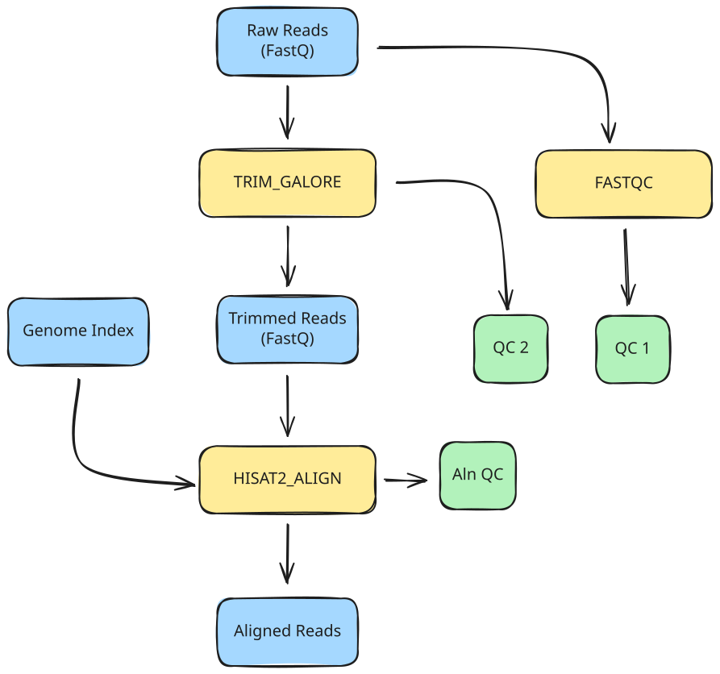

<span class="ai-translation-notice">Traduction assistée par IA - [en savoir plus et suggérer des améliorations](https://github.com/nextflow-io/training/blob/master/TRANSLATING.md)</span>

Dans cette partie du cours, nous allons développer un workflow qui automatise les étapes que nous avons exécutées manuellement dans la Partie 1, en traitant un échantillon à la fois.

:::caution[Prérequis]
Vous devez travailler la [Partie 1 : Aperçu de la méthode](./01_method.mdx) avant de commencer cette leçon.
Plus précisément, travailler la section 1.2.3 crée le fichier d'index du génome (`data/genome_index.tar.gz`) requis pour l'étape d'alignement dans cette leçon.
:::

## Objectif

Dans cette partie du cours, nous allons développer un workflow qui effectue les opérations suivantes :

1. Exécuter le contrôle qualité (FastQC) sur les lectures d'entrée
2. Nettoyer les adaptateurs et exécuter le QC post-nettoyage (Trim Galore)
3. Aligner les lectures nettoyées sur un génome de référence (HISAT2)



Cela automatise les étapes de la première section de la [Partie 1 : Aperçu de la méthode](./01_method.mdx#1-traitement-dun-échantillon-unique), où vous avez exécuté ces commandes manuellement dans leurs conteneurs.

Comme point de départ, nous vous fournissons un fichier de workflow, `rnaseq.nf`, qui décrit les parties principales du workflow, ainsi que quatre fichiers de modules dans le répertoire `modules/` (`fastqc.nf`, `trim_galore.nf`, `hisat2_align.nf`, et `multiqc.nf`) qui décrivent la structure de chaque processus.

<details class="full-code">
<summary>Fichiers squelettes</summary>

```nextflow title="rnaseq.nf"
#!/usr/bin/env nextflow

// Instructions INCLUDE de modules

/*
 * Paramètres du pipeline
 */

// Entrée principale

workflow {

    main:
    // Créer le canal d'entrée

    // Appeler les processus

    publish:
    // Déclarer les sorties à publier
}

output {
    // Configurer les cibles de publication
}
```

```nextflow title="modules/fastqc.nf"
#!/usr/bin/env nextflow

/*
 * Exécuter FastQC sur les lectures d'entrée
 */
process FASTQC {

    container

    input:

    output:

    script:
    """

    """
}
```

```nextflow title="modules/trim_galore.nf"
#!/usr/bin/env nextflow

/*
 * Nettoyer les adaptateurs et exécuter le QC post-nettoyage
 */
process TRIM_GALORE {

    container

    input:

    output:

    script:
    """

    """
}
```

```nextflow title="modules/hisat2_align.nf"
#!/usr/bin/env nextflow

/*
 * Aligner les lectures sur un génome de référence
 */
process HISAT2_ALIGN {

    container

    input:

    output:

    script:
    """

    """
}
```

```nextflow title="modules/multiqc.nf"
#!/usr/bin/env nextflow

/*
 * Agréger les rapports QC avec MultiQC
 */
process MULTIQC {

    container

    input:

    output:

    script:
    """

    """
}
```

</details>

Ces fichiers ne sont pas fonctionnels ; leur but est simplement de servir de squelettes que vous remplirez avec les parties intéressantes du code.

## Plan de la leçon

Afin de rendre le processus de développement plus pédagogique, nous avons divisé cela en trois étapes :

1. **Écrire un workflow à une seule étape qui exécute l'étape de QC initial.**
   Cela couvre la configuration d'un paramètre CLI, la création d'un canal d'entrée, l'écriture d'un module de processus et la configuration de la publication des sorties.
2. **Ajouter le nettoyage des adaptateurs et le QC post-nettoyage.**
   Cela introduit le chaînage des processus en connectant la sortie d'un processus à l'entrée d'un autre.
3. **Ajouter l'alignement sur le génome de référence.**
   Cela couvre la gestion d'entrées de référence supplémentaires et le travail avec des archives compressées.

Chaque étape se concentre sur un aspect spécifique du développement de workflow.

:::tip[Astuce]
Assurez-vous d'être dans le bon répertoire de travail :
`cd /workspaces/training/nf4-science/rnaseq`
:::

---

## 1. Écrire un workflow à une seule étape qui exécute le QC initial

Cette première étape se concentre sur les bases : charger un fichier FASTQ et exécuter le contrôle qualité dessus.

Rappelez-vous la commande `fastqc` de la [Partie 1](01_method.mdx) :

```bash
fastqc <reads>
```

La commande prend un fichier FASTQ en entrée et produit un rapport de contrôle qualité sous forme d'archive `.zip` et un résumé `.html`.
L'URI du conteneur était `community.wave.seqera.io/library/trim-galore:0.6.10--1bf8ca4e1967cd18`.

Nous allons prendre ces informations et les encapsuler dans Nextflow en trois étapes :

1. Configurer l'entrée
2. Écrire le processus QC et l'appeler dans le workflow
3. Configurer la gestion des sorties

### 1.1. Configurer l'entrée

Nous devons déclarer un paramètre d'entrée, créer un profil de test pour fournir une valeur par défaut pratique, et créer un canal d'entrée.

#### 1.1.1. Ajouter une déclaration de paramètre d'entrée

Dans `rnaseq.nf`, sous la section `Pipeline parameters`, déclarez un paramètre appelé `reads` avec le type `Path`.

<CodeWalkthrough>

```nextflow title="rnaseq.nf" showLineNumbers startLineNumber=5 step="Avant"
/*
 * Paramètres du pipeline
 */

// Entrée principale
```

```nextflow {4-7} title="rnaseq.nf" showLineNumbers startLineNumber=5 step="Après"
/*
 * Paramètres du pipeline
 */
params {
    // Entrée principale
    input: Path
}
```

</CodeWalkthrough>

Cela configure le paramètre CLI, mais nous ne voulons pas taper le chemin du fichier à chaque fois que nous exécutons le workflow pendant le développement.
Il existe plusieurs options pour fournir une valeur par défaut ; ici nous utilisons un profil de test.

#### 1.1.2. Créer un profil de test avec une valeur par défaut dans `nextflow.config`

Un profil de test fournit des valeurs par défaut pratiques pour essayer un workflow sans spécifier d'entrées sur la ligne de commande.
C'est une convention courante dans l'écosystème Nextflow (voir [Hello Config](../../hello_nextflow/06_hello_config.mdx) pour plus de détails).

Ajoutez un bloc `profiles` à `nextflow.config` avec un profil `test` qui définit le paramètre `reads` sur l'un des fichiers FASTQ de test.

<CodeWalkthrough>

```nextflow title="nextflow.config" showLineNumbers step="Avant"
docker.enabled = true
```

```nextflow {3-7} title="nextflow.config" showLineNumbers step="Après"
docker.enabled = true

profiles {
    test {
        params.input = "${projectDir}/data/reads/ENCSR000COQ1_1.fastq.gz"
    }
}
```

</CodeWalkthrough>

Ici, nous utilisons `${projectDir}{:nextflow}`, une variable intégrée de Nextflow qui pointe vers le répertoire où se trouve le script de workflow.
Cela facilite le référencement des fichiers de données et autres ressources sans coder en dur des chemins absolus.

Le paramètre a maintenant une valeur par défaut pratique. Ensuite, nous devons créer un canal à partir de celui-ci.

#### 1.1.3. Configurer le canal d'entrée

Dans le bloc workflow, créez un canal d'entrée à partir de la valeur du paramètre en utilisant la fabrique de canaux `.fromPath` (comme utilisée dans [Hello Channels](../../hello_nextflow/02_hello_channels.mdx)).

<CodeWalkthrough>

```nextflow title="rnaseq.nf" showLineNumbers startLineNumber=13 step="Avant"
workflow {

    main:
    // Créer le canal d'entrée

    // Appeler les processus

    publish:
    // Déclarer les sorties à publier
}
```

```nextflow {4-5} title="rnaseq.nf" showLineNumbers startLineNumber=13 step="Après"
workflow {

    main:
    // Créer le canal d'entrée à partir d'un chemin de fichier
    read_ch = channel.fromPath(params.input)

    // Appeler les processus

    publish:
    // Déclarer les sorties à publier
}
```

</CodeWalkthrough>

Ensuite, nous devrons créer le processus pour exécuter le QC sur cette entrée.

### 1.2. Écrire le processus QC et l'appeler dans le workflow

Nous devons remplir la définition du processus dans le fichier de module, l'importer dans le workflow en utilisant une instruction include, et l'appeler sur l'entrée.

#### 1.2.1. Remplir le module pour le processus QC

Ouvrez `modules/fastqc.nf` et examinez la structure de la définition du processus.
Vous devriez reconnaître les principaux éléments structurels ; sinon, envisagez de lire [Hello Nextflow](../../hello_nextflow/01_hello_world.mdx) pour un rappel.

Allez-y et remplissez la définition du processus par vous-même en utilisant les informations fournies ci-dessus, puis vérifiez votre travail par rapport à la solution dans l'onglet "Après" ci-dessous.

<CodeWalkthrough>

```nextflow title="modules/fastqc.nf" showLineNumbers step="Avant"
#!/usr/bin/env nextflow

/*
 * Exécuter FastQC sur les lectures d'entrée
 */
process FASTQC {

    container

    input:

    output:

    script:
    """

    """
}
```

```nextflow {8,11,14,15,19} title="modules/fastqc.nf" showLineNumbers step="Après"
#!/usr/bin/env nextflow

/*
 * Exécuter FastQC sur les lectures d'entrée
 */
process FASTQC {

    container "community.wave.seqera.io/library/trim-galore:0.6.10--1bf8ca4e1967cd18"

    input:
    path reads

    output:
    path "${reads.simpleName}_fastqc.zip", emit: zip
    path "${reads.simpleName}_fastqc.html", emit: html

    script:
    """
    fastqc ${reads}
    """
}
```

</CodeWalkthrough>

L'accesseur `simpleName` supprime toutes les extensions du nom de fichier, donc `ENCSR000COQ1_1.fastq.gz` devient `ENCSR000COQ1_1`.
Nous utilisons la syntaxe `emit:` pour assigner des noms à chaque canal de sortie, ce qui sera utile pour connecter les sorties au bloc publish.

Une fois que vous avez terminé cela, le processus est complet.
Pour l'utiliser dans le workflow, vous devrez importer le module et ajouter un appel de processus.

#### 1.2.2. Inclure le module

Dans `rnaseq.nf`, ajoutez une instruction `include` pour rendre le processus disponible au workflow :

<CodeWalkthrough>

```nextflow title="rnaseq.nf" showLineNumbers startLineNumber=3 step="Avant"
// Instructions INCLUDE de modules
```

```nextflow {2} title="rnaseq.nf" showLineNumbers startLineNumber=3 step="Après"
// Instructions INCLUDE de modules
include { FASTQC } from './modules/fastqc.nf'
```

</CodeWalkthrough>

Le processus est maintenant disponible dans la portée du workflow.

#### 1.2.3. Appeler le processus QC sur l'entrée

Ajoutez un appel à `FASTQC` dans le bloc workflow, en passant le canal d'entrée comme argument.

<CodeWalkthrough>

```nextflow title="rnaseq.nf" showLineNumbers startLineNumber=14 step="Avant"
workflow {

    main:
    // Créer le canal d'entrée à partir d'un chemin de fichier
    read_ch = channel.fromPath(params.input)

    // Appeler les processus

    publish:
    // Déclarer les sorties à publier
}
```

```nextflow {7-8} title="rnaseq.nf" showLineNumbers startLineNumber=14 step="Après"
workflow {

    main:
    // Créer le canal d'entrée à partir d'un chemin de fichier
    read_ch = channel.fromPath(params.input)

    // Contrôle qualité initial
    FASTQC(read_ch)

    publish:
    // Déclarer les sorties à publier
}
```

</CodeWalkthrough>

Le workflow charge maintenant l'entrée et exécute le processus QC dessus.
Ensuite, nous devons configurer comment la sortie est publiée.

### 1.3. Configurer la gestion des sorties

Nous devons déclarer quelles sorties de processus publier et spécifier où elles doivent aller.

#### 1.3.1. Déclarer les sorties dans la section `publish:`

La section `publish:` à l'intérieur du bloc workflow déclare quelles sorties de processus doivent être publiées.
Assignez les sorties de `FASTQC` à des cibles nommées.

<CodeWalkthrough>

```nextflow title="rnaseq.nf" showLineNumbers startLineNumber=23 step="Avant"
    publish:
    // Déclarer les sorties à publier
}
```

```nextflow {2-3} title="rnaseq.nf" showLineNumbers startLineNumber=23 step="Après"
    publish:
    fastqc_zip = FASTQC.out.zip
    fastqc_html = FASTQC.out.html
}
```

</CodeWalkthrough>

Ensuite, nous devrons indiquer à Nextflow où placer les sorties publiées.

#### 1.3.2. Configurer les cibles de sortie dans le bloc `output {}`

Le bloc `output {}` se situe en dehors du workflow et spécifie où chaque cible nommée est publiée.
Configurez les deux cibles pour publier dans un sous-répertoire `fastqc/`.

<CodeWalkthrough>

```nextflow title="rnaseq.nf" showLineNumbers startLineNumber=28 step="Avant"
output {
    // Configurer les cibles de publication
}
```

```nextflow {2-7} title="rnaseq.nf" showLineNumbers startLineNumber=28 step="Après"
output {
    fastqc_zip {
        path 'fastqc'
    }
    fastqc_html {
        path 'fastqc'
    }
}
```

</CodeWalkthrough>

:::note[Note]
Par défaut, Nextflow publie les fichiers de sortie sous forme de liens symboliques, ce qui évite une duplication inutile.
Même si les fichiers de données que nous utilisons ici sont très petits, en génomique ils peuvent devenir très volumineux.
Les liens symboliques seront rompus lorsque vous nettoierez votre répertoire `work`, donc pour les workflows de production vous voudrez peut-être remplacer le mode de publication par défaut par `'copy'`.
:::

### 1.4. Exécuter le workflow

À ce stade, nous avons un workflow QC en une étape qui devrait être entièrement fonctionnel.

Nous exécutons avec `-profile test` pour utiliser la valeur par défaut configurée dans le profil de test, évitant ainsi d'avoir à écrire le chemin sur la ligne de commande.

```bash
nextflow run rnaseq.nf -profile test
# [!output]
 N E X T F L O W   ~  version 26.04.4

Launching `rnaseq.nf` [fabulous_engelbart] revision: 859d80cde8

executor >  local (1)
[4e/36fb3d] FASTQC (1) | 1 of 1 ✔

Outputs:

  /workspaces/training/nf4-science/rnaseq/results

  fastqc_zip:
    - fastqc/ENCSR000COQ1_1_fastqc.zip

  fastqc_html:
    - fastqc/ENCSR000COQ1_1_fastqc.html
```

Cela devrait s'exécuter très rapidement si vous avez travaillé la Partie 1 et avez déjà téléchargé le conteneur.
Si vous l'avez sautée, Nextflow téléchargera le conteneur pour vous ; vous n'avez rien à faire pour que cela se produise, mais vous devrez peut-être attendre jusqu'à une minute.

Vous pouvez vérifier les sorties dans le répertoire results.

```bash
ls results/fastqc
```

```console title="Output"
ENCSR000COQ1_1_fastqc.html  ENCSR000COQ1_1_fastqc.zip
```

Les rapports QC pour l'échantillon sont maintenant publiés dans le sous-répertoire `fastqc/`.

### À retenir

Vous savez comment créer un module contenant un processus, l'importer dans un workflow, l'appeler avec un canal d'entrée, et publier les résultats en utilisant le bloc output au niveau du workflow.

### Et ensuite ?

Ajoutez le nettoyage des adaptateurs avec le QC post-nettoyage comme deuxième étape dans le workflow.

---

## 2. Ajouter le nettoyage des adaptateurs et le contrôle qualité post-nettoyage

Maintenant que nous avons le QC initial en place, nous pouvons ajouter l'étape de nettoyage des adaptateurs avec son QC post-nettoyage intégré.

Rappelez-vous la commande `trim_galore` de la [Partie 1](01_method.mdx) :

```bash
trim_galore --fastqc <reads>
```

La commande nettoie les adaptateurs d'un fichier FASTQ et exécute FastQC sur la sortie nettoyée.
Elle produit des lectures nettoyées, un rapport de nettoyage et des rapports FastQC pour les lectures nettoyées.
L'URI du conteneur était `community.wave.seqera.io/library/trim-galore:0.6.10--1bf8ca4e1967cd18`.

Nous devons simplement écrire la définition du processus, l'importer, l'appeler dans le workflow et mettre à jour la gestion des sorties.

### 2.1. Écrire le processus de nettoyage et l'appeler dans le workflow

Comme précédemment, nous devons remplir la définition du processus, importer le module et ajouter l'appel de processus.

#### 2.1.1. Remplir le module pour le processus de nettoyage

Ouvrez `modules/trim_galore.nf` et examinez la structure de la définition du processus.

Allez-y et remplissez la définition du processus par vous-même en utilisant les informations fournies ci-dessus, puis vérifiez votre travail par rapport à la solution dans l'onglet "Après" ci-dessous.

<CodeWalkthrough>

```nextflow title="modules/trim_galore.nf" showLineNumbers step="Avant"
#!/usr/bin/env nextflow

/*
 * Nettoyer les adaptateurs et exécuter le QC post-nettoyage
 */
process TRIM_GALORE {

    container

    input:

    output:

    script:
    """

    """
}
```

```nextflow {8,11,14,15,16,20} title="modules/trim_galore.nf" showLineNumbers step="Après"
#!/usr/bin/env nextflow

/*
 * Nettoyer les adaptateurs et exécuter le QC post-nettoyage
 */
process TRIM_GALORE {

    container "community.wave.seqera.io/library/trim-galore:0.6.10--1bf8ca4e1967cd18"

    input:
    path reads

    output:
    path "${reads.simpleName}_trimmed.fq.gz", emit: trimmed_reads
    path "${reads}_trimming_report.txt", emit: trimming_reports
    path "${reads.simpleName}_trimmed_fastqc.{zip,html}", emit: fastqc_reports

    script:
    """
    trim_galore --fastqc ${reads}
    """
}
```

</CodeWalkthrough>

Ce processus a trois sorties nommées : les lectures nettoyées qui alimentent l'étape d'alignement, le rapport de nettoyage et les rapports FastQC post-nettoyage.
Le flag `--fastqc` indique à Trim Galore d'exécuter automatiquement FastQC sur la sortie nettoyée.

#### 2.1.2. Inclure le module

Mettez à jour `rnaseq.nf` pour importer le nouveau module :

<CodeWalkthrough>

```nextflow title="rnaseq.nf" showLineNumbers startLineNumber=3 step="Avant"
// Instructions INCLUDE de modules
include { FASTQC } from './modules/fastqc.nf'
```

```nextflow {3} title="rnaseq.nf" showLineNumbers startLineNumber=3 step="Après"
// Instructions INCLUDE de modules
include { FASTQC } from './modules/fastqc.nf'
include { TRIM_GALORE } from './modules/trim_galore.nf'
```

</CodeWalkthrough>

Ensuite, nous ajouterons l'appel de processus au workflow.

#### 2.1.3. Appeler le processus de nettoyage sur l'entrée

Ajoutez l'appel de processus dans le bloc workflow :

<CodeWalkthrough>

```nextflow title="rnaseq.nf" showLineNumbers startLineNumber=15 step="Avant"
workflow {

    main:
    // Créer le canal d'entrée à partir d'un chemin de fichier
    read_ch = channel.fromPath(params.input)

    // Contrôle qualité initial
    FASTQC(read_ch)

    publish:
    fastqc_zip = FASTQC.out.zip
    fastqc_html = FASTQC.out.html
}
```

```nextflow {10-11} title="rnaseq.nf" showLineNumbers startLineNumber=15 step="Après"
workflow {

    main:
    // Créer le canal d'entrée à partir d'un chemin de fichier
    read_ch = channel.fromPath(params.input)

    // Contrôle qualité initial
    FASTQC(read_ch)

    // Nettoyage des adaptateurs et QC post-nettoyage
    TRIM_GALORE(read_ch)

    publish:
    fastqc_zip = FASTQC.out.zip
    fastqc_html = FASTQC.out.html
}
```

</CodeWalkthrough>

Le processus de nettoyage est maintenant intégré dans le workflow.

### 2.2. Mettre à jour la gestion des sorties

Nous devons ajouter les sorties de nettoyage à la déclaration de publication et configurer où elles vont.

#### 2.2.1. Ajouter des cibles de publication pour les sorties de nettoyage

Ajoutez les sorties de nettoyage à la section `publish:` :

<CodeWalkthrough>

```nextflow title="rnaseq.nf" showLineNumbers startLineNumber=27 step="Avant"
    publish:
    fastqc_zip = FASTQC.out.zip
    fastqc_html = FASTQC.out.html
}
```

```nextflow {4-6} title="rnaseq.nf" showLineNumbers startLineNumber=27 step="Après"
    publish:
    fastqc_zip = FASTQC.out.zip
    fastqc_html = FASTQC.out.html
    trimmed_reads = TRIM_GALORE.out.trimmed_reads
    trimming_reports = TRIM_GALORE.out.trimming_reports
    trimming_fastqc = TRIM_GALORE.out.fastqc_reports
}
```

</CodeWalkthrough>

Ensuite, nous devrons indiquer à Nextflow où placer ces sorties.

#### 2.2.2. Configurer les nouvelles cibles de sortie

Ajoutez des entrées pour les cibles de nettoyage dans le bloc `output {}`, en les publiant dans un sous-répertoire `trimming/` :

<CodeWalkthrough>

```nextflow title="rnaseq.nf" showLineNumbers startLineNumber=35 step="Avant"
output {
    fastqc_zip {
        path 'fastqc'
    }
    fastqc_html {
        path 'fastqc'
    }
}
```

```nextflow {8-16} title="rnaseq.nf" showLineNumbers startLineNumber=35 step="Après"
output {
    fastqc_zip {
        path 'fastqc'
    }
    fastqc_html {
        path 'fastqc'
    }
    trimmed_reads {
        path 'trimming'
    }
    trimming_reports {
        path 'trimming'
    }
    trimming_fastqc {
        path 'trimming'
    }
}
```

</CodeWalkthrough>

La configuration de sortie est complète.

### 2.3. Exécuter le workflow

Le workflow inclut maintenant à la fois le QC initial et le nettoyage des adaptateurs.

```bash
nextflow run rnaseq.nf -profile test
# [!output]
 N E X T F L O W   ~  version 26.04.4

Launching `rnaseq.nf` [stupefied_volhard] revision: faaf310b2f

executor >  local (2)
[a3/ac9284] FASTQC (1)      | 1 of 1 ✔
[55/c4d983] TRIM_GALORE (1) | 1 of 1 ✔

Outputs:

  /workspaces/training/nf4-science/rnaseq/results

  fastqc_zip:
    - fastqc/ENCSR000COQ1_1_fastqc.zip

  fastqc_html:
    - fastqc/ENCSR000COQ1_1_fastqc.html

  trimmed_reads:
    - trimming/ENCSR000COQ1_1_trimmed.fq.gz

  trimming_reports:
    - trimming/ENCSR000COQ1_1.fastq.gz_trimming_report.txt

  trimming_fastqc:
    - [trimming/ENCSR000COQ1_1_trimmed_fastqc.html, trimming/ENCSR000COQ1_1_trimmed_fastqc.zip]
```

Cela devrait également s'exécuter très rapidement, car nous travaillons sur un fichier d'entrée si petit.

Vous pouvez trouver les sorties de nettoyage dans le répertoire results.

```bash
ls results/trimming
```

```console title="Output"
ENCSR000COQ1_1.fastq.gz_trimming_report.txt  ENCSR000COQ1_1_trimmed_fastqc.zip
ENCSR000COQ1_1_trimmed_fastqc.html           ENCSR000COQ1_1_trimmed.fq.gz
```

Les sorties de nettoyage et les rapports QC post-nettoyage sont maintenant dans le sous-répertoire `trimming/`.

### À retenir

Vous savez comment ajouter une deuxième étape de traitement qui s'exécute indépendamment sur la même entrée, produisant plusieurs sorties nommées.

### Et ensuite ?

Ajoutez l'étape d'alignement qui s'enchaîne à partir de la sortie des lectures nettoyées.

---

## 3. Ajouter l'alignement sur le génome de référence

Finalement, nous pouvons ajouter l'étape d'alignement du génome en utilisant HISAT2.

Rappelez-vous la commande d'alignement de la [Partie 1](01_method.mdx) :

```bash
hisat2 -x <genome_index> -U <reads> \
    --new-summary --summary-file <reads>.hisat2.log | \
    samtools view -bS -o <reads>.bam
```

La commande aligne les lectures sur un génome de référence et convertit la sortie au format BAM.
Elle nécessite une archive d'index de génome pré-construite et produit un fichier BAM et un journal récapitulatif d'alignement.
L'URI du conteneur était `community.wave.seqera.io/library/hisat2_samtools:5e49f68a37dc010e`.

Ce processus nécessite une entrée supplémentaire (l'archive d'index du génome), nous devons donc d'abord la configurer, puis écrire et connecter le processus.

### 3.1. Configurer les entrées

Nous devons déclarer un paramètre pour l'archive d'index du génome.

#### 3.1.1. Ajouter un paramètre pour l'index du génome

Ajoutez une déclaration de paramètre pour l'archive d'index du génome dans `rnaseq.nf` :

<CodeWalkthrough>

```nextflow title="rnaseq.nf" showLineNumbers startLineNumber=11 step="Avant"
params {
    // Entrée principale
    input: Path
}
```

```nextflow {5-6} title="rnaseq.nf" showLineNumbers startLineNumber=11 step="Après"
params {
    // Entrée principale
    input: Path

    // Archive du génome de référence
    hisat2_index_zip: Path
}
```

</CodeWalkthrough>

#### 3.1.2. Ajouter la valeur par défaut de l'index du génome au profil de test

Tout comme nous l'avons fait pour `reads` dans la section 1.1.2, ajoutez une valeur par défaut pour l'index du génome au profil de test dans `nextflow.config` :

<CodeWalkthrough>

```nextflow title="nextflow.config" showLineNumbers step="Avant"
docker.enabled = true

profiles {
    test {
        params.input = "${projectDir}/data/reads/ENCSR000COQ1_1.fastq.gz"
    }
}
```

```nextflow {6} title="nextflow.config" showLineNumbers step="Après"
docker.enabled = true

profiles {
    test {
        params.input = "${projectDir}/data/reads/ENCSR000COQ1_1.fastq.gz"
        params.hisat2_index_zip = "${projectDir}/data/genome_index.tar.gz"
    }
}
```

</CodeWalkthrough>

Le paramètre est prêt ; nous pouvons maintenant créer le processus d'alignement.

### 3.2. Écrire le processus d'alignement et l'appeler dans le workflow

Comme précédemment, nous devons remplir la définition du processus, importer le module et ajouter l'appel de processus.

#### 3.2.1. Remplir le module pour le processus d'alignement

Ouvrez `modules/hisat2_align.nf` et examinez la structure de la définition du processus.

Allez-y et remplissez la définition du processus par vous-même en utilisant les informations fournies ci-dessus, puis vérifiez votre travail par rapport à la solution dans l'onglet "Après" ci-dessous.

<CodeWalkthrough>

```nextflow title="modules/hisat2_align.nf" showLineNumbers step="Avant"
#!/usr/bin/env nextflow

/*
 * Aligner les lectures sur un génome de référence
 */
process HISAT2_ALIGN {

    container

    input:

    output:

    script:
    """

    """
}
```

```nextflow {8,11,12,15,16,20,21,22,23} title="modules/hisat2_align.nf" showLineNumbers step="Après"
#!/usr/bin/env nextflow

/*
 * Aligner les lectures sur un génome de référence
 */
process HISAT2_ALIGN {

    container "community.wave.seqera.io/library/hisat2_samtools:5e49f68a37dc010e"

    input:
    path reads
    path index_zip

    output:
    path "${reads.simpleName}.bam", emit: bam
    path "${reads.simpleName}.hisat2.log", emit: log

    script:
    """
    tar -xzvf ${index_zip}
    hisat2 -x ${index_zip.simpleName} -U ${reads} \
        --new-summary --summary-file ${reads.simpleName}.hisat2.log | \
        samtools view -bS -o ${reads.simpleName}.bam
    """
}
```

</CodeWalkthrough>

Ce processus prend deux entrées : les lectures et l'archive d'index du génome.
Le bloc script extrait d'abord l'index de l'archive, puis exécute l'alignement HISAT2 redirigé vers `samtools view` pour convertir la sortie au format BAM.
L'accesseur `simpleName` sur `index_zip` extrait le nom de base de l'archive (`genome_index`) à utiliser comme préfixe d'index.

#### 3.2.2. Inclure le module

Mettez à jour `rnaseq.nf` pour importer le nouveau module :

<CodeWalkthrough>

```nextflow title="rnaseq.nf" showLineNumbers startLineNumber=3 step="Avant"
// Instructions INCLUDE de modules
include { FASTQC } from './modules/fastqc.nf'
include { TRIM_GALORE } from './modules/trim_galore.nf'
```

```nextflow {4} title="rnaseq.nf" showLineNumbers startLineNumber=3 step="Après"
// Instructions INCLUDE de modules
include { FASTQC } from './modules/fastqc.nf'
include { TRIM_GALORE } from './modules/trim_galore.nf'
include { HISAT2_ALIGN } from './modules/hisat2_align.nf'
```

</CodeWalkthrough>

Ensuite, nous ajouterons l'appel de processus au workflow.

#### 3.2.3. Appeler le processus d'alignement

Les lectures nettoyées sont dans le canal de sortie `TRIM_GALORE.out.trimmed_reads` produit par l'étape précédente.
Nous utilisons `file(params.hisat2_index_zip){:nextflow}` pour fournir l'archive d'index du génome.

<CodeWalkthrough>

```nextflow title="rnaseq.nf" showLineNumbers startLineNumber=19 step="Avant"
workflow {

    main:
    // Créer le canal d'entrée à partir d'un chemin de fichier
    read_ch = channel.fromPath(params.input)

    // Contrôle qualité initial
    FASTQC(read_ch)

    // Nettoyage des adaptateurs et QC post-nettoyage
    TRIM_GALORE(read_ch)
```

```nextflow {13-14} title="rnaseq.nf" showLineNumbers startLineNumber=19 step="Après"
workflow {

    main:
    // Créer le canal d'entrée à partir d'un chemin de fichier
    read_ch = channel.fromPath(params.input)

    // Contrôle qualité initial
    FASTQC(read_ch)

    // Nettoyage des adaptateurs et QC post-nettoyage
    TRIM_GALORE(read_ch)

    // Alignement sur un génome de référence
    HISAT2_ALIGN(TRIM_GALORE.out.trimmed_reads, file(params.hisat2_index_zip))
```

</CodeWalkthrough>

Le processus d'alignement est maintenant intégré dans le workflow.

### 3.3. Mettre à jour la gestion des sorties

Nous devons ajouter les sorties d'alignement à la déclaration de publication et configurer où elles vont.

#### 3.3.1. Ajouter des cibles de publication pour les sorties d'alignement

Ajoutez les sorties d'alignement à la section `publish:` :

<CodeWalkthrough>

```nextflow title="rnaseq.nf" showLineNumbers startLineNumber=34 step="Avant"
    publish:
    fastqc_zip = FASTQC.out.zip
    fastqc_html = FASTQC.out.html
    trimmed_reads = TRIM_GALORE.out.trimmed_reads
    trimming_reports = TRIM_GALORE.out.trimming_reports
    trimming_fastqc = TRIM_GALORE.out.fastqc_reports
}
```

```nextflow {7-8} title="rnaseq.nf" showLineNumbers startLineNumber=34 step="Après"
    publish:
    fastqc_zip = FASTQC.out.zip
    fastqc_html = FASTQC.out.html
    trimmed_reads = TRIM_GALORE.out.trimmed_reads
    trimming_reports = TRIM_GALORE.out.trimming_reports
    trimming_fastqc = TRIM_GALORE.out.fastqc_reports
    bam = HISAT2_ALIGN.out.bam
    align_log = HISAT2_ALIGN.out.log
}
```

</CodeWalkthrough>

Ensuite, nous devrons indiquer à Nextflow où placer ces sorties.

#### 3.3.2. Configurer les nouvelles cibles de sortie

Ajoutez des entrées pour les cibles d'alignement dans le bloc `output {}`, en les publiant dans un sous-répertoire `align/` :

<CodeWalkthrough>

```nextflow title="rnaseq.nf" showLineNumbers startLineNumber=44 step="Avant"
output {
    fastqc_zip {
        path 'fastqc'
    }
    fastqc_html {
        path 'fastqc'
    }
    trimmed_reads {
        path 'trimming'
    }
    trimming_reports {
        path 'trimming'
    }
    trimming_fastqc {
        path 'trimming'
    }
}
```

```nextflow {17-22} title="rnaseq.nf" showLineNumbers startLineNumber=44 step="Après"
output {
    fastqc_zip {
        path 'fastqc'
    }
    fastqc_html {
        path 'fastqc'
    }
    trimmed_reads {
        path 'trimming'
    }
    trimming_reports {
        path 'trimming'
    }
    trimming_fastqc {
        path 'trimming'
    }
    bam {
        path 'align'
    }
    align_log {
        path 'align'
    }
}
```

</CodeWalkthrough>

La configuration de sortie est complète.

### 3.4. Exécuter le workflow

Le workflow inclut maintenant les trois étapes de traitement : QC, nettoyage et alignement.

```bash
nextflow run rnaseq.nf -profile test
# [!output]
 N E X T F L O W   ~  version 26.04.4

Launching `rnaseq.nf` [nauseous_allen] revision: 45d77a9709

executor >  local (3)
[57/b3c2cb] FASTQC (1)       | 1 of 1 ✔
[98/451aef] TRIM_GALORE (1)  | 1 of 1 ✔
[78/7cf2c3] HISAT2_ALIGN (1) | 1 of 1 ✔

Outputs:

  /workspaces/training/nf4-science/rnaseq/results

  fastqc_zip:
    - fastqc/ENCSR000COQ1_1_fastqc.zip

  fastqc_html:
    - fastqc/ENCSR000COQ1_1_fastqc.html

  trimmed_reads:
    - trimming/ENCSR000COQ1_1_trimmed.fq.gz

  trimming_reports:
    - trimming/ENCSR000COQ1_1.fastq.gz_trimming_report.txt

  trimming_fastqc:
    - [trimming/ENCSR000COQ1_1_trimmed_fastqc.html, trimming/ENCSR000COQ1_1_trimmed_fastqc.zip]

  bam:
    - align/ENCSR000COQ1_1_trimmed.bam

  align_log:
    - align/ENCSR000COQ1_1_trimmed.hisat2.log
```

Vous pouvez trouver les sorties d'alignement dans le répertoire results.

```bash
ls results/align
```

```console title="Output"
ENCSR000COQ1_1_trimmed.bam  ENCSR000COQ1_1_trimmed.hisat2.log
```

Cela complète le traitement de base que nous devons appliquer à chaque échantillon.

_Nous ajouterons l'agrégation de rapports MultiQC dans la Partie 3, après avoir fait en sorte que le workflow accepte plusieurs échantillons à la fois._

---

### À retenir

Vous savez comment encapsuler toutes les étapes principales pour traiter des échantillons RNAseq single-end individuellement.

### Et ensuite ?

Faites une pause ! C'était beaucoup.

Lorsque vous vous sentirez reposé·e, passez à la [Partie 3](./03_multi-sample.mdx), où vous apprendrez comment modifier le workflow pour traiter plusieurs échantillons en parallèle, agréger les rapports QC sur toutes les étapes pour tous les échantillons, et permettre l'exécution du workflow sur des données RNAseq paired-end.
