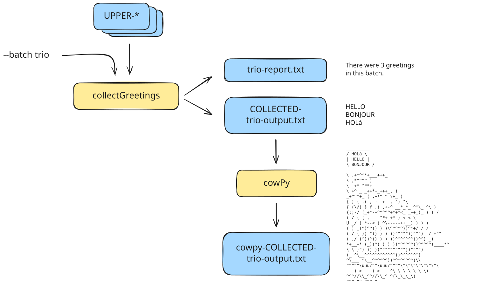
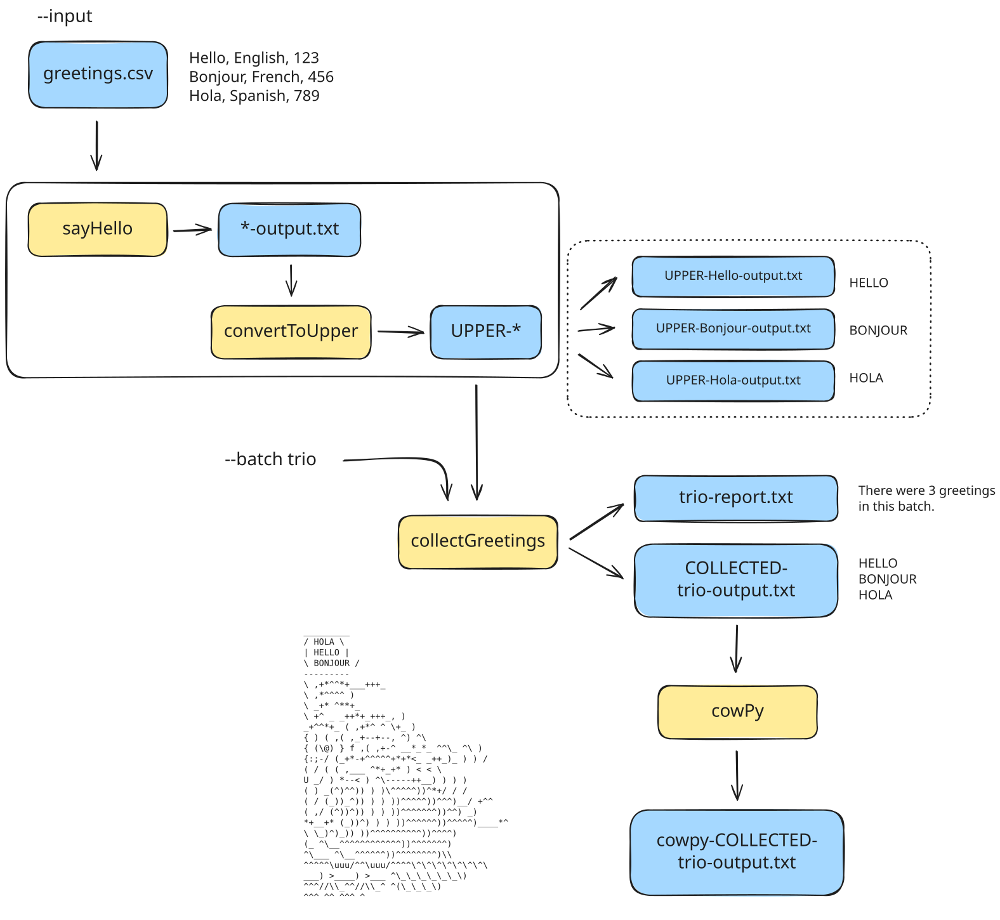

<span class="ai-translation-notice">Traduzione assistita da IA - [scopri di più e suggerisci miglioramenti](https://github.com/nextflow-io/training/blob/master/TRANSLATING.md)</span>

<figure>
<div class="video-wrapper">
  <iframe width="560" height="315" src="https://www.youtube.com/embed/Xqr--bKEN9U?si=y8lAedhEHWaTV4zd&amp;list=PLPZ8WHdZGxmWKozQuzr27jyMGqp9kElVK&amp;cc_load_policy=1" title="YouTube video player" frameborder="0" allow="accelerometer; autoplay; clipboard-write; encrypted-media; gyroscope; picture-in-picture; web-share" referrerpolicy="strict-origin-when-cross-origin" allowfullscreen></iframe>
</div>
<figcaption>

Guarda [l'intera playlist](https://youtube.com/playlist?list=PLPZ8WHdZGxmWKozQuzr27jyMGqp9kElVK&si=eF7cLR62goy-lc6n) sul canale YouTube di Nextflow.

📗 La trascrizione del video è disponibile [qui](./transcripts/05_hello_containers.mdx).

</figcaption>
</figure>

Nelle Parti 1-4 di questo corso di formazione, avete imparato come usare i blocchi di costruzione di base di Nextflow per assemblare un semplice flusso di lavoro capace di elaborare del testo, parallelizzare l'esecuzione se ci sono più input, e raccogliere i risultati per ulteriori elaborazioni.

Tuttavia, eravate limitati agli strumenti UNIX di base disponibili nel vostro ambiente.
Le attività del mondo reale spesso richiedono vari strumenti e pacchetti non inclusi di default.
Tipicamente, dovreste installare questi strumenti, gestire le loro dipendenze e risolvere eventuali conflitti.

Tutto ciò è molto tedioso e fastidioso, quindi vi mostreremo come usare i **container** per risolvere questo problema in modo molto più conveniente.

Un **container** è un'unità di software leggera, autonoma ed eseguibile creata da un'**immagine** container che include tutto il necessario per eseguire un'applicazione, incluso codice, librerie di sistema e impostazioni.
Come potete immaginare, questo sarà molto utile per rendere le vostre pipeline più riproducibili.

Nota che insegneremo questo usando [Docker](https://www.docker.com/get-started/), ma tenete presente che Nextflow supporta anche [diverse altre tecnologie container](https://nextflow.io/docs/latest/container.html).

<details class="info">
<summary>Come iniziare da questa sezione</summary>

Questa sezione del corso presuppone che abbiate completato le Parti 1-4 del corso [Hello Nextflow](./index.mdx) e abbiate una pipeline funzionante completa.

Se state iniziando il corso da questo punto, dovrete copiare la directory `modules` dalle soluzioni:

```bash
cp -r solutions/4-hello-modules/modules .
```

</details>

---

## 0. Riscaldamento: Eseguire `hello-containers.nf`

Useremo lo script del flusso di lavoro `hello-containers.nf` come punto di partenza.
È equivalente allo script prodotto seguendo la Parte 4 di questo corso di formazione, tranne che abbiamo cambiato le destinazioni dell'output:

```nextflow {3,7,11,15} title="hello-containers.nf" showLineNumbers startLineNumber=37
output {
    first_output {
        path 'hello_containers'
        mode 'copy'
    }
    uppercased {
        path 'hello_containers'
        mode 'copy'
    }
    collected {
        path 'hello_containers'
        mode 'copy'
    }
    batch_report {
        path 'hello_containers'
        mode 'copy'
    }
}
```

Solo per assicurarci che tutto funzioni, eseguiamo lo script una volta prima di apportare modifiche:

```bash
nextflow run hello-containers.nf
# [!output]
N E X T F L O W   ~  version 26.04.4

Launching `hello-containers.nf` [nice_escher] revision: d5dfdc9872

executor >  local (7)
[5a/ec1fa1] sayHello (2)       | 3 of 3 ✔
[30/32b5b8] convertToUpper (3) | 3 of 3 ✔
[d3/be01bc] collectGreetings   | 1 of 1 ✔

Outputs:

  /workspaces/training/hello-nextflow/results

  first_output:
    - hello_containers/Hola-output.txt
    - hello_containers/Bonjour-output.txt
    - hello_containers/Hello-output.txt
  uppercased:
    - hello_containers/UPPER-Bonjour-output.txt
    - hello_containers/UPPER-Hola-output.txt
    - hello_containers/UPPER-Hello-output.txt
  collected: hello_containers/COLLECTED-batch-output.txt
  batch_report: hello_containers/batch-report.txt
```

Come in precedenza, troverete i file di output nella directory specificata nel blocco `output` (`results/hello_containers/`).

<details class="abstract">
<summary>Contenuto della directory</summary>

```console
results/hello_containers/
├── Bonjour-output.txt
├── COLLECTED-batch-output.txt
├── Hello-output.txt
├── Hola-output.txt
├── batch-report.txt
├── UPPER-Bonjour-output.txt
├── UPPER-Hello-output.txt
└── UPPER-Hola-output.txt
```

</details>

Se tutto ha funzionato, siete pronti a imparare come usare i container.

---

## 1. Usare un container 'manualmente'

Quello che vogliamo fare è aggiungere un passaggio al nostro flusso di lavoro che userà un container per l'esecuzione.

Tuttavia, prima esamineremo alcuni concetti e operazioni di base per consolidare la vostra comprensione di cosa sono i container prima di iniziare a usarli in Nextflow.

### 1.1. Scaricare l'immagine del container

Per usare un container, di solito si scarica o si fa il _pull_ di un'immagine container da un registro container, e poi si esegue l'immagine container per creare un'istanza container.

La sintassi generale è la seguente:

```bash title="Syntax"
docker pull '<container>'
```

La parte `docker pull` è l'istruzione al sistema container per scaricare un'immagine container da un repository.

La parte `'<container>'` è l'indirizzo URI dell'immagine container.

Come esempio, scarichiamo un'immagine container che contiene [cowpy](https://github.com/jeffbuttars/cowpy), un'implementazione Python di uno strumento chiamato `cowsay` che genera ASCII art per visualizzare input di testo arbitrari in modo divertente.

```txt title="Example"
 ________________________
< Are we having fun yet? >
 ------------------------
    \                                  ___-------___
     \                             _-~~             ~~-_
      \                         _-~                    /~-_
             /^\__/^\         /~  \                   /    \
           /|  O|| O|        /      \_______________/        \
          | |___||__|      /       /                \          \
          |          \    /      /                    \          \
          |   (_______) /______/                        \_________ \
          |         / /         \                      /            \
           \         \^\\         \                  /               \     /
             \         ||           \______________/      _-_       //\__//
               \       ||------_-~~-_ ------------- \ --/~   ~\    || __/
                 ~-----||====/~     |==================|       |/~~~~~
                  (_(__/  ./     /                    \_\      \.
                         (_(___/                         \_____)_)
```

Ci sono vari repository dove potete trovare container pubblicati.
Abbiamo usato il servizio [Seqera Containers](https://seqera.io/containers/) per generare questa immagine Docker container dal pacchetto Conda `cowpy`: `'community.wave.seqera.io/library/cowpy:1.1.5--3db457ae1977a273'`.

Eseguite il comando pull completo:

```bash
docker pull 'community.wave.seqera.io/library/cowpy:1.1.5--3db457ae1977a273'
# [!output]
1.1.5--3db457ae1977a273: Pulling from library/cowpy
dafa2b0c44d2: Pull complete
dec6b097362e: Pull complete
f88da01cff0b: Pull complete
4f4fb700ef54: Pull complete
92dc97a3ef36: Pull complete
403f74b0f85e: Pull complete
10b8c00c10a5: Pull complete
17dc7ea432cc: Pull complete
bb36d6c3110d: Pull complete
0ea1a16bbe82: Pull complete
030a47592a0a: Pull complete
c23bdb422167: Pull complete
e1686ff32a11: Pull complete
Digest: sha256:1ebc0043e8cafa61203bf42d29fd05bd14e7b4298e5e8cf986504c15f5aa4160
Status: Downloaded newer image for community.wave.seqera.io/library/cowpy:1.1.5--3db457ae1977a273
community.wave.seqera.io/library/cowpy:1.1.5--3db457ae1977a273
```

Se non avete mai scaricato l'immagine prima, potrebbe richiedere un minuto per completare.
Una volta fatto, avrete una copia locale dell'immagine container.

### 1.2. Usare il container per eseguire `cowpy` come comando singolo

Un modo molto comune in cui le persone usano i container è eseguirli direttamente, _cioè_ in modo non interattivo.
Questo è ottimo per eseguire comandi una tantum.

La sintassi generale è la seguente:

```bash title="Syntax"
docker run --rm '<container>' [tool command]
```

La parte `docker run --rm '<container>'` è l'istruzione al sistema container per avviare un'istanza container da un'immagine container ed eseguire un comando al suo interno.
Il flag `--rm` dice al sistema di spegnere l'istanza container dopo che il comando è stato completato.

La sintassi `[tool command]` dipende dallo strumento che state usando e da come è configurato il container.
Iniziamo semplicemente con `cowpy`.

Completamente assemblato, il comando di esecuzione del container appare così; procedete ed eseguitelo.

```bash
docker run --rm 'community.wave.seqera.io/library/cowpy:1.1.5--3db457ae1977a273' cowpy
# [!output]
______________________________________________________
< Cowacter, eyes:default, tongue:False, thoughts:False >
------------------------------------------------------
    \   ^__^
      \  (oo)\_______
        (__)\       )\/\
          ||----w |
          ||     ||
```

Il sistema ha avviato il container, eseguito il comando `cowpy` con i suoi parametri, inviato l'output alla console e infine, spento l'istanza container.

### 1.3. Usare il container per eseguire `cowpy` interattivamente

Potete anche eseguire un container interattivamente, il che vi dà un prompt di shell all'interno del container e vi permette di giocare con il comando.

#### 1.3.1. Avviare il container

Per eseguire interattivamente, basta aggiungere `-it` al comando `docker run`.
Opzionalmente, possiamo specificare la shell che vogliamo usare all'interno del container aggiungendo _es._ `/bin/bash` al comando.

```bash
docker run --rm -it 'community.wave.seqera.io/library/cowpy:1.1.5--3db457ae1977a273' /bin/bash
```

Nota che il vostro prompt cambia in qualcosa come `(base) root@b645838b3314:/tmp#`, che indica che ora siete all'interno del container.

Potete verificarlo eseguendo `ls /` per elencare i contenuti della directory dalla radice del filesystem:

```bash
ls /
```

<details class="abstract">
<summary>Output del comando</summary>

```console
bin  boot  dev  etc  home  lib  lib64  media  mnt  opt  proc  root  run  sbin  srv  sys  tmp  usr  var
```

</details>

Usiamo `ls` qui invece di `tree` perché l'utility `tree` non è disponibile in questo container.
Potete vedere che il filesystem all'interno del container è diverso dal filesystem sul vostro sistema host.

Una limitazione di quello che abbiamo appena fatto è che il container è completamente isolato dal sistema host per impostazione predefinita.
Questo significa che il container non può accedere a nessun file sul sistema host a meno che non gli si permetta esplicitamente di farlo.

Vi mostreremo come farlo tra un minuto.

#### 1.3.2. Eseguire il/i comando/i dello strumento desiderato

Ora che siete all'interno del container, potete eseguire il comando `cowpy` direttamente e dargli alcuni parametri.
Per esempio, la documentazione dello strumento dice che possiamo cambiare il personaggio ('cowacter') con `-c`.

```bash
echo "Hello Containers" | cowpy -c tux
# [!output]
 __________________
< Hello Containers >
 ------------------
   \
    \
        .--.
       |o_o |
       |:_/ |
      //   \ \
     (|     | )
    /'\_   _/`\
    \___)=(___/
```

Ora l'output mostra il pinguino Linux, Tux, invece della mucca predefinita, perché abbiamo specificato il parametro `-c tux`.

Poiché siete all'interno del container, potete eseguire il comando `cowpy` quante volte volete, variando i parametri di input, senza dovervi preoccupare dei comandi Docker.

:::tip[Suggerimento]
Usate il flag '-c' per scegliere un personaggio diverso, inclusi:
`beavis`, `cheese`, `daemon`, `dragonandcow`, `ghostbusters`, `kitty`, `moose`, `milk`, `stegosaurus`, `turkey`, `turtle`, `tux`
:::

Questo è carino. Sarebbe ancora più carino se potessimo passare il nostro `greetings.csv` come input.
Ma dato che non abbiamo accesso al filesystem, non possiamo.

Risolviamo questo problema.

#### 1.3.3. Uscire dal container

Per uscire dal container, potete digitare `exit` al prompt o usare la scorciatoia da tastiera <kbd>Ctrl</kbd>+<kbd>D</kbd>.

```bash
exit
```

Il vostro prompt dovrebbe ora essere tornato a quello che era prima di avviare il container.

#### 1.3.4. Montare i dati nel container

Come notato in precedenza, il container è isolato dal sistema host per impostazione predefinita.

Per permettere al container di accedere al filesystem host, potete **montare** un **volume** dal sistema host nel container usando la seguente sintassi:

```bash title="Syntax"
-v <outside_path>:<inside_path>
```

Nel nostro caso `<outside_path>` sarà la directory di lavoro corrente, quindi possiamo semplicemente usare un punto (`.`), e `<inside_path>` è solo un alias che inventiamo; chiamiamolo `/my_project` (il percorso interno deve essere assoluto).

Per montare un volume, sostituiamo i percorsi e aggiungiamo l'argomento di montaggio del volume al comando docker run come segue:

```bash
docker run --rm -it -v .:/my_project 'community.wave.seqera.io/library/cowpy:1.1.5--3db457ae1977a273' /bin/bash
```

Questo monta la directory di lavoro corrente come volume che sarà accessibile sotto `/my_project` all'interno del container.

Potete verificare che funzioni elencando i contenuti di `/my_project`:

```bash
ls /my_project
# [!output]
data               hello-config.nf      hello-modules.nf   hello-world.nf  nextflow.config  solutions         work
hello-channels.nf  hello-containers.nf  hello-workflow.nf  modules         results          test-params.json
```

Ora potete vedere i contenuti della directory di lavoro dall'interno del container, incluso il file `greetings.csv` sotto `data/`.

Questo ha effettivamente stabilito un tunnel attraverso la parete del container che potete usare per accedere a quella parte del vostro filesystem.

#### 1.3.5. Usare i dati montati

Ora che abbiamo montato la directory di lavoro nel container, possiamo usare il comando `cowpy` per visualizzare i contenuti del file `greetings.csv`.

Per fare questo, useremo `cat /my_project/data/greetings.csv | ` per fare il pipe dei contenuti del file CSV nel comando `cowpy`.

```bash
cat /my_project/data/greetings.csv | cowpy -c turkey
# [!output]
 ____________________
/ Hello,English,123  \
| Bonjour,French,456 |
\ Hola,Spanish,789   /
--------------------
  \                                  ,+*^^*+___+++_
  \                           ,*^^^^              )
    \                       _+*                     ^**+_
    \                    +^       _ _++*+_+++_,         )
              _+^^*+_    (     ,+*^ ^          \+_        )
            {       )  (    ,(    ,_+--+--,      ^)      ^\
            { (\@)    } f   ,(  ,+-^ __*_*_  ^^\_   ^\       )
          {:;-/    (_+*-+^^^^^+*+*<_ _++_)_    )    )      /
          ( /  (    (        ,___    ^*+_+* )   <    <      \
          U _/     )    *--<  ) ^\-----++__)   )    )       )
            (      )  _(^)^^))  )  )\^^^^^))^*+/    /       /
          (      /  (_))_^)) )  )  ))^^^^^))^^^)__/     +^^
        (     ,/    (^))^))  )  ) ))^^^^^^^))^^)       _)
          *+__+*       (_))^)  ) ) ))^^^^^^))^^^^^)____*^
          \             \_)^)_)) ))^^^^^^^^^^))^^^^)
          (_             ^\__^^^^^^^^^^^^))^^^^^^^)
            ^\___            ^\__^^^^^^))^^^^^^^^)\\
                  ^^^^^\uuu/^^\uuu/^^^^\^\^\^\^\^\^\^\
                    ___) >____) >___   ^\_\_\_\_\_\_\)
                    ^^^//\\_^^//\\_^       ^(\_\_\_\)
                      ^^^ ^^ ^^^ ^
```

Questo produce l'ASCII art desiderata di un tacchino che recita i nostri saluti di esempio!
Tranne che qui il tacchino sta ripetendo le righe complete invece di solo i saluti.
Sappiamo già che il nostro flusso di lavoro Nextflow farà un lavoro migliore!

Sentitevi liberi di giocare con questo comando.
Quando avete finito, uscite dal container come in precedenza:

```bash
exit
```

Vi ritroverete nella vostra shell normale.

### Takeaway

Sapete come scaricare un container ed eseguirlo sia come comando singolo che interattivamente. Sapete anche come rendere i vostri dati accessibili dall'interno del vostro container, il che vi permette di provare qualsiasi strumento che vi interessa su dati reali senza dover installare alcun software sul vostro sistema.

### Cosa c'è dopo?

Imparare come usare i container per l'esecuzione dei processi Nextflow.

---

## 2. Usare i container in Nextflow

Nextflow ha supporto integrato per eseguire processi all'interno di container per permettervi di eseguire strumenti che non avete installato nel vostro ambiente di calcolo.
Questo significa che potete usare qualsiasi immagine container che desiderate per eseguire i vostri processi, e Nextflow si occuperà di scaricare l'immagine, montare i dati ed eseguire il processo al suo interno.

Per dimostrare questo, aggiungeremo un passaggio `cowpy` alla pipeline che abbiamo sviluppato, dopo il passaggio `collectGreetings`.



### 2.1. Scrivere un modulo `cowpy`

Prima, creiamo il modulo del processo `cowpy`.

#### 2.1.1. Creare uno stub di file per il nuovo modulo

Create un file vuoto per il modulo chiamato `cowpy.nf`.

```bash
touch modules/cowpy.nf
```

Questo ci dà un posto dove mettere il codice del processo.

#### 2.1.2. Copiare il codice del processo `cowpy` nel file del modulo

Possiamo modellare il nostro processo `cowpy` sugli altri processi che abbiamo scritto in precedenza.

```nextflow title="modules/cowpy.nf" showLineNumbers
#!/usr/bin/env nextflow

// Genera arte ASCII con cowpy
process cowpy {

    input:
    path input_file
    val character

    output:
    path "cowpy-${input_file}"

    script:
    """
    cat ${input_file} | cowpy -c "${character}" > cowpy-${input_file}
    """

}
```

Il processo si aspetta un `input_file` contenente i saluti così come un valore `character`.

L'output sarà un nuovo file di testo contenente l'ASCII art generata dallo strumento `cowpy`.

### 2.2. Aggiungere cowpy al flusso di lavoro

Ora dobbiamo importare il modulo e chiamare il processo.

#### 2.2.1. Importare il processo `cowpy` in `hello-containers.nf`

Inserite la dichiarazione di import sopra il blocco workflow e compilatela appropriatamente.

<CodeWalkthrough>

```nextflow title="hello-containers.nf" showLineNumbers startLineNumber=3 step="Prima"
// Include i moduli
include { sayHello } from './modules/sayHello.nf'
include { convertToUpper } from './modules/convertToUpper.nf'
include { collectGreetings } from './modules/collectGreetings.nf'
```

```nextflow {5} title="hello-containers.nf" showLineNumbers startLineNumber=3 step="Dopo"
// Include i moduli
include { sayHello } from './modules/sayHello.nf'
include { convertToUpper } from './modules/convertToUpper.nf'
include { collectGreetings } from './modules/collectGreetings.nf'
include { cowpy } from './modules/cowpy.nf'
```

</CodeWalkthrough>

Ora il modulo `cowpy` è disponibile per l'uso nel flusso di lavoro.

#### 2.2.2. Aggiungere una chiamata al processo `cowpy` nel flusso di lavoro

Connettiamo il processo `cowpy()` all'output del processo `collectGreetings()`, che come potete ricordare produce due output:

- `collectGreetings.out.outfile` contiene il file di output &lt;--_quello che vogliamo_
- `collectGreetings.out.report` contiene il file di report con il conteggio dei saluti per batch

Nel blocco workflow, effettuate la seguente modifica al codice:

<CodeWalkthrough>

```nextflow title="hello-containers.nf" showLineNumbers startLineNumber=19 step="Prima"
    main:
    // crea un canale per gli input da un file CSV
    greeting_ch = channel.fromPath(params.input)
                        .splitCsv()
                        .map { line -> line[0] }
    // emette un saluto
    sayHello(greeting_ch)
    // converte il saluto in maiuscolo
    convertToUpper(sayHello.out)
    // raccoglie tutti i saluti in un file
    collectGreetings(convertToUpper.out.collect(), params.batch)
```

```nextflow {12-13} title="hello-containers.nf" showLineNumbers startLineNumber=19 step="Dopo"
    main:
    // crea un canale per gli input da un file CSV
    greeting_ch = channel.fromPath(params.input)
                        .splitCsv()
                        .map { line -> line[0] }
    // emette un saluto
    sayHello(greeting_ch)
    // converte il saluto in maiuscolo
    convertToUpper(sayHello.out)
    // raccoglie tutti i saluti in un file
    collectGreetings(convertToUpper.out.collect(), params.batch)
    // genera arte ASCII dei saluti con cowpy
    cowpy(collectGreetings.out.outfile, params.character)
```

</CodeWalkthrough>

Nota che abbiamo dichiarato un nuovo parametro CLI, `params.character`, per specificare quale personaggio vogliamo che dica i saluti.

#### 2.2.3. Aggiungere il parametro `character` al blocco `params`

Questo è tecnicamente opzionale ma è la pratica raccomandata ed è un'opportunità per impostare un valore predefinito per il personaggio mentre ci siamo.

<CodeWalkthrough>

```nextflow title="hello-containers.nf" showLineNumbers startLineNumber=9 step="Prima"
/*
* Parametri della pipeline
*/
params {
    input: Path = 'data/greetings.csv'
    batch: String = 'batch'
}
```

```nextflow {7} title="hello-containers.nf" showLineNumbers startLineNumber=9 step="Dopo"
/*
* Parametri della pipeline
*/
params {
    input: Path = 'data/greetings.csv'
    batch: String = 'batch'
    character: String = 'turkey'
}
```

</CodeWalkthrough>

Ora possiamo essere pigri e saltare la digitazione del parametro character nelle nostre righe di comando.

#### 2.2.4. Aggiornare gli output del flusso di lavoro

Dobbiamo aggiornare gli output del flusso di lavoro per pubblicare l'output del processo `cowpy`.

##### 2.2.4.1. Aggiornare la sezione `publish:`

Nel blocco `workflow`, effettuate la seguente modifica al codice:

<CodeWalkthrough>

```nextflow title="hello-containers.nf" showLineNumbers startLineNumber=34 step="Prima"
    publish:
    first_output = sayHello.out
    uppercased = convertToUpper.out
    collected = collectGreetings.out.outfile
    batch_report = collectGreetings.out.report
```

```nextflow {6} title="hello-containers.nf" showLineNumbers startLineNumber=34 step="Dopo"
    publish:
    first_output = sayHello.out
    uppercased = convertToUpper.out
    collected = collectGreetings.out.outfile
    batch_report = collectGreetings.out.report
    cowpy_art = cowpy.out
```

</CodeWalkthrough>

Il processo `cowpy` produce solo un output quindi possiamo riferirci ad esso nel modo usuale aggiungendo `.out`.

Ma per ora, finiamo di aggiornare gli output a livello di flusso di lavoro.

##### 2.2.4.2. Aggiornare il blocco `output`

Dobbiamo aggiungere l'output finale `cowpy_art` al blocco `output`. Già che ci siamo, modifichiamo anche le destinazioni di pubblicazione dato che ora la nostra pipeline è completa e sappiamo quali output ci interessano davvero.

Nel blocco `output`, effettuate le seguenti modifiche al codice:

<CodeWalkthrough>

```nextflow {3,7,11,15} title="hello-containers.nf" showLineNumbers startLineNumber=42 step="Prima"
output {
    first_output {
        path 'hello_containers'
        mode 'copy'
    }
    uppercased {
        path 'hello_containers'
        mode 'copy'
    }
    collected {
        path 'hello_containers'
        mode 'copy'
    }
    batch_report {
        path 'hello_containers'
        mode 'copy'
    }
}
```

```nextflow {3,7,11,15,18-21} title="hello-containers.nf" showLineNumbers startLineNumber=42 step="Dopo"
output {
    first_output {
        path 'hello_containers/intermediates'
        mode 'copy'
    }
    uppercased {
        path 'hello_containers/intermediates'
        mode 'copy'
    }
    collected {
        path 'hello_containers/intermediates'
        mode 'copy'
    }
    batch_report {
        path 'hello_containers'
        mode 'copy'
    }
    cowpy_art {
        path 'hello_containers'
        mode 'copy'
    }
}
```

</CodeWalkthrough>

Ora gli output pubblicati saranno un po' più organizzati.

#### 2.2.5. Eseguire il flusso di lavoro

Per ricapitolare, questo è quello a cui miriamo:



Pensate che funzionerà?

Cancelliamo gli output pubblicati precedenti per avere una lavagna pulita, ed eseguiamo il flusso di lavoro con il flag `-resume`.

```bash
rm -r results/hello_containers/
nextflow run hello-containers.nf -resume
# [!output]
N E X T F L O W   ~  version 26.04.4

Launching `hello-containers.nf` [lonely_woese] revision: abf1dccf7f

executor >  local (1)
[c9/f5c686] sayHello (3)       | 3 of 3, cached: 3 ✔
[ef/3135a8] convertToUpper (3) | 3 of 3, cached: 3 ✔
[7f/f435e3] collectGreetings   | 1 of 1, cached: 1 ✔
[9b/02e776] cowpy              | 0 of 1 ✘
# [!output stderr]
ERROR ~ Error executing process > 'cowpy' # [!code highlight]

Caused by:
  Process `cowpy` terminated with an error exit status (127) # [!code highlight]


Command executed:

  cat COLLECTED-batch-output.txt | cowpy -c "turkey" > cowpy-COLLECTED-batch-output.txt

Command exit status: # [!code highlight]
  127 # [!code highlight]

Command output:
  (empty)

Command error: # [!code highlight]
  .command.sh: line 2: cowpy: command not found # [!code highlight]

Work dir:
  /workspaces/training/hello-nextflow/work/9b/02e7761db848f82db3c3e59ff3a9b6

Tip: when you have fixed the problem you can continue the execution adding the option `-resume` to the run command line

-- Check '.nextflow.log' file for details
```

Oh no, c'è un errore!
Il codice di errore dato da `error exit status (127)` significa che l'eseguibile che abbiamo richiesto non è stato trovato.

Ha senso, dato che chiamiamo lo strumento `cowpy` ma non abbiamo ancora specificato un container (oops).

### 2.3. Usare un container per eseguire il processo `cowpy`

Dobbiamo specificare un container e dire a Nextflow di usarlo per il processo `cowpy()`.

#### 2.3.1. Specificare un container per `cowpy`

Possiamo usare la stessa immagine che stavamo usando direttamente nella prima sezione di questo tutorial.

Modificate il modulo `cowpy.nf` per aggiungere la direttiva `container` alla definizione del processo come segue:

<CodeWalkthrough>

```nextflow title="modules/cowpy.nf" showLineNumbers startLineNumber=4 step="Prima"
process cowpy {

    input:
    path input_file
    val character

    output:
    path "cowpy-${input_file}"

    script:
    """
    cat ${input_file} | cowpy -c "${character}" > cowpy-${input_file}
    """
}
```

```nextflow {3} title="modules/cowpy.nf" showLineNumbers startLineNumber=4 step="Dopo"
process cowpy {

    container 'community.wave.seqera.io/library/cowpy:1.1.5--3db457ae1977a273'

    input:
    path input_file
    val character

    output:
    path "cowpy-${input_file}"

    script:
    """
    cat ${input_file} | cowpy -c "${character}" > cowpy-${input_file}
    """
}
```

</CodeWalkthrough>

Questo dice a Nextflow che _se l'uso di Docker è abilitato_, dovrebbe usare l'immagine container specificata qui per eseguire il processo.

#### 2.3.2. Abilitare l'uso di Docker tramite il file `nextflow.config`

Nota che abbiamo detto _'se l'uso di Docker è abilitato'_. Per impostazione predefinita, non lo è, quindi dobbiamo dire a Nextflow che è autorizzato a usare Docker.
A tal fine, anticiperemo leggermente l'argomento della prossima e ultima parte di questo corso (Parte 6), che tratta la configurazione.

Uno dei modi principali che Nextflow offre per configurare l'esecuzione del flusso di lavoro è usare un file `nextflow.config`.
Quando tale file è presente nella directory corrente, Nextflow lo caricherà automaticamente e applicherà qualsiasi configurazione contenga.

Abbiamo fornito un file `nextflow.config` con una singola riga di codice che disabilita esplicitamente Docker: `docker.enabled = false`.

Ora, cambiamo quello a `true` per abilitare Docker:

<CodeWalkthrough>

```console {1} title="nextflow.config" showLineNumbers step="Prima"
docker.enabled = false
```

```console {1} title="nextflow.config" showLineNumbers step="Dopo"
docker.enabled = true
```

</CodeWalkthrough>

:::tip[Suggerimento]
È possibile abilitare l'esecuzione Docker dalla riga di comando, su base per esecuzione, usando il parametro `-with-docker <container>`.
Tuttavia, questo ci permette solo di specificare un container per l'intero flusso di lavoro, mentre l'approccio che vi abbiamo appena mostrato ci permette di specificare un container diverso per processo.
Questo è meglio per modularità, manutenzione del codice e riproducibilità.
:::

#### 2.3.3. Eseguire il flusso di lavoro con Docker abilitato

Eseguite il flusso di lavoro con il flag `-resume`:

```bash
nextflow run hello-containers.nf -resume
# [!output]
N E X T F L O W   ~  version 26.04.4

Launching `hello-containers.nf` [drunk_perlman] revision: abf1dccf7f

executor >  local (1)
[c9/f5c686] sayHello (3)       | 3 of 3, cached: 3 ✔
[ef/3135a8] convertToUpper (3) | 3 of 3, cached: 3 ✔
[7f/f435e3] collectGreetings   | 1 of 1, cached: 1 ✔
[98/656c6c] cowpy              | 1 of 1 ✔

Outputs:

  /workspaces/training/hello-nextflow/results

  first_output:
    - hello_containers/intermediates/Bonjour-output.txt
    - hello_containers/intermediates/Hola-output.txt
    - hello_containers/intermediates/Hello-output.txt
  uppercased:
    - hello_containers/intermediates/UPPER-Hola-output.txt
    - hello_containers/intermediates/UPPER-Bonjour-output.txt
    - hello_containers/intermediates/UPPER-Hello-output.txt
  collected: hello_containers/intermediates/COLLECTED-batch-output.txt
  batch_report: hello_containers/batch-report.txt
  cowpy_art: hello_containers/cowpy-COLLECTED-batch-output.txt
```

Questa volta funziona davvero!
Come al solito potete trovare gli output del flusso di lavoro nella directory dei risultati corrispondente, anche se questa volta sono un po' più ordinatamente organizzati, con solo il report e l'output finale al livello superiore, e tutti i file intermedi spostati in una sottodirectory.

<details class="abstract">
<summary>Contenuto della directory</summary>

```console
results/hello_containers/
├── cowpy-COLLECTED-batch-output.txt
├── intermediates
│   ├── Bonjour-output.txt
│   ├── COLLECTED-batch-output.txt
│   ├── Hello-output.txt
│   ├── Hola-output.txt
│   ├── UPPER-Bonjour-output.txt
│   ├── UPPER-Hello-output.txt
│   └── UPPER-Hola-output.txt
└── batch-report.txt
```

</details>

L'output ASCII art finale è nella directory `results/hello_containers/`, sotto il nome `cowpy-COLLECTED-batch-output.txt`.

<details class="abstract">
<summary>Contenuto del file</summary>

```console title="results/hello_containers/cowpy-COLLECTED-batch-output.txt"
_________
/ HOLA    \
| HELLO   |
\ BONJOUR /
---------
  \                                  ,+*^^*+___+++_
  \                           ,*^^^^              )
    \                       _+*                     ^**+_
    \                    +^       _ _++*+_+++_,         )
              _+^^*+_    (     ,+*^ ^          \+_        )
            {       )  (    ,(    ,_+--+--,      ^)      ^\
            { (\@)    } f   ,(  ,+-^ __*_*_  ^^\_   ^\       )
          {:;-/    (_+*-+^^^^^+*+*<_ _++_)_    )    )      /
          ( /  (    (        ,___    ^*+_+* )   <    <      \
          U _/     )    *--<  ) ^\-----++__)   )    )       )
            (      )  _(^)^^))  )  )\^^^^^))^*+/    /       /
          (      /  (_))_^)) )  )  ))^^^^^))^^^)__/     +^^
        (     ,/    (^))^))  )  ) ))^^^^^^^))^^)       _)
          *+__+*       (_))^)  ) ) ))^^^^^^))^^^^^)____*^
          \             \_)^)_)) ))^^^^^^^^^^))^^^^)
          (_             ^\__^^^^^^^^^^^^))^^^^^^^)
            ^\___            ^\__^^^^^^))^^^^^^^^)\\
                  ^^^^^\uuu/^^\uuu/^^^^\^\^\^\^\^\^\^\
                    ___) >____) >___   ^\_\_\_\_\_\_\)
                    ^^^//\\_^^//\\_^       ^(\_\_\_\)
                      ^^^ ^^ ^^^ ^
```

</details>

Ed eccolo, il nostro bellissimo tacchino che dice i saluti come desiderato.

#### 2.3.4. Ispezionare come Nextflow ha lanciato l'attività containerizzata

Come coda finale a questa sezione, diamo un'occhiata alla sottodirectory di lavoro per una delle chiamate del processo `cowpy` per ottenere un po' più di comprensione su come Nextflow lavora con i container sotto il cofano.

Controllate l'output dal vostro comando `nextflow run` per trovare il percorso alla sottodirectory di lavoro per il processo `cowpy`.
Guardando quello che abbiamo ottenuto per l'esecuzione mostrata sopra, la riga del log della console per il processo `cowpy` inizia con `[98/656c6c]`.
Questo corrisponde al seguente percorso di directory troncato: `work/98/656c6c`.

In quella directory, troverete il file `.command.run` che contiene tutti i comandi che Nextflow ha eseguito per vostro conto nel corso dell'esecuzione della pipeline.

<details class="abstract">
<summary>Contenuto del file</summary>

```console title="work/98/656c6c90cce1667c094d880f4b6dcc/.command.run"
#!/bin/bash
### ---
### name: 'cowpy'
### container: 'community.wave.seqera.io/library/cowpy:1.1.5--3db457ae1977a273'
### outputs:
### - 'cowpy-COLLECTED-batch-output.txt'
### ...
set -e
set -u
NXF_DEBUG=${NXF_DEBUG:=0}; [[ $NXF_DEBUG > 1 ]] && set -x
NXF_ENTRY=${1:-nxf_main}


nxf_sleep() {
  sleep $1 2>/dev/null || sleep 1;
}

nxf_date() {
    local ts=$(date +%s%3N);
    if [[ ${#ts} == 10 ]]; then echo ${ts}000
    elif [[ $ts == *%3N ]]; then echo ${ts/\%3N/000}
    elif [[ $ts == *3N ]]; then echo ${ts/3N/000}
    elif [[ ${#ts} == 13 ]]; then echo $ts
    else echo "Unexpected timestamp value: $ts"; exit 1
    fi
}

nxf_env() {
    echo '============= task environment ============='
    env | sort | sed "s/\(.*\)AWS\(.*\)=\(.\{6\}\).*/\1AWS\2=\3xxxxxxxxxxxxx/"
    echo '============= task output =================='
}

nxf_kill() {
    declare -a children
    while read P PP;do
        children[$PP]+=" $P"
    done < <(ps -e -o pid= -o ppid=)

    kill_all() {
        [[ $1 != $$ ]] && kill $1 2>/dev/null || true
        for i in ${children[$1]:=}; do kill_all $i; done
    }

    kill_all $1
}

nxf_mktemp() {
    local base=${1:-/tmp}
    mkdir -p "$base"
    if [[ $(uname) = Darwin ]]; then mktemp -d $base/nxf.XXXXXXXXXX
    else TMPDIR="$base" mktemp -d -t nxf.XXXXXXXXXX
    fi
}

nxf_fs_copy() {
  local source=$1
  local target=$2
  local basedir=$(dirname $1)
  mkdir -p $target/$basedir
  cp -fRL $source $target/$basedir
}

nxf_fs_move() {
  local source=$1
  local target=$2
  local basedir=$(dirname $1)
  mkdir -p $target/$basedir
  mv -f $source $target/$basedir
}

nxf_fs_rsync() {
  rsync -rRl $1 $2
}

nxf_fs_rclone() {
  rclone copyto $1 $2/$1
}

nxf_fs_fcp() {
  fcp $1 $2/$1
}

on_exit() {
    local last_err=$?
    local exit_status=${nxf_main_ret:=0}
    [[ ${exit_status} -eq 0 && ${nxf_unstage_ret:=0} -ne 0 ]] && exit_status=${nxf_unstage_ret:=0}
    [[ ${exit_status} -eq 0 && ${last_err} -ne 0 ]] && exit_status=${last_err}
    printf -- $exit_status > /workspaces/training/hello-nextflow/work/98/656c6c90cce1667c094d880f4b6dcc/.exitcode
    set +u
    docker rm $NXF_BOXID &>/dev/null || true
    exit $exit_status
}

on_term() {
    set +e
    docker stop $NXF_BOXID
}

nxf_launch() {
    docker run -i --cpu-shares 1024 -e "NXF_TASK_WORKDIR" -v /workspaces/training/hello-nextflow/work:/workspaces/training/hello-nextflow/work -w "$NXF_TASK_WORKDIR" --name $NXF_BOXID community.wave.seqera.io/library/cowpy:1.1.5--3db457ae1977a273 /bin/bash -ue /workspaces/training/hello-nextflow/work/98/656c6c90cce1667c094d880f4b6dcc/.command.sh
}

nxf_stage() {
    true
    # stage input files
    rm -f COLLECTED-batch-output.txt
    ln -s /workspaces/training/hello-nextflow/work/7f/f435e3f2cf95979b5f3d7647ae6696/COLLECTED-batch-output.txt COLLECTED-batch-output.txt
}

nxf_unstage_outputs() {
    true
}

nxf_unstage_controls() {
    true
}

nxf_unstage() {
    if [[ ${nxf_main_ret:=0} == 0 ]]; then
        (set -e -o pipefail; (nxf_unstage_outputs | tee -a .command.out) 3>&1 1>&2 2>&3 | tee -a .command.err)
        nxf_unstage_ret=$?
    fi
    nxf_unstage_controls
}

nxf_main() {
    trap on_exit EXIT
    trap on_term TERM INT USR2
    trap '' USR1

    [[ "${NXF_CHDIR:-}" ]] && cd "$NXF_CHDIR"
    export NXF_BOXID="nxf-$(dd bs=18 count=1 if=/dev/urandom 2>/dev/null | base64 | tr +/ 0A | tr -d '\r\n')"
    NXF_SCRATCH=''
    [[ $NXF_DEBUG > 0 ]] && nxf_env
    touch /workspaces/training/hello-nextflow/work/98/656c6c90cce1667c094d880f4b6dcc/.command.begin
    set +u
    set -u
    [[ $NXF_SCRATCH ]] && cd $NXF_SCRATCH
    export NXF_TASK_WORKDIR="$PWD"
    nxf_stage

    set +e
    (set -o pipefail; (nxf_launch | tee .command.out) 3>&1 1>&2 2>&3 | tee .command.err) &
    pid=$!
    wait $pid || nxf_main_ret=$?
    nxf_unstage
}

$NXF_ENTRY

```

</details>

Se cercate `nxf_launch` in questo file, dovreste vedere qualcosa come questo:

```console
nxf_launch() {
    docker run -i --cpu-shares 1024 -e "NXF_TASK_WORKDIR" -v /workspaces/training/hello-nextflow/work:/workspaces/training/hello-nextflow/work -w "$NXF_TASK_WORKDIR" --name $NXF_BOXID community.wave.seqera.io/library/cowpy:1.1.5--3db457ae1977a273 /bin/bash -ue /workspaces/training/hello-nextflow/work/98/656c6c90cce1667c094d880f4b6dcc/.command.sh
}
```

Come potete vedere, Nextflow sta usando il comando `docker run` per lanciare la chiamata del processo.
Monta anche la sottodirectory di lavoro corrispondente nel container, imposta la directory di lavoro all'interno del container di conseguenza, ed esegue il nostro script bash templato nel file `.command.sh`.

Tutto il lavoro duro che abbiamo dovuto fare manualmente nella prima sezione? Nextflow lo fa per noi dietro le quinte!

```txt
 _______________________
< Hurray for robots...! >
 -----------------------
                                   ,-----.
                                   |     |
                                ,--|     |-.
                         __,----|  |     | |
                       ,;::     |  `_____' |
                       `._______|    i^i   |
                                `----| |---'| .
                           ,-------._| |== ||//
                           |       |_|P`.  /'/
                           `-------' 'Y Y/'/'
                                     .==\ /_\
   ^__^                             /   /'|  `i
   (oo)\_______                   /'   /  |   |
   (__)\       )\/\             /'    /   |   `i
       ||----w |           ___,;`----'.___L_,-'`\__
       ||     ||          i_____;----\.____i""\____\
```

### Takeaway

Sapete come usare i container in Nextflow per eseguire processi.

### Cosa c'è dopo?

Prendetevi una pausa!

Quando siete pronti, passate alla [**Parte 6: Hello Config**](./06_hello_config.mdx) per imparare come configurare l'esecuzione della vostra pipeline per adattarla alla vostra infrastruttura e gestire la configurazione di input e parametri.

È l'ultima parte, e poi avrete finito con questo corso!

---

## Quiz

<Quiz id="quiz-1">

Cos'è un container?
- [ ] Un tipo di macchina virtuale
- [ ] Un formato di compressione file
- [x] Un'unità eseguibile leggera e autonoma che include tutto il necessario per eseguire un'applicazione
- [ ] Un protocollo di rete

</Quiz>

<Quiz id="quiz-2">

Qual è la differenza tra un'immagine container e un'istanza container?
- [ ] Sono la stessa cosa
- [x] Un'immagine è un template; un'istanza è un container in esecuzione creato da quell'immagine
- [ ] Un'istanza è un template; un'immagine è un container in esecuzione
- [ ] Le immagini sono per Docker; le istanze sono per Singularity

</Quiz>

<Quiz id="quiz-3">

Cosa fa il flag `-v` in un comando `docker run`?
- [ ] Abilita l'output verbose
- [ ] Valida il container
- [x] Monta un volume dal sistema host nel container
- [ ] Specifica la versione del container

Per approfondire: [1.3.4. Montare i dati nel container](#134-montare-i-dati-nel-container)

</Quiz>

<Quiz id="quiz-4">

Perché è necessario montare i volumi quando si usano i container?
- [ ] Per migliorare le prestazioni del container
- [ ] Per risparmiare spazio su disco
- [x] Perché i container sono isolati dal filesystem host per impostazione predefinita
- [ ] Per abilitare il networking

Per approfondire: [1.3.4. Montare i dati nel container](#134-montare-i-dati-nel-container)

</Quiz>

<Quiz id="quiz-5">

Come si specifica un container per un processo Nextflow?
- [ ] `docker 'container-uri'`
- [ ] `image 'container-uri'`
- [x] `container 'container-uri'`
- [ ] `use 'container-uri'`

Per approfondire: [2.3.1. Specificare un container per cowpy](#231-specificare-un-container-per-cowpy)

</Quiz>

<Quiz id="quiz-6">

Quale impostazione `nextflow.config` abilita Docker per il vostro flusso di lavoro?
- [ ] `process.docker = true{:nextflow}`
- [x] `docker.enabled = true{:nextflow}`
- [ ] `container.engine = 'docker'{:nextflow}`
- [ ] `docker.activate = true{:nextflow}`

Per approfondire: [2.3.2. Abilitare l'uso di Docker tramite il file `nextflow.config`](#232-abilitare-luso-di-docker-tramite-il-file-nextflowconfig)

</Quiz>

<Quiz id="quiz-7">

Cosa gestisce automaticamente Nextflow quando esegue un processo in un container? (Selezionate tutte le risposte applicabili)
- [x] Scaricare l'immagine container se necessario
- [x] Montare la directory di lavoro
- [x] Eseguire lo script del processo all'interno del container
- [x] Pulire l'istanza container dopo l'esecuzione

Per approfondire: [2.3.4. Ispezionare come Nextflow ha lanciato l'attività containerizzata](#234-ispezionare-come-nextflow-ha-lanciato-lattività-containerizzata)

</Quiz>
