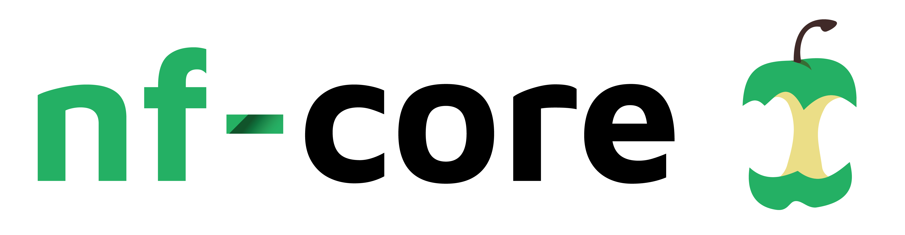
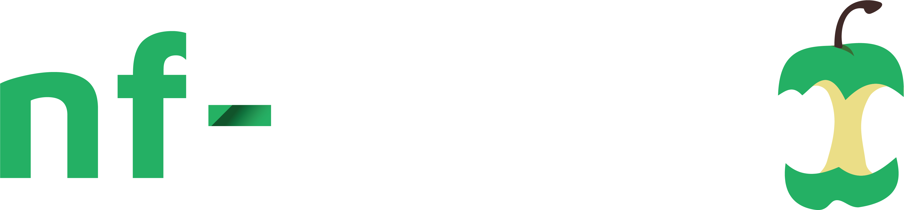

Traduzione assistita da IA - [scopri di più e suggerisci miglioramenti](https://github.com/nextflow-io/training/blob/master/TRANSLATING.md)

**Build with nf-core è un'introduzione pratica all'uso delle risorse e delle best practice di nf-core.**

Attraverso esempi pratici ed esercizi guidati, imparerete a utilizzare e sviluppare moduli e pipeline compatibili con nf-core, e a utilizzare efficacemente gli strumenti nf-core.

Acquisirete le competenze e la sicurezza per iniziare a sviluppare pipeline secondo le best practice di nf-core.

<CourseInfo frontmatter={frontmatter} />

## Panoramica del corso

Questo corso è progettato per essere pratico, con esercizi orientati agli obiettivi strutturati per introdurre le informazioni gradualmente.

Verrete introdotti a [**nf-core**](https://nf-co.re/), uno sforzo comunitario per sviluppare e mantenere un insieme curato di pipeline scientifiche costruite utilizzando Nextflow, oltre a strumenti e linee guida rilevanti che promuovono lo sviluppo aperto, i test e la revisione tra pari ([Nat Biotechnol 38, 276–278 (2020)](https://www.nature.com/articles/s41587-020-0439-x), [Genome Biol 26, 228 (2025)](https://genomebiology.biomedcentral.com/articles/10.1186/s13059-025-03673-9)).

Le pipeline sviluppate dalla comunità nf-core sono progettate per essere modulari, scalabili e portabili, consentendo ai ricercatori di adattarle ed eseguirle facilmente utilizzando i propri dati e risorse di calcolo.
Le linee guida sulle best practice applicate dal progetto garantiscono inoltre che le pipeline siano robuste, ben documentate e validate su dataset reali.
Questo aiuta ad aumentare l'affidabilità e la riproducibilità delle analisi scientifiche e, in definitiva, consente ai ricercatori di accelerare le proprie scoperte scientifiche.

Non copriremo tutto ciò che c'è da sapere sulle pipeline nf-core in questo corso, perché nf-core comprende molte funzionalità e convenzioni sviluppate dalla comunità nel corso degli anni.
Ci concentreremo invece sui concetti essenziali che vi aiuteranno a iniziare e a capire come funziona nf-core.

### Piano delle lezioni

Abbiamo suddiviso il corso in quattro parti, ciascuna focalizzata su aspetti specifici dell'utilizzo delle risorse nf-core.

| Capitolo del corso                                                        | Riepilogo                                                                                                                                                         | Durata stimata |
| ------------------------------------------------------------------------- | ----------------------------------------------------------------------------------------------------------------------------------------------------------------- | -------------- |
| [Parte 1: Riscrivere Hello per nf-core](./01_rewrite_hello.mdx)            | Adattare un workflow esistente allo scaffold del template nf-core, partendo dal workflow semplice prodotto nel corso [Hello Nextflow](../hello_nextflow/index.mdx) | 60 minuti      |
| [Parte 2: Usare un modulo nf-core](./02_use_module.mdx)                    | Esplorare la libreria di moduli della comunità e imparare a integrare moduli pre-costruiti e testati che incapsulano strumenti bioinformatici comuni              | 30 minuti      |
| [Parte 3: Creare un modulo nf-core](./03_make_module.mdx)                  | Creare il proprio modulo in stile nf-core utilizzando la struttura specifica, le convenzioni di denominazione e i requisiti di metadati stabiliti da nf-core      | 30 minuti      |
| [Parte 4: Aggiungere la validazione dell'input](./04_input_validation.mdx) | Implementare la validazione dell'input sia per i parametri da riga di comando che per i file di dati di input utilizzando nf-schema                               | 30 minuti      |

Al termine di questo corso, sarete in grado di sfruttare l'enorme ricchezza di risorse offerte dal progetto nf-core.

Pronti a iniziare il corso?

<LinkButton href="00_orientation.mdx" variant="primary" icon="right-arrow">Inizia a imparare</LinkButton>
