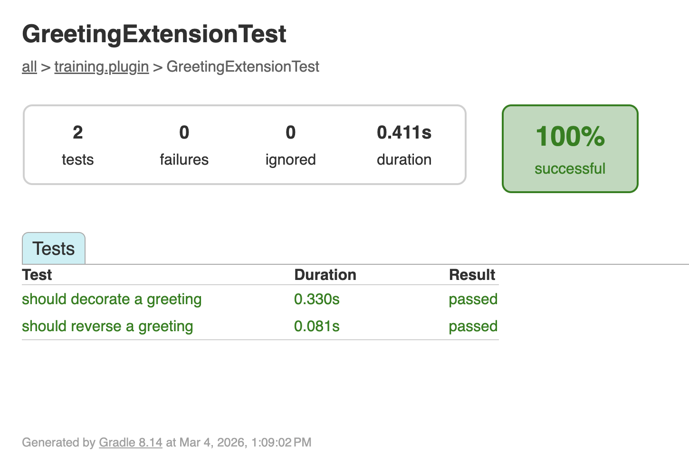

<span class="ai-translation-notice">Traduzione assistita da IA - [scopri di più e suggerisci miglioramenti](https://github.com/nextflow-io/training/blob/master/TRANSLATING.md)</span>

I plugin sono software autonomi di cui gli sviluppatori di pipeline devono potersi fidare.
Testare ogni funzionalità in modo indipendente, al di fuori di una pipeline, garantisce che il plugin funzioni correttamente prima che qualcuno lo integri in un flusso di lavoro.
In questa sezione, scriveremo ed eseguiremo test utilizzando il framework di testing Spock.

:::tip[Suggerimento]
Se vi unite a partire da questa parte, copiate la soluzione della Parte 3 come punto di partenza:

```bash
cp -r solutions/3-custom-functions/* .
```

Poi spostatevi nella directory del plugin:

```bash
cd nf-greeting
```
:::

Assicuratevi di essere nella directory del plugin:

```bash
cd nf-greeting
```

---

## 1. Perché testare?

Una build riuscita significa che il codice compila, ma non verifica che funzioni come previsto.
I test unitari sono piccoli pezzi di codice che controllano automaticamente se le vostre funzioni producono l'output corretto per un dato input.
Ad esempio, un test potrebbe verificare che `reverseGreeting("Hello"){:nextflow}` restituisca `"olleH"`.

I test sono utili perché:

- Individuano i bug prima che lo facciano gli utenti
- Vi danno la sicurezza di apportare modifiche senza rompere nulla
- Servono come documentazione che mostra come le funzioni dovrebbero essere utilizzate

---

## 2. Capire i test Spock

Il template del plugin utilizza [Spock](https://spockframework.org/), un framework di testing per Groovy.
Spock è già configurato nel progetto (tramite `build.gradle`), quindi non è necessario aggiungere nulla.

Se avete già utilizzato strumenti di testing (come `pytest` in Python o `testthat` in R), Spock svolge lo stesso ruolo: scrivete piccole funzioni che chiamano il vostro codice con input noti e verificano gli output.
La differenza è che Spock utilizza blocchi etichettati (`given:`, `expect:`, `when:`, `then:`) simili a un processo o flusso di lavoro Nextflow.

Ecco la struttura di base:

```groovy
def 'should reverse a greeting'() {   // [!annotate] **Nome del test tra virgolette**: Descrive cosa verifica il test. Usate un linguaggio semplice.
    given:                             // [!annotate] **Blocco `given:`**: Configurate ciò di cui avete bisogno per il test (create oggetti, preparate i dati)
    def ext = new GreetingExtension()

    expect:                            // [!annotate] **Blocco `expect:`**: I controlli effettivi. Ogni riga deve essere `true` affinché il test passi
    ext.reverseGreeting('Hello') == 'olleH'
}
```

Questa struttura rende i test leggibili: "Dato un oggetto extension, ci aspettiamo che `reverseGreeting('Hello')` sia uguale a `'olleH'`."

---

## 3. Scrivere i test

Scrivete i test per le due funzioni create nella Parte 3: `reverseGreeting` e `decorateGreeting`.

### 3.1. Creare la classe di test

```bash
touch src/test/groovy/training/plugin/GreetingExtensionTest.groovy
```

Apritelo nel vostro editor e aggiungete lo scheletro della classe di test vuota:

```groovy title="src/test/groovy/training/plugin/GreetingExtensionTest.groovy" showLineNumbers
package training.plugin

import spock.lang.Specification

/**
 * Test per le funzioni dell'extension di saluto
 */
class GreetingExtensionTest extends Specification {  // [!annotate] Tutte le classi di test Spock estendono `Specification`. Questo è il punto di partenza per qualsiasi file di test Spock.

}
```

### 3.2. Testare reverseGreeting

Aggiungete un metodo di test all'interno del corpo della classe.
Il blocco `given:` crea un'istanza di `GreetingExtension`, e il blocco `expect:` verifica che `reverseGreeting` inverta correttamente due input diversi.
Questo testa la funzione direttamente, senza eseguire una pipeline.

<CodeWalkthrough>

```groovy title="GreetingExtensionTest.groovy" showLineNumbers step="Prima"
package training.plugin

import spock.lang.Specification

/**
 * Test per le funzioni dell'extension di saluto
 */
class GreetingExtensionTest extends Specification {

}
```

```groovy {10-17} title="GreetingExtensionTest.groovy" showLineNumbers step="Dopo"
package training.plugin

import spock.lang.Specification

/**
 * Test per le funzioni dell'extension di saluto
 */
class GreetingExtensionTest extends Specification {

    def 'should reverse a greeting'() {
        given:
        def ext = new GreetingExtension()            // [!annotate] Create un'istanza della vostra extension da testare direttamente, senza eseguire una pipeline

        expect:
        ext.reverseGreeting('Hello') == 'olleH'     // [!annotate] Ogni riga in `expect:` è un'asserzione; il test passa solo se tutte sono `true`
        ext.reverseGreeting('Bonjour') == 'ruojnoB'
    }
}
```

</CodeWalkthrough>

### 3.3. Testare decorateGreeting

Aggiungete un secondo metodo di test dopo il primo.
Questo verifica che `decorateGreeting` avvolga la stringa di input con `***` su ciascun lato.

<CodeWalkthrough>

```groovy {18} title="GreetingExtensionTest.groovy" showLineNumbers step="Prima"
package training.plugin

import spock.lang.Specification

/**
 * Test per le funzioni dell'extension di saluto
 */
class GreetingExtensionTest extends Specification {

    def 'should reverse a greeting'() {
        given:
        def ext = new GreetingExtension()

        expect:
        ext.reverseGreeting('Hello') == 'olleH'
        ext.reverseGreeting('Bonjour') == 'ruojnoB'
    }
}
```

```groovy {18-25} title="GreetingExtensionTest.groovy" showLineNumbers step="Dopo"
package training.plugin

import spock.lang.Specification

/**
 * Test per le funzioni dell'extension di saluto
 */
class GreetingExtensionTest extends Specification {

    def 'should reverse a greeting'() {
        given:
        def ext = new GreetingExtension()

        expect:
        ext.reverseGreeting('Hello') == 'olleH'
        ext.reverseGreeting('Bonjour') == 'ruojnoB'
    }

    def 'should decorate a greeting'() {
        given:
        def ext = new GreetingExtension()

        expect:
        ext.decorateGreeting('Hello') == '*** Hello ***'
    }
}
```

</CodeWalkthrough>

---

## 4. Eseguire i test

```bash
make test
```

<details class="example">
<summary>Output dei test</summary>

```console
BUILD SUCCESSFUL in 5s
7 actionable tasks: 7 executed
```

**Dove sono i risultati dei test?** Gradle nasconde l'output dettagliato quando tutti i test passano.
"BUILD SUCCESSFUL" significa che tutto ha funzionato.
Se un test fallisce, vedrete messaggi di errore dettagliati.

</details>

<details class="exercise">
<summary>Aggiungere un test per un caso limite</summary>

Aggiungete un test che verifichi che `reverseGreeting` gestisca una stringa vuota.
Cosa dovrebbe restituire `reverseGreeting('')`?
Aggiungete il test, eseguite `make test` e verificate che passi.

<details class="solution">
<summary>Soluzione</summary>

Aggiungete questo metodo di test a `GreetingExtensionTest.groovy`:

```groovy
def 'should handle empty string'() {
    given:
    def ext = new GreetingExtension()

    expect:
    ext.reverseGreeting('') == ''
}
```

Una stringa vuota invertita è ancora una stringa vuota.

</details>

</details>

---

## 5. Visualizzare il report dei test

Gradle genera un report HTML dei test con risultati dettagliati per ciascun test.
Avviate un web server nella directory del report:

```bash
pushd build/reports/tests/test
python -m http.server
```

VS Code vi chiederà di aprire l'applicazione nel browser.
Cliccate sulla vostra classe di test per vedere i risultati dei singoli test:



Il report mostra ogni metodo di test e se ha superato o meno la verifica.

Premete <kbd>Ctrl</kbd>+<kbd>C</kbd> per fermare il server, poi tornate alla directory precedente:

```bash
popd
```

Tornate alla directory principale del progetto:

```bash
cd ..
```

---

## Takeaway

Abbiamo imparato che:

- I test Spock utilizzano una struttura leggibile `given:`/`expect:`
- Si usa `make test` per eseguire i test e `build/reports/tests/test/` per il report HTML
- I test verificano il comportamento e servono come documentazione su come le funzioni dovrebbero essere utilizzate

---

## Cosa c'è dopo?

Finora, il vostro plugin aggiunge funzioni personalizzate che le pipeline possono chiamare.
I plugin possono anche reagire agli eventi del flusso di lavoro (il completamento di un'attività, la pubblicazione di un file, il termine della pipeline) utilizzando i trace observer.
Nella prossima sezione, costruiremo un observer che conta le attività completate e stampa un riepilogo al termine della pipeline.

<LinkButton href="05_observers.mdx" variant="primary" icon="right-arrow">Continua alla Parte 5</LinkButton>
