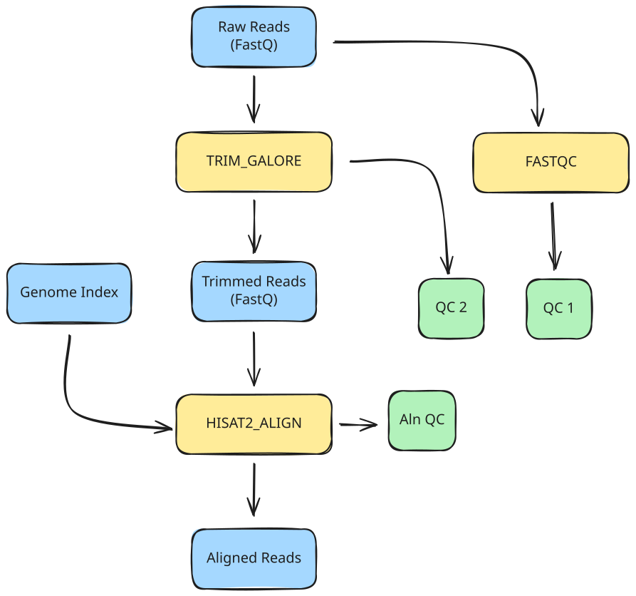

<span class="ai-translation-notice">Tłumaczenie wspomagane przez AI - [dowiedz się więcej i zasugeruj ulepszenia](https://github.com/nextflow-io/training/blob/master/TRANSLATING.md)</span>

W tej części kursu napiszemy workflow, który obejmie wszystkie polecenia uruchomione w Części 1, aby zautomatyzować ich wykonywanie. Będziemy dążyć do przetwarzania jednej próbki na raz.

:::caution[Wymaganie wstępne]
Musisz przejść przez [Część 1: Przegląd metody](./01_method.mdx) przed rozpoczęciem tej lekcji.
W szczególności, praca przez sekcję 1.2.3 tworzy plik indeksu genomu (`data/genome_index.tar.gz`) wymagany do kroku dopasowania w tej lekcji.
:::

## Zadanie

W tej części kursu opracujemy workflow, który wykonuje następujące czynności:

1. Uruchamia kontrolę jakości (FastQC) na odczytach wejściowych
2. Przycina adaptery i uruchamia kontrolę jakości po przycięciu (Trim Galore)
3. Dopasowuje przycięte odczyty do genomu referencyjnego (HISAT2)



To automatyzuje kroki z pierwszej sekcji [Części 1: Przegląd metody](./01_method.mdx#1-przetwarzanie-pojedynczej-próbki), gdzie uruchamiałeś te polecenia ręcznie w ich kontenerach.

Jako punkt wyjścia udostępniamy plik workflow'u, `rnaseq.nf`, który określa główne części workflow'u, oraz cztery pliki modułów w katalogu `modules/` (`fastqc.nf`, `trim_galore.nf`, `hisat2_align.nf` i `multiqc.nf`), które określają strukturę każdego procesu.

<details class="full-code">
<summary>Pliki szkieletowe</summary>

```nextflow title="rnaseq.nf"
#!/usr/bin/env nextflow

// Instrukcje INCLUDE modułów

/*
 * Parametry pipeline'u
 */

// Główne wejście

workflow {

    main:
    // Utwórz kanał wejściowy

    // Wywołaj procesy

    publish:
    // Zadeklaruj wyjścia do publikacji
}

output {
    // Skonfiguruj cele publikacji
}
```

```nextflow title="modules/fastqc.nf"
#!/usr/bin/env nextflow

/*
 * Uruchom FastQC na odczytach wejściowych
 */
process FASTQC {

    container

    input:

    output:

    script:
    """

    """
}
```

```nextflow title="modules/trim_galore.nf"
#!/usr/bin/env nextflow

/*
 * Przytnij adaptery i uruchom kontrolę jakości po przycięciu
 */
process TRIM_GALORE {

    container

    input:

    output:

    script:
    """

    """
}
```

```nextflow title="modules/hisat2_align.nf"
#!/usr/bin/env nextflow

/*
 * Dopasuj odczyty do genomu referencyjnego
 */
process HISAT2_ALIGN {

    container

    input:

    output:

    script:
    """

    """
}
```

```nextflow title="modules/multiqc.nf"
#!/usr/bin/env nextflow

/*
 * Agreguj raporty kontroli jakości za pomocą MultiQC
 */
process MULTIQC {

    container

    input:

    output:

    script:
    """

    """
}
```

</details>

Te pliki nie są funkcjonalne; ich celem jest jedynie służenie jako szkielety, które wypełnisz interesującymi częściami kodu.

## Plan lekcji

Aby proces rozwoju był bardziej edukacyjny, podzieliliśmy to na trzy etapy:

1. **Napisanie jednoetapowego workflow'u, który uruchamia początkowy krok kontroli jakości.**
   Obejmuje to konfigurację parametru CLI, utworzenie kanału wejściowego, napisanie modułu procesu i skonfigurowanie publikacji wyjścia.
2. **Dodanie przycinania adapterów i kontroli jakości po przycięciu.**
   Wprowadza to łączenie procesów poprzez połączenie wyjścia jednego procesu z wejściem drugiego.
3. **Dodanie dopasowania do genomu referencyjnego.**
   Obejmuje to obsługę dodatkowych wejść referencyjnych i pracę ze skompresowanymi archiwami.

Każdy krok koncentruje się na konkretnym aspekcie rozwoju workflow'u.

:::tip[Wskazówka]
Upewnij się, że jesteś we właściwym katalogu roboczym:
`cd /workspaces/training/nf4-science/rnaseq`
:::

---

## 1. Napisanie jednoetapowego workflow'u, który uruchamia początkową kontrolę jakości

Ten pierwszy krok koncentruje się na podstawach: wczytaniu pliku FASTQ i uruchomieniu na nim kontroli jakości.

Przypomnij sobie polecenie `fastqc` z [Części 1](01_method.mdx):

```bash
fastqc <reads>
```

Polecenie przyjmuje plik FASTQ jako wejście i tworzy raport kontroli jakości jako archiwum `.zip` oraz podsumowanie `.html`.
URI kontenera to `community.wave.seqera.io/library/trim-galore:0.6.10--1bf8ca4e1967cd18`.

Opakujemy te informacje w Nextflow w trzech etapach:

1. Konfiguracja wejścia
2. Napisanie procesu kontroli jakości i wywołanie go w workflow
3. Skonfigurowanie obsługi wyjścia

### 1.1. Konfiguracja wejścia

Musimy zadeklarować parametr wejściowy, utworzyć profil testowy, aby zapewnić wygodną wartość domyślną, i utworzyć kanał wejściowy.

#### 1.1.1. Dodanie deklaracji parametru wejściowego

W `rnaseq.nf`, w sekcji `Pipeline parameters`, zadeklaruj parametr o nazwie `reads` z typem `Path`.

<CodeWalkthrough>

```nextflow title="rnaseq.nf" showLineNumbers startLineNumber=5 step="Przed"
/*
 * Parametry pipeline'u
 */

// Główne wejście
```

```nextflow {4-7} title="rnaseq.nf" showLineNumbers startLineNumber=5 step="Po"
/*
 * Parametry pipeline'u
 */
params {
    // Główne wejście
    input: Path
}
```

</CodeWalkthrough>

To konfiguruje parametr CLI, ale nie chcemy wpisywać ścieżki pliku za każdym razem, gdy uruchamiamy workflow podczas rozwoju.
Istnieje wiele opcji dostarczenia wartości domyślnej; tutaj używamy profilu testowego.

#### 1.1.2. Utworzenie profilu testowego z wartością domyślną w `nextflow.config`

Profil testowy zapewnia wygodne wartości domyślne do wypróbowania workflow'u bez określania wejść w linii poleceń.
Jest to powszechna konwencja w ekosystemie Nextflow (zobacz [Hello Config](../../hello_nextflow/06_hello_config.mdx) po więcej szczegółów).

Dodaj blok `profiles` do `nextflow.config` z profilem `test`, który ustawia parametr `reads` na jeden z testowych plików FASTQ.

<CodeWalkthrough>

```nextflow title="nextflow.config" showLineNumbers step="Przed"
docker.enabled = true
```

```nextflow {3-7} title="nextflow.config" showLineNumbers step="Po"
docker.enabled = true

profiles {
    test {
        params.input = "${projectDir}/data/reads/ENCSR000COQ1_1.fastq.gz"
    }
}
```

</CodeWalkthrough>

Tutaj używamy `${projectDir}{:nextflow}`, wbudowanej zmiennej Nextflow, która wskazuje na katalog, w którym znajduje się skrypt workflow'u.
Ułatwia to odwoływanie się do plików danych i innych zasobów bez kodowania bezwzględnych ścieżek.

Parametr ma teraz wygodną wartość domyślną. Następnie musimy utworzyć z niego kanał.

#### 1.1.3. Konfiguracja kanału wejściowego

W bloku workflow utwórz kanał wejściowy z wartości parametru, używając fabryki kanałów `.fromPath` (jak w [Hello Channels](../../hello_nextflow/02_hello_channels.mdx)).

<CodeWalkthrough>

```nextflow title="rnaseq.nf" showLineNumbers startLineNumber=13 step="Przed"
workflow {

    main:
    // Utwórz kanał wejściowy

    // Wywołaj procesy

    publish:
    // Zadeklaruj wyjścia do publikacji
}
```

```nextflow {4-5} title="rnaseq.nf" showLineNumbers startLineNumber=13 step="Po"
workflow {

    main:
    // Utwórz kanał wejściowy ze ścieżki pliku
    read_ch = channel.fromPath(params.input)

    // Wywołaj procesy

    publish:
    // Zadeklaruj wyjścia do publikacji
}
```

</CodeWalkthrough>

Następnie musimy utworzyć proces do uruchomienia kontroli jakości na tym wejściu.

### 1.2. Napisanie procesu kontroli jakości i wywołanie go w workflow

Musimy wypełnić definicję procesu w pliku modułu, zaimportować go do workflow'u za pomocą instrukcji include i wywołać go na wejściu.

#### 1.2.1. Wypełnienie modułu dla procesu kontroli jakości

Otwórz `modules/fastqc.nf` i przeanalizuj zarys definicji procesu.
Powinieneś rozpoznać główne elementy strukturalne; jeśli nie, rozważ przeczytanie [Hello Nextflow](../../hello_nextflow/01_hello_world.mdx) dla przypomnienia.

Wypełnij definicję procesu samodzielnie, używając informacji podanych powyżej, a następnie sprawdź swoją pracę z rozwiązaniem w zakładce "Po" poniżej.

<CodeWalkthrough>

```nextflow title="modules/fastqc.nf" showLineNumbers step="Przed"
#!/usr/bin/env nextflow

/*
 * Uruchom FastQC na odczytach wejściowych
 */
process FASTQC {

    container

    input:

    output:

    script:
    """

    """
}
```

```nextflow {8,11,14,15,19} title="modules/fastqc.nf" showLineNumbers step="Po"
#!/usr/bin/env nextflow

/*
 * Uruchom FastQC na odczytach wejściowych
 */
process FASTQC {

    container "community.wave.seqera.io/library/trim-galore:0.6.10--1bf8ca4e1967cd18"

    input:
    path reads

    output:
    path "${reads.simpleName}_fastqc.zip", emit: zip
    path "${reads.simpleName}_fastqc.html", emit: html

    script:
    """
    fastqc ${reads}
    """
}
```

</CodeWalkthrough>

Akcesor `simpleName` usuwa wszystkie rozszerzenia z nazwy pliku, więc `ENCSR000COQ1_1.fastq.gz` staje się `ENCSR000COQ1_1`.
Używamy składni `emit:`, aby przypisać nazwy do każdego kanału wyjściowego, co będzie przydatne do podłączenia wyjść do bloku publish.

Po zakończeniu tego proces jest kompletny.
Aby użyć go w workflow, musisz zaimportować moduł i dodać wywołanie procesu.

#### 1.2.2. Dołączenie modułu

W `rnaseq.nf` dodaj instrukcję `include`, aby udostępnić proces workflow'owi:

<CodeWalkthrough>

```nextflow title="rnaseq.nf" showLineNumbers startLineNumber=3 step="Przed"
// Instrukcje INCLUDE modułów
```

```nextflow {2} title="rnaseq.nf" showLineNumbers startLineNumber=3 step="Po"
// Instrukcje INCLUDE modułów
include { FASTQC } from './modules/fastqc.nf'
```

</CodeWalkthrough>

Proces jest teraz dostępny w zakresie workflow'u.

#### 1.2.3. Wywołanie procesu kontroli jakości na wejściu

Dodaj wywołanie `FASTQC` w bloku workflow, przekazując kanał wejściowy jako argument.

<CodeWalkthrough>

```nextflow title="rnaseq.nf" showLineNumbers startLineNumber=14 step="Przed"
workflow {

    main:
    // Utwórz kanał wejściowy ze ścieżki pliku
    read_ch = channel.fromPath(params.input)

    // Wywołaj procesy

    publish:
    // Zadeklaruj wyjścia do publikacji
}
```

```nextflow {7-8} title="rnaseq.nf" showLineNumbers startLineNumber=14 step="Po"
workflow {

    main:
    // Utwórz kanał wejściowy ze ścieżki pliku
    read_ch = channel.fromPath(params.input)

    // Początkowa kontrola jakości
    FASTQC(read_ch)

    publish:
    // Zadeklaruj wyjścia do publikacji
}
```

</CodeWalkthrough>

Workflow teraz wczytuje wejście i uruchamia na nim proces kontroli jakości.
Następnie musimy skonfigurować sposób publikacji wyjścia.

### 1.3. Skonfigurowanie obsługi wyjścia

Musimy zadeklarować, które wyjścia procesu publikować i określić, gdzie powinny trafić.

#### 1.3.1. Zadeklarowanie wyjść w sekcji `publish:`

Sekcja `publish:` wewnątrz bloku workflow deklaruje, które wyjścia procesu powinny być publikowane.
Przypisz wyjścia `FASTQC` do nazwanych celów.

<CodeWalkthrough>

```nextflow title="rnaseq.nf" showLineNumbers startLineNumber=23 step="Przed"
    publish:
    // Zadeklaruj wyjścia do publikacji
}
```

```nextflow {2-3} title="rnaseq.nf" showLineNumbers startLineNumber=23 step="Po"
    publish:
    fastqc_zip = FASTQC.out.zip
    fastqc_html = FASTQC.out.html
}
```

</CodeWalkthrough>

Następnie musimy powiedzieć Nextflow, gdzie umieścić opublikowane wyjścia.

#### 1.3.2. Skonfigurowanie celów wyjściowych w bloku `output {}`

Blok `output {}` znajduje się poza workflow i określa, gdzie każdy nazwany cel jest publikowany.
Skonfiguruj oba cele do publikacji w podkatalogu `fastqc/`.

<CodeWalkthrough>

```nextflow title="rnaseq.nf" showLineNumbers startLineNumber=28 step="Przed"
output {
    // Skonfiguruj cele publikacji
}
```

```nextflow {2-7} title="rnaseq.nf" showLineNumbers startLineNumber=28 step="Po"
output {
    fastqc_zip {
        path 'fastqc'
    }
    fastqc_html {
        path 'fastqc'
    }
}
```

</CodeWalkthrough>

:::note[Uwaga]
Domyślnie Nextflow publikuje pliki wyjściowe jako dowiązania symboliczne, co unika niepotrzebnego duplikowania.
Mimo że pliki danych, których tutaj używamy, są bardzo małe, w genomice mogą być bardzo duże.
Dowiązania symboliczne przestaną działać po wyczyszczeniu katalogu `work`, więc w finalnych workflow'ach możesz chcieć nadpisać domyślny tryb publikacji na `'copy'`.
:::

### 1.4. Uruchomienie workflow'u

W tym momencie mamy jednoetapowy workflow kontroli jakości, który powinien być w pełni funkcjonalny.

Uruchamiamy z `-profile test`, aby użyć wartości domyślnej ustawionej w profilu testowym, unikając konieczności wpisywania ścieżki w linii poleceń.

```bash
nextflow run rnaseq.nf -profile test
# [!output]
 N E X T F L O W   ~  version 26.04.4

Launching `rnaseq.nf` [fabulous_engelbart] revision: 859d80cde8

executor >  local (1)
[4e/36fb3d] FASTQC (1) | 1 of 1 ✔

Outputs:

  /workspaces/training/nf4-science/rnaseq/results

  fastqc_zip:
    - fastqc/ENCSR000COQ1_1_fastqc.zip

  fastqc_html:
    - fastqc/ENCSR000COQ1_1_fastqc.html
```

Powinno to działać bardzo szybko, jeśli pracowałeś przez Część 1 i już pobrałeś kontener.
Jeśli ją pominąłeś, Nextflow pobierze kontener za Ciebie; nie musisz nic robić, aby to się stało, ale możesz potrzebować poczekać do minuty.

Możesz sprawdzić wyjścia w katalogu results.

```bash
ls results/fastqc
```

```console title="Output"
ENCSR000COQ1_1_fastqc.html  ENCSR000COQ1_1_fastqc.zip
```

Raporty kontroli jakości dla próbki są teraz opublikowane w podkatalogu `fastqc/`.

### Podsumowanie

Wiesz, jak utworzyć moduł zawierający proces, zaimportować go do workflow'u, wywołać go z kanałem wejściowym i opublikować wyniki za pomocą bloku output na poziomie workflow'u.

### Co dalej?

Dodaj przycinanie adapterów z kontrolą jakości po przycięciu jako drugi krok w workflow.

---

## 2. Dodanie przycinania adapterów i kontroli jakości po przycięciu

Teraz, gdy mamy początkową kontrolę jakości, możemy dodać krok przycinania adapterów z wbudowaną kontrolą jakości po przycięciu.

Przypomnij sobie polecenie `trim_galore` z [Części 1](01_method.mdx):

```bash
trim_galore --fastqc <reads>
```

Polecenie przycina adaptery z pliku FASTQ i uruchamia FastQC na przyciętym wyjściu.
Tworzy przycięte odczyty, raport przycinania i raporty FastQC dla przyciętych odczytów.
URI kontenera to `community.wave.seqera.io/library/trim-galore:0.6.10--1bf8ca4e1967cd18`.

Musimy tylko napisać definicję procesu, zaimportować go, wywołać w workflow i zaktualizować obsługę wyjścia.

### 2.1. Napisanie procesu przycinania i wywołanie go w workflow

Jak poprzednio, musimy wypełnić definicję procesu, zaimportować moduł i dodać wywołanie procesu.

#### 2.1.1. Wypełnienie modułu dla procesu przycinania

Otwórz `modules/trim_galore.nf` i przeanalizuj zarys definicji procesu.

Wypełnij definicję procesu samodzielnie, używając informacji podanych powyżej, a następnie sprawdź swoją pracę z rozwiązaniem w zakładce "Po" poniżej.

<CodeWalkthrough>

```nextflow title="modules/trim_galore.nf" showLineNumbers step="Przed"
#!/usr/bin/env nextflow

/*
 * Przytnij adaptery i uruchom kontrolę jakości po przycięciu
 */
process TRIM_GALORE {

    container

    input:

    output:

    script:
    """

    """
}
```

```nextflow {8,11,14,15,16,20} title="modules/trim_galore.nf" showLineNumbers step="Po"
#!/usr/bin/env nextflow

/*
 * Przytnij adaptery i uruchom kontrolę jakości po przycięciu
 */
process TRIM_GALORE {

    container "community.wave.seqera.io/library/trim-galore:0.6.10--1bf8ca4e1967cd18"

    input:
    path reads

    output:
    path "${reads.simpleName}_trimmed.fq.gz", emit: trimmed_reads
    path "${reads}_trimming_report.txt", emit: trimming_reports
    path "${reads.simpleName}_trimmed_fastqc.{zip,html}", emit: fastqc_reports

    script:
    """
    trim_galore --fastqc ${reads}
    """
}
```

</CodeWalkthrough>

Ten proces ma trzy nazwane wyjścia: przycięte odczyty, które trafiają do kroku dopasowania, raport przycinania i raporty FastQC po przycięciu.
Flaga `--fastqc` mówi Trim Galore, aby automatycznie uruchomił FastQC na przyciętym wyjściu.

#### 2.1.2. Dołączenie modułu

Zaktualizuj `rnaseq.nf`, aby zaimportować nowy moduł:

<CodeWalkthrough>

```nextflow title="rnaseq.nf" showLineNumbers startLineNumber=3 step="Przed"
// Instrukcje INCLUDE modułów
include { FASTQC } from './modules/fastqc.nf'
```

```nextflow {3} title="rnaseq.nf" showLineNumbers startLineNumber=3 step="Po"
// Instrukcje INCLUDE modułów
include { FASTQC } from './modules/fastqc.nf'
include { TRIM_GALORE } from './modules/trim_galore.nf'
```

</CodeWalkthrough>

Następnie dodamy wywołanie procesu do workflow'u.

#### 2.1.3. Wywołanie procesu przycinania na wejściu

Dodaj wywołanie procesu w bloku workflow:

<CodeWalkthrough>

```nextflow title="rnaseq.nf" showLineNumbers startLineNumber=15 step="Przed"
workflow {

    main:
    // Utwórz kanał wejściowy ze ścieżki pliku
    read_ch = channel.fromPath(params.input)

    // Początkowa kontrola jakości
    FASTQC(read_ch)

    publish:
    fastqc_zip = FASTQC.out.zip
    fastqc_html = FASTQC.out.html
}
```

```nextflow {10-11} title="rnaseq.nf" showLineNumbers startLineNumber=15 step="Po"
workflow {

    main:
    // Utwórz kanał wejściowy ze ścieżki pliku
    read_ch = channel.fromPath(params.input)

    // Początkowa kontrola jakości
    FASTQC(read_ch)

    // Przycinanie adapterów i kontrola jakości po przycięciu
    TRIM_GALORE(read_ch)

    publish:
    fastqc_zip = FASTQC.out.zip
    fastqc_html = FASTQC.out.html
}
```

</CodeWalkthrough>

Proces przycinania jest teraz podłączony do workflow'u.

### 2.2. Aktualizacja obsługi wyjścia

Musimy dodać wyjścia przycinania do deklaracji publish i skonfigurować, gdzie mają trafić.

#### 2.2.1. Dodanie celów publikacji dla wyjść przycinania

Dodaj wyjścia przycinania do sekcji `publish:`:

<CodeWalkthrough>

```nextflow title="rnaseq.nf" showLineNumbers startLineNumber=27 step="Przed"
    publish:
    fastqc_zip = FASTQC.out.zip
    fastqc_html = FASTQC.out.html
}
```

```nextflow {4-6} title="rnaseq.nf" showLineNumbers startLineNumber=27 step="Po"
    publish:
    fastqc_zip = FASTQC.out.zip
    fastqc_html = FASTQC.out.html
    trimmed_reads = TRIM_GALORE.out.trimmed_reads
    trimming_reports = TRIM_GALORE.out.trimming_reports
    trimming_fastqc = TRIM_GALORE.out.fastqc_reports
}
```

</CodeWalkthrough>

Następnie musimy powiedzieć Nextflow'owi, gdzie umieścić te wyjścia.

#### 2.2.2. Skonfigurowanie nowych celów wyjściowych

Dodaj wpisy dla celów przycinania w bloku `output {}`, publikując je w podkatalogu `trimming/`:

<CodeWalkthrough>

```nextflow title="rnaseq.nf" showLineNumbers startLineNumber=35 step="Przed"
output {
    fastqc_zip {
        path 'fastqc'
    }
    fastqc_html {
        path 'fastqc'
    }
}
```

```nextflow {8-16} title="rnaseq.nf" showLineNumbers startLineNumber=35 step="Po"
output {
    fastqc_zip {
        path 'fastqc'
    }
    fastqc_html {
        path 'fastqc'
    }
    trimmed_reads {
        path 'trimming'
    }
    trimming_reports {
        path 'trimming'
    }
    trimming_fastqc {
        path 'trimming'
    }
}
```

</CodeWalkthrough>

Konfiguracja wyjścia jest kompletna.

### 2.3. Uruchomienie workflow'u

Workflow teraz obejmuje zarówno początkową kontrolę jakości, jak i przycinanie adapterów.

```bash
nextflow run rnaseq.nf -profile test
# [!output]
 N E X T F L O W   ~  version 26.04.4

Launching `rnaseq.nf` [stupefied_volhard] revision: faaf310b2f

executor >  local (2)
[a3/ac9284] FASTQC (1)      | 1 of 1 ✔
[55/c4d983] TRIM_GALORE (1) | 1 of 1 ✔

Outputs:

  /workspaces/training/nf4-science/rnaseq/results

  fastqc_zip:
    - fastqc/ENCSR000COQ1_1_fastqc.zip

  fastqc_html:
    - fastqc/ENCSR000COQ1_1_fastqc.html

  trimmed_reads:
    - trimming/ENCSR000COQ1_1_trimmed.fq.gz

  trimming_reports:
    - trimming/ENCSR000COQ1_1.fastq.gz_trimming_report.txt

  trimming_fastqc:
    - [trimming/ENCSR000COQ1_1_trimmed_fastqc.html, trimming/ENCSR000COQ1_1_trimmed_fastqc.zip]
```

To również powinno działać bardzo szybko, ponieważ uruchamiamy na tak małym pliku wejściowym.

Możesz znaleźć wyjścia przycinania w katalogu results.

```bash
ls results/trimming
```

```console title="Output"
ENCSR000COQ1_1.fastq.gz_trimming_report.txt  ENCSR000COQ1_1_trimmed_fastqc.zip
ENCSR000COQ1_1_trimmed_fastqc.html           ENCSR000COQ1_1_trimmed.fq.gz
```

Wyjścia przycinania i raporty kontroli jakości po przycięciu są teraz w podkatalogu `trimming/`.

### Podsumowanie

Wiesz, jak dodać drugi krok przetwarzania, który działa niezależnie na tym samym wejściu, tworząc wiele nazwanych wyjść.

### Co dalej?

Dodaj krok dopasowania, który łączy się z wyjściem przyciętych odczytów.

---

## 3. Dodanie dopasowania do genomu referencyjnego

Na koniec możemy dodać krok dopasowania genomu przy użyciu HISAT2.

Przypomnij sobie polecenie dopasowania z [Części 1](01_method.mdx):

```bash
hisat2 -x <genome_index> -U <reads> \
    --new-summary --summary-file <reads>.hisat2.log | \
    samtools view -bS -o <reads>.bam
```

Polecenie dopasowuje odczyty do genomu referencyjnego i konwertuje wyjście do formatu BAM.
Wymaga wstępnie zbudowanego archiwum indeksu genomu i tworzy plik BAM oraz log podsumowania dopasowania.
URI kontenera to `community.wave.seqera.io/library/hisat2_samtools:5e49f68a37dc010e`.

Ten proces wymaga dodatkowego wejścia (archiwum indeksu genomu), więc musimy najpierw to skonfigurować, a następnie napisać i podłączyć proces.

### 3.1. Konfiguracja wejść

Musimy zadeklarować parametr dla archiwum indeksu genomu.

#### 3.1.1. Dodanie parametru dla indeksu genomu

Dodaj deklarację parametru dla archiwum indeksu genomu w `rnaseq.nf`:

<CodeWalkthrough>

```nextflow title="rnaseq.nf" showLineNumbers startLineNumber=11 step="Przed"
params {
    // Główne wejście
    input: Path
}
```

```nextflow {5-6} title="rnaseq.nf" showLineNumbers startLineNumber=11 step="Po"
params {
    // Główne wejście
    input: Path

    // Archiwum genomu referencyjnego
    hisat2_index_zip: Path
}
```

</CodeWalkthrough>

#### 3.1.2. Dodanie wartości domyślnej indeksu genomu do profilu testowego

Tak jak zrobiliśmy dla `reads` w sekcji 1.1.2, dodaj wartość domyślną dla indeksu genomu do profilu testowego w `nextflow.config`:

<CodeWalkthrough>

```nextflow title="nextflow.config" showLineNumbers step="Przed"
docker.enabled = true

profiles {
    test {
        params.input = "${projectDir}/data/reads/ENCSR000COQ1_1.fastq.gz"
    }
}
```

```nextflow {6} title="nextflow.config" showLineNumbers step="Po"
docker.enabled = true

profiles {
    test {
        params.input = "${projectDir}/data/reads/ENCSR000COQ1_1.fastq.gz"
        params.hisat2_index_zip = "${projectDir}/data/genome_index.tar.gz"
    }
}
```

</CodeWalkthrough>

Parametr jest gotowy; teraz możemy utworzyć proces dopasowania.

### 3.2. Napisanie procesu dopasowania i wywołanie go w workflow

Jak poprzednio, musimy wypełnić definicję procesu, zaimportować moduł i dodać wywołanie procesu.

#### 3.2.1. Wypełnienie modułu dla procesu dopasowania

Otwórz `modules/hisat2_align.nf` i przeanalizuj zarys definicji procesu.

Wypełnij definicję procesu samodzielnie, używając informacji podanych powyżej, a następnie sprawdź swoją pracę z rozwiązaniem w zakładce "Po" poniżej.

<CodeWalkthrough>

```nextflow title="modules/hisat2_align.nf" showLineNumbers step="Przed"
#!/usr/bin/env nextflow

/*
 * Dopasuj odczyty do genomu referencyjnego
 */
process HISAT2_ALIGN {

    container

    input:

    output:

    script:
    """

    """
}
```

```nextflow {8,11,12,15,16,20,21,22,23} title="modules/hisat2_align.nf" showLineNumbers step="Po"
#!/usr/bin/env nextflow

/*
 * Dopasuj odczyty do genomu referencyjnego
 */
process HISAT2_ALIGN {

    container "community.wave.seqera.io/library/hisat2_samtools:5e49f68a37dc010e"

    input:
    path reads
    path index_zip

    output:
    path "${reads.simpleName}.bam", emit: bam
    path "${reads.simpleName}.hisat2.log", emit: log

    script:
    """
    tar -xzvf ${index_zip}
    hisat2 -x ${index_zip.simpleName} -U ${reads} \
        --new-summary --summary-file ${reads.simpleName}.hisat2.log | \
        samtools view -bS -o ${reads.simpleName}.bam
    """
}
```

</CodeWalkthrough>

Ten proces przyjmuje dwa wejścia: odczyty i archiwum indeksu genomu.
Blok script najpierw wypakowuje indeks z archiwum, a następnie uruchamia dopasowanie HISAT2 przekierowane do `samtools view`, aby przekonwertować wyjście do formatu BAM.
Akcesor `simpleName` na `index_zip` wyodrębnia nazwę bazową archiwum (`genome_index`) do użycia jako prefiks indeksu.

#### 3.2.2. Dołączenie modułu

Zaktualizuj `rnaseq.nf`, aby zaimportować nowy moduł:

<CodeWalkthrough>

```nextflow title="rnaseq.nf" showLineNumbers startLineNumber=3 step="Przed"
// Instrukcje INCLUDE modułów
include { FASTQC } from './modules/fastqc.nf'
include { TRIM_GALORE } from './modules/trim_galore.nf'
```

```nextflow {4} title="rnaseq.nf" showLineNumbers startLineNumber=3 step="Po"
// Instrukcje INCLUDE modułów
include { FASTQC } from './modules/fastqc.nf'
include { TRIM_GALORE } from './modules/trim_galore.nf'
include { HISAT2_ALIGN } from './modules/hisat2_align.nf'
```

</CodeWalkthrough>

Następnie dodamy wywołanie procesu do workflow'u.

#### 3.2.3. Wywołanie procesu dopasowania

Przycięte odczyty znajdują się w kanale wyjściowym `TRIM_GALORE.out.trimmed_reads` z poprzedniego kroku.
Używamy `file(params.hisat2_index_zip){:nextflow}`, aby dostarczyć archiwum indeksu genomu.

<CodeWalkthrough>

```nextflow title="rnaseq.nf" showLineNumbers startLineNumber=19 step="Przed"
workflow {

    main:
    // Utwórz kanał wejściowy ze ścieżki pliku
    read_ch = channel.fromPath(params.input)

    // Początkowa kontrola jakości
    FASTQC(read_ch)

    // Przycinanie adapterów i kontrola jakości po przycięciu
    TRIM_GALORE(read_ch)
```

```nextflow {13-14} title="rnaseq.nf" showLineNumbers startLineNumber=19 step="Po"
workflow {

    main:
    // Utwórz kanał wejściowy ze ścieżki pliku
    read_ch = channel.fromPath(params.input)

    // Początkowa kontrola jakości
    FASTQC(read_ch)

    // Przycinanie adapterów i kontrola jakości po przycięciu
    TRIM_GALORE(read_ch)

    // Dopasowanie do genomu referencyjnego
    HISAT2_ALIGN(TRIM_GALORE.out.trimmed_reads, file(params.hisat2_index_zip))
```

</CodeWalkthrough>

Proces dopasowania jest teraz podłączony do workflow'u.

### 3.3. Aktualizacja obsługi wyjścia

Musimy dodać wyjścia dopasowania do deklaracji publish i skonfigurować, gdzie mają trafić.

#### 3.3.1. Dodanie celów publikacji dla wyjść dopasowania

Dodaj wyjścia dopasowania do sekcji `publish:`:

<CodeWalkthrough>

```nextflow title="rnaseq.nf" showLineNumbers startLineNumber=34 step="Przed"
    publish:
    fastqc_zip = FASTQC.out.zip
    fastqc_html = FASTQC.out.html
    trimmed_reads = TRIM_GALORE.out.trimmed_reads
    trimming_reports = TRIM_GALORE.out.trimming_reports
    trimming_fastqc = TRIM_GALORE.out.fastqc_reports
}
```

```nextflow {7-8} title="rnaseq.nf" showLineNumbers startLineNumber=34 step="Po"
    publish:
    fastqc_zip = FASTQC.out.zip
    fastqc_html = FASTQC.out.html
    trimmed_reads = TRIM_GALORE.out.trimmed_reads
    trimming_reports = TRIM_GALORE.out.trimming_reports
    trimming_fastqc = TRIM_GALORE.out.fastqc_reports
    bam = HISAT2_ALIGN.out.bam
    align_log = HISAT2_ALIGN.out.log
}
```

</CodeWalkthrough>

Następnie musimy powiedzieć Nextflow'owi, gdzie umieścić te wyjścia.

#### 3.3.2. Skonfigurowanie nowych celów wyjściowych

Dodaj wpisy dla celów dopasowania w bloku `output {}`, publikując je w podkatalogu `align/`:

<CodeWalkthrough>

```nextflow title="rnaseq.nf" showLineNumbers startLineNumber=44 step="Przed"
output {
    fastqc_zip {
        path 'fastqc'
    }
    fastqc_html {
        path 'fastqc'
    }
    trimmed_reads {
        path 'trimming'
    }
    trimming_reports {
        path 'trimming'
    }
    trimming_fastqc {
        path 'trimming'
    }
}
```

```nextflow {17-22} title="rnaseq.nf" showLineNumbers startLineNumber=44 step="Po"
output {
    fastqc_zip {
        path 'fastqc'
    }
    fastqc_html {
        path 'fastqc'
    }
    trimmed_reads {
        path 'trimming'
    }
    trimming_reports {
        path 'trimming'
    }
    trimming_fastqc {
        path 'trimming'
    }
    bam {
        path 'align'
    }
    align_log {
        path 'align'
    }
}
```

</CodeWalkthrough>

Konfiguracja wyjścia jest kompletna.

### 3.4. Uruchomienie workflow'u

Workflow teraz obejmuje wszystkie trzy kroki przetwarzania: kontrolę jakości, przycinanie i dopasowanie.

```bash
nextflow run rnaseq.nf -profile test
# [!output]
 N E X T F L O W   ~  version 26.04.4

Launching `rnaseq.nf` [nauseous_allen] revision: 45d77a9709

executor >  local (3)
[57/b3c2cb] FASTQC (1)       | 1 of 1 ✔
[98/451aef] TRIM_GALORE (1)  | 1 of 1 ✔
[78/7cf2c3] HISAT2_ALIGN (1) | 1 of 1 ✔

Outputs:

  /workspaces/training/nf4-science/rnaseq/results

  fastqc_zip:
    - fastqc/ENCSR000COQ1_1_fastqc.zip

  fastqc_html:
    - fastqc/ENCSR000COQ1_1_fastqc.html

  trimmed_reads:
    - trimming/ENCSR000COQ1_1_trimmed.fq.gz

  trimming_reports:
    - trimming/ENCSR000COQ1_1.fastq.gz_trimming_report.txt

  trimming_fastqc:
    - [trimming/ENCSR000COQ1_1_trimmed_fastqc.html, trimming/ENCSR000COQ1_1_trimmed_fastqc.zip]

  bam:
    - align/ENCSR000COQ1_1_trimmed.bam

  align_log:
    - align/ENCSR000COQ1_1_trimmed.hisat2.log
```

Możesz znaleźć wyjścia dopasowania w katalogu results.

```bash
ls results/align
```

```console title="Output"
ENCSR000COQ1_1_trimmed.bam  ENCSR000COQ1_1_trimmed.hisat2.log
```

To kończy podstawowe przetwarzanie, które musimy zastosować do każdej próbki.

_Dodamy agregację raportów MultiQC w Części 3, po tym, jak sprawimy, że workflow będzie akceptować wiele próbek naraz._

---

### Podsumowanie

Wiesz, jak opakować wszystkie podstawowe kroki do przetwarzania próbek RNAseq single-end indywidualnie.

### Co dalej?

Zrób sobie przerwę! To było dużo.

Kiedy poczujesz się odświeżony, przejdź do [Części 3](./03_multi-sample.mdx), gdzie nauczysz się, jak zmodyfikować workflow, aby przetwarzać wiele próbek równolegle, agregować raporty kontroli jakości we wszystkich krokach dla wszystkich próbek i umożliwić uruchamianie workflow'u na danych RNAseq paired-end.
