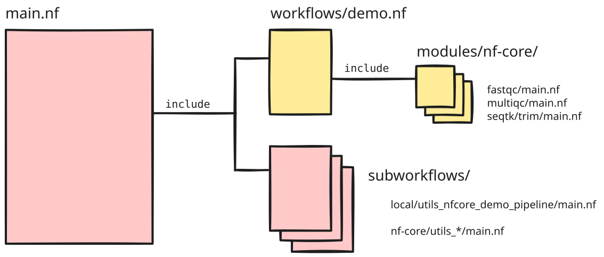
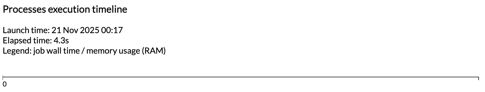
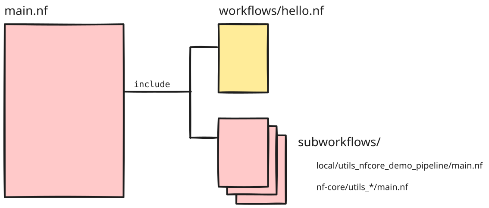
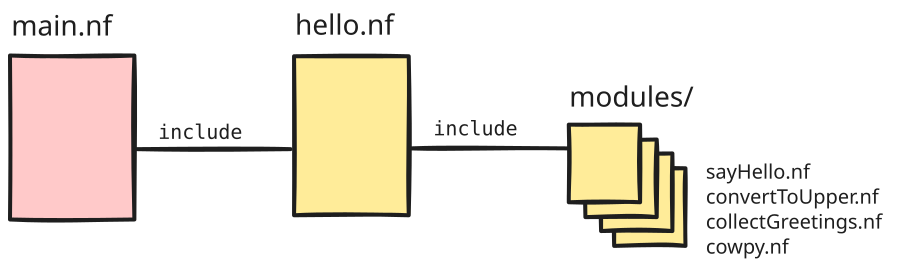
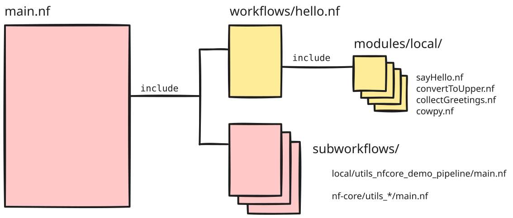
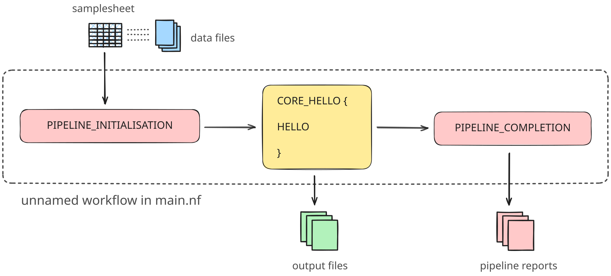
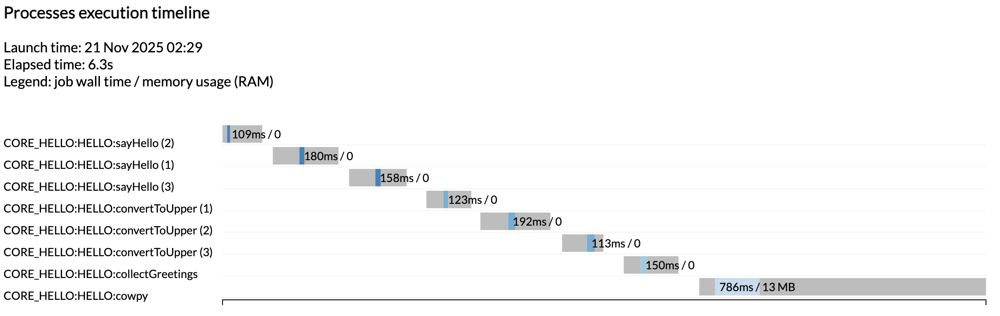

<span class="ai-translation-notice">Tłumaczenie wspomagane przez AI - [dowiedz się więcej i zasugeruj ulepszenia](https://github.com/nextflow-io/training/blob/master/TRANSLATING.md)</span>

W tej pierwszej części kursu szkoleniowego Build with nf-core pokażemy Ci, jak utworzyć wersję pipeline'u kompatybilną z nf-core, opartą na projekcie z kursu dla początkujących [Hello Nextflow](../hello_nextflow/index.mdx).

Zrobimy to w dwóch fazach: najpierw użyjemy narzędzi nf-core do stworzenia szkieletu pipeline'u, a następnie przeszczepimy na niego istniejący kod 'zwykłego' pipeline'u.

Jeśli nie znasz pipeline'u Hello lub potrzebujesz przypomnienia, zobacz [tę stronę informacyjną](../info/hello_pipeline.mdx).

:::tip[Wskazówka]
Ta część kursu wprowadza dwa ważne mechanizmy Nextflow'a, które nie są omówione w kursie wprowadzającym Hello Nextflow: [meta maps](../side_quests/metadata/index.mdx) oraz [workflows of workflows](../side_quests/workflows_of_workflows/index.mdx) — oba szczegółowo opisane w powiązanych Side Quests.

Poniższe instrukcje zawierają niezbędne informacje potrzebne do zrozumienia, jak są one używane w kontekście nf-core, ale może to być dużo do przyswojenia naraz.
Jeśli masz czas, zalecamy najpierw przejście przez oba Side Quests (w dowolnej kolejności):

- [Workflows of Workflows](../side_quests/workflows_of_workflows/index.mdx)
- [Metadata and meta maps](../side_quests/metadata/index.mdx)
:::

---

## 1. Zbadanie struktury kodu pipeline'u

Projekt nf-core narzuca ścisłe wytyczne dotyczące struktury pipeline'ów oraz organizacji, konfiguracji i dokumentacji kodu.

Zanim przystąpimy do tworzenia pipeline'u, musimy zrozumieć tę strukturę i organizację.
Przyjrzyjmy się więc, jak kod pipeline'u jest zorganizowany w repozytorium `nf-core/demo`, używając kopii w `pipelines/nf-core/demo`, którą sklonowałeś podczas [Pierwszych kroków](00_orientation.mdx).

Dla przypomnienia: możesz użyć polecenia `tree` lub eksploratora plików, aby znaleźć i otworzyć katalog `pipelines/nf-core/demo`.

```bash
tree -L 1 pipelines/nf-core/demo
```

<details class="abstract">
<summary>Zawartość katalogu</summary>

```console
pipelines/nf-core/demo
├── assets
├── CHANGELOG.md
├── CITATIONS.md
├── CODE_OF_CONDUCT.md
├── conf
├── docs
├── LICENSE
├── main.nf
├── modules
├── modules.json
├── nextflow.config
├── nextflow_schema.json
├── nf-test.config
├── README.md
├── ro-crate-metadata.json
├── subworkflows
├── tests
├── tower.yml
└── workflows
```

</details>

Na razie skupimy się konkretnie na komponentach kodu pipeline'u (`main.nf`, `workflows`, `subworkflows`, `modules`) i ich wzajemnych relacjach.

### 1.1. Modularna struktura workflow'ów nf-core

Standardowa organizacja kodu pipeline'u nf-core opiera się na strukturze modularnej zaprojektowanej w celu maksymalizacji ponownego użycia kodu, zgodnie z tym, co zostało wprowadzone w [Hello Modules](../hello_nextflow/04_hello_modules.mdx), Części 4 kursu [Hello Nextflow](../hello_nextflow/index.mdx) — choć w prawdziwym stylu nf-core jest to zaimplementowane z nieco większą złożonością.
W szczególności pipeline'y nf-core intensywnie korzystają z subworkflow'ów, czyli skryptów workflow'u importowanych przez workflow nadrzędny.

Może to brzmieć nieco abstrakcyjnie, więc przyjrzyjmy się, jak jest to stosowane w praktyce w pipeline'ie `nf-core/demo`.

Jeśli zajrzysz do pliku `main.nf`, zobaczysz, że importuje on workflow o nazwie `DEMO` z `workflows/demo.nf`, a także kilka modułów i subworkflow'ów.

Oto jak wyglądają relacje między odpowiednimi komponentami kodu:



Nienazwany workflow w `main.nf` nazywany jest skryptem _punktu wejścia_. Pełni rolę otoczki dla dwóch rodzajów zagnieżdżonych workflow'ów: workflow'u `DEMO` zawierającego właściwą logikę analizy, znajdującego się w `workflows/demo.nf`, oraz zestawu workflow'ów porządkowych zlokalizowanych w `subworkflows/`.
Workflow `demo.nf` wywołuje **moduły** znajdujące się w `modules/`; zawierają one **procesy**, które wykonują właściwe kroki analizy.

:::note[Info]
Subworkflow'y nie są ograniczone do funkcji porządkowych i mogą korzystać z modułów procesów.

Pipeline `nf-core/demo` pokazany tutaj jest stosunkowo prosty, ale inne pipeline'y nf-core (takie jak `nf-core/rnaseq`) wykorzystują subworkflow'y biorące udział w samej analizie.
:::

Przyjrzyjmy się teraz szczegółowo tym komponentom.

### 1.2. Skrypt punktu wejścia: `main.nf`

Skrypt `main.nf` jest punktem wejścia, od którego Nextflow zaczyna działanie po wykonaniu `nextflow run nf-core/demo`.
Oznacza to, że gdy uruchamiasz `nextflow run nf-core/demo`, Nextflow automatycznie odnajduje i wykonuje skrypt `main.nf`.
Działa to dla każdego pipeline'u Nextflow'a stosującego tę konwencjonalną nazwę i strukturę, nie tylko dla pipeline'ów nf-core.

Użycie skryptu punktu wejścia ułatwia uruchamianie standardowych subworkflow'ów 'porządkowych' przed i po wykonaniu właściwego skryptu analizy.
Omówimy je po przeglądzie workflow'u analizy i jego modułów.

### 1.3. Skrypt analizy: `workflows/demo.nf`

Workflow `workflows/demo.nf` zawiera centralną logikę pipeline'u.
Jest zbudowany podobnie do zwykłego workflow'u Nextflow'a, z tą różnicą, że jest zaprojektowany do wywoływania z workflow'u nadrzędnego, co wymaga kilku dodatkowych funkcji.
Omówimy istotne różnice w następnej części tego kursu, gdy zajmiemy się konwersją prostego pipeline'u Hello z Hello Nextflow do postaci kompatybilnej z nf-core.

Workflow `demo.nf` wywołuje **moduły** znajdujące się w `modules/`, które omówimy poniżej.

:::note[Info]
Niektóre workflow'y analizy nf-core wykazują dodatkowe poziomy zagnieżdżenia poprzez wywoływanie subworkflow'ów niższego poziomu.
Służy to głównie do łączenia dwóch lub więcej modułów, które są często używane razem, w łatwo wielokrotnego użytku segmenty pipeline'u.
Przykłady możesz zobaczyć, przeglądając dostępne [subworkflow'y nf-core](https://nf-co.re/subworkflows/) na stronie nf-core.

Gdy skrypt analizy korzysta z subworkflow'ów, są one przechowywane w katalogu `subworkflows/`.
:::

### 1.4. Moduły

Moduły zawierają kod procesów, zgodnie z opisem w [Części 4 kursu szkoleniowego Hello Nextflow](../hello_nextflow/04_hello_modules.mdx).

W projekcie nf-core moduły są zorganizowane w wielopoziomowej strukturze zagnieżdżonej, odzwierciedlającej zarówno ich pochodzenie, jak i zawartość.
Na najwyższym poziomie moduły są podzielone na `nf-core` i `local` (niebędące częścią projektu nf-core), a następnie umieszczane w katalogu nazwanym od narzędzia lub narzędzi, które opakowują.
Jeśli narzędzie należy do zestawu narzędzi (pakietu zawierającego wiele narzędzi), istnieje pośredni poziom katalogu nazwany od tego zestawu.

Możesz zobaczyć to zastosowane w praktyce w modułach pipeline'u `nf-core/demo`:

```bash
tree -L 3 pipelines/nf-core/demo/modules
```

<details class="abstract">
<summary>Zawartość katalogu</summary>

```console
pipelines/nf-core/demo/modules
├── local
│   └── cowpy
│       ├── environment.yml
│       ├── main.nf
│       └── meta.yaml
└── nf-core
    ├── fastqc
    │   ├── environment.yml
    │   ├── main.nf
    │   ├── meta.yml
    │   └── tests
    ├── multiqc
    │   ├── environment.yml
    │   ├── main.nf
    │   ├── meta.yml
    │   └── tests
    └── seqtk
        └── trim

9 directories, 9 files
```

</details>

Widać tutaj, że moduły `fastqc` i `multiqc` znajdują się na najwyższym poziomie w modułach `nf-core`, natomiast moduł `trim` jest umieszczony pod zestawem narzędzi, do którego należy — `seqtk`.
Moduł `cowpy` w katalogu `local` jest modułem lokalnym, napisanym specjalnie dla tego pipeline'u, a nie zainstalowanym z repozytorium modułów nf-core.

Plik kodu modułu opisujący proces zawsze nosi nazwę `main.nf` i towarzyszy mu zestaw testów oraz pliki `.yml`, które na razie pominiemy.

Łącznie skrypt punktu wejścia, workflow analizy i moduły są wystarczające do uruchomienia 'interesujących' części pipeline'u.
Wiemy jednak, że są tam również subworkflow'y porządkowe, więc przyjrzyjmy się im teraz.

### 1.5. Subworkflow'y porządkowe

Podobnie jak moduły, subworkflow'y są podzielone na katalogi `local` i `nf-core`, a każdy subworkflow ma własną zagnieżdżoną strukturę katalogów z własnym skryptem `main.nf`, testami i plikiem `.yml`.

```bash
tree -L 3 pipelines/nf-core/demo/subworkflows
```

<details class="abstract">
<summary>Zawartość katalogu</summary>

```console
pipelines/nf-core/demo/subworkflows
├── local
│   └── utils_nfcore_demo_pipeline
│       └── main.nf
└── nf-core
    ├── utils_nextflow_pipeline
    │   ├── main.nf
    │   ├── meta.yml
    │   └── tests
    ├── utils_nfcore_pipeline
    │   ├── main.nf
    │   ├── meta.yml
    │   └── tests
    └── utils_nfschema_plugin
        ├── main.nf
        ├── meta.yml
        └── tests

9 directories, 7 files
```

</details>

Jak wspomniano powyżej, pipeline `nf-core/demo` nie zawiera żadnych subworkflow'ów specyficznych dla analizy, więc wszystkie widoczne tutaj subworkflow'y są tzw. workflow'ami 'porządkowymi' lub 'narzędziowymi', co sygnalizuje przedrostek `utils_` w ich nazwach.
To właśnie te subworkflow'y generują efektowny nagłówek nf-core w wyjściu konsoli, wśród innych funkcji pomocniczych.

:::tip[Wskazówka]
Poza wzorcem nazewniczym, kolejną wskazówką, że te subworkflow'y nie wykonują żadnych funkcji związanych z analizą, jest to, że nie wywołują żadnych procesów.
:::

To kończy przegląd podstawowych komponentów kodu składających się na pipeline `nf-core/demo`.

### Podsumowanie

Masz teraz ogólne pojęcie o modularnej strukturze pipeline'ów nf-core.

### Co dalej?

Utwórz szkielet pipeline'u używając narzędzi nf-core.

---

## 2. Stworzenie nowego projektu pipeline'u

Jak widziałeś, pipeline'y nf-core mają ustandaryzowaną strukturę z wieloma plikami pomocniczymi.
Tworzenie tego wszystkiego od zera byłoby bardzo żmudne, dlatego społeczność nf-core opracowała narzędzia, które zamiast tego korzystają z szablonu, aby przyspieszyć ten proces.

### 2.1. Uruchomienie narzędzia do tworzenia pipeline'u opartego na szablonie

Zacznijmy od stworzenia nowego pipeline'u za pomocą polecenia `nf-core pipelines create`.
Spowoduje to utworzenie nowego szkieletu pipeline'u przy użyciu podstawowego szablonu nf-core, dostosowanego za pomocą nazwy pipeline'u, opisu i autora.

```bash
nf-core pipelines create
```

Uruchomienie tego polecenia otworzy tekstowy interfejs użytkownika (TUI) do tworzenia pipeline'u:

<div class="video-wrapper">
  <iframe width="560" height="315" src="https://www.youtube.com/embed/VwjXNXONHlY?si=d0HkFSISnKn76TeI" title="YouTube video player" frameborder="0" allow="accelerometer; autoplay; clipboard-write; encrypted-media; gyroscope; picture-in-picture; web-share" allowfullscreen></iframe>
</div>

Ten TUI poprosi Cię o podanie podstawowych informacji o pipeline'ie i pozwoli wybrać funkcje do włączenia lub wyłączenia w szkielecie pipeline'u.

- Na ekranie powitalnym kliknij **Let's go!**.
- Na ekranie `Choose pipeline type` kliknij **Custom**.
- Wprowadź szczegóły Swojego pipeline'u w następujący sposób (zastępując `< YOUR NAME >` Swoim imieniem), następnie kliknij **Next**.

```
[ ] GitHub organisation: core
[ ] Workflow name: hello
[ ] A short description of your pipeline: A basic nf-core style version of Hello Nextflow
[ ] Name of the main author(s): < YOUR NAME >
```

- Na ekranie Template features ustaw `Toggle all features` na **off**, następnie selektywnie **włącz** następujące opcje. Sprawdź Swoje wybory i kliknij **Continue**.

```
[ ] Add testing profiles
[ ] Use nf-core components
[ ] Use nf-schema
[ ] Add configuration files
[ ] Add documentation
```

- Na ekranie `Final details` kliknij **Finish**. Poczekaj na utworzenie pipeline'u, następnie kliknij **Continue**.
- Na ekranie Create GitHub repository kliknij **Finish without creating a repo**. Wyświetlone zostaną instrukcje tworzenia repozytorium GitHub na później. Zignoruj je i kliknij **Close**.

Po zamknięciu TUI powinieneś zobaczyć następujące wyjście konsoli.

<details class="success">
<summary>Wyjście polecenia</summary>

```console
                                          ,--./,-.
          ___     __   __   __   ___     /,-._.--~\
    |\ | |__  __ /  ` /  \ |__) |__         }  {
    | \| |       \__, \__/ |  \ |___     \`-._,-`-,
                                          `._,._,'

    nf-core/tools version 4.1.0 - https://nf-co.re


INFO     Launching interactive nf-core pipeline creation tool.
```

</details>

Po zakończeniu działania TUI narzędzie informuje, że utworzyło pipeline i zainicjalizowało lokalne repozytorium git dla nowego pipeline'u:

```console
INFO     Creating new pipeline: 'hello'
INFO     Initialising local pipeline git repository
INFO     Pipeline created: ./core-hello
```

Powinieneś teraz zobaczyć nowy katalog o nazwie `core-hello`.

Wyświetl zawartość nowego katalogu, aby zobaczyć, ile pracy zaoszczędziłeś używając szablonu.

```bash
tree core-hello
```

<details class="abstract">
<summary>Zawartość katalogu</summary>

```console
core-hello
├── assets
│   ├── samplesheet.csv
│   └── schema_input.json
├── conf
│   ├── base.config
│   ├── modules.config
│   ├── test.config
│   └── test_full.config
├── docs
│   ├── CONTRIBUTING.md
│   ├── output.md
│   ├── README.md
│   └── usage.md
├── main.nf
├── modules.json
├── nextflow.config
├── nextflow_schema.json
├── README.md
├── subworkflows
│   ├── local
│   │   └── utils_nfcore_hello_pipeline
│   │       └── main.nf
│   └── nf-core
│       ├── utils_nextflow_pipeline
│       │   ├── main.nf
│       │   ├── meta.yml
│       │   └── tests
│       │       ├── main.function.nf.test
│       │       ├── main.function.nf.test.snap
│       │       ├── main.workflow.nf.test
│       │       └── nextflow.config
│       ├── utils_nfcore_pipeline
│       │   ├── main.nf
│       │   ├── meta.yml
│       │   └── tests
│       │       ├── main.function.nf.test
│       │       ├── main.function.nf.test.snap
│       │       ├── main.nf.test
│       │       ├── main.nf.test.snap
│       │       ├── main.workflow.nf.test
│       │       ├── main.workflow.nf.test.snap
│       │       └── nextflow.config
│       └── utils_nfschema_plugin
│           ├── main.nf
│           ├── meta.yml
│           └── tests
│               ├── main.nf.test
│               ├── nextflow.config
│               └── nextflow_schema.json
└── workflows
    └── hello.nf

14 directories, 37 files
```

</details>

To dużo plików!
Nie martw się, jeśli czujesz się trochę zagubiony; omówimy ważne części wkrótce, a następnie krok po kroku przez resztę kursu.

Ogólnie rzecz biorąc, powinno to wyglądać podobnie do struktury kodu, którą zaobserwowaliśmy dla pipeline'u nf-core/demo, z tą różnicą, że nie ma tutaj katalogu `modules`.

### 2.2. Sprawdzenie, czy szkielet jest funkcjonalny

Wierz lub nie, mimo że nie dodałeś jeszcze żadnych modułów do wykonywania rzeczywistej pracy, szkielet pipeline'u można uruchomić używając profilu testowego, tak samo jak uruchamialiśmy pipeline `nf-core/demo`.

```bash
nextflow run ./core-hello -profile docker,test --outdir core-hello-results
# [!output]
N E X T F L O W   ~  version 26.04.4

Launching `./core-hello/main.nf` [cheesy_avogadro] revision: d6bbba9521

WARN: Unrecognized config option 'validation.defaultIgnoreParams'
WARN: Unrecognized config option 'validation.monochromeLogs'
Input/output options
  input                     : https://raw.githubusercontent.com/nf-core/test-datasets/viralrecon/samplesheet/samplesheet_test_illumina_amplicon.csv
  outdir                    : core-hello-results

Institutional config options
  config_profile_name       : Test profile
  config_profile_description: Minimal test dataset to check pipeline function

Generic options
  trace_report_suffix       : 2026-06-23_16-56-58

Core Nextflow options
  runName                   : cheesy_avogadro
  containerEngine           : docker
  launchDir                 : /workspaces/training/nfcore-build
  workDir                   : /workspaces/training/nfcore-build/work
  projectDir                : /workspaces/training/nfcore-build/core-hello
  userName                  : root
  profile                   : docker,test
  configFiles               : /workspaces/training/nfcore-build/core-hello/nextflow.config

!! Only displaying parameters that differ from the pipeline defaults !!
------------------------------------------------------
-[core/hello] Pipeline completed successfully-
```

Linie `WARN: Unrecognized config option 'validation.*'` pochodzą z wersji wtyczki nf-schema przypiętej w świeżo utworzonym szablonie.
Są nieszkodliwe i nie wpływają na przebieg uruchomienia.

Pozostała część tego kursu używa nf-schema 2.7.2, która nie generuje tych ostrzeżeń.
Otwórz `core-hello/nextflow.config` i zaktualizuj wersję wtyczki w bloku `plugins`:

<CodeWalkthrough>

```nextflow {3} title="core-hello/nextflow.config" showLineNumbers startLineNumber=246 step="Przed"
// Nextflow plugins
plugins {
    id 'nf-schema@2.5.1' // Walidacja parametrów pipeline'u i tworzenie kanału wejściowego z sample sheet
}
```

```nextflow {3} title="core-hello/nextflow.config" showLineNumbers startLineNumber=246 step="Po"
// Nextflow plugins
plugins {
    id 'nf-schema@2.7.2' // Walidacja parametrów pipeline'u i tworzenie kanału wejściowego z sample sheet
}
```

</CodeWalkthrough>

To pokazuje, że całe podstawowe okablowanie jest na miejscu.
Gdzie więc są wyniki? Czy w ogóle jakieś są?

W rzeczywistości został utworzony nowy katalog wyników o nazwie `core-hello-results` zawierający standardowe raporty wykonania:

```bash
tree core-hello-results
```

<details class="abstract">
<summary>Zawartość katalogu</summary>

```console
core-hello-results
└── pipeline_info
    ├── execution_report_2026-06-23_16-56-58.html
    ├── execution_timeline_2026-06-23_16-56-58.html
    ├── execution_trace_2026-06-23_16-56-58.txt
    ├── hello_software_versions.yml
    ├── params_2026-06-23_16-57-00.json
    └── pipeline_dag_2026-06-23_16-56-58.html

1 directory, 6 files
```

</details>

Możesz zajrzeć do raportów, aby zobaczyć, co zostało uruchomione, a odpowiedzią jest: nic w ogóle!



Przyjrzyjmy się bliżej temu, co faktycznie znajduje się w środku.

### 2.3. Zbadanie struktury szkieletu

Jeśli pamiętasz strukturę pipeline'u `nf-core/demo`, był tam plik `main.nf` zawierający workflow punktu wejścia opakowujący workflow `DEMO`.
Teraz, jeśli otworzysz plik `main.nf` w nowo utworzonym projekcie, zobaczysz, że importuje on workflow o nazwie `HELLO` z `workflows/hello.nf`.
Jest to bezpośredni odpowiednik workflow'u `DEMO`, choć na razie jest to tylko zastępnik.

Oto jak wygląda ogólna struktura szkieletu pipeline'u:



Powinno to przypominać strukturę pipeline'u `nf-core/demo`!
Jedyna prawdziwa różnica polega na tym, że workflow `DEMO` zawierał procesy z modułów. Tutaj równoważny workflow `HELLO` nie zawiera jeszcze żadnych procesów.

Przyjrzyjmy się bliżej.

### 2.4. Zbadanie zastępczego workflow'u

Pełni on rolę zastępnika dla naszego workflow'u analizy, z niektórymi funkcjami nf-core już na miejscu.

```nextflow {15,17,21,53} title="core-hello/workflows/hello.nf" showLineNumbers
/*
~~~~~~~~~~~~~~~~~~~~~~~~~~~~~~~~~~~~~~~~~~~~~~~~~~~~~~~~~~~~~~~~~~~~~~~~~~~~~~~~~~~~~~~~
    IMPORT MODULES / SUBWORKFLOWS / FUNCTIONS
~~~~~~~~~~~~~~~~~~~~~~~~~~~~~~~~~~~~~~~~~~~~~~~~~~~~~~~~~~~~~~~~~~~~~~~~~~~~~~~~~~~~~~~~
*/
include { paramsSummaryMap       } from 'plugin/nf-schema'
include { softwareVersionsToYAML } from '../subworkflows/nf-core/utils_nfcore_pipeline'

/*
~~~~~~~~~~~~~~~~~~~~~~~~~~~~~~~~~~~~~~~~~~~~~~~~~~~~~~~~~~~~~~~~~~~~~~~~~~~~~~~~~~~~~~~~
    RUN MAIN WORKFLOW
~~~~~~~~~~~~~~~~~~~~~~~~~~~~~~~~~~~~~~~~~~~~~~~~~~~~~~~~~~~~~~~~~~~~~~~~~~~~~~~~~~~~~~~~
*/

workflow HELLO {

    take:
    ch_samplesheet // kanał: samplesheet wczytany z --input
    outdir

    main:

    def ch_versions = channel.empty()

    //
    // Zbierz i zapisz wersje oprogramowania
    //
    def topic_versions = channel.topic("versions")
        .distinct()
        .branch { entry ->
            versions_file: entry instanceof Path
            versions_tuple: true
        }

    def topic_versions_string = topic_versions.versions_tuple
        .map { process, tool, version ->
            [ process[process.lastIndexOf(':')+1..-1], "  ${tool}: ${version}" ]
        }
        .groupTuple(by:0)
        .map { process, tool_versions ->
            tool_versions.unique().sort()
            "${process}:\n${tool_versions.join('\n')}"
        }

    def ch_collated_versions = softwareVersionsToYAML(ch_versions.mix(topic_versions.versions_file))
        .mix(topic_versions_string)
        .collectFile(
            storeDir: "${outdir}/pipeline_info",
            name:  'hello_software_'  + 'versions.yml',
            sort: true,
            newLine: true
        )
    emit:
    versions       = ch_versions                 // kanał: [ path(versions.yml) ]
}

/*
~~~~~~~~~~~~~~~~~~~~~~~~~~~~~~~~~~~~~~~~~~~~~~~~~~~~~~~~~~~~~~~~~~~~~~~~~~~~~~~~~~~~~~~~
    THE END
~~~~~~~~~~~~~~~~~~~~~~~~~~~~~~~~~~~~~~~~~~~~~~~~~~~~~~~~~~~~~~~~~~~~~~~~~~~~~~~~~~~~~~~~
*/
```

W porównaniu do podstawowego workflow'u Nextflow'a, takiego jak ten opracowany w [Hello Nextflow](../hello_nextflow/index.mdx), zauważysz kilka nowych rzeczy (podświetlone linie powyżej):

- Blok **workflow** ma nazwę
- Wejścia workflow'u są deklarowane za pomocą słowa kluczowego `take:` (tutaj kanał samplesheet i katalog wyjściowy), a konstrukcja kanału jest przenoszona do workflow'u nadrzędnego
- Zawartość workflow'u jest umieszczona w bloku `main:`
- Wyjścia są deklarowane za pomocą słowa kluczowego `emit:`

Są to opcjonalne funkcje Nextflow'a, które sprawiają, że workflow jest **kompozycyjny**, co oznacza, że może być wywoływany z innego workflow'u.

<details class="note">
<summary>Blok `channel.topic`</summary>

Być może zauważyłeś blok `def topic_versions = channel.topic("versions")` zaczynający się od linii 28.
Jest to standardowy kod porządkowy, który automatycznie zbiera informacje o wersjach oprogramowania ze wszystkich modułów.
nf-core wdraża ten mechanizm we wszystkich pipeline'ach w 2026 roku, więc znajdziesz go we wszystkich nowych pipeline'ach.
Część 3 tego kursu szczegółowo wyjaśnia, jak działa.

</details>

Będziemy musieli podłączyć odpowiednią logikę z naszego workflow'u do tej struktury.

### Podsumowanie

Wiesz już, jak stworzyć szkielet pipeline'u używając narzędzi nf-core i porównać go ze strukturą pipeline'u demo.

### Co dalej?

Naucz się, jak uczynić prosty workflow kompozycyjnym jako wstęp do uczynienia go kompatybilnym z nf-core.

---

## 3. Uczynienie workflow'u Hello Nextflow kompozycyjnym

Teraz czas rozpocząć pracę nad integracją naszego workflow'u do szkieletu nf-core.

Przypominamy, że pracujemy z workflow'em przedstawionym w kursie szkoleniowym [Hello Nextflow](../hello_nextflow/index.mdx).
Został on napisany jako prosty nienazwany workflow, który może być uruchomiony samodzielnie.

Aby jasno określić, które części oryginalnego workflow'u powinny trafić w które miejsce szkieletu nf-core, zaczniemy od przekształcenia oryginalnego workflow'u Hello w **kompozycyjny** workflow, który może być uruchamiany z poziomu workflow'u nadrzędnego, jak wymaga szablon nf-core.

Oto co chcemy teraz zbudować:



W praktyce chcemy odwzorować modularną strukturę szkieletu nf-core, ale na razie z mniejszą złożonością.

Dostarczamy Ci czystą, w pełni funkcjonalną kopię ukończonego workflow'u Hello Nextflow w katalogu `original-hello` wraz z jego modułami i domyślnym plikiem CSV, którego oczekuje jako wejścia.

```bash
tree original-hello/
```

<details class="abstract">
<summary>Zawartość katalogu</summary>

```console
original-hello/
├── hello.nf
├── modules
│   ├── collectGreetings.nf
│   ├── convertToUpper.nf
│   ├── cowpy.nf
│   └── sayHello.nf
└── nextflow.config

1 directory, 6 files
```

</details>

Możesz go uruchomić, aby upewnić się, że działa:

```bash
nextflow run original-hello/hello.nf
# [!output]
N E X T F L O W   ~  version 26.04.4

Launching `original-hello/hello.nf` [sharp_dijkstra] revision: 319b99ee58

executor >  local (8)
[23/4eb61e] sayHello (3)       | 3 of 3 ✔
[c8/81a076] convertToUpper (1) | 3 of 3 ✔
[90/ea197e] collectGreetings   | 1 of 1 ✔
[da/3df79a] cowpy              | 1 of 1 ✔
```

Jeśli to działa, możesz zacząć wprowadzać zmiany.

### 3.1. Modyfikacja oryginalnego workflow'u Hello

Otwórzmy plik workflow'u `hello.nf`, aby sprawdzić kod, który jest pokazany w całości poniżej (nie licząc procesów, które są w modułach):

```nextflow title="original-hello/hello.nf" showLineNumbers
#!/usr/bin/env nextflow

/*
* Pipeline parameters
*/
params.greeting = 'greetings.csv'
params.batch = 'test-batch'
params.character = 'turkey'

// Include modules
include { sayHello } from './modules/sayHello.nf'
include { convertToUpper } from './modules/convertToUpper.nf'
include { collectGreetings } from './modules/collectGreetings.nf'
include { cowpy } from './modules/cowpy.nf'

workflow {

  // utwórz kanał dla danych wejściowych z pliku CSV
  greeting_ch = channel.fromPath(params.greeting)
                      .splitCsv()
                      .map { line -> line[0] }

  // wyemituj powitanie
  sayHello(greeting_ch)

  // zamień powitanie na wielkie litery
  convertToUpper(sayHello.out)

  // zbierz wszystkie powitania do jednego pliku
  collectGreetings(convertToUpper.out.collect(), params.batch)

  // wygeneruj ASCII art powitań za pomocą cowpy
  cowpy(collectGreetings.out.outfile, params.character)
}
```

Jak widać, ten workflow został napisany jako prosty nienazwany workflow, który może być uruchomiony samodzielnie.
Aby uczynić go kompozycyjnym, wprowadzamy następujące zmiany:

1. Nadanie workflow'owi nazwy
2. Zastąpienie konstrukcji kanału instrukcją `take:`
3. Poprzedzenie operacji workflow'u instrukcją `main:`
4. Dodanie instrukcji `emit:`

Przejdźmy przez niezbędne zmiany jedna po drugiej.

#### 3.1.1. Nazwanie workflow'u

Najpierw nadajmy workflow'owi nazwę, abyśmy mogli się do niego odwoływać z workflow'u nadrzędnego.

<CodeWalkthrough>

```nextflow title="original-hello/hello.nf" showLineNumbers startLineNumber=16 step="Przed"
workflow {
```

```nextflow title="original-hello/hello.nf" showLineNumbers startLineNumber=16 step="Po"
workflow HELLO {
```

</CodeWalkthrough>

Te same konwencje dotyczą nazw workflow'ów, co nazw modułów.

#### 3.1.2. Zastąpienie konstrukcji kanału instrukcją `take`

Teraz zastąp konstrukcję kanału prostą instrukcją `take` deklarującą oczekiwane wejścia.

<CodeWalkthrough>

```nextflow title="original-hello/hello.nf" showLineNumbers startLineNumber=18 step="Przed"
    // utwórz kanał dla danych wejściowych z pliku CSV
    greeting_ch = channel.fromPath(params.greeting)
                        .splitCsv()
                        .map { line -> line[0] }
```

```nextflow title="original-hello/hello.nf" showLineNumbers startLineNumber=18 step="Po"
    take:
    // kanał pozdrowień
    greeting_ch
```

</CodeWalkthrough>

To pozostawia szczegóły sposobu dostarczania wejść workflow'owi nadrzędnemu.

Skoro już przy tym jesteśmy, możemy również zakomentować linię `params.greeting = 'greetings.csv'`:

<CodeWalkthrough>

```nextflow {4} title="original-hello/hello.nf" showLineNumbers startLineNumber=3 step="Przed"
    /*
    * Pipeline parameters
    */
    params.greeting = 'greetings.csv'
    params.batch = 'test-batch'
    params.character = 'turkey'
```

```nextflow {4} title="original-hello/hello.nf" showLineNumbers startLineNumber=3 step="Po"
    /*
    * Pipeline parameters
    */
    //params.greeting = 'greetings.csv'
    params.batch = 'test-batch'
    params.character = 'turkey'
```

</CodeWalkthrough>

:::note[Info]
Jeśli masz zainstalowane rozszerzenie serwera języka Nextflow, sprawdzanie składni podświetli Twój kod czerwonymi falkami.
Dzieje się tak, ponieważ jeśli umieścisz instrukcję `take:`, musisz również mieć `main:`.

Dodamy to w następnym kroku.
:::

#### 3.1.3. Poprzedzenie operacji workflow'u instrukcją `main`

Następnie dodaj instrukcję `main` przed pozostałymi operacjami wywoływanymi w ciele workflow'u.

<CodeWalkthrough>

```nextflow title="original-hello/hello.nf" showLineNumbers startLineNumber=22 step="Przed"
    // wyemituj powitanie
    sayHello(greeting_ch)

    // zamień powitanie na wielkie litery
    convertToUpper(sayHello.out)

    // zbierz wszystkie powitania do jednego pliku
    collectGreetings(convertToUpper.out.collect(), params.batch)

    // wygeneruj ASCII art powitań za pomocą cowpy
    cowpy(collectGreetings.out.outfile, params.character)
```

```nextflow {1} title="original-hello/hello.nf" showLineNumbers startLineNumber=22 step="Po"
    main:

    // wyemituj powitanie
    sayHello(greeting_ch)

    // zamień powitanie na wielkie litery
    convertToUpper(sayHello.out)

    // zbierz wszystkie powitania do jednego pliku
    collectGreetings(convertToUpper.out.collect(), params.batch)

    // wygeneruj ASCII art powitań za pomocą cowpy
    cowpy(collectGreetings.out.outfile, params.character)
```

</CodeWalkthrough>

To w zasadzie mówi: 'to jest to, co ten workflow _robi_'.

#### 3.1.4. Dodanie instrukcji `emit`

Na koniec dodaj instrukcję `emit` deklarującą końcowe wyjścia workflow'u.

```nextflow title="original-hello/hello.nf" showLineNumbers startLineNumber=36
    emit:
    cowpy_hellos = cowpy.out
```

To jest nowy dodatek do kodu w porównaniu z oryginalnym workflow'em.

#### 3.1.5. Podsumowanie ukończonych zmian

Jeśli wykonałeś wszystkie zmiany zgodnie z opisem, Twój workflow powinien teraz wyglądać następująco:

```nextflow {16,18-20,22,36-37} title="original-hello/hello.nf" showLineNumbers
#!/usr/bin/env nextflow

/*
* Pipeline parameters
*/
// params.greeting = 'greetings.csv'
params.batch = 'test-batch'
params.character = 'turkey'

// Include modules
include { sayHello } from './modules/sayHello.nf'
include { convertToUpper } from './modules/convertToUpper.nf'
include { collectGreetings } from './modules/collectGreetings.nf'
include { cowpy } from './modules/cowpy.nf'

workflow HELLO {

    take:
    // kanał pozdrowień
    greeting_ch

    main:

    // wyemituj powitanie
    sayHello(greeting_ch)

    // zamień powitanie na wielkie litery
    convertToUpper(sayHello.out)

    // zbierz wszystkie powitania do jednego pliku
    collectGreetings(convertToUpper.out.collect(), params.batch)

    // wygeneruj ASCII art powitań za pomocą cowpy
    cowpy(collectGreetings.out.outfile, params.character)

    emit:
    cowpy_hellos = cowpy.out
}
```

To opisuje wszystko, czego Nextflow potrzebuje, Z WYJĄTKIEM tego, co podać do kanału wejściowego.
Zostanie to zdefiniowane w workflow'ie nadrzędnym, nazywanym również workflow'em **punktu wejścia**.

### 3.2. Stworzenie fikcyjnego workflow'u punktu wejścia

Zanim zintegrujemy nasz kompozycyjny workflow do złożonego szkieletu nf-core, sprawdźmy, czy działa poprawnie.
Możemy stworzyć prosty fikcyjny workflow punktu wejścia, aby przetestować kompozycyjny workflow w izolacji.

Utwórz pusty plik o nazwie `main.nf` w tym samym katalogu `original-hello`.

```bash
touch original-hello/main.nf
```

Skopiuj następujący kod do pliku `main.nf`.

```nextflow title="original-hello/main.nf" showLineNumbers
#!/usr/bin/env nextflow

// importuj kod workflow'u z pliku hello.nf
include { HELLO } from './hello.nf'

// zadeklaruj parametr wejściowy
params.greeting = 'greetings.csv'

workflow {
  // utwórz kanał dla danych wejściowych z pliku CSV
  greeting_ch = channel.fromPath(params.greeting)
                      .splitCsv()
                      .map { line -> line[0] }

  // wywołaj zaimportowany workflow na kanale pozdrowień
  HELLO(greeting_ch)

  // wyświetl wyjścia wyemitowane przez workflow
  HELLO.out.view { output -> "Output: $output" }
}
```

Są tutaj dwie ważne obserwacje:

- Sposób wywoływania zaimportowanego workflow'u jest zasadniczo taki sam jak w przypadku modułów.
- Wszystko, co jest związane z wprowadzaniem wejść (parametr wejściowy i konstrukcja kanału) jest teraz zadeklarowane w nadrzędnym skrypcie.

:::note[Info]
Nazwanie pliku workflow'u punktu wejścia `main.nf` jest konwencją, a nie wymogiem.

Jeśli zastosujesz się do tej konwencji, możesz pominąć podanie nazwy pliku workflow'u w poleceniu `nextflow run`.
Nextflow automatycznie poszuka pliku o nazwie `main.nf` w katalogu wykonania.

Możesz jednak nazwać plik workflow'u punktu wejścia inaczej, jeśli wolisz.
W takim przypadku pamiętaj, aby określić nazwę pliku workflow'u w poleceniu `nextflow run`.
:::

### 3.3. Sprawdzenie, czy workflow działa

W końcu mamy wszystkie elementy potrzebne do zweryfikowania, że kompozycyjny workflow działa.
Uruchommy go!

```bash
nextflow run ./original-hello
```

Tutaj widać zalety używania konwencji nazewniczej `main.nf`.
Gdybyśmy nazwali workflow punktu wejścia `something_else.nf`, musielibyśmy wykonać `nextflow run original-hello/something_else.nf`.

Jeśli wykonałeś wszystkie zmiany poprawnie, powinno to uruchomić się do końca.

<details class="success">
<summary>Wyjście polecenia</summary>

```console
N E X T F L O W   ~  version 26.04.4

Launching `original-hello/main.nf` [irreverent_cajal] revision: 619249b1d7

executor >  local (8)
[50/b02a90] HELLO:sayHello (1)       | 3 of 3 ✔
[c0/3c336a] HELLO:convertToUpper (2) | 3 of 3 ✔
[5c/47bb4f] HELLO:collectGreetings   | 1 of 1 ✔
[07/bfc706] HELLO:cowpy              | 1 of 1 ✔
Output: /workspaces/training/nfcore-build/work/07/bfc7061fa521e86f4e1954191ab4c4/cowpy-COLLECTED-test-batch-output.txt
```

</details>

To oznacza, że pomyślnie zaktualizowaliśmy nasz workflow `HELLO`, aby był kompozycyjny.

### Podsumowanie

Wiesz, jak uczynić workflow kompozycyjnym, nadając mu nazwę oraz dodając instrukcje `take`, `main` i `emit`, a także jak wywoływać go z workflow'u punktu wejścia.

### Co dalej?

Naucz się, jak przeszczepić podstawowy kompozycyjny workflow na szkielet nf-core.

---

## 4. Dopasowanie zaktualizowanej logiki workflow'u do zastępczego workflow'u

Teraz, gdy zweryfikowaliśmy poprawność naszego kompozycyjnego workflow'u, wróćmy do szkieletu nf-core, który utworzyliśmy w sekcji 2.
Chcemy zintegrować opracowany właśnie kod ze strukturą szablonu, więc wynik końcowy powinien wyglądać mniej więcej tak.



Jak więc to osiągnąć? Spójrzmy na obecną zawartość workflow'u `HELLO` w `core-hello/workflows/hello.nf` (szkielet nf-core).

```nextflow {15,17,21,53} title="core-hello/workflows/hello.nf" showLineNumbers
/*
~~~~~~~~~~~~~~~~~~~~~~~~~~~~~~~~~~~~~~~~~~~~~~~~~~~~~~~~~~~~~~~~~~~~~~~~~~~~~~~~~~~~~~~~
    IMPORT MODULES / SUBWORKFLOWS / FUNCTIONS
~~~~~~~~~~~~~~~~~~~~~~~~~~~~~~~~~~~~~~~~~~~~~~~~~~~~~~~~~~~~~~~~~~~~~~~~~~~~~~~~~~~~~~~~
*/
include { paramsSummaryMap       } from 'plugin/nf-schema'
include { softwareVersionsToYAML } from '../subworkflows/nf-core/utils_nfcore_pipeline'

/*
~~~~~~~~~~~~~~~~~~~~~~~~~~~~~~~~~~~~~~~~~~~~~~~~~~~~~~~~~~~~~~~~~~~~~~~~~~~~~~~~~~~~~~~~
    RUN MAIN WORKFLOW
~~~~~~~~~~~~~~~~~~~~~~~~~~~~~~~~~~~~~~~~~~~~~~~~~~~~~~~~~~~~~~~~~~~~~~~~~~~~~~~~~~~~~~~~
*/

workflow HELLO {

    take:
    ch_samplesheet // kanał: samplesheet wczytany z --input
    outdir

    main:

    def ch_versions = channel.empty()

    //
    // Zbierz i zapisz wersje oprogramowania
    //
    def topic_versions = channel.topic("versions")
        .distinct()
        .branch { entry ->
            versions_file: entry instanceof Path
            versions_tuple: true
        }

    def topic_versions_string = topic_versions.versions_tuple
        .map { process, tool, version ->
            [ process[process.lastIndexOf(':')+1..-1], "  ${tool}: ${version}" ]
        }
        .groupTuple(by:0)
        .map { process, tool_versions ->
            tool_versions.unique().sort()
            "${process}:\n${tool_versions.join('\n')}"
        }

    def ch_collated_versions = softwareVersionsToYAML(ch_versions.mix(topic_versions.versions_file))
        .mix(topic_versions_string)
        .collectFile(
            storeDir: "${outdir}/pipeline_info",
            name:  'hello_software_'  + 'versions.yml',
            sort: true,
            newLine: true
        )
    emit:
    versions       = ch_versions                 // kanał: [ path(versions.yml) ]
}

/*
~~~~~~~~~~~~~~~~~~~~~~~~~~~~~~~~~~~~~~~~~~~~~~~~~~~~~~~~~~~~~~~~~~~~~~~~~~~~~~~~~~~~~~~~
    THE END
~~~~~~~~~~~~~~~~~~~~~~~~~~~~~~~~~~~~~~~~~~~~~~~~~~~~~~~~~~~~~~~~~~~~~~~~~~~~~~~~~~~~~~~~
*/
```

Podświetlone linie definiują strukturę kompozycyjnego workflow'u: `workflow HELLO {`, `take:`, `main:` i `emit:`.
Duży blok między liniami 25–52 jest bardziej rozbudowany: obsługuje przechwytywanie wersji oprogramowania przy użyciu topic channels — mechanizmu, który nf-core wdraża we wszystkich pipeline'ach w 2026 roku.
Wyjaśnimy go w Części 3; na razie traktuj go jako standardowy kod, który możesz pozostawić bez zmian.

Musimy dodać odpowiednią logikę z kompozycyjnej wersji oryginalnego workflow'u, który opracowaliśmy w sekcji 3.

Zamierzamy zająć się tym w następujących etapach:

1. Skopiowanie modułów i ustawienie importów modułów
2. Pozostawienie deklaracji `take` bez zmian
3. Dodanie logiki workflow'u do bloku `main`
4. Aktualizacja bloku `emit`

:::note[Info]
Na razie zignorujemy blok przechwytywania wersji.
Część 3 wyjaśnia, jak działa.
:::

### 4.1. Skopiowanie modułów i ustawienie importów modułów

Cztery procesy z naszego workflow'u Hello Nextflow są przechowywane jako moduły w `original-hello/modules/`.
Musimy skopiować te moduły do struktury projektu nf-core (pod `core-hello/modules/local/`) i dodać instrukcje importu do pliku workflow'u nf-core.

Najpierw skopiujmy pliki modułów z `original-hello/` do `core-hello/`:

```bash
mkdir -p core-hello/modules/local/
cp original-hello/modules/* core-hello/modules/local/.
```

Powinieneś teraz zobaczyć katalog modułów wymieniony pod `core-hello/`.

```bash
tree core-hello/modules
```

<details class="abstract">
<summary>Zawartość katalogu</summary>

```console
core-hello/modules
└── local
    ├── collectGreetings.nf
    ├── convertToUpper.nf
    ├── cowpy.nf
    └── sayHello.nf

1 directory, 4 files
```

</details>

Teraz skonfigurujmy instrukcje importu modułów.

To były instrukcje importu w workflow'ie `original-hello/hello.nf`:

```nextflow title="original-hello/hello.nf" showLineNumbers startLineNumber=10
// Include modules
include { sayHello } from './modules/sayHello.nf'
include { convertToUpper } from './modules/convertToUpper.nf'
include { collectGreetings } from './modules/collectGreetings.nf'
include { cowpy } from './modules/cowpy.nf'
```

Otwórz plik `core-hello/workflows/hello.nf` i przenieś te instrukcje importu do niego, jak pokazano poniżej.

<CodeWalkthrough>

```nextflow title="core-hello/workflows/hello.nf" showLineNumbers step="Przed"
/*
~~~~~~~~~~~~~~~~~~~~~~~~~~~~~~~~~~~~~~~~~~~~~~~~~~~~~~~~~~~~~~~~~~~~~~~~~~~~~~~~~~~~~~~~
    IMPORT MODULES / SUBWORKFLOWS / FUNCTIONS
~~~~~~~~~~~~~~~~~~~~~~~~~~~~~~~~~~~~~~~~~~~~~~~~~~~~~~~~~~~~~~~~~~~~~~~~~~~~~~~~~~~~~~~~
*/
include { paramsSummaryMap       } from 'plugin/nf-schema'
include { softwareVersionsToYAML } from '../subworkflows/nf-core/utils_nfcore_pipeline'
```

```nextflow {8-11} title="core-hello/workflows/hello.nf" showLineNumbers step="Po"
/*
~~~~~~~~~~~~~~~~~~~~~~~~~~~~~~~~~~~~~~~~~~~~~~~~~~~~~~~~~~~~~~~~~~~~~~~~~~~~~~~~~~~~~~~~
    IMPORT MODULES / SUBWORKFLOWS / FUNCTIONS
~~~~~~~~~~~~~~~~~~~~~~~~~~~~~~~~~~~~~~~~~~~~~~~~~~~~~~~~~~~~~~~~~~~~~~~~~~~~~~~~~~~~~~~~
*/
include { paramsSummaryMap       } from 'plugin/nf-schema'
include { softwareVersionsToYAML } from '../subworkflows/nf-core/utils_nfcore_pipeline'
include { sayHello               } from '../modules/local/sayHello.nf'
include { convertToUpper         } from '../modules/local/convertToUpper.nf'
include { collectGreetings       } from '../modules/local/collectGreetings.nf'
include { cowpy                  } from '../modules/local/cowpy.nf'
```

</CodeWalkthrough>

Jeszcze dwie interesujące obserwacje:

- Zaadaptowaliśmy formatowanie instrukcji importu, aby były zgodne z konwencją stylu nf-core.
- Zaktualizowaliśmy ścieżki względne do modułów, aby odzwierciedlały fakt, że są teraz przechowywane na innym poziomie zagnieżdżenia.

### 4.2. Pozostawienie deklaracji `take` bez zmian

Projekt nf-core ma wiele wbudowanych funkcji związanych z koncepcją samplesheet, który jest zazwyczaj plikiem CSV zawierającym dane kolumnowe.
Ponieważ to jest zasadniczo tym, czym jest nasz plik `greetings.csv`, zachowamy obecną deklarację `take` bez zmian i po prostu zaktualizujemy nazwę kanału wejściowego w następnym kroku.

```nextflow title="core-hello/workflows/hello.nf" showLineNumbers startLineNumber=21
    take:
    ch_samplesheet // kanał: samplesheet wczytany z --input
    outdir
```

Obsługa wejścia będzie wykonywana przed tym workflow'iem (nie w tym pliku kodu).

### 4.3. Dodanie logiki workflow'u do bloku `main`

Teraz, gdy nasze moduły są dostępne dla workflow'u, możemy podłączyć logikę workflow'u do bloku `main`.

Przypominamy, że to jest odpowiedni kod w oryginalnym workflow'ie, który nie zmienił się zbytnio, gdy uczyniliśmy go kompozycyjnym (dodaliśmy tylko linię `main:`):

```nextflow title="original-hello/hello.nf" showLineNumbers startLineNumber=22
    main:

    // wyemituj powitanie
    sayHello(greeting_ch)

    // zamień powitanie na wielkie litery
    convertToUpper(sayHello.out)

    // zbierz wszystkie powitania do jednego pliku
    collectGreetings(convertToUpper.out.collect(), params.batch)

    // wygeneruj ASCII art powitań za pomocą cowpy
    cowpy(collectGreetings.out.outfile, params.character)
```

Musimy skopiować kod, który następuje po `main:` do nowej wersji workflow'u.

Jest tam już fragment związany z przechwytywaniem wersji uruchamianych narzędzi. Na razie zostawimy to w spokoju (zajmiemy się tym później).
Zachowamy inicjalizację `def ch_versions = channel.empty()` na górze, następnie wstawimy naszą logikę, zachowując zestawianie wersji na końcu.
Ta kolejność ma sens, ponieważ w prawdziwym projekcie procesy emitowałyby informacje o wersjach, które byłyby dodawane do kanału `ch_versions` podczas uruchamiania.

<CodeWalkthrough>

```nextflow title="core-hello/workflows/hello.nf" showLineNumbers startLineNumber=19 step="Przed"
workflow HELLO {

    take:
    ch_samplesheet // kanał: samplesheet wczytany z --input
    outdir

    main:

    def ch_versions = channel.empty()

    //
    // Zbierz i zapisz wersje oprogramowania
    //
    def topic_versions = channel.topic("versions")
        .distinct()
        .branch { entry ->
            versions_file: entry instanceof Path
            versions_tuple: true
        }

    def topic_versions_string = topic_versions.versions_tuple
        .map { process, tool, version ->
            [ process[process.lastIndexOf(':')+1..-1], "  ${tool}: ${version}" ]
        }
        .groupTuple(by:0)
        .map { process, tool_versions ->
            tool_versions.unique().sort()
            "${process}:\n${tool_versions.join('\n')}"
        }

    def ch_collated_versions = softwareVersionsToYAML(ch_versions.mix(topic_versions.versions_file))
        .mix(topic_versions_string)
        .collectFile(
            storeDir: "${outdir}/pipeline_info",
            name:  'hello_software_'  + 'versions.yml',
            sort: true,
            newLine: true
        )
    emit:
    versions       = ch_versions                 // kanał: [ path(versions.yml) ]
}
```

```nextflow {11-21} title="core-hello/workflows/hello.nf" showLineNumbers startLineNumber=19 step="Po"
workflow HELLO {

    take:
    ch_samplesheet // kanał: samplesheet wczytany z --input
    outdir

    main:

    def ch_versions = channel.empty()

    // wyemituj powitanie
    sayHello(greeting_ch)

    // zamień powitanie na wielkie litery
    convertToUpper(sayHello.out)

    // zbierz wszystkie powitania do jednego pliku
    collectGreetings(convertToUpper.out.collect(), params.batch)

    // wygeneruj ASCII art powitań za pomocą cowpy
    cowpy(collectGreetings.out.outfile, params.character)

    //
    // Zbierz i zapisz wersje oprogramowania
    //
    def topic_versions = channel.topic("versions")
        .distinct()
        .branch { entry ->
            versions_file: entry instanceof Path
            versions_tuple: true
        }

    def topic_versions_string = topic_versions.versions_tuple
        .map { process, tool, version ->
            [ process[process.lastIndexOf(':')+1..-1], "  ${tool}: ${version}" ]
        }
        .groupTuple(by:0)
        .map { process, tool_versions ->
            tool_versions.unique().sort()
            "${process}:\n${tool_versions.join('\n')}"
        }

    def ch_collated_versions = softwareVersionsToYAML(ch_versions.mix(topic_versions.versions_file))
        .mix(topic_versions_string)
        .collectFile(
            storeDir: "${outdir}/pipeline_info",
            name:  'hello_software_'  + 'versions.yml',
            sort: true,
            newLine: true
        )
    emit:
    versions       = ch_versions                 // kanał: [ path(versions.yml) ]
}
```

</CodeWalkthrough>

To wygląda świetnie, ale nadal musimy zaktualizować nazwę kanału, który przekazujemy do procesu `sayHello()` z `greeting_ch` na `ch_samplesheet`, jak pokazano poniżej, aby pasowała do tego, co jest napisane pod słowem kluczowym `take:`.

<CodeWalkthrough>

```nextflow title="core-hello/workflows/hello.nf" showLineNumbers startLineNumber=29 step="Przed"
    // wyemituj powitanie
    sayHello(greeting_ch)
```

```nextflow title="core-hello/workflows/hello.nf" showLineNumbers startLineNumber=29 step="Po"
    // wyemituj powitanie (zaktualizowane do używania konwencji nf-core dla samplesheet)
    sayHello(ch_samplesheet)
```

</CodeWalkthrough>

Teraz logika workflow'u jest poprawnie podłączona.

### 4.4. Aktualizacja bloku `emit`

Na koniec musimy zaktualizować blok `emit`, aby uwzględnić deklarację końcowych wyników workflow'u.

<CodeWalkthrough>

```nextflow title="core-hello/workflows/hello.nf" showLineNumbers startLineNumber=69 step="Przed"
    emit:
    versions       = ch_versions                 // kanał: [ path(versions.yml) ]
```

```nextflow {2} title="core-hello/workflows/hello.nf" showLineNumbers startLineNumber=69 step="Po"
    emit:
    cowpy_hellos   = cowpy.out
    versions       = ch_versions                 // kanał: [ path(versions.yml) ]
```

</CodeWalkthrough>

To kończy modyfikacje, które musimy wprowadzić do samego workflow'u `HELLO`.
W tym momencie osiągnęliśmy ogólną strukturę kodu, którą zamierzaliśmy wdrożyć.

### Podsumowanie

Wiesz, jak dopasować podstawowe elementy kompozycyjnego workflow'u do zastępczego workflow'u nf-core.

### Co dalej?

Naucz się, jak dostosować sposób obsługi wejść w szkielecie pipeline'u nf-core.

---

## 5. Dostosowanie obsługi wejść

Teraz, gdy pomyślnie zintegrowaliśmy logikę workflow'u do szkieletu nf-core, musimy zająć się jeszcze jednym krytycznym elementem: zapewnieniem, że nasze dane wejściowe są prawidłowo przetwarzane.
Szablon nf-core jest wyposażony w zaawansowaną obsługę wejść zaprojektowaną dla złożonych zestawów danych genomicznych, więc musimy ją dostosować do pracy z naszym prostszym plikiem `greetings.csv`.

### 5.1. Identyfikacja miejsca obsługi wejść

Pierwszym krokiem jest ustalenie, gdzie odbywa się obsługa wejść.

Możesz sobie przypomnieć, że kiedy przepisaliśmy workflow Hello Nextflow, aby był kompozycyjny, przenieśliśmy deklarację parametru wejściowego o jeden poziom wyżej, do workflow'u punktu wejścia `main.nf`.
Spójrzmy więc na workflow punktu wejścia najwyższego poziomu `main.nf`, który został utworzony jako część szkieletu pipeline'u:

```nextflow title="core-hello/main.nf" showLineNumbers
#!/usr/bin/env nextflow
/*
~~~~~~~~~~~~~~~~~~~~~~~~~~~~~~~~~~~~~~~~~~~~~~~~~~~~~~~~~~~~~~~~~~~~~~~~~~~~~~~~~~~~~~~~
    core/hello
~~~~~~~~~~~~~~~~~~~~~~~~~~~~~~~~~~~~~~~~~~~~~~~~~~~~~~~~~~~~~~~~~~~~~~~~~~~~~~~~~~~~~~~~
    Github : https://github.com/core/hello
----------------------------------------------------------------------------------------
*/

/*
~~~~~~~~~~~~~~~~~~~~~~~~~~~~~~~~~~~~~~~~~~~~~~~~~~~~~~~~~~~~~~~~~~~~~~~~~~~~~~~~~~~~~~~~
    IMPORT FUNCTIONS / MODULES / SUBWORKFLOWS / WORKFLOWS
~~~~~~~~~~~~~~~~~~~~~~~~~~~~~~~~~~~~~~~~~~~~~~~~~~~~~~~~~~~~~~~~~~~~~~~~~~~~~~~~~~~~~~~~
*/

include { HELLO  } from './workflows/hello'
include { PIPELINE_INITIALISATION } from './subworkflows/local/utils_nfcore_hello_pipeline'
include { PIPELINE_COMPLETION     } from './subworkflows/local/utils_nfcore_hello_pipeline'
/*
~~~~~~~~~~~~~~~~~~~~~~~~~~~~~~~~~~~~~~~~~~~~~~~~~~~~~~~~~~~~~~~~~~~~~~~~~~~~~~~~~~~~~~~~
    NAMED WORKFLOWS FOR PIPELINE
~~~~~~~~~~~~~~~~~~~~~~~~~~~~~~~~~~~~~~~~~~~~~~~~~~~~~~~~~~~~~~~~~~~~~~~~~~~~~~~~~~~~~~~~
*/

//
// WORKFLOW: Uruchom główny pipeline analizy w zależności od typu danych wejściowych
//
workflow CORE_HELLO {

    take:
    samplesheet // kanał: samplesheet wczytany z --input

    main:

    //
    // WORKFLOW: Uruchom pipeline
    //
    HELLO (
        samplesheet,
        params.outdir,
    )
}
/*
~~~~~~~~~~~~~~~~~~~~~~~~~~~~~~~~~~~~~~~~~~~~~~~~~~~~~~~~~~~~~~~~~~~~~~~~~~~~~~~~~~~~~~~~
    RUN MAIN WORKFLOW
~~~~~~~~~~~~~~~~~~~~~~~~~~~~~~~~~~~~~~~~~~~~~~~~~~~~~~~~~~~~~~~~~~~~~~~~~~~~~~~~~~~~~~~~
*/

workflow {

    main:
    //
    // SUBWORKFLOW: Uruchom zadania inicjalizacyjne
    //
    PIPELINE_INITIALISATION (
        params.version,
        params.validate_params,
        params.monochrome_logs,
        args,
        params.outdir,
        params.input,
        params.help,
        params.help_full,
        params.show_hidden
    )

    //
    // WORKFLOW: Uruchom główny workflow
    //
    CORE_HELLO (
        PIPELINE_INITIALISATION.out.samplesheet
    )
    //
    // SUBWORKFLOW: Uruchom zadania końcowe
    //
    PIPELINE_COMPLETION (
        params.monochrome_logs,
    )
}

/*
~~~~~~~~~~~~~~~~~~~~~~~~~~~~~~~~~~~~~~~~~~~~~~~~~~~~~~~~~~~~~~~~~~~~~~~~~~~~~~~~~~~~~~~~
    THE END
~~~~~~~~~~~~~~~~~~~~~~~~~~~~~~~~~~~~~~~~~~~~~~~~~~~~~~~~~~~~~~~~~~~~~~~~~~~~~~~~~~~~~~~~
*/
```

Projekt nf-core intensywnie wykorzystuje zagnieżdżone subworkflow'y, więc ta część może być na początku trochę myląca.

To, co tutaj ma znaczenie, to fakt, że zdefiniowane są dwa workflow'y:

- `CORE_HELLO` to cienka otoczka do uruchamiania workflow'u `HELLO`, który właśnie zakończyliśmy adaptować w `core-hello/workflows/hello.nf`.
- Nienazwany workflow, który wywołuje `CORE_HELLO` oraz dwa inne subworkflow'y: `PIPELINE_INITIALISATION` i `PIPELINE_COMPLETION`.

Oto diagram pokazujący, jak się do siebie odnoszą:



Co ważne, nie możemy znaleźć na tym poziomie żadnego kodu konstruującego kanał wejściowy — tylko odniesienia do samplesheet dostarczonego przez parametr `--input`.

Trochę poszukiwań ujawnia, że obsługa wejść jest wykonywana przez subworkflow `PIPELINE_INITIALISATION`, co jest całkiem stosowne. Jest on importowany z `core-hello/subworkflows/local/utils_nfcore_hello_pipeline/main.nf`.

Jeśli otworzymy ten plik i przewiniemy w dół, natrafimy na ten fragment kodu:

```nextflow title="core-hello/subworkflows/local/utils_nfcore_hello_pipeline/main.nf" showLineNumbers startLineNumber=84
    //
    // Utwórz kanał z pliku wejściowego podanego przez params.input
    //

    channel
        .fromList(samplesheetToList(input, "${projectDir}/assets/schema_input.json"))
        .map {
            meta, fastq_1, fastq_2 ->
                if (!fastq_2) {
                    return [ meta.id, meta + [ single_end:true ], [ fastq_1 ] ]
                } else {
                    return [ meta.id, meta + [ single_end:false ], [ fastq_1, fastq_2 ] ]
                }
        }
        .groupTuple()
        .map { samplesheet ->
            validateInputSamplesheet(samplesheet)
        }
        .map {
            meta, fastqs ->
                return [ meta, fastqs.flatten() ]
        }
        .set { ch_samplesheet }

    emit:
    samplesheet = ch_samplesheet
    versions    = ch_versions
```

To jest fabryka kanałów, która parsuje samplesheet i przekazuje go dalej w formie gotowej do użycia przez workflow `HELLO`.

:::note[Info]
Składnia powyżej różni się nieco od tego, czego używaliśmy wcześniej, ale zasadniczo:

```nextflow
channel.<...>.set { ch_samplesheet }
```

jest równoważne temu:

```nextflow
ch_samplesheet = channel.<...>
```
:::

Ten kod obejmuje pewne kroki parsowania i walidacji, które są wysoce specyficzne dla przykładowego samplesheet dołączonego do szablonu pipeline'u nf-core — w chwili pisania jest on bardzo domenowo-specyficzny i nieodpowiedni dla naszego prostego projektu.

### 5.2. Zastąpienie kodu kanału wejściowego z szablonu

Dobrą wiadomością jest to, że potrzeby naszego pipeline'u są znacznie prostsze, więc możemy zastąpić to wszystko kodem konstrukcji kanału, który opracowaliśmy w oryginalnym workflow'ie Hello Nextflow.

Przypominamy, że konstrukcja kanału wyglądała tak (jak widać w katalogu rozwiązań):

```nextflow {2} title="solutions/composable-hello/main.nf" showLineNumbers startLineNumber=10
    // utwórz kanał dla danych wejściowych z pliku CSV
    greeting_ch = channel.fromPath(params.greeting)
        .splitCsv()
        .map { line -> line[0] }
```

Musimy więc po prostu podłączyć to do workflow'u inicjalizacji, z drobnymi zmianami: aktualizujemy nazwę kanału z `greeting_ch` na `ch_samplesheet` i nazwę parametru z `params.greeting` na `params.input` (zobacz podświetloną linię).

<CodeWalkthrough>

```nextflow {5-23} title="core-hello/subworkflows/local/utils_nfcore_hello_pipeline/main.nf" showLineNumbers startLineNumber=84 step="Przed"
    //
    // Utwórz kanał z pliku wejściowego podanego przez params.input
    //

    channel
        .fromList(samplesheetToList(input, "${projectDir}/assets/schema_input.json"))
        .map {
            meta, fastq_1, fastq_2 ->
                if (!fastq_2) {
                    return [ meta.id, meta + [ single_end:true ], [ fastq_1 ] ]
                } else {
                    return [ meta.id, meta + [ single_end:false ], [ fastq_1, fastq_2 ] ]
                }
        }
        .groupTuple()
        .map { samplesheet ->
            validateInputSamplesheet(samplesheet)
        }
        .map {
            meta, fastqs ->
                return [ meta, fastqs.flatten() ]
        }
        .set { ch_samplesheet }

    emit:
    samplesheet = ch_samplesheet
    versions    = ch_versions
```

```nextflow {5-7} title="core-hello/subworkflows/local/utils_nfcore_hello_pipeline/main.nf" showLineNumbers startLineNumber=84 step="Po"
    //
    // Utwórz kanał z pliku wejściowego podanego przez params.input
    //

    ch_samplesheet = channel.fromPath(params.input)
        .splitCsv()
        .map { line -> line[0] }

    emit:
    samplesheet = ch_samplesheet
    versions    = ch_versions
```

</CodeWalkthrough>

To kończy zmiany, które musimy wprowadzić, aby przetwarzanie wejść działało.

W obecnej formie nie pozwoli nam to skorzystać z wbudowanych możliwości nf-core do walidacji schematu, ale możemy dodać to później.
Na razie skupiamy się na tym, aby było to jak najprostsze, aby uzyskać coś, co możemy pomyślnie uruchomić na danych testowych.

### 5.3. Aktualizacja profilu testowego

Mówiąc o danych testowych i parametrach, zaktualizujmy profil testowy tego pipeline'u, aby używał mini-samplesheet `greetings.csv` zamiast przykładowego samplesheet dostarczonego w szablonie.

Pod `core-hello/conf` znajdujemy dwa szablonowe profile testowe: `test.config` i `test_full.config`, które są przeznaczone do testowania małej próbki danych i pełnowymiarowej.
Biorąc pod uwagę cel naszego pipeline'u, nie ma sensu konfigurowanie profilu testowego pełnowymiarowego, więc możesz zignorować lub usunąć `test_full.config`.
Skupimy się na skonfigurowaniu `test.config` do uruchomienia na naszym pliku `greetings.csv` z kilkoma domyślnymi parametrami.

#### 5.3.1. Skopiowanie pliku `greetings.csv`

Najpierw musimy skopiować plik `greetings.csv` do odpowiedniego miejsca w naszym projekcie pipeline'u.
Zazwyczaj małe pliki testowe są przechowywane w katalogu `assets`, więc skopiujmy plik z naszego katalogu roboczego.

```bash
cp greetings.csv core-hello/assets/.
```

Teraz plik `greetings.csv` jest gotowy do użycia jako dane wejściowe testowe.

#### 5.3.2. Aktualizacja pliku `test.config`

Teraz możemy zaktualizować plik `test.config` w następujący sposób:

<CodeWalkthrough>

```nextflow {6-8} title="core-hello/conf/test.config" showLineNumbers startLineNumber=21 step="Przed"
params {
    config_profile_name        = 'Test profile'
    config_profile_description = 'Minimal test dataset to check pipeline function'

    // Dane wejściowe
    // TODO nf-core: Określ ścieżki do Swoich danych testowych w nf-core/test-datasets
    // TODO nf-core: Podaj wszystkie wymagane parametry dla testu, aby nie były potrzebne flagi linii poleceń
    input  = params.pipelines_testdata_base_path + 'viralrecon/samplesheet/samplesheet_test_illumina_amplicon.csv'
}
```

```nextflow {6,8-10} title="core-hello/conf/test.config" showLineNumbers startLineNumber=21 step="Po"
params {
    config_profile_name        = 'Test profile'
    config_profile_description = 'Minimal test dataset to check pipeline function'

    // Dane wejściowe
    input  = "${projectDir}/assets/greetings.csv"

    // Inne parametry
    batch     = 'test'
    character = 'tux'
}
```

</CodeWalkthrough>

Kluczowe punkty:

- **Używanie `${projectDir}{:nextflow}`**: To jest niejawna zmienna Nextflow'a, która wskazuje na katalog, w którym znajduje się główny skrypt workflow'u (katalog główny pipeline'u). Użycie jej zapewnia, że ścieżka działa niezależnie od tego, skąd pipeline jest uruchamiany.
- **Ścieżki bezwzględne**: Używając `${projectDir}{:nextflow}`, tworzymy ścieżkę bezwzględną, co jest ważne dla danych testowych dostarczanych z pipeline'em.
- **Lokalizacja danych testowych**: Pipeline'y nf-core zazwyczaj przechowują dane testowe w katalogu `assets/` w repozytorium pipeline'u dla małych plików testowych lub odwołują się do zewnętrznych zestawów danych testowych dla większych plików.

Skoro już przy tym jesteśmy, zaostrzmy domyślne limity zasobów, aby upewnić się, że będzie to działać na bardzo podstawowych maszynach (jak minimalne maszyny wirtualne w Github Codespaces):

<CodeWalkthrough>

```nextflow {3-4} title="core-hello/conf/test.config" showLineNumbers startLineNumber=13 step="Przed"
process {
    resourceLimits = [
        cpus: 4,
        memory: '15.GB',
        time: '1.h'
    ]
}
```

```nextflow {3-4} title="core-hello/conf/test.config" showLineNumbers startLineNumber=13 step="Po"
process {
    resourceLimits = [
        cpus: 2,
        memory: '4.GB',
        time: '1.h'
    ]
}
```

</CodeWalkthrough>

To kończy modyfikacje kodu, które musimy wykonać.

### 5.4. Wyłączenie walidacji parametrów

Zastąpiliśmy szablonowe parsowanie samplesheet własną prostą konstrukcją kanału, ale szablon nadal zawiera pliki `nextflow_schema.json` i `assets/schema_input.json` opisujące samplesheet oparty na plikach FASTQ.
Ponieważ nie dostosowaliśmy jeszcze tych schematów do formatu naszego pliku `greetings.csv`, musimy na razie wyłączyć walidację parametrów (skonfigurujemy ją poprawnie później).

Otwórz plik `core-hello/nextflow.config` i ustaw `validate_params` na `false`:

<CodeWalkthrough>

```nextflow title="core-hello/nextflow.config" showLineNumbers startLineNumber=37 step="Przed"
    validate_params            = true
```

```nextflow title="core-hello/nextflow.config" showLineNumbers startLineNumber=37 step="Po"
    validate_params            = false
```

</CodeWalkthrough>

Ustawiamy to w pliku konfiguracyjnym, a nie w wierszu poleceń, ponieważ począwszy od Nextflow w wersji 26.04 wszystkie wartości podawane w wierszu poleceń są traktowane jako ciągi znaków.
W związku z tym parametry logiczne muszą być ustawiane w pliku konfiguracyjnym lub w pliku `-params-file`, aby przyjąć rzeczywistą wartość `true`/`false`.

Na przykład użycie `--validate_params false` w tym miejscu zostałoby zinterpretowane jako **ciąg znaków** `"false"`, co pozostawiłoby walidację włączoną.

:::tip[Linie zgodności parsera v2 w `nextflow.config`]
Skoro mowa o składni v2, możesz zauważyć te dwie linie tuż poniżej bloku `params` w pliku konfiguracyjnym:

```nextflow nextflow="config"
outputDir = params.outdir
workflow.output.mode = params.publish_dir_mode
```

Są one wymagane dla zgodności z parserem składni v2.

- W składni v2 zmienne `params.*` nie mogą być bezpośrednio przywoływane wewnątrz dyrektyw `publishDir` w modułach procesów, dlatego `outputDir` jest tutaj zdefiniowany jako zmienna konfiguracyjna najwyższego poziomu, do której te dyrektywy mogą się odwoływać.

- `workflow.output.mode` ustawia domyślny tryb publikowania dla bloku wyjściowego workflow'u w składni v2.

Obie zmienne są generowane automatycznie przez szablon pipeline'u nf-core i nie wymagają modyfikacji.
:::

### 5.5. Uruchomienie pipeline'u z profilem testowym

To było dużo, ale w końcu możemy spróbować uruchomić pipeline!

```bash
nextflow run core-hello --outdir core-hello-results -profile test,docker
```

Jeśli wykonałeś wszystkie modyfikacje poprawnie, powinno to uruchomić się do końca.

<details class="success">
<summary>Wyjście polecenia</summary>

```console
 N E X T F L O W   ~  version 26.04.4

Downloading plugin nf-schema@2.7.2
Launching `core-hello/main.nf` [voluminous_caravaggio] revision: d6bbba9521

Input/output options
  input                     : /workspaces/training/nfcore-build/core-hello/assets/greetings.csv
  outdir                    : core-hello-results

Institutional config options
  config_profile_name       : Test profile
  config_profile_description: Minimal test dataset to check pipeline function

Generic options
  validate_params           : false
  trace_report_suffix       : 2026-06-23_16-58-45

Core Nextflow options
  runName                   : voluminous_caravaggio
  containerEngine           : docker
  launchDir                 : /workspaces/training/nfcore-build
  workDir                   : /workspaces/training/nfcore-build/work
  projectDir                : /workspaces/training/nfcore-build/core-hello
  userName                  : root
  profile                   : test,docker
  configFiles               : /workspaces/training/nfcore-build/core-hello/nextflow.config

!! Only displaying parameters that differ from the pipeline defaults !!
------------------------------------------------------
executor >  local (8)
[30/fc3bdb] CORE_HELLO:HELLO:sayHello (1)       | 3 of 3 ✔
[55/58b611] CORE_HELLO:HELLO:convertToUpper (1) | 3 of 3 ✔
[12/83c0bc] CORE_HELLO:HELLO:collectGreetings   | 1 of 1 ✔
[18/4894fd] CORE_HELLO:HELLO:cowpy              | 1 of 1 ✔
-[core/hello] Pipeline completed successfully-
```

</details>

Jak widać, wygenerowało to typowe podsumowanie nf-core na początku dzięki subworkflow'owi inicjalizacji, a linie dla każdego modułu teraz pokazują pełne nazwy `PIPELINE:WORKFLOW:moduł`.

### 5.6. Znalezienie wyników pipeline'u

Pytanie brzmi teraz: gdzie są wyniki pipeline'u?
A odpowiedź jest dość interesująca: są teraz dwa różne miejsca, w których należy szukać wyników.

Jak możesz sobie przypomnieć z wcześniejszych sekcji, nasze pierwsze uruchomienie nowo utworzonego workflow'u wytworzyło katalog o nazwie `core-hello-results/`, który zawierał różne raporty wykonania i metadane.

```bash
tree core-hello-results
```

<details class="abstract">
<summary>Zawartość katalogu</summary>

```console
core-hello-results
└── pipeline_info
    ├── execution_report_2026-06-23_16-56-58.html
    ├── execution_report_2026-06-23_16-58-45.html
    ├── execution_timeline_2026-06-23_16-56-58.html
    ├── execution_timeline_2026-06-23_16-58-45.html
    ├── execution_trace_2026-06-23_16-56-58.txt
    ├── execution_trace_2026-06-23_16-58-45.txt
    ├── hello_software_versions.yml
    ├── params_2026-06-23_16-57-00.json
    ├── params_2026-06-23_16-58-47.json
    ├── pipeline_dag_2026-06-23_16-56-58.html
    └── pipeline_dag_2026-06-23_16-58-45.html

1 directory, 11 files
```

</details>

Widzisz, że otrzymaliśmy kolejny zestaw raportów wykonania oprócz tych z pierwszego uruchomienia, gdy workflow był jeszcze tylko zastępczy.
Tym razem widać wszystkie zadania, które zostały uruchomione zgodnie z oczekiwaniami.



:::note[Info]
Ponownie zadania nie były uruchamiane równolegle, ponieważ działamy na minimalistycznej maszynie w Github Codespaces.
Aby zobaczyć, jak te uruchamiają się równolegle, spróbuj zwiększyć alokację CPU Swojego codespace oraz limity zasobów w konfiguracji testowej.
:::

To świetnie, ale nasze rzeczywiste wyniki pipeline'u tam nie są!

Oto co się stało: nie zmieniliśmy niczego w samych modułach, więc wyniki obsługiwane przez dyrektywy `publishDir` na poziomie modułów nadal trafiają do katalogu `results`, jak określono w oryginalnym pipeline'ie.

```bash
tree results
```

<details class="abstract">
<summary>Zawartość katalogu</summary>

```console
results
├── Bonjour-output.txt
├── COLLECTED-test-batch-output.txt
├── COLLECTED-test-output.txt
├── cowpy-COLLECTED-test-batch-output.txt
├── cowpy-COLLECTED-test-output.txt
├── Hello-output.txt
├── Hola-output.txt
├── UPPER-Bonjour-output.txt
├── UPPER-Hello-output.txt
└── UPPER-Hola-output.txt

0 directories, 10 files
```

</details>

Aha, są tutaj, pomieszane z wynikami wcześniejszych uruchomień oryginalnego pipeline'u Hello.

Jeśli chcemy, aby były starannie zorganizowane jak wyniki pipeline'u demo, będziemy musieli zmienić sposób konfiguracji publikowania wyników.
Pokażemy Ci, jak to zrobić później w tym kursie szkoleniowym.

{/* TODO: Update this once we've updated Hello Nextflow to use workflow-level outputs */}

I to tyle! Może się wydawać, że to dużo pracy, aby osiągnąć ten sam rezultat co oryginalny pipeline, ale otrzymujesz wszystkie te ładne raporty generowane automatycznie i masz teraz solidny fundament do wykorzystania dodatkowych funkcji nf-core, w tym walidacji wejść oraz niektórych fajnych możliwości obsługi metadanych, które omówimy w późniejszej sekcji.

---

### Podsumowanie

Wiesz, jak przekonwertować zwykły pipeline Nextflow na pipeline w stylu nf-core używając szablonu nf-core.
W ramach tego nauczyłeś się, jak uczynić workflow kompozycyjnym oraz jak zidentyfikować elementy szablonu nf-core, które najczęściej wymagają dostosowania podczas tworzenia niestandardowego pipeline'u w stylu nf-core.

### Co dalej?

Zrób sobie przerwę, to była ciężka praca! Kiedy będziesz gotowy, przejdź do [Części 2: Użycie modułu nf-core](./02_use_module.mdx), aby nauczyć się, jak wykorzystać moduły utrzymywane przez społeczność z repozytorium nf-core/modules.
