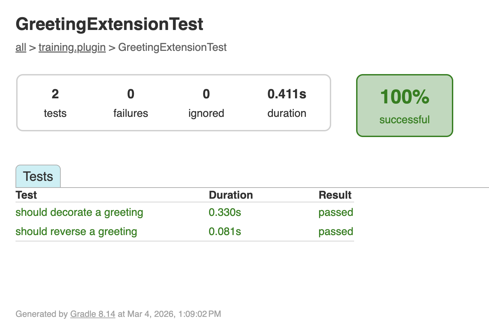

<span class="ai-translation-notice">Tłumaczenie wspomagane przez AI - [dowiedz się więcej i zasugeruj ulepszenia](https://github.com/nextflow-io/training/blob/master/TRANSLATING.md)</span>

Wtyczki to samodzielne oprogramowanie, któremu deweloperzy pipeline'ów muszą ufać.
Testowanie każdej funkcji niezależnie, poza pipeline'em, zapewnia poprawne działanie wtyczki, zanim ktokolwiek zintegruje ją z workflow'em.
W tej sekcji napiszesz i uruchomisz testy przy użyciu frameworka testowego Spock.

:::tip[Wskazówka]
Jeśli zaczynasz od tej części, skopiuj rozwiązanie z Części 3, aby użyć go jako punktu startowego:

```bash
cp -r solutions/3-custom-functions/* .
```

Następnie przejdź do katalogu wtyczki:

```bash
cd nf-greeting
```
:::

Upewnij się, że jesteś w katalogu wtyczki:

```bash
cd nf-greeting
```

---

## 1. Po co testować?

Pomyślna kompilacja oznacza, że kod się kompiluje, ale nie sprawdza, czy działa zgodnie z oczekiwaniami.
Testy jednostkowe to małe fragmenty kodu, które automatycznie sprawdzają, czy Twoje funkcje zwracają właściwe wyjście dla danego wejścia.
Na przykład test może sprawdzić, że `reverseGreeting("Hello"){:nextflow}` zwraca `"olleH"`.

Testy są wartościowe, ponieważ:

- Wykrywają błędy, zanim zrobią to użytkownicy
- Dają pewność, że możesz wprowadzać zmiany bez psucia istniejącej funkcjonalności
- Służą jako dokumentacja pokazująca, jak funkcje powinny być używane

---

## 2. Jak działają testy Spock

Szablon wtyczki używa [Spock](https://spockframework.org/) — frameworka testowego dla Groovy.
Spock jest już skonfigurowany w projekcie (przez `build.gradle`), więc nie musisz nic dodawać.

Jeśli korzystałeś wcześniej z narzędzi testowych (takich jak `pytest` w Pythonie czy `testthat` w R), Spock pełni tę samą rolę: piszesz małe funkcje, które wywołują Twój kod ze znanymi danymi wejściowymi i sprawdzają wyniki.
Różnica polega na tym, że Spock używa oznaczonych bloków (`given:`, `expect:`, `when:`, `then:`), podobnych do procesu lub workflow'u w Nextflow.

Oto podstawowa struktura:

```groovy
def 'should reverse a greeting'() {   // [!annotate] **Nazwa testu w cudzysłowie**: Opisuje, co sprawdza test. Używaj prostego języka angielskiego.
    given:                             // [!annotate] **Blok `given:`**: Przygotuj wszystko, czego potrzebujesz do testu (twórz obiekty, przygotowuj dane)
    def ext = new GreetingExtension()

    expect:                            // [!annotate] **Blok `expect:`**: Właściwe sprawdzenia. Każda linia musi być `true`, aby test przeszedł
    ext.reverseGreeting('Hello') == 'olleH'
}
```

Ta struktura sprawia, że testy są czytelne: „Mając obiekt rozszerzenia, oczekuj, że `reverseGreeting('Hello')` zwróci `'olleH'`."

---

## 3. Napisz testy

Napisz testy dla dwóch funkcji, które stworzyłeś w Części 3: `reverseGreeting` i `decorateGreeting`.

### 3.1. Utwórz klasę testową

```bash
touch src/test/groovy/training/plugin/GreetingExtensionTest.groovy
```

Otwórz plik w edytorze i dodaj pusty szkielet klasy testowej:

```groovy title="src/test/groovy/training/plugin/GreetingExtensionTest.groovy" showLineNumbers
package training.plugin

import spock.lang.Specification

/**
 * Testy dla funkcji rozszerzenia powitań
 */
class GreetingExtensionTest extends Specification {  // [!annotate] Wszystkie klasy testowe Spock rozszerzają `Specification`. To punkt startowy dla każdego pliku testowego Spock.

}
```

### 3.2. Testowanie reverseGreeting

Dodaj metodę testową wewnątrz ciała klasy.
Blok `given:` tworzy instancję `GreetingExtension`, a blok `expect:` sprawdza, czy `reverseGreeting` poprawnie odwraca dwa różne wejścia.
Test sprawdza funkcję bezpośrednio, bez uruchamiania pipeline'u.

<CodeWalkthrough>

```groovy title="GreetingExtensionTest.groovy" showLineNumbers step="Przed"
package training.plugin

import spock.lang.Specification

/**
 * Testy dla funkcji rozszerzenia powitań
 */
class GreetingExtensionTest extends Specification {

}
```

```groovy {10-17} title="GreetingExtensionTest.groovy" showLineNumbers step="Po"
package training.plugin

import spock.lang.Specification

/**
 * Testy dla funkcji rozszerzenia powitań
 */
class GreetingExtensionTest extends Specification {

    def 'should reverse a greeting'() {
        given:
        def ext = new GreetingExtension()            // [!annotate] Utwórz instancję rozszerzenia, aby testować je bezpośrednio, bez uruchamiania pipeline'u

        expect:
        ext.reverseGreeting('Hello') == 'olleH'     // [!annotate] Każda linia w `expect:` to asercja; test przechodzi tylko wtedy, gdy wszystkie są `true`
        ext.reverseGreeting('Bonjour') == 'ruojnoB'
    }
}
```

</CodeWalkthrough>

### 3.3. Testowanie decorateGreeting

Dodaj drugą metodę testową po pierwszej.
Sprawdza ona, czy `decorateGreeting` opakowuje wejściowy string znakami `***` po każdej stronie.

<CodeWalkthrough>

```groovy {18} title="GreetingExtensionTest.groovy" showLineNumbers step="Przed"
package training.plugin

import spock.lang.Specification

/**
 * Testy dla funkcji rozszerzenia powitań
 */
class GreetingExtensionTest extends Specification {

    def 'should reverse a greeting'() {
        given:
        def ext = new GreetingExtension()

        expect:
        ext.reverseGreeting('Hello') == 'olleH'
        ext.reverseGreeting('Bonjour') == 'ruojnoB'
    }
}
```

```groovy {18-25} title="GreetingExtensionTest.groovy" showLineNumbers step="Po"
package training.plugin

import spock.lang.Specification

/**
 * Testy dla funkcji rozszerzenia powitań
 */
class GreetingExtensionTest extends Specification {

    def 'should reverse a greeting'() {
        given:
        def ext = new GreetingExtension()

        expect:
        ext.reverseGreeting('Hello') == 'olleH'
        ext.reverseGreeting('Bonjour') == 'ruojnoB'
    }

    def 'should decorate a greeting'() {
        given:
        def ext = new GreetingExtension()

        expect:
        ext.decorateGreeting('Hello') == '*** Hello ***'
    }
}
```

</CodeWalkthrough>

---

## 4. Uruchom testy

```bash
make test
```

<details class="example">
<summary>Wynik testów</summary>

```console
BUILD SUCCESSFUL in 5s
7 actionable tasks: 7 executed
```

**Gdzie są wyniki testów?** Gradle ukrywa szczegółowe wyjście, gdy wszystkie testy przechodzą.
„BUILD SUCCESSFUL" oznacza, że wszystko zadziałało.
Jeśli jakiś test nie przejdzie, zobaczysz szczegółowe komunikaty o błędach.

</details>

<details class="exercise">
<summary>Dodaj test przypadku brzegowego</summary>

Dodaj test sprawdzający, czy `reverseGreeting` obsługuje pusty string.
Co powinno zwrócić `reverseGreeting('')`?
Dodaj test, uruchom `make test` i sprawdź, czy przechodzi.

<details class="solution">
<summary>Rozwiązanie</summary>

Dodaj tę metodę testową do `GreetingExtensionTest.groovy`:

```groovy
def 'should handle empty string'() {
    given:
    def ext = new GreetingExtension()

    expect:
    ext.reverseGreeting('') == ''
}
```

Odwrócony pusty string to nadal pusty string.

</details>

</details>

---

## 5. Wyświetl raport testów

Gradle generuje raport testów w formacie HTML ze szczegółowymi wynikami dla każdego testu.
Uruchom serwer WWW w katalogu z raportem:

```bash
pushd build/reports/tests/test
python -m http.server
```

VS Code wyświetli monit o otwarcie aplikacji w przeglądarce.
Przejdź do swojej klasy testowej, aby zobaczyć wyniki poszczególnych testów:



Raport pokazuje każdą metodę testową i informację, czy przeszła, czy nie.

Naciśnij <kbd>Ctrl</kbd>+<kbd>C</kbd>, aby zatrzymać serwer, a następnie wróć do poprzedniego katalogu:

```bash
popd
```

Wróć do głównego katalogu projektu:

```bash
cd ..
```

---

## Podsumowanie

Nauczyłeś się, że:

- Testy Spock używają czytelnej struktury `given:`/`expect:`
- Do uruchamiania testów służy `make test`, a raport HTML znajdziesz w `build/reports/tests/test/`
- Testy weryfikują zachowanie funkcji i służą jako dokumentacja pokazująca, jak powinny być używane

---

## Co dalej?

Do tej pory Twoja wtyczka dodaje niestandardowe funkcje, które pipeline'y mogą wywoływać.
Wtyczki mogą też reagować na zdarzenia workflow'u (zakończenie zadania, opublikowanie pliku, zakończenie pipeline'u) przy użyciu obserwatorów śledzenia.
W następnej sekcji zbudujesz obserwatora, który zlicza ukończone zadania i wyświetla podsumowanie po zakończeniu pipeline'u.

<LinkButton href="05_observers.mdx" variant="primary" icon="right-arrow">Przejdź do Części 5</LinkButton>
