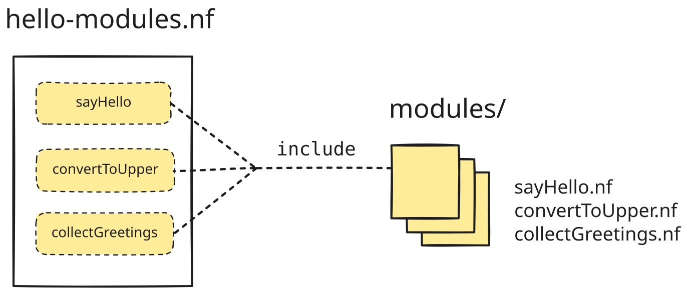

<span class="ai-translation-notice">Tradução assistida por IA - [saiba mais e sugira melhorias](https://github.com/nextflow-io/training/blob/master/TRANSLATING.md)</span>

<figure>
<div class="video-wrapper">
  <iframe width="560" height="315" src="https://www.youtube.com/embed/43Ot-f0iOME?si=y8lAedhEHWaTV4zd&amp;list=PLPZ8WHdZGxmWKozQuzr27jyMGqp9kElVK&amp;cc_load_policy=1" title="YouTube video player" frameborder="0" allow="accelerometer; autoplay; clipboard-write; encrypted-media; gyroscope; picture-in-picture; web-share" referrerpolicy="strict-origin-when-cross-origin" allowfullscreen></iframe>
</div>
<figcaption>

Veja [a playlist completa](https://youtube.com/playlist?list=PLPZ8WHdZGxmWKozQuzr27jyMGqp9kElVK&si=eF7cLR62goy-lc6n) no canal do Nextflow no YouTube.

📗 A transcrição do vídeo está disponível [aqui](./transcripts/04_hello_modules.mdx).

</figcaption>
</figure>

Esta seção aborda como organizar o código do seu fluxo de trabalho para tornar o desenvolvimento e a manutenção do seu pipeline mais eficientes e sustentáveis.
Especificamente, vamos demonstrar como usar [**módulos**](https://nextflow.io/docs/latest/module.html).

No Nextflow, um **módulo** é um arquivo de código independente, frequentemente encapsulando uma única definição de processo.
Para usar um módulo em um fluxo de trabalho, você apenas adiciona uma única declaração `include` ao seu arquivo de código do fluxo de trabalho; então você pode integrar o processo no fluxo de trabalho da mesma forma que normalmente faria.
Isso torna possível reutilizar definições de processos em múltiplos fluxos de trabalho sem produzir múltiplas cópias do código.

Quando começamos a desenvolver nosso fluxo de trabalho, escrevemos tudo em um único arquivo de código.
Agora vamos mover os processos para módulos individuais.



Isso tornará nosso código mais compartilhável, flexível e de fácil manutenção.

<details class="info">
<summary>Como começar a partir desta seção</summary>

Esta seção do curso pressupõe que você completou as Partes 1-3 do curso [Hello Nextflow](./index.mdx), mas se você está confortável com os conceitos básicos abordados nessas seções, pode começar a partir daqui sem fazer nada especial.

</details>

---

## 0. Aquecimento: Execute `hello-modules.nf`

Vamos usar o script de fluxo de trabalho `hello-modules.nf` como ponto de partida.
Ele é equivalente ao script produzido ao trabalhar na Parte 3 deste curso de treinamento, exceto que mudamos os destinos de saída:

```nextflow {3,7,11,15} title="hello-modules.nf" showLineNumbers startLineNumber=37
output {
    first_output {
        path 'hello_modules'
        mode 'copy'
    }
    uppercased {
        path 'hello_modules'
        mode 'copy'
    }
    collected {
        path 'hello_modules'
        mode 'copy'
    }
    batch_report {
        path 'hello_modules'
        mode 'copy'
    }
}
```

Apenas para ter certeza de que tudo está funcionando, execute o script uma vez antes de fazer quaisquer alterações:

```bash
nextflow run hello-modules.nf
# [!output]
N E X T F L O W   ~  version 26.04.4

Launching `hello-modules.nf` [hopeful_avogadro] revision: b09af1237d

executor >  local (7)
[0f/8795c9] sayHello (3)       | 3 of 3 ✔
[6a/eb2510] convertToUpper (3) | 3 of 3 ✔
[af/479117] collectGreetings   | 1 of 1 ✔

Outputs:

  /workspaces/training/hello-nextflow/results

  first_output:
    - hello_modules/Hola-output.txt
    - hello_modules/Bonjour-output.txt
    - hello_modules/Hello-output.txt
  uppercased:
    - hello_modules/UPPER-Hola-output.txt
    - hello_modules/UPPER-Bonjour-output.txt
    - hello_modules/UPPER-Hello-output.txt
  collected: hello_modules/COLLECTED-batch-output.txt
  batch_report: hello_modules/batch-report.txt
```

Como anteriormente, você encontrará os arquivos de saída no diretório especificado no bloco `output` (aqui, `results/hello_modules/`).

<details class="abstract">
<summary>Conteúdo do diretório</summary>

```console
results/hello_modules/
├── Bonjour-output.txt
├── COLLECTED-batch-output.txt
├── Hello-output.txt
├── Hola-output.txt
├── batch-report.txt
├── UPPER-Bonjour-output.txt
├── UPPER-Hello-output.txt
└── UPPER-Hola-output.txt
```

</details>

Se funcionou para você, você está pronto para aprender como modularizar o código do seu fluxo de trabalho.

---

## 1. Crie um diretório para armazenar módulos

É uma boa prática armazenar seus módulos em um diretório específico.
Você pode chamar esse diretório de qualquer nome, mas a convenção é chamá-lo de `modules/`.

```bash
mkdir modules
```

---

## 2. Crie um módulo para `sayHello()`

Na sua forma mais simples, transformar um processo existente em um módulo é pouco mais do que uma operação de copiar e colar.
Vamos criar um esboço de arquivo para o módulo, copiar o código relevante e então excluí-lo do arquivo principal do fluxo de trabalho.

Então tudo o que precisaremos fazer é adicionar uma declaração `include` para que o Nextflow saiba trazer o código relevante em tempo de execução.

### 2.1. Crie um esboço de arquivo para o novo módulo

Vamos criar um arquivo vazio para o módulo chamado `sayHello.nf`.

```bash
touch modules/sayHello.nf
```

Isso nos dá um lugar para colocar o código do processo.

### 2.2. Mova o código do processo `sayHello` para o arquivo do módulo

Copie toda a definição do processo do arquivo de fluxo de trabalho para o arquivo do módulo.

```nextflow title="modules/sayHello.nf" showLineNumbers
/*
 * Usa echo para imprimir 'Hello World!' em um arquivo
 */
process sayHello {

    input:
    val greeting

    output:
    path "${greeting}-output.txt"

    script:
    """
    echo '${greeting}' > '${greeting}-output.txt'
    """
}
```

Uma vez feito isso, exclua a definição do processo do arquivo de fluxo de trabalho.

### 2.3. Adicione uma declaração de importação antes do bloco de fluxo de trabalho

A sintaxe para incluir um processo de um módulo é bastante direta:

```nextflow title="Syntax: include declaration"
include { <PROCESS_NAME> } from '<path_to_module>'
```

Vamos inserir isso acima do bloco `params` e preenchê-lo adequadamente.

<CodeWalkthrough>

```nextflow title="hello-modules.nf" showLineNumbers startLineNumber=44 step="Antes"
/*
* Pipeline parameters
*/
params {
    input: Path = 'data/greetings.csv'
    batch: String = 'batch'
}
```

```nextflow {1,2} title="hello-modules.nf" showLineNumbers startLineNumber=44 step="Depois"
// Inclui módulos
include { sayHello } from './modules/sayHello.nf'

/*
* Pipeline parameters
*/
params {
    input: Path = 'data/greetings.csv'
    batch: String = 'batch'
}
```

</CodeWalkthrough>

Você vê que preenchemos o nome do processo, `sayHello`, e o caminho para o arquivo contendo o código do módulo, `./modules/sayHello.nf`.

### 2.4. Execute o fluxo de trabalho

Estamos executando o fluxo de trabalho com essencialmente o mesmo código e entradas de antes, então vamos executar com a flag `-resume` e ver o que acontece.

```bash
nextflow run hello-modules.nf -resume
# [!output]
N E X T F L O W   ~  version 26.04.4

Launching `hello-modules.nf` [romantic_poisson] revision: 96edfa9ad3

[f6/cc0107] sayHello (1)       | 3 of 3, cached: 3 ✔
[3c/4058ba] convertToUpper (2) | 3 of 3, cached: 3 ✔
[1a/bc5901] collectGreetings   | 1 of 1, cached: 1 ✔

Outputs:

  /workspaces/training/hello-nextflow/results

  first_output:
    - hello_modules/Hello-output.txt
    - hello_modules/Bonjour-output.txt
    - hello_modules/Hola-output.txt
  uppercased:
    - hello_modules/UPPER-Hola-output.txt
    - hello_modules/UPPER-Bonjour-output.txt
    - hello_modules/UPPER-Hello-output.txt
  collected: hello_modules/COLLECTED-batch-output.txt
  batch_report: hello_modules/batch-report.txt
```

Isso deve ser executado muito rapidamente porque tudo está em cache.
Sinta-se à vontade para verificar as saídas publicadas.

O Nextflow reconheceu que ainda é todo o mesmo trabalho a ser feito, mesmo que o código esteja dividido em múltiplos arquivos.

### Conclusão

Você sabe como extrair um processo para um módulo local e você sabe que fazer isso não quebra a capacidade de retomada do fluxo de trabalho.

### O que vem a seguir?

Pratique criando mais módulos.
Uma vez que você fez um, você pode fazer um milhão mais...
Mas vamos fazer apenas mais dois por enquanto.

---

## 3. Modularize o processo `convertToUpper()`

### 3.1. Crie um esboço de arquivo para o novo módulo

Crie um arquivo vazio para o módulo chamado `convertToUpper.nf`.

```bash
touch modules/convertToUpper.nf
```

### 3.2. Mova o código do processo `convertToUpper` para o arquivo do módulo

Copie toda a definição do processo do arquivo de fluxo de trabalho para o arquivo do módulo.

```nextflow title="modules/convertToUpper.nf" showLineNumbers
/*
 * Usa uma ferramenta de substituição de texto para converter a saudação para maiúsculas
 */
process convertToUpper {

    input:
    path input_file

    output:
    path "UPPER-${input_file}"

    script:
    """
    cat ${input_file} | tr '[a-z]' '[A-Z]' > UPPER-${input_file}
    """
}
```

Uma vez feito isso, exclua a definição do processo do arquivo de fluxo de trabalho.

### 3.3. Adicione uma declaração de importação antes do bloco `params`

Insira a declaração de importação acima do bloco `params` e preencha-a adequadamente.

<CodeWalkthrough>

```nextflow title="hello-modules.nf" showLineNumbers startLineNumber=23 step="Antes"
// Inclui módulos
include { sayHello } from './modules/sayHello.nf'

/*
* Pipeline parameters
*/
params {
    input: Path = 'data/greetings.csv'
    batch: String = 'batch'
}
```

```nextflow {3} title="hello-modules.nf" showLineNumbers startLineNumber=23 step="Depois"
// Inclui módulos
include { sayHello } from './modules/sayHello.nf'
include { convertToUpper } from './modules/convertToUpper.nf'

/*
* Pipeline parameters
*/
params {
    input: Path = 'data/greetings.csv'
    batch: String = 'batch'
}
```

</CodeWalkthrough>

Isso deve começar a parecer muito familiar.

### 3.4. Execute o fluxo de trabalho novamente

Execute isso com a flag `-resume`.

```bash
nextflow run hello-modules.nf -resume
# [!output]
N E X T F L O W   ~  version 26.04.4

Launching `hello-modules.nf` [nauseous_heisenberg] revision: a04a9f2da0

[c9/763d42] sayHello (3)       | 3 of 3, cached: 3 ✔
[60/bc6831] convertToUpper (3) | 3 of 3, cached: 3 ✔
[1a/bc5901] collectGreetings   | 1 of 1, cached: 1 ✔

Outputs:

  /workspaces/training/hello-nextflow/results

  first_output:
    - hello_modules/Hola-output.txt
    - hello_modules/Hello-output.txt
    - hello_modules/Bonjour-output.txt
  uppercased:
    - hello_modules/UPPER-Bonjour-output.txt
    - hello_modules/UPPER-Hello-output.txt
    - hello_modules/UPPER-Hola-output.txt
  collected: hello_modules/COLLECTED-batch-output.txt
  batch_report: hello_modules/batch-report.txt
```

Isso ainda deve produzir a mesma saída de antes.

Dois feitos, mais um para fazer!

---

## 4. Modularize o processo `collectGreetings()`

### 4.1. Crie um esboço de arquivo para o novo módulo

Crie um arquivo vazio para o módulo chamado `collectGreetings.nf`.

```bash
touch modules/collectGreetings.nf
```

### 4.2. Mova o código do processo `collectGreetings` para o arquivo do módulo

Copie toda a definição do processo do arquivo de fluxo de trabalho para o arquivo do módulo.

```nextflow title="modules/collectGreetings.nf" showLineNumbers
/*
 * Coleta saudações em maiúsculas em um único arquivo de saída
 */
process collectGreetings {

    input:
    path input_files
    val batch_name

    output:
    path "COLLECTED-${batch_name}-output.txt", emit: outfile
    path "${batch_name}-report.txt", emit: report

    script:
    count_greetings = input_files.size()
    """
    cat ${input_files} > 'COLLECTED-${batch_name}-output.txt'
    echo 'There were ${count_greetings} greetings in this batch.' > '${batch_name}-report.txt'
    """
}
```

Uma vez feito isso, exclua a definição do processo do arquivo de fluxo de trabalho.

### 4.3. Adicione uma declaração de importação antes do bloco `params`

Insira a declaração de importação acima do bloco `params` e preencha-a adequadamente.

<CodeWalkthrough>

```nextflow title="hello-modules.nf" showLineNumbers startLineNumber=3 step="Antes"
// Inclui módulos
include { sayHello } from './modules/sayHello.nf'
include { convertToUpper } from './modules/convertToUpper.nf'

/*
* Pipeline parameters
*/
params {
    input: Path = 'data/greetings.csv'
    batch: String = 'batch'
}
```

```nextflow {4} title="hello-modules.nf" showLineNumbers startLineNumber=3 step="Depois"
// Inclui módulos
include { sayHello } from './modules/sayHello.nf'
include { convertToUpper } from './modules/convertToUpper.nf'
include { collectGreetings } from './modules/collectGreetings.nf'

/*
* Pipeline parameters
*/
params {
    input: Path = 'data/greetings.csv'
    batch: String = 'batch'
}
```

</CodeWalkthrough>

Último!

### 4.4. Execute o fluxo de trabalho

Execute isso com a flag `-resume`.

```bash
nextflow run hello-modules.nf -resume
# [!output]
N E X T F L O W   ~  version 26.04.4

Launching `hello-modules.nf` [friendly_coulomb] revision: 7aa2b9bc0f

[f6/cc0107] sayHello (1)       | 3 of 3, cached: 3 ✔
[3c/4058ba] convertToUpper (2) | 3 of 3, cached: 3 ✔
[1a/bc5901] collectGreetings   | 1 of 1, cached: 1 ✔

Outputs:

  /workspaces/training/hello-nextflow/results

  first_output:
    - hello_modules/Hello-output.txt
    - hello_modules/Bonjour-output.txt
    - hello_modules/Hola-output.txt
  uppercased:
    - hello_modules/UPPER-Bonjour-output.txt
    - hello_modules/UPPER-Hello-output.txt
    - hello_modules/UPPER-Hola-output.txt
  collected: hello_modules/COLLECTED-batch-output.txt
  batch_report: hello_modules/batch-report.txt
```

Isso ainda deve produzir a mesma saída de antes.

### Conclusão

Você sabe como modularizar múltiplos processos em um fluxo de trabalho.

Parabéns, você fez todo esse trabalho e absolutamente nada mudou na forma como o pipeline funciona!

Brincadeiras à parte, agora seu código é mais modular, e se você decidir escrever outro pipeline que chama um desses processos, você só precisa digitar uma curta declaração `include` para usar o módulo relevante.
Isso é melhor do que copiar e colar o código, porque se mais tarde você decidir melhorar o módulo, todos os seus pipelines herdarão as melhorias.

### O que vem a seguir?

Faça uma pequena pausa se quiser.

Quando estiver pronto, passe para a [**Parte 5: Hello Containers**](./05_hello_containers.mdx) para aprender como usar contêineres para gerenciar dependências de software de forma mais conveniente e reproduzível.

---

## Quiz

<Quiz id="quiz-1">

O que é um módulo no Nextflow?
- [ ] Um arquivo de configuração
- [x] Um arquivo independente que pode conter definições de processos
- [ ] Uma definição de fluxo de trabalho
- [ ] Um operador de canal

Saiba mais: [2. Crie um módulo para `sayHello()`](#2-crie-um-módulo-para-sayhello)

</Quiz>

<Quiz id="quiz-2">

Qual convenção é normalmente usada para armazenar arquivos de módulo?
- [ ] No mesmo diretório que o fluxo de trabalho
- [ ] Em um diretório `bin/`
- [x] Em um diretório `modules/`
- [ ] Em um diretório `lib/`

Saiba mais: [1. Crie um diretório para armazenar módulos](#1-crie-um-diretório-para-armazenar-módulos)

</Quiz>

<Quiz id="quiz-3">

Qual é a sintaxe correta para usar um módulo?

- [ ] `import { SAYHELLO } from './modules/sayhello.nf'{:nextflow}`
- [ ] `require { SAYHELLO } from './modules/sayhello.nf'{:nextflow}`
- [x] `include { SAYHELLO } from './modules/sayhello.nf'{:nextflow}`
- [ ] `load { SAYHELLO } from './modules/sayhello.nf'{:nextflow}`

Saiba mais: [2.3. Adicione uma declaração de importação](#23-adicione-uma-declaração-de-importação-antes-do-bloco-de-fluxo-de-trabalho)

</Quiz>

<Quiz id="quiz-4">

O que acontece com a funcionalidade `-resume` ao usar módulos?
- [ ] Ela não funciona mais
- [ ] Ela requer configuração adicional
- [x] Ela funciona da mesma forma que antes
- [ ] Ela funciona apenas para módulos locais

</Quiz>

<Quiz id="quiz-5">

Quais são os benefícios de usar módulos? (Selecione todas as opções aplicáveis)
- [x] Reutilização de código entre fluxos de trabalho
- [x] Manutenção mais fácil
- [x] Melhor organização do código do fluxo de trabalho
- [ ] Velocidade de execução mais rápida

</Quiz>
