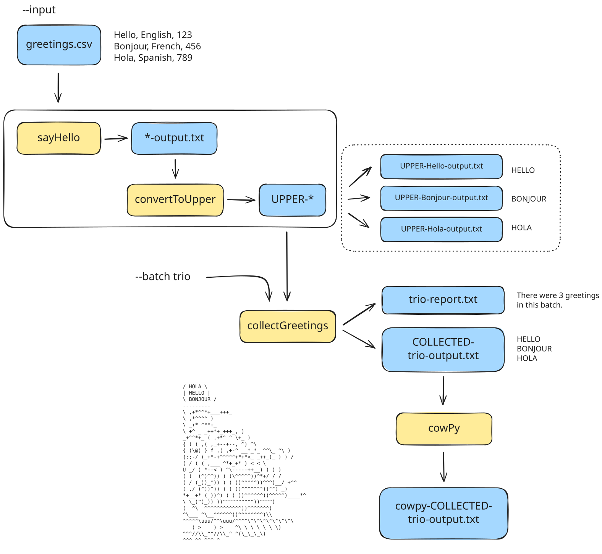

Tradução assistida por IA - [saiba mais e sugira melhorias](https://github.com/nextflow-io/training/blob/master/TRANSLATING.md)

Parabéns por concluir o curso de treinamento Hello Nextflow! 🎉

<figure>

  <iframe width="560" height="315" src="https://www.youtube.com/embed/wnmUAfDL01E?si=y8lAedhEHWaTV4zd&amp;list=PLPZ8WHdZGxmWKozQuzr27jyMGqp9kElVK&amp;cc_load_policy=1&amp;cc_lang_pref=pt" title="YouTube video player" frameborder="0" allow="accelerometer; autoplay; clipboard-write; encrypted-media; gyroscope; picture-in-picture; web-share" referrerpolicy="strict-origin-when-cross-origin" allowfullscreen></iframe>

<figcaption>

Veja a [playlist completa no canal do YouTube do Nextflow](https://youtube.com/playlist?list=PLPZ8WHdZGxmWKozQuzr27jyMGqp9kElVK&si=eF7cLR62goy-lc6n).

📗 Você pode ler a [transcrição do vídeo](./transcripts/07_next_steps.mdx) junto com o vídeo.

</figcaption>
</figure>

## Sua jornada

Você começou com um fluxo de trabalho muito básico que executava um comando hardcoded.
Ao longo de seis partes, você transformou esse fluxo de trabalho básico em um pipeline modular de múltiplas etapas que exercita recursos-chave do Nextflow, incluindo canais, operadores, suporte integrado para contêineres e opções de configuração.

### O que você construiu

- A forma final do fluxo de trabalho Hello recebe como entrada um arquivo CSV contendo saudações em texto.
- As quatro etapas são implementadas como processos Nextflow (`sayHello`, `convertToUpper`, `collectGreetings` e `cowpy`) armazenados em arquivos de módulo separados.
- Os resultados são publicados em um diretório chamado `results/`.
- A saída final do pipeline é um arquivo de texto simples contendo arte ASCII de um personagem dizendo as saudações em maiúsculas.

1. **`sayHello`:** Escreve cada saudação em seu próprio arquivo de saída (_ex._ "Hello-output.txt")
2. **`convertToUpper`:** Converte cada saudação para maiúsculas (_ex._ "HELLO")
3. **`collectGreetings`:** Coleta todas as saudações em maiúsculas em um único arquivo em lote
4. **`cowpy`:** Gera arte ASCII usando a ferramenta `cowpy`

A configuração do fluxo de trabalho suporta fornecer entradas e parâmetros de forma flexível e reproduzível.

### Habilidades adquiridas

Através deste curso prático, você aprendeu como:

- Descrever e utilizar componentes principais do Nextflow suficientes para construir um fluxo de trabalho simples de múltiplas etapas
- Descrever conceitos de próximo nível, como operadores e fábricas de canais
- Lançar um fluxo de trabalho Nextflow localmente
- Encontrar e interpretar saídas (resultados) e arquivos de log gerados pelo Nextflow
- Solucionar problemas básicos

Você está agora equipado com o conhecimento fundamental para começar a desenvolver seus próprios pipelines no Nextflow.

## Próximos passos para desenvolver suas habilidades

Aqui estão nossas 3 principais sugestões do que fazer em seguida:

- Aplique Nextflow a um caso de uso de análise científica com [Nextflow for Science](../nf4_science/index.mdx)
- Comece com nf-core através do [Build with nf-core](../nfcore_build/index.mdx)
- Explore recursos mais avançados do Nextflow com as [Side Quests](../side_quests/index.mdx)

Finalmente, recomendamos que você dê uma olhada no [**Seqera Platform**](https://seqera.io/), uma plataforma baseada em nuvem desenvolvida pelos criadores do Nextflow que torna ainda mais fácil lançar e gerenciar seus fluxos de trabalho, bem como gerenciar seus dados e executar análises interativamente em qualquer ambiente.

## Pesquisa de feedback

Antes de prosseguir, por favor reserve um minuto para completar a pesquisa do curso! Seu feedback nos ajuda a melhorar nossos materiais de treinamento para todos.

<LinkButton href="survey.mdx" variant="primary" icon="right-arrow">Responder a pesquisa</LinkButton>
