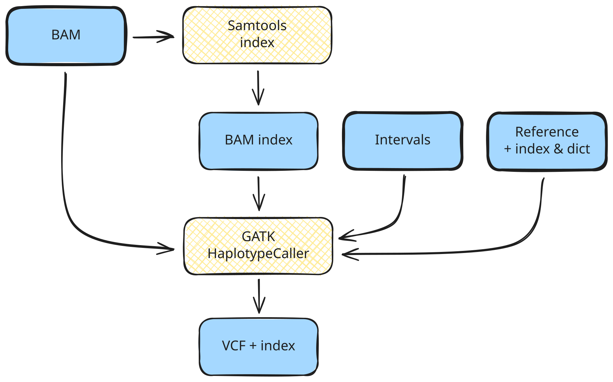

<span class="ai-translation-notice">Tradução assistida por IA - [saiba mais e sugira melhorias](https://github.com/nextflow-io/training/blob/master/TRANSLATING.md)</span>

Na Parte 1, você testou os comandos do Samtools e do GATK manualmente em seus respectivos contêineres.
Em seguida, vamos encapsular esses mesmos comandos em um fluxo de trabalho Nextflow.

## Tarefa

Nesta parte do curso, vamos desenvolver um fluxo de trabalho que faz o seguinte:

1. Gerar um arquivo de índice para cada arquivo BAM de entrada usando o [Samtools](https://www.htslib.org/)
2. Executar o GATK HaplotypeCaller em cada arquivo BAM de entrada para gerar chamadas de variantes por amostra em VCF (Variant Call Format)



Isso automatiza as etapas da primeira seção da [Parte 1: Visão geral do método](./01_method.mdx#1-chamada-de-variantes-por-amostra), onde você executou esses comandos manualmente em seus contêineres.

Como ponto de partida, fornecemos um arquivo de fluxo de trabalho, `genomics.nf`, que descreve as partes principais do fluxo de trabalho, bem como dois arquivos de módulo, `samtools_index.nf` e `gatk_haplotypecaller.nf`, que descrevem a estrutura de cada processo.

<details class="full-code">
<summary>Arquivos de estrutura</summary>

```nextflow title="genomics.nf"
#!/usr/bin/env nextflow

// Module INCLUDE statements

/*
 * Pipeline parameters
 */

// Primary input

workflow {

    main:
    // Create input channel

    // Call processes

    publish:
    // Declare outputs to publish
}

output {
    // Configure publish targets
}
```

```nextflow title="modules/samtools_index.nf"
#!/usr/bin/env nextflow

/*
 * Generate BAM index file
 */
process SAMTOOLS_INDEX {

    container

    input:

    output:

    script:
    """

    """
}
```

```nextflow title="modules/gatk_haplotypecaller.nf"
#!/usr/bin/env nextflow

/*
 * Call variants with GATK HaplotypeCaller
 */
process GATK_HAPLOTYPECALLER {

    container

    input:

    output:

    script:
    """

    """
}
```

</details>

Esses arquivos não são funcionais; seu propósito é apenas servir como estruturas para você preencher com as partes interessantes do código.

## Plano de aula

Para tornar o processo de desenvolvimento mais educativo, dividimos isso em quatro estágios:

1. **Escrever um fluxo de trabalho de uma única etapa que executa o Samtools index em um arquivo BAM.**
   Isso cobre a criação de um módulo, sua importação e chamada em um fluxo de trabalho.
2. **Adicionar um segundo processo para executar o GATK HaplotypeCaller no arquivo BAM indexado.**
   Isso introduz o encadeamento de saídas de processos para entradas e o manuseio de arquivos acessórios.
3. **Adaptar o fluxo de trabalho para executar em um lote de amostras.**
   Isso cobre a execução paralela e introduz tuplas para manter arquivos associados juntos.
4. **Fazer o fluxo de trabalho aceitar um arquivo de texto contendo um lote de arquivos de entrada.**
   Isso demonstra um padrão comum para fornecer entradas em massa.

Cada estágio se concentra em um aspecto específico do desenvolvimento de fluxos de trabalho.

:::tip[Dica]
Certifique-se de estar no diretório de trabalho correto:
`cd /workspaces/training/nf4-science/genomics`
:::

---

## 1. Escrever um fluxo de trabalho de uma única etapa que executa o Samtools index em um arquivo BAM

Esta primeira etapa se concentra no básico: carregar um arquivo BAM e gerar um índice para ele.

Lembre-se do comando `samtools index` da [Parte 1](01_method.mdx):

```bash
samtools index '<input_bam>'
```

O comando recebe um arquivo BAM como entrada e produz um arquivo de índice `.bai` ao lado dele.
O URI do contêiner era `community.wave.seqera.io/library/samtools:1.20--b5dfbd93de237464`.

Vamos pegar essas informações e encapsulá-las no Nextflow em três estágios:

1. Configurar a entrada
2. Escrever o processo de indexação e chamá-lo no fluxo de trabalho
3. Configurar o manuseio da saída

### 1.1. Configurar a entrada

Precisamos declarar um parâmetro de entrada, criar um perfil de teste para fornecer um valor padrão conveniente e criar um canal de entrada.

#### 1.1.1. Adicionar uma declaração de parâmetro de entrada

No arquivo principal do fluxo de trabalho `genomics.nf`, na seção `Pipeline parameters`, declare um parâmetro CLI chamado `input`.

<CodeWalkthrough>

```nextflow title="genomics.nf" showLineNumbers startLineNumber=5 step="Antes"
/*
 * Pipeline parameters
 */

// Primary input
```

```nextflow {4-7} title="genomics.nf" showLineNumbers startLineNumber=5 step="Depois"
/*
 * Pipeline parameters
 */
params {
    // Primary input
    input: Path
}
```

</CodeWalkthrough>

Isso configura o parâmetro CLI, mas não queremos digitar o caminho do arquivo toda vez que executamos o fluxo de trabalho durante o desenvolvimento.
Existem várias opções para fornecer um valor padrão; aqui usamos um perfil de teste.

#### 1.1.2. Criar um perfil de teste com um valor padrão em `nextflow.config`

Um perfil de teste fornece valores padrão convenientes para experimentar um fluxo de trabalho sem especificar entradas na linha de comando.
Esta é uma convenção comum no ecossistema Nextflow (veja [Hello Config](../../hello_nextflow/06_hello_config.mdx) para mais detalhes).

Adicione um bloco `profiles` ao `nextflow.config` com um perfil `test` que define o parâmetro `input` para um dos arquivos BAM de teste.

<CodeWalkthrough>

```nextflow title="nextflow.config" showLineNumbers step="Antes"
docker.enabled = true
```

```nextflow {3-7} title="nextflow.config" showLineNumbers step="Depois"
docker.enabled = true

profiles {
    test {
        params.input = "${projectDir}/data/bam/reads_mother.bam"
    }
}
```

</CodeWalkthrough>

Aqui, estamos usando `${projectDir}`, uma variável integrada do Nextflow que aponta para o diretório onde o script do fluxo de trabalho está localizado.
Isso facilita a referência a arquivos de dados e outros recursos sem codificar caminhos absolutos.

#### 1.1.3. Configurar o canal de entrada

No bloco workflow, crie um canal de entrada a partir do valor do parâmetro usando a factory de canal `.fromPath` (como usado em [Hello Channels](../../hello_nextflow/02_hello_channels.mdx)).

<CodeWalkthrough>

```nextflow title="genomics.nf" showLineNumbers startLineNumber=13 step="Antes"
workflow {

    main:
    // Create input channel
```

```nextflow {4-5} title="genomics.nf" showLineNumbers startLineNumber=13 step="Depois"
workflow {

    main:
    // Cria o canal de entrada (arquivo único via parâmetro CLI)
    reads_ch = channel.fromPath(params.input)
```

</CodeWalkthrough>

Em seguida, precisaremos criar o processo para executar a indexação nesta entrada.

### 1.2. Escrever o processo de indexação e chamá-lo no fluxo de trabalho

Precisamos escrever a definição do processo no arquivo do módulo, importá-lo para o fluxo de trabalho usando uma instrução include e chamá-lo na entrada.

#### 1.2.1. Preencher o módulo para o processo de indexação

Abra `modules/samtools_index.nf` e examine o esboço da definição do processo.
Você deve reconhecer os principais elementos estruturais; caso contrário, considere ler [Hello Nextflow](../../hello_nextflow/01_hello_world.mdx) para uma revisão.

Vá em frente e preencha a definição do processo por conta própria usando as informações fornecidas acima, depois verifique seu trabalho comparando com a solução na aba "Depois" abaixo.

<CodeWalkthrough>

```nextflow title="modules/samtools_index.nf" showLineNumbers step="Antes"
#!/usr/bin/env nextflow

/*
 * Generate BAM index file
 */
process SAMTOOLS_INDEX {

    container

    input:

    output:

    script:
    """

    """
}
```

```nextflow {8,11,14,18} title="modules/samtools_index.nf" showLineNumbers step="Depois"
#!/usr/bin/env nextflow

/*
 * Generate BAM index file
 */
process SAMTOOLS_INDEX {

    container 'community.wave.seqera.io/library/samtools:1.20--b5dfbd93de237464'

    input:
    path input_bam

    output:
    path "${input_bam}.bai"

    script:
    """
    samtools index '$input_bam'
    """
}
```

</CodeWalkthrough>

Uma vez concluído isso, o processo está completo.
Para usá-lo no fluxo de trabalho, você precisará importar o módulo e adicionar uma chamada de processo.

#### 1.2.2. Incluir o módulo

Em `genomics.nf`, adicione uma instrução `include` para tornar o processo disponível para o fluxo de trabalho:

<CodeWalkthrough>

```nextflow title="genomics.nf" showLineNumbers startLineNumber=3 step="Antes"
// Module INCLUDE statements
```

```nextflow {2} title="genomics.nf" showLineNumbers startLineNumber=3 step="Depois"
// Module INCLUDE statements
include { SAMTOOLS_INDEX } from './modules/samtools_index.nf'
```

</CodeWalkthrough>

O processo agora está disponível no escopo do fluxo de trabalho.

#### 1.2.3. Chamar o processo de indexação na entrada

Agora, vamos adicionar uma chamada para `SAMTOOLS_INDEX` no bloco workflow, passando o canal de entrada como argumento.

<CodeWalkthrough>

```nextflow title="genomics.nf" showLineNumbers startLineNumber=14 step="Antes"
workflow {

    main:
    // Cria o canal de entrada (arquivo único via parâmetro CLI)
    reads_ch = channel.fromPath(params.input)

    // Call processes
```

```nextflow {7-8} title="genomics.nf" showLineNumbers startLineNumber=14 step="Depois"
workflow {

    main:
    // Cria o canal de entrada (arquivo único via parâmetro CLI)
    reads_ch = channel.fromPath(params.input)

    // Cria o arquivo de índice para o arquivo BAM de entrada
    SAMTOOLS_INDEX(reads_ch)
```

</CodeWalkthrough>

O fluxo de trabalho agora carrega a entrada e executa o processo de indexação nela.
Em seguida, precisamos configurar como a saída é publicada.

### 1.3. Configurar o manuseio da saída

Precisamos declarar quais saídas de processo publicar e especificar para onde elas devem ir.

#### 1.3.1. Declarar uma saída na seção `publish:`

A seção `publish:` dentro do bloco workflow declara quais saídas de processo devem ser publicadas.
Atribua a saída de `SAMTOOLS_INDEX` a um destino nomeado chamado `bam_index`.

<CodeWalkthrough>

```nextflow title="genomics.nf" showLineNumbers startLineNumber=22 step="Antes"
    publish:
    // Declare outputs to publish
}
```

```nextflow {2} title="genomics.nf" showLineNumbers startLineNumber=22 step="Depois"
    publish:
    bam_index = SAMTOOLS_INDEX.out
}
```

</CodeWalkthrough>

Em seguida, precisaremos dizer ao Nextflow onde colocar a saída publicada.

#### 1.3.2. Configurar o destino de saída no bloco `output {}`

O bloco `output {}` fica fora do fluxo de trabalho e especifica onde cada destino nomeado é publicado.
Vamos adicionar um destino para `bam_index` que publica em um subdiretório `bam/`.

<CodeWalkthrough>

```nextflow title="genomics.nf" showLineNumbers startLineNumber=26 step="Antes"
output {
    // Configure publish targets
}
```

```nextflow {2-4} title="genomics.nf" showLineNumbers startLineNumber=26 step="Depois"
output {
    bam_index {
        path 'bam'
    }
}
```

</CodeWalkthrough>

:::note[Nota]
Por padrão, o Nextflow publica arquivos de saída como links simbólicos, o que evita duplicação desnecessária.
Embora os arquivos de dados que estamos usando aqui sejam muito pequenos, em genômica eles podem ficar muito grandes.
Os links simbólicos serão quebrados quando você limpar seu diretório `work`, então para fluxos de trabalho de produção você pode querer substituir o modo de publicação padrão para `'copy'`.
:::

### 1.4. Executar o fluxo de trabalho

Neste ponto, temos um fluxo de trabalho de indexação de uma etapa que deve estar totalmente funcional. Vamos testar se funciona!

Podemos executá-lo com `-profile test` para usar o valor padrão configurado no perfil de teste e evitar ter que escrever o caminho na linha de comando.

```bash
nextflow run genomics.nf -profile test
# [!output]
 N E X T F L O W   ~  version 26.04.4

Launching `genomics.nf` [elegant_ochoa] revision: fd242ec7cf

executor >  local (1)
[ad/b2c9bf] SAMTOOLS_INDEX (1) | 1 of 1 ✔

Outputs:

  /workspaces/training/nf4-science/genomics/results

  bam_index:
    - bam/reads_mother.bam.bai
```

Você pode verificar se o arquivo de índice foi gerado corretamente olhando no diretório work ou no diretório results.

<details class="abstract">
<summary>Conteúdo do diretório work</summary>

```console
work/ad/b2c9bf4af404ef7cf63e0aa3887f65
├── reads_mother.bam -> /workspaces/training/nf4-science/genomics/data/bam/reads_mother.bam
└── reads_mother.bam.bai
```

</details>

<details class="abstract">
<summary>Conteúdo do diretório de resultados</summary>

```console
results/
└── bam/
    └── reads_mother.bam.bai -> ...
```

</details>

Aí está!

### Conclusão

Você sabe como criar um módulo contendo um processo, importá-lo para um fluxo de trabalho, chamá-lo com um canal de entrada e publicar os resultados.

### O que vem a seguir?

Adicionar uma segunda etapa que pega a saída do processo de indexação e a usa para executar a chamada de variantes.

---

## 2. Adicionar um segundo processo para executar o GATK HaplotypeCaller no arquivo BAM indexado

Agora que temos um índice para nosso arquivo de entrada, podemos passar para a configuração da etapa de chamada de variantes.

Lembre-se do comando `gatk HaplotypeCaller` da [Parte 1](01_method.mdx):

```bash
gatk HaplotypeCaller \
        -R /data/ref/ref.fasta \
        -I /data/bam/reads_mother.bam \
        -O reads_mother.vcf \
        -L /data/ref/intervals.bed
```

O comando recebe um arquivo BAM (`-I`), um genoma de referência (`-R`) e um arquivo de intervalos (`-L`), e produz um arquivo VCF (`-O`) junto com seu índice.
A ferramenta também espera que o índice do BAM, o índice da referência e o dicionário da referência estejam localizados junto com seus respectivos arquivos.
O URI do contêiner era `community.wave.seqera.io/library/gatk4:4.5.0.0--730ee8817e436867`.

Seguimos os mesmos três estágios de antes:

1. Configurar as entradas
2. Escrever o processo de chamada de variantes e chamá-lo no fluxo de trabalho
3. Configurar o manuseio da saída

### 2.1. Configurar as entradas

A etapa de chamada de variantes requer vários arquivos de entrada adicionais.
Precisamos declarar parâmetros para eles, adicionar valores padrão ao perfil de teste e criar variáveis para carregá-los.

#### 2.1.1. Adicionar declarações de parâmetros para entradas acessórias

Como nosso novo processo espera alguns arquivos adicionais, adicione declarações de parâmetros para eles em `genomics.nf` na seção `Pipeline parameters`:

<CodeWalkthrough>

```nextflow title="genomics.nf" showLineNumbers startLineNumber=9 step="Antes"
params {
    // Primary input
    input: Path
}
```

```nextflow {5-9} title="genomics.nf" showLineNumbers startLineNumber=9 step="Depois"
params {
    // Primary input
    input: Path

    // Accessory files
    reference: Path
    reference_index: Path
    reference_dict: Path
    intervals: Path
}
```

</CodeWalkthrough>

Como antes, forneceremos valores padrão através do perfil de teste em vez de inline.

#### 2.1.2. Adicionar padrões de arquivos acessórios ao perfil de teste

Assim como fizemos para `input` na seção 1.1.2, adicione valores padrão para os arquivos acessórios ao perfil de teste em `nextflow.config`:

<CodeWalkthrough>

```nextflow title="nextflow.config" showLineNumbers startLineNumber=4 step="Antes"
test {
    params.input = "${projectDir}/data/bam/reads_mother.bam"
}
```

```nextflow {3-6} title="nextflow.config" showLineNumbers startLineNumber=4 step="Depois"
test {
    params.input = "${projectDir}/data/bam/reads_mother.bam"
    params.reference = "${projectDir}/data/ref/ref.fasta"
    params.reference_index = "${projectDir}/data/ref/ref.fasta.fai"
    params.reference_dict = "${projectDir}/data/ref/ref.dict"
    params.intervals = "${projectDir}/data/ref/intervals.bed"
}
```

</CodeWalkthrough>

Em seguida, precisaremos criar variáveis que carreguem esses caminhos de arquivo para uso no fluxo de trabalho.

#### 2.1.3. Criar variáveis para os arquivos acessórios

Adicione variáveis para os caminhos dos arquivos acessórios dentro do bloco workflow:

<CodeWalkthrough>

```nextflow title="genomics.nf" showLineNumbers startLineNumber=21 step="Antes"
workflow {

    main:
    // Cria o canal de entrada (arquivo único via parâmetro CLI)
    reads_ch = channel.fromPath(params.input)

    // Cria o arquivo de índice para o arquivo BAM de entrada
    SAMTOOLS_INDEX(reads_ch)
```

```nextflow {7-11} title="genomics.nf" showLineNumbers startLineNumber=21 step="Depois"
workflow {

    main:
    // Cria o canal de entrada (arquivo único via parâmetro CLI)
    reads_ch = channel.fromPath(params.input)

    // Carrega os caminhos de arquivo para os arquivos acessórios (referência e intervalos)
    ref_file        = file(params.reference)
    ref_index_file  = file(params.reference_index)
    ref_dict_file   = file(params.reference_dict)
    intervals_file  = file(params.intervals)

    // Cria o arquivo de índice para o arquivo BAM de entrada
    SAMTOOLS_INDEX(reads_ch)
```

</CodeWalkthrough>

A sintaxe `file()` diz explicitamente ao Nextflow para tratar essas entradas como caminhos de arquivo.
Você pode aprender mais sobre isso na Side Quest [Working with files](../../side_quests/working_with_files/index.mdx).

### 2.2. Escrever o processo de chamada de variantes e chamá-lo no fluxo de trabalho

Precisamos escrever a definição do processo no arquivo do módulo, importá-lo para o fluxo de trabalho usando uma instrução include e chamá-lo nas leituras de entrada mais a saída da etapa de indexação e os arquivos acessórios.

#### 2.2.1. Preencher o módulo para o processo de chamada de variantes

Abra `modules/gatk_haplotypecaller.nf` e examine o esboço da definição do processo.

Vá em frente e preencha a definição do processo por conta própria usando as informações fornecidas acima, depois verifique seu trabalho comparando com a solução na aba "Depois" abaixo.

<CodeWalkthrough>

```nextflow title="modules/gatk_haplotypecaller.nf" showLineNumbers step="Antes"
#!/usr/bin/env nextflow

/*
 * Call variants with GATK HaplotypeCaller
 */
process GATK_HAPLOTYPECALLER {

    container

    input:

    output:

    script:
    """

    """
}
```

```nextflow {8,11-16,19-20,24-28} title="modules/gatk_haplotypecaller.nf" showLineNumbers step="Depois"
#!/usr/bin/env nextflow

/*
 * Call variants with GATK HaplotypeCaller
 */
process GATK_HAPLOTYPECALLER {

    container "community.wave.seqera.io/library/gatk4:4.5.0.0--730ee8817e436867"

    input:
    path input_bam
    path input_bam_index
    path ref_fasta
    path ref_index
    path ref_dict
    path interval_list

    output:
    path "${input_bam}.vcf"     , emit: vcf
    path "${input_bam}.vcf.idx" , emit: idx

    script:
    """
    gatk HaplotypeCaller \
        -R ${ref_fasta} \
        -I ${input_bam} \
        -O ${input_bam}.vcf \
        -L ${interval_list}
    """
}
```

</CodeWalkthrough>

Você notará que este processo tem mais entradas do que o comando GATK em si requer.
O GATK sabe procurar o arquivo de índice do BAM e os arquivos acessórios do genoma de referência com base em convenções de nomenclatura, mas o Nextflow é agnóstico de domínio e não conhece essas convenções.
Precisamos listá-los explicitamente para que o Nextflow os prepare no diretório de trabalho em tempo de execução; caso contrário, o GATK lançará um erro sobre arquivos ausentes.

Da mesma forma, listamos o arquivo de índice do VCF de saída (`"${input_bam}.vcf.idx"`) explicitamente para que o Nextflow o rastreie para etapas subsequentes.
Usamos a sintaxe `emit:` para atribuir um nome a cada canal de saída, o que se tornará útil quando conectarmos as saídas ao bloco publish.

Uma vez concluído isso, o processo está completo.
Para usá-lo no fluxo de trabalho, você precisará importar o módulo e adicionar uma chamada de processo.

#### 2.2.2. Importar o novo módulo

Atualize `genomics.nf` para importar o novo módulo:

<CodeWalkthrough>

```nextflow title="genomics.nf" showLineNumbers startLineNumber=3 step="Antes"
// Module INCLUDE statements
include { SAMTOOLS_INDEX } from './modules/samtools_index.nf'
```

```nextflow {3} title="genomics.nf" showLineNumbers startLineNumber=3 step="Depois"
// Module INCLUDE statements
include { SAMTOOLS_INDEX } from './modules/samtools_index.nf'
include { GATK_HAPLOTYPECALLER } from './modules/gatk_haplotypecaller.nf'
```

</CodeWalkthrough>

O processo agora está disponível no escopo do fluxo de trabalho.

#### 2.2.3. Adicionar a chamada do processo

Adicione a chamada do processo no corpo do workflow, sob `main:`:

<CodeWalkthrough>

```nextflow title="genomics.nf" showLineNumbers startLineNumber=33 step="Antes"
    // Cria o arquivo de índice para o arquivo BAM de entrada
    SAMTOOLS_INDEX(reads_ch)
```

```nextflow {4-12} title="genomics.nf" showLineNumbers startLineNumber=33 step="Depois"
    // Cria o arquivo de índice para o arquivo BAM de entrada
    SAMTOOLS_INDEX(reads_ch)

    // Chama variantes do arquivo BAM indexado
    GATK_HAPLOTYPECALLER(
        reads_ch,
        SAMTOOLS_INDEX.out,
        ref_file,
        ref_index_file,
        ref_dict_file,
        intervals_file
    )
```

</CodeWalkthrough>

Você deve reconhecer a sintaxe `*.out` da série de treinamento Hello Nextflow; estamos dizendo ao Nextflow para pegar o canal de saída de `SAMTOOLS_INDEX` e conectá-lo à chamada do processo `GATK_HAPLOTYPECALLER`.

:::note[Nota]
Observe que as entradas são fornecidas exatamente na mesma ordem na chamada do processo como estão listadas no bloco input do processo.
No Nextflow, as entradas são posicionais, o que significa que você _deve_ seguir a mesma ordem; e é claro que deve haver o mesmo número de elementos.
:::

### 2.3. Configurar o manuseio da saída

Precisamos adicionar as novas saídas à declaração publish e configurar para onde elas vão.

#### 2.3.1. Adicionar destinos de publicação para as saídas de chamada de variantes

Adicione as saídas VCF e índice à seção `publish:`:

<CodeWalkthrough>

```nextflow title="genomics.nf" showLineNumbers startLineNumber=45 step="Antes"
    publish:
    bam_index = SAMTOOLS_INDEX.out
}
```

```nextflow {3-4} title="genomics.nf" showLineNumbers startLineNumber=45 step="Depois"
    publish:
    bam_index = SAMTOOLS_INDEX.out
    vcf = GATK_HAPLOTYPECALLER.out.vcf
    vcf_idx = GATK_HAPLOTYPECALLER.out.idx
}
```

</CodeWalkthrough>

Em seguida, precisaremos dizer ao Nextflow onde colocar as novas saídas.

#### 2.3.2. Configurar os novos destinos de saída

Adicione entradas para os destinos `vcf` e `vcf_idx` no bloco `output {}`, publicando ambos em um subdiretório `vcf/`:

<CodeWalkthrough>

```nextflow title="genomics.nf" showLineNumbers startLineNumber=49 step="Antes"
output {
    bam_index {
        path 'bam'
    }
}
```

```nextflow {5-10} title="genomics.nf" showLineNumbers startLineNumber=51 step="Depois"
output {
    bam_index {
        path 'bam'
    }
    vcf {
        path 'vcf'
    }
    vcf_idx {
        path 'vcf'
    }
}
```

</CodeWalkthrough>

O VCF e seu índice são publicados como destinos separados que ambos vão para o subdiretório `vcf/`.

### 2.4. Executar o fluxo de trabalho

Execute o fluxo de trabalho expandido, adicionando `-resume` desta vez para que não tenhamos que executar a etapa de indexação novamente.

```bash
nextflow run genomics.nf -profile test -resume
# [!output]
 N E X T F L O W   ~  version 26.04.4

Launching `genomics.nf` [amazing_stonebraker] revision: 3dc6f69336

executor >  local (1)
[ad/b2c9bf] SAMTOOLS_INDEX (1)       | 1 of 1, cached: 1 ✔
[12/2f009f] GATK_HAPLOTYPECALLER (1) | 1 of 1 ✔

Outputs:

  /workspaces/training/nf4-science/genomics/results

  bam_index:
    - bam/reads_mother.bam.bai

  vcf:
    - vcf/reads_mother.bam.vcf

  vcf_idx:
    - vcf/reads_mother.bam.vcf.idx
```

Agora, se olharmos para a saída do console, vemos os dois processos listados.

O primeiro processo foi pulado graças ao cache, como esperado, enquanto o segundo processo foi executado por ser novo.

Você encontrará os arquivos de saída no diretório results (como links simbólicos para o diretório work).

<details class="abstract">
<summary>Conteúdo do diretório</summary>

```console
results/
├── bam/
│   └── reads_mother.bam.bai -> ...
└── vcf/
    ├── reads_mother.bam.vcf -> ...
    └── reads_mother.bam.vcf.idx -> ...
```

</details>

Se você abrir o arquivo VCF, deverá ver o mesmo conteúdo do arquivo que você gerou executando o comando GATK diretamente no contêiner.

<details class="abstract">
<summary>Conteúdo do arquivo</summary>

```console title="reads_mother.bam.vcf" showLineNumbers startLineNumber=26
#CHROM	POS	ID	REF	ALT	QUAL	FILTER	INFO	FORMAT	reads_mother
20_10037292_10066351	3480	.	C	CT	503.03	.	AC=2;AF=1.00;AN=2;DP=23;ExcessHet=0.0000;FS=0.000;MLEAC=2;MLEAF=1.00;MQ=60.00;QD=27.95;SOR=1.179	GT:AD:DP:GQ:PL	1/1:0,18:18:54:517,54,0
20_10037292_10066351	3520	.	AT	A	609.03	.	AC=2;AF=1.00;AN=2;DP=18;ExcessHet=0.0000;FS=0.000;MLEAC=2;MLEAF=1.00;MQ=60.00;QD=33.83;SOR=0.693	GT:AD:DP:GQ:PL	1/1:0,18:18:54:623,54,0
20_10037292_10066351	3529	.	T	A	155.64	.	AC=1;AF=0.500;AN=2;BaseQRankSum=-0.544;DP=21;ExcessHet=0.0000;FS=1.871;MLEAC=1;MLEAF=0.500;MQ=60.00;MQRankSum=0.000;QD=7.78;ReadPosRankSum=-1.158;SOR=1.034	GT:AD:DP:GQ:PL	0/1:12,8:20:99:163,0,328
```

</details>

Esta é a saída que nos importa gerar para cada amostra em nosso estudo.

### Conclusão

Você sabe como fazer um fluxo de trabalho modular de duas etapas que faz trabalho de análise real e é capaz de lidar com as idiossincrasias de formatos de arquivo de genômica, como os arquivos acessórios.

### O que vem a seguir?

Fazer o fluxo de trabalho lidar com várias amostras em massa.

---

## 3. Adaptar o fluxo de trabalho para executar em um lote de amostras

É muito bom ter um fluxo de trabalho que pode automatizar o processamento em uma única amostra, mas e se você tiver 1000 amostras?
Você precisa escrever um script bash que percorre todas as suas amostras?

Não, graças a Deus! Basta fazer um pequeno ajuste no código e o Nextflow cuidará disso para você também.

### 3.1. Atualizar a entrada para listar três amostras

Para executar em várias amostras, atualize o perfil de teste para fornecer um array de caminhos de arquivo em vez de um único.
Esta é uma maneira rápida de testar a execução de várias amostras; na próxima etapa, mudaremos para uma abordagem mais escalável usando um arquivo de entradas.

Primeiro, comente a anotação de tipo na declaração do parâmetro, já que arrays não podem usar declarações tipadas:

<CodeWalkthrough>

```nextflow title="genomics.nf" showLineNumbers startLineNumber=10 step="Antes"
    // Primary input
    input: Path
```

```nextflow {1-2} title="genomics.nf" showLineNumbers startLineNumber=10 step="Depois"
    // Entrada primária (array de três amostras)
    input //: Path
```

</CodeWalkthrough>

Em seguida, atualize o perfil de teste para listar todas as três amostras:

<CodeWalkthrough>

```nextflow title="nextflow.config" showLineNumbers startLineNumber=4 step="Antes"
test {
    params.input = "${projectDir}/data/bam/reads_mother.bam"
    params.reference = "${projectDir}/data/ref/ref.fasta"
    params.reference_index = "${projectDir}/data/ref/ref.fasta.fai"
    params.reference_dict = "${projectDir}/data/ref/ref.dict"
    params.intervals = "${projectDir}/data/ref/intervals.bed"
}
```

```nextflow {2-6} title="nextflow.config" showLineNumbers startLineNumber=4 step="Depois"
test {
    params.input = [
        "${projectDir}/data/bam/reads_mother.bam",
        "${projectDir}/data/bam/reads_father.bam",
        "${projectDir}/data/bam/reads_son.bam"
    ]
    params.reference = "${projectDir}/data/ref/ref.fasta"
    params.reference_index = "${projectDir}/data/ref/ref.fasta.fai"
    params.reference_dict = "${projectDir}/data/ref/ref.dict"
    params.intervals = "${projectDir}/data/ref/intervals.bed"
}
```

</CodeWalkthrough>

A factory de canal no corpo do workflow (`.fromPath`) aceita vários caminhos de arquivo tão bem quanto um único, então nenhuma outra mudança é necessária.

### 3.2. Executar o fluxo de trabalho

Tente executar o fluxo de trabalho agora que a estrutura está configurada para executar em todas as três amostras de teste.

```bash
nextflow run genomics.nf -profile test -resume
```

Coisa engraçada: isso _pode funcionar_, OU _pode falhar_. Por exemplo, aqui está uma execução que teve sucesso:

<details class="success">
<summary>Saída do comando</summary>

```console
 N E X T F L O W   ~  version 26.04.4

Launching `genomics.nf` [pensive_noyce] revision: 6c424c0674

executor >  local (6)
[f9/ccfefd] SAMTOOLS_INDEX (3)       | 3 of 3 ✔
[dc/b63c4b] GATK_HAPLOTYPECALLER (2) | 3 of 3 ✔

Outputs:

  /workspaces/training/nf4-science/genomics/results

  bam_index:
    - bam/reads_mother.bam.bai
    - bam/reads_father.bam.bai
    - bam/reads_son.bam.bai

  vcf:
    - vcf/reads_son.bam.vcf
    - vcf/reads_mother.bam.vcf
    - vcf/reads_father.bam.vcf

  vcf_idx:
    - vcf/reads_son.bam.vcf.idx
    - vcf/reads_mother.bam.vcf.idx
    - vcf/reads_father.bam.vcf.idx
```

</details>

Se a execução do seu fluxo de trabalho teve sucesso, execute-o novamente até obter um erro como este:

<details class="failure">
<summary>Saída do comando</summary>

```console
 N E X T F L O W   ~  version 26.04.4

Launching `genomics.nf` [wise_cray] revision: 6c424c0674

executor >  local (4)
[3e/565553] SAMTOOLS_INDEX (2)       | 3 of 3, cached: 1 ✔
[fb/7d64e0] GATK_HAPLOTYPECALLER (2) | 1 of 3, cached: 1 ✘
ERROR ~ Error executing process > 'GATK_HAPLOTYPECALLER (3)'

Caused by:
  Process `GATK_HAPLOTYPECALLER (3)` terminated with an error exit status (2)

Command executed:

  gatk HaplotypeCaller         -R ref.fasta         -I reads_son.bam         -O reads_son.bam.vcf         -L intervals.bed

Command exit status:
  2

Command error:
  ...
  A USER ERROR has occurred: Traversal by intervals was requested but some input files are not indexed.
  ...
```

</details>

Se você olhar para a saída de erro do comando GATK, haverá uma linha como esta:

```console
A USER ERROR has occurred: Traversal by intervals was requested but some input files are not indexed.
```

Bem, isso é estranho, considerando que indexamos explicitamente os arquivos BAM na primeira etapa do fluxo de trabalho. Poderia haver algo errado com a estrutura?

### 3.3. Solucionar o problema

Vamos inspecionar os diretórios work e usar o operador `view()` para descobrir o que deu errado.

#### 3.3.1. Verificar os diretórios work para as chamadas relevantes

Dê uma olhada dentro do diretório work para a chamada do processo `GATK_HAPLOTYPECALLER` que falhou, listada na saída do console.

<details class="abstract">
<summary>Conteúdo do diretório</summary>

```console
work/3f/e775e3104e279ca5f292bf7b652f3e
├── intervals.bed -> /workspaces/training/nf4-science/genomics/data/ref/intervals.bed
├── reads_father.bam.bai -> /workspaces/training/nf4-science/genomics/work/3e/565553bc8010ce09098c9444851c21/reads_father.bam.bai
├── reads_son.bam -> /workspaces/training/nf4-science/genomics/data/bam/reads_son.bam
├── reads_son.bam.vcf
├── reads_son.bam.vcf.idx
├── ref.dict -> /workspaces/training/nf4-science/genomics/data/ref/ref.dict
├── ref.fasta -> /workspaces/training/nf4-science/genomics/data/ref/ref.fasta
└── ref.fasta.fai -> /workspaces/training/nf4-science/genomics/data/ref/ref.fasta.fai
```

</details>

Preste atenção especial aos nomes do arquivo BAM e do índice BAM que estão listados neste diretório: `reads_son.bam` e `reads_father.bam.bai`.

Que diabos? O Nextflow preparou um arquivo de índice no diretório work desta chamada de processo, mas é o errado. Como isso pôde acontecer?

#### 3.3.2. Usar o [operador view()](https://www.nextflow.io/docs/latest/reference/operator.html#view) para inspecionar o conteúdo do canal

Adicione estas duas linhas no corpo do workflow antes da chamada do processo `GATK_HAPLOTYPECALLER` para visualizar o conteúdo do canal:

<CodeWalkthrough>

```nextflow title="genomics.nf" showLineNumbers startLineNumber=36 step="Antes"
    SAMTOOLS_INDEX(reads_ch)

    // Chama variantes do arquivo BAM indexado
    GATK_HAPLOTYPECALLER(
```

```nextflow {3-5} title="genomics.nf" showLineNumbers startLineNumber=36 step="Depois"
    SAMTOOLS_INDEX(reads_ch)

    // diagnósticos temporários
    reads_ch.view()
    SAMTOOLS_INDEX.out.view()

    // Chama variantes do arquivo BAM indexado
    GATK_HAPLOTYPECALLER(
```

</CodeWalkthrough>

Em seguida, execute o comando do fluxo de trabalho novamente.

```bash
nextflow run genomics.nf -profile test
```

Mais uma vez, isso pode ter sucesso ou falhar. Aqui está como fica a saída das duas chamadas `.view()` para uma execução que falhou:

```console
/workspaces/training/nf4-science/genomics/data/bam/reads_mother.bam
/workspaces/training/nf4-science/genomics/data/bam/reads_father.bam
/workspaces/training/nf4-science/genomics/data/bam/reads_son.bam
/workspaces/training/nf4-science/genomics/work/4d/8e12c356480c490e6e59c85e2abaa8/reads_son.bam.bai
/workspaces/training/nf4-science/genomics/work/d6/fd0227cfd683b47126429029ecad65/reads_father.bam.bai
/workspaces/training/nf4-science/genomics/work/74/9ed94e4fbe4566ea61082e2f2df55a/reads_mother.bam.bai
```

As três primeiras linhas correspondem ao canal de entrada e a segunda, ao canal de saída.
Você pode ver que os arquivos BAM e os arquivos de índice para as três amostras não estão listados na mesma ordem!

:::note[Nota]
Quando você chama um processo Nextflow em um canal contendo vários elementos, o Nextflow tentará paralelizar a execução o máximo possível e coletará as saídas em qualquer ordem em que fiquem disponíveis.
A consequência é que as saídas correspondentes podem ser coletadas em uma ordem diferente da que as entradas originais foram fornecidas.
:::

Como está escrito atualmente, nosso script de fluxo de trabalho assume que os arquivos de índice sairão da etapa de indexação listados na mesma ordem mãe/pai/filho que as entradas foram fornecidas.
Mas isso não é garantido, e é por isso que às vezes (embora nem sempre) os arquivos errados são emparelhados na segunda etapa.

Para corrigir isso, precisamos garantir que os arquivos BAM e seus arquivos de índice viajem juntos pelos canais.

:::tip[Dica]
As instruções `view()` no código do fluxo de trabalho não fazem nada, então não é um problema deixá-las.
No entanto, elas vão poluir sua saída do console, então recomendamos removê-las quando terminar de solucionar o problema.
:::

### 3.4. Atualizar o fluxo de trabalho para lidar com os arquivos de índice corretamente

A correção é agrupar cada arquivo BAM com seu índice em uma tupla, depois atualizar o processo downstream e a estrutura do fluxo de trabalho para corresponder.

#### 3.4.1. Alterar a saída do módulo SAMTOOLS_INDEX para uma tupla

A maneira mais simples de garantir que um arquivo BAM e seu índice permaneçam intimamente associados é empacotá-los juntos em uma tupla saindo da tarefa de índice.

:::note[Nota]
Uma **tupla** é uma lista finita e ordenada de elementos que é comumente usada para retornar vários valores de uma função. As tuplas são particularmente úteis para passar várias entradas ou saídas entre processos, preservando sua associação e ordem.
:::

Atualize a saída em `modules/samtools_index.nf` para incluir o arquivo BAM:

<CodeWalkthrough>

```nextflow title="modules/samtools_index.nf" showLineNumbers startLineNumber=14 step="Antes"
    output:
    path "${input_bam}.bai"
```

```nextflow {2} title="modules/samtools_index.nf" showLineNumbers startLineNumber=14 step="Depois"
    output:
    tuple path(input_bam), path("${input_bam}.bai")
```

</CodeWalkthrough>

Dessa forma, cada arquivo de índice será fortemente acoplado ao seu arquivo BAM original, e a saída geral da etapa de indexação será um único canal contendo pares de arquivos.

#### 3.4.2. Alterar a entrada do módulo GATK_HAPLOTYPECALLER para aceitar uma tupla

Como mudamos a 'forma' da saída do primeiro processo, precisamos atualizar a definição de entrada do segundo processo para corresponder.

Atualize `modules/gatk_haplotypecaller.nf`:

<CodeWalkthrough>

```nextflow title="modules/gatk_haplotypecaller.nf" showLineNumbers startLineNumber=11 step="Antes"
    input:
    path input_bam
    path input_bam_index
```

```nextflow {2} title="modules/gatk_haplotypecaller.nf" showLineNumbers startLineNumber=11 step="Depois"
    input:
    tuple path(input_bam), path(input_bam_index)
```

</CodeWalkthrough>

Em seguida, precisaremos atualizar o fluxo de trabalho para refletir a nova estrutura de tupla na chamada do processo e nos destinos de publicação.

#### 3.4.3. Atualizar a chamada para GATK_HAPLOTYPECALLER no fluxo de trabalho

Não precisamos mais fornecer o `reads_ch` original ao processo `GATK_HAPLOTYPECALLER`, já que o arquivo BAM agora está agrupado no canal de saída por `SAMTOOLS_INDEX`.

Atualize a chamada em `genomics.nf`:

<CodeWalkthrough>

```nextflow title="genomics.nf" showLineNumbers startLineNumber=42 step="Antes"
    GATK_HAPLOTYPECALLER(
        reads_ch,
        SAMTOOLS_INDEX.out,
```

```nextflow {2} title="genomics.nf" showLineNumbers startLineNumber=42 step="Depois"
    GATK_HAPLOTYPECALLER(
        SAMTOOLS_INDEX.out,
```

</CodeWalkthrough>

Finalmente, precisamos atualizar os destinos de publicação para refletir a nova estrutura de saída.

#### 3.4.4. Atualizar o destino de publicação para a saída do BAM indexado

Como a saída de SAMTOOLS_INDEX agora é uma tupla contendo tanto o arquivo BAM quanto seu índice, renomeie o destino de publicação de `bam_index` para `indexed_bam` para melhor refletir seu conteúdo:

<CodeWalkthrough>

```nextflow title="genomics.nf" showLineNumbers startLineNumber=46 step="Antes"
    publish:
    bam_index = SAMTOOLS_INDEX.out
    vcf = GATK_HAPLOTYPECALLER.out.vcf
    vcf_idx = GATK_HAPLOTYPECALLER.out.idx
}

output {
    bam_index {
        path 'bam'
    }
    vcf {
        path 'vcf'
    }
    vcf_idx {
        path 'vcf'
    }
}
```

```nextflow {2,8} title="genomics.nf" showLineNumbers startLineNumber=46 step="Depois"
    publish:
    indexed_bam = SAMTOOLS_INDEX.out
    vcf = GATK_HAPLOTYPECALLER.out.vcf
    vcf_idx = GATK_HAPLOTYPECALLER.out.idx
}

output {
    indexed_bam {
        path 'bam'
    }
    vcf {
        path 'vcf'
    }
    vcf_idx {
        path 'vcf'
    }
}
```

</CodeWalkthrough>

Com essas mudanças, o BAM e seu índice têm garantia de viajar juntos, então o emparelhamento sempre estará correto.

### 3.5. Executar o fluxo de trabalho corrigido

Execute o fluxo de trabalho novamente para garantir que isso funcionará de forma confiável daqui para frente.

```bash
nextflow run genomics.nf -profile test
```

Desta vez (e todas as vezes) tudo deve executar corretamente:

<details class="success">
<summary>Saída do comando</summary>

```console
 N E X T F L O W   ~  version 26.04.4

Launching `genomics.nf` [furious_hirsch] revision: 4f0b37c75a

executor >  local (6)
[39/6efc23] SAMTOOLS_INDEX (1)       | 3 of 3 ✔
[de/b3744f] GATK_HAPLOTYPECALLER (2) | 3 of 3 ✔

Outputs:

  /workspaces/training/nf4-science/genomics/results

  indexed_bam:
    - [bam/reads_son.bam, bam/reads_son.bam.bai]
    - [bam/reads_father.bam, bam/reads_father.bam.bai]
    - [bam/reads_mother.bam, bam/reads_mother.bam.bai]

  vcf:
    - vcf/reads_mother.bam.vcf
    - vcf/reads_son.bam.vcf
    - vcf/reads_father.bam.vcf

  vcf_idx:
    - vcf/reads_mother.bam.vcf.idx
    - vcf/reads_son.bam.vcf.idx
    - vcf/reads_father.bam.vcf.idx
```

</details>

O diretório results agora contém tanto os arquivos BAM quanto BAI para cada amostra (da tupla), junto com as saídas VCF:

<details class="abstract">
<summary>Conteúdo do diretório de resultados</summary>

```console
results/
├── bam/
│   ├── reads_father.bam -> ...
│   ├── reads_father.bam.bai -> ...
│   ├── reads_mother.bam -> ...
│   ├── reads_mother.bam.bai -> ...
│   ├── reads_son.bam -> ...
│   └── reads_son.bam.bai -> ...
└── vcf/
    ├── reads_father.bam.vcf -> ...
    ├── reads_father.bam.vcf.idx -> ...
    ├── reads_mother.bam.vcf -> ...
    ├── reads_mother.bam.vcf.idx -> ...
    ├── reads_son.bam.vcf -> ...
    └── reads_son.bam.vcf.idx -> ...
```

</details>

Ao agrupar arquivos associados em tuplas, garantimos que os arquivos corretos sempre viajem juntos pelo fluxo de trabalho.
O fluxo de trabalho agora processa qualquer número de amostras de forma confiável, mas listá-las individualmente no config não é muito escalável.
Na próxima etapa, mudaremos para ler entradas de um arquivo.

### Conclusão

Você sabe como fazer seu fluxo de trabalho executar em várias amostras (independentemente).

### O que vem a seguir?

Facilitar o manuseio de amostras em massa.

---

## 4. Fazer o fluxo de trabalho aceitar um arquivo de texto contendo um lote de arquivos de entrada

Uma maneira muito comum de fornecer vários arquivos de dados de entrada para um fluxo de trabalho é fazê-lo com um arquivo de texto contendo os caminhos dos arquivos.
Pode ser tão simples quanto um arquivo de texto listando um caminho de arquivo por linha e nada mais, ou o arquivo pode conter metadados adicionais, caso em que é frequentemente chamado de samplesheet.

Aqui vamos mostrar como fazer o caso simples.

### 4.1. Examinar o arquivo CSV fornecido listando os caminhos dos arquivos de entrada

Já fizemos um arquivo CSV listando os caminhos dos arquivos de entrada, chamado `samplesheet.csv`, que você pode encontrar no diretório `data/`.

```txt title="samplesheet.csv"
sample_id,reads_bam
NA12878,/workspaces/training/nf4-science/genomics/data/bam/reads_mother.bam
NA12877,/workspaces/training/nf4-science/genomics/data/bam/reads_father.bam
NA12882,/workspaces/training/nf4-science/genomics/data/bam/reads_son.bam
```

Este arquivo CSV inclui uma linha de cabeçalho que nomeia as colunas.

:::caution[Aviso]
Os caminhos de arquivo no CSV são caminhos absolutos que devem corresponder ao seu ambiente.
Se você não estiver executando isso no ambiente de treinamento que fornecemos, precisará atualizar os caminhos para corresponder ao seu sistema.
:::

### 4.2. Atualizar o parâmetro e o perfil de teste

Mude o parâmetro `input` para apontar para o arquivo `samplesheet.csv` em vez de listar amostras individuais.

Restaure a anotação de tipo no bloco params (já que é um único caminho novamente):

<CodeWalkthrough>

```nextflow title="genomics.nf" showLineNumbers startLineNumber=10 step="Antes"
    // Entrada primária (array de três amostras)
    input
```

```nextflow {1-2} title="genomics.nf" showLineNumbers startLineNumber=10 step="Depois"
    // Entrada primária (arquivo de arquivos de entrada, um por linha)
    input: Path
```

</CodeWalkthrough>

Em seguida, atualize o perfil de teste para apontar para o arquivo de texto:

<CodeWalkthrough>

```nextflow title="nextflow.config" showLineNumbers startLineNumber=4 step="Antes"
test {
    params.input = [
        "${projectDir}/data/bam/reads_mother.bam",
        "${projectDir}/data/bam/reads_father.bam",
        "${projectDir}/data/bam/reads_son.bam"
    ]
    params.reference = "${projectDir}/data/ref/ref.fasta"
    params.reference_index = "${projectDir}/data/ref/ref.fasta.fai"
    params.reference_dict = "${projectDir}/data/ref/ref.dict"
    params.intervals = "${projectDir}/data/ref/intervals.bed"
}
```

```nextflow {2} title="nextflow.config" showLineNumbers startLineNumber=4 step="Depois"
test {
    params.input = "${projectDir}/data/samplesheet.csv"
    params.reference = "${projectDir}/data/ref/ref.fasta"
    params.reference_index = "${projectDir}/data/ref/ref.fasta.fai"
    params.reference_dict = "${projectDir}/data/ref/ref.dict"
    params.intervals = "${projectDir}/data/ref/intervals.bed"
}
```

</CodeWalkthrough>

A lista de arquivos não vive mais no código, o que é um grande passo na direção certa.

### 4.3. Atualizar a factory de canal para analisar entrada CSV

Atualmente, nossa factory de canal de entrada trata quaisquer arquivos que damos a ela como as entradas de dados que queremos alimentar ao processo de indexação.
Como agora estamos dando a ela um arquivo que lista caminhos de arquivos de entrada, precisamos mudar seu comportamento para analisar o arquivo e tratar os caminhos de arquivo que ele contém como as entradas de dados.

Podemos fazer isso usando o mesmo padrão que usamos na [Parte 2 do Hello Nextflow](../../hello_nextflow/02_hello_channels.mdx#42-use-o-operador-splitcsv-para-analisar-o-arquivo): aplicando o operador [`splitCsv()`](https://nextflow.io/docs/latest/reference/operator.html#splitcsv) para analisar o arquivo, depois uma operação `map` para extrair o caminho do arquivo de cada linha.

<CodeWalkthrough>

```nextflow title="genomics.nf" showLineNumbers startLineNumber=24 step="Antes"
    // Cria o canal de entrada (arquivo único via parâmetro CLI)
    reads_ch = channel.fromPath(params.input)
```

```nextflow {1-4} title="genomics.nf" showLineNumbers startLineNumber=24 step="Depois"
    // Cria o canal de entrada a partir de um arquivo CSV listando caminhos de arquivos de entrada
    reads_ch = channel.fromPath(params.input)
            .splitCsv(header: true)
            .map { row -> file(row.reads_bam) }
```

</CodeWalkthrough>

Uma coisa que é nova em comparação com o que você encontrou no curso Hello Nextflow é que este CSV tem uma linha de cabeçalho, então adicionamos `header: true{:nextflow}` à chamada `splitCsv()`.
Isso nos permite referenciar colunas por nome na operação `map`: `row.reads_bam{:nextflow}` extrai o caminho do arquivo da coluna `reads_bam` de cada linha.

:::tip[Dica]
Se você não está confiante de que entende o que os operadores estão fazendo aqui, esta é outra ótima oportunidade para usar o operador `.view()` para ver como fica o conteúdo do canal antes e depois de aplicá-los.
:::

### 4.4. Executar o fluxo de trabalho

Execute o fluxo de trabalho mais uma vez.

```bash
nextflow run genomics.nf -profile test
# [!output]
 N E X T F L O W   ~  version 26.04.4

Launching `genomics.nf` [spontaneous_descartes] revision: aa5d4a64f3

executor >  local (6)
[f4/553469] SAMTOOLS_INDEX (3)       | 3 of 3 ✔
[89/83e197] GATK_HAPLOTYPECALLER (1) | 3 of 3 ✔

Outputs:

  /workspaces/training/nf4-science/genomics/results

  indexed_bam:
    - [bam/reads_father.bam, bam/reads_father.bam.bai]
    - [bam/reads_mother.bam, bam/reads_mother.bam.bai]
    - [bam/reads_son.bam, bam/reads_son.bam.bai]

  vcf:
    - vcf/reads_son.bam.vcf
    - vcf/reads_mother.bam.vcf
    - vcf/reads_father.bam.vcf

  vcf_idx:
    - vcf/reads_son.bam.vcf.idx
    - vcf/reads_mother.bam.vcf.idx
    - vcf/reads_father.bam.vcf.idx
```

Isso deve produzir o mesmo resultado de antes. Nosso fluxo de trabalho simples de chamada de variantes agora tem todos os recursos básicos que queríamos.

### Conclusão

Você sabe como fazer um fluxo de trabalho modular de várias etapas para indexar um arquivo BAM e aplicar chamada de variantes por amostra usando o GATK.

De forma mais geral, você aprendeu como usar componentes e lógica essenciais do Nextflow para construir um pipeline de genômica simples que faz trabalho real, levando em conta as idiossincrasias de formatos de arquivo de genômica e requisitos de ferramentas.

### O que vem a seguir?

Faça uma pausa! Isso foi muito.

Quando estiver se sentindo revigorado, vá para a [Parte 3](./03_joint_calling.mdx), onde você aprenderá como transformar este fluxo de trabalho simples de chamada de variantes por amostra para aplicar chamada de variantes conjunta aos dados.
