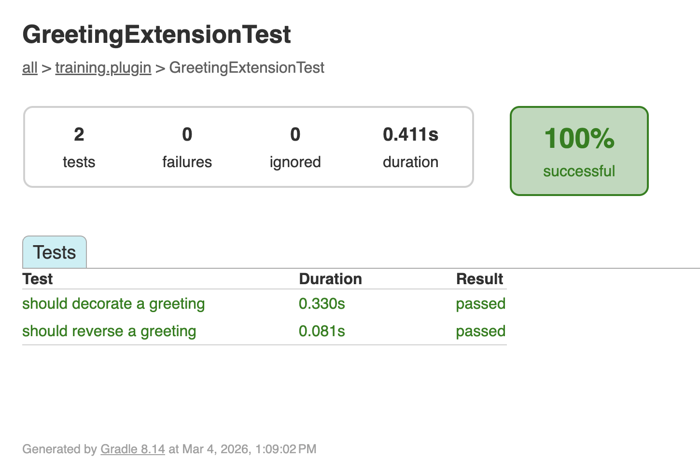

<span class="ai-translation-notice">Tradução assistida por IA - [saiba mais e sugira melhorias](https://github.com/nextflow-io/training/blob/master/TRANSLATING.md)</span>

Plugins são softwares independentes nos quais os desenvolvedores de pipelines precisam confiar.
Testar cada funcionalidade de forma independente, fora de um pipeline, garante que o plugin funcione corretamente antes que alguém o integre a um fluxo de trabalho.
Nesta seção, você vai escrever e executar testes usando o framework de testes Spock.

:::tip[Começando a partir daqui?]
Se você está entrando nesta parte, copie a solução da Parte 3 para usar como ponto de partida:

```bash
cp -r solutions/3-custom-functions/* .
```

Em seguida, entre no diretório do plugin:

```bash
cd nf-greeting
```
:::

Certifique-se de que você está no diretório do plugin:

```bash
cd nf-greeting
```

---

## 1. Por que testar?

Um build bem-sucedido significa que o código compila, mas não verifica se ele funciona como esperado.
Testes unitários são pequenos trechos de código que verificam automaticamente se suas funções produzem a saída correta para uma determinada entrada.
Por exemplo, um teste pode verificar que `reverseGreeting("Hello"){:nextflow}` retorna `"olleH"`.

Os testes são valiosos porque:

- Eles detectam bugs antes que os usuários o façam
- Eles dão confiança para fazer alterações sem quebrar o que já funciona
- Eles servem como documentação mostrando como as funções devem ser usadas

---

## 2. Entendendo os testes Spock

O template do plugin usa o [Spock](https://spockframework.org/), um framework de testes para Groovy.
O Spock já está configurado no projeto (via `build.gradle`), então você não precisa adicionar nada.

Se você já usou ferramentas de teste antes (como `pytest` em Python ou `testthat` em R), o Spock cumpre o mesmo papel: você escreve pequenas funções que chamam seu código com entradas conhecidas e verificam as saídas.
A diferença é que o Spock usa blocos com rótulos (`given:`, `expect:`, `when:`, `then:`) que são semelhantes a um processo ou fluxo de trabalho do Nextflow.

Aqui está a estrutura básica:

```groovy
def 'should reverse a greeting'() {   // [!annotate] **Nome do teste entre aspas**: Descreve o que o teste verifica. Use linguagem simples.
    given:                             // [!annotate] **Bloco `given:`**: Configure o que você precisa para o teste (criar objetos, preparar dados)
    def ext = new GreetingExtension()

    expect:                            // [!annotate] **Bloco `expect:`**: As verificações em si. Cada linha deve ser `true` para o teste passar
    ext.reverseGreeting('Hello') == 'olleH'
}
```

Essa estrutura torna os testes legíveis: "Dado um objeto de extensão, espera-se que `reverseGreeting('Hello')` seja igual a `'olleH'`."

---

## 3. Escreva os testes

Escreva testes para as duas funções que você criou na Parte 3: `reverseGreeting` e `decorateGreeting`.

### 3.1. Crie a classe de teste

```bash
touch src/test/groovy/training/plugin/GreetingExtensionTest.groovy
```

Abra o arquivo no seu editor e adicione o esqueleto vazio da classe de teste:

```groovy title="src/test/groovy/training/plugin/GreetingExtensionTest.groovy" showLineNumbers
package training.plugin

import spock.lang.Specification

/**
 * Testes para as funções de extensão de saudação
 */
class GreetingExtensionTest extends Specification {  // [!annotate] Todas as classes de teste Spock estendem `Specification`. Este é o ponto de partida para qualquer arquivo de teste Spock.

}
```

### 3.2. Teste reverseGreeting

Adicione um método de teste dentro do corpo da classe.
O bloco `given:` cria uma instância de `GreetingExtension`, e o bloco `expect:` verifica que `reverseGreeting` inverte corretamente duas entradas diferentes.
Isso testa a função diretamente, sem executar um pipeline.

<CodeWalkthrough>

```groovy title="GreetingExtensionTest.groovy" showLineNumbers step="Antes"
package training.plugin

import spock.lang.Specification

/**
 * Testes para as funções de extensão de saudação
 */
class GreetingExtensionTest extends Specification {

}
```

```groovy {10-17} title="GreetingExtensionTest.groovy" showLineNumbers step="Depois"
package training.plugin

import spock.lang.Specification

/**
 * Testes para as funções de extensão de saudação
 */
class GreetingExtensionTest extends Specification {

    def 'should reverse a greeting'() {
        given:
        def ext = new GreetingExtension()            // [!annotate] Crie uma instância da sua extensão para testar diretamente, sem executar um pipeline

        expect:
        ext.reverseGreeting('Hello') == 'olleH'     // [!annotate] Cada linha em `expect:` é uma asserção; o teste passa somente se todas forem `true`
        ext.reverseGreeting('Bonjour') == 'ruojnoB'
    }
}
```

</CodeWalkthrough>

### 3.3. Teste decorateGreeting

Adicione um segundo método de teste após o primeiro.
Este verifica que `decorateGreeting` envolve a string de entrada com `***` em cada lado.

<CodeWalkthrough>

```groovy {18} title="GreetingExtensionTest.groovy" showLineNumbers step="Antes"
package training.plugin

import spock.lang.Specification

/**
 * Testes para as funções de extensão de saudação
 */
class GreetingExtensionTest extends Specification {

    def 'should reverse a greeting'() {
        given:
        def ext = new GreetingExtension()

        expect:
        ext.reverseGreeting('Hello') == 'olleH'
        ext.reverseGreeting('Bonjour') == 'ruojnoB'
    }
}
```

```groovy {18-25} title="GreetingExtensionTest.groovy" showLineNumbers step="Depois"
package training.plugin

import spock.lang.Specification

/**
 * Testes para as funções de extensão de saudação
 */
class GreetingExtensionTest extends Specification {

    def 'should reverse a greeting'() {
        given:
        def ext = new GreetingExtension()

        expect:
        ext.reverseGreeting('Hello') == 'olleH'
        ext.reverseGreeting('Bonjour') == 'ruojnoB'
    }

    def 'should decorate a greeting'() {
        given:
        def ext = new GreetingExtension()

        expect:
        ext.decorateGreeting('Hello') == '*** Hello ***'
    }
}
```

</CodeWalkthrough>

---

## 4. Execute os testes

```bash
make test
```

<details class="example">
<summary>Saída dos testes</summary>

```console
BUILD SUCCESSFUL in 5s
7 actionable tasks: 7 executed
```

**Onde estão os resultados dos testes?** O Gradle oculta a saída detalhada quando todos os testes passam.
"BUILD SUCCESSFUL" significa que tudo funcionou.
Se algum teste falhar, você verá mensagens de erro detalhadas.

</details>

<details class="exercise">
<summary>Adicione um teste de caso extremo</summary>

Adicione um teste que verifique se `reverseGreeting` lida com uma string vazia.
O que `reverseGreeting('')` deve retornar?
Adicione o teste, execute `make test` e verifique se ele passa.

<details class="solution">
<summary>Solução</summary>

Adicione este método de teste ao `GreetingExtensionTest.groovy`:

```groovy
def 'should handle empty string'() {
    given:
    def ext = new GreetingExtension()

    expect:
    ext.reverseGreeting('') == ''
}
```

Uma string vazia invertida continua sendo uma string vazia.

</details>

</details>

---

## 5. Visualize o relatório de testes

O Gradle gera um relatório de testes em HTML com resultados detalhados para cada teste.
Inicie um servidor web no diretório do relatório:

```bash
pushd build/reports/tests/test
python -m http.server
```

O VS Code vai solicitar que você abra a aplicação no seu navegador.
Clique até chegar à sua classe de teste para ver os resultados individuais de cada teste:



O relatório mostra cada método de teste e se ele passou ou falhou.

Pressione <kbd>Ctrl</kbd>+<kbd>C</kbd> para parar o servidor e, em seguida, retorne ao diretório anterior:

```bash
popd
```

Volte ao diretório principal do projeto:

```bash
cd ..
```

---

## Conclusão

Você aprendeu que:

- Os testes Spock usam uma estrutura legível com `given:`/`expect:`
- Use `make test` para executar os testes e `build/reports/tests/test/` para o relatório HTML
- Os testes verificam o comportamento e servem como documentação de como as funções devem ser usadas

---

## O que vem a seguir?

Até agora, seu plugin adiciona funções personalizadas que os pipelines podem chamar.
Plugins também podem reagir a eventos do fluxo de trabalho (uma tarefa sendo concluída, um arquivo sendo publicado, o pipeline terminando) usando trace observers.
Na próxima seção, você vai construir um observer que conta as tarefas concluídas e imprime um resumo quando o pipeline termina.

<LinkButton href="05_observers.mdx" variant="primary" icon="right-arrow">Continuar para a Parte 5</LinkButton>
