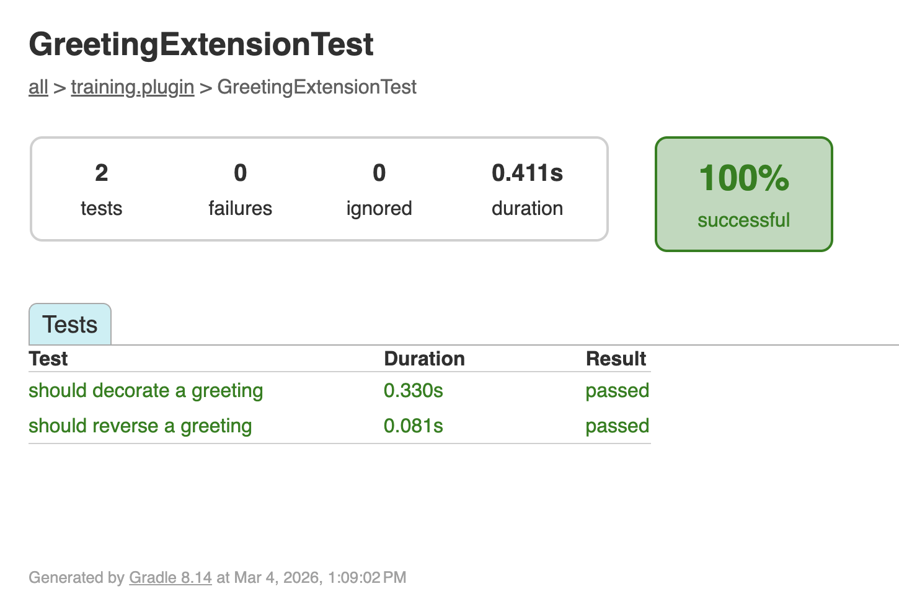

Plugins are standalone software that pipeline developers need to trust.
Testing each feature independently, outside of a pipeline, ensures the plugin works correctly before anyone integrates it into a workflow.
In this section, you'll write and run tests using the Spock testing framework.

:::tip[Starting from here?]
If you're joining at this part, copy the solution from Part 3 to use as your starting point:

```bash
cp -r solutions/3-custom-functions/* .
```

Then change into the plugin directory:

```bash
cd nf-greeting
```
:::

Make sure you're in the plugin directory:

```bash
cd nf-greeting
```

---

## 1. Why test?

A successful build means the code compiles, but doesn't check that it works as expected.
Unit tests are small pieces of code that automatically check if your functions produce the right output for a given input.
For example, a test might check that `reverseGreeting("Hello"){:nextflow}` returns `"olleH"`.

Tests are valuable because:

- They catch bugs before users do
- They give you confidence to make changes without breaking things
- They serve as documentation showing how functions should be used

---

## 2. Understanding Spock tests

The plugin template uses [Spock](https://spockframework.org/), a testing framework for Groovy.
Spock is already configured in the project (via `build.gradle`), so you don't need to add anything.

If you've used testing tools before (like `pytest` in Python or `testthat` in R), Spock fills the same role: you write small functions that call your code with known inputs and check the outputs.
The difference is that Spock uses labelled blocks (`given:`, `expect:`, `when:`, `then:`) that are similar to a Nextflow process or workflow.

Here's the basic structure:

```groovy
def 'should reverse a greeting'() {   // [!annotate] **Test name in quotes**: Describes what the test checks. Use plain English.
    given:                             // [!annotate] **`given:` block**: Set up what you need for the test (create objects, prepare data)
    def ext = new GreetingExtension()

    expect:                            // [!annotate] **`expect:` block**: The actual checks. Each line should be `true` for the test to pass
    ext.reverseGreeting('Hello') == 'olleH'
}
```

This structure makes tests readable: "Given an extension object, expect that `reverseGreeting('Hello')` equals `'olleH'`."

---

## 3. Write the tests

Write tests for the two functions you created in Part 3: `reverseGreeting` and `decorateGreeting`.

### 3.1. Create the test class

```bash
touch src/test/groovy/training/plugin/GreetingExtensionTest.groovy
```

Open it in your editor and add the empty test class skeleton:

```groovy title="src/test/groovy/training/plugin/GreetingExtensionTest.groovy" showLineNumbers
package training.plugin

import spock.lang.Specification

/**
 * Tests for the greeting extension functions
 */
class GreetingExtensionTest extends Specification {  // [!annotate] All Spock test classes extend `Specification`. This is the starting point for any Spock test file.

}
```

### 3.2. Test reverseGreeting

Add a test method inside the class body.
The `given:` block creates a `GreetingExtension` instance, and the `expect:` block checks that `reverseGreeting` correctly reverses two different inputs.
This tests the function directly, without running a pipeline.

<CodeWalkthrough>

```groovy title="GreetingExtensionTest.groovy" showLineNumbers step="Before"
package training.plugin

import spock.lang.Specification

/**
 * Tests for the greeting extension functions
 */
class GreetingExtensionTest extends Specification {

}
```

```groovy {10-17} title="GreetingExtensionTest.groovy" showLineNumbers step="After"
package training.plugin

import spock.lang.Specification

/**
 * Tests for the greeting extension functions
 */
class GreetingExtensionTest extends Specification {

    def 'should reverse a greeting'() {
        given:
        def ext = new GreetingExtension()            // [!annotate] Create an instance of your extension to test directly, without running a pipeline

        expect:
        ext.reverseGreeting('Hello') == 'olleH'     // [!annotate] Each line in `expect:` is an assertion; the test passes only if all are `true`
        ext.reverseGreeting('Bonjour') == 'ruojnoB'
    }
}
```

</CodeWalkthrough>

### 3.3. Test decorateGreeting

Add a second test method after the first one.
This one verifies that `decorateGreeting` wraps the input string with `***` on each side.

<CodeWalkthrough>

```groovy {18} title="GreetingExtensionTest.groovy" showLineNumbers step="Before"
package training.plugin

import spock.lang.Specification

/**
 * Tests for the greeting extension functions
 */
class GreetingExtensionTest extends Specification {

    def 'should reverse a greeting'() {
        given:
        def ext = new GreetingExtension()

        expect:
        ext.reverseGreeting('Hello') == 'olleH'
        ext.reverseGreeting('Bonjour') == 'ruojnoB'
    }
}
```

```groovy {18-25} title="GreetingExtensionTest.groovy" showLineNumbers step="After"
package training.plugin

import spock.lang.Specification

/**
 * Tests for the greeting extension functions
 */
class GreetingExtensionTest extends Specification {

    def 'should reverse a greeting'() {
        given:
        def ext = new GreetingExtension()

        expect:
        ext.reverseGreeting('Hello') == 'olleH'
        ext.reverseGreeting('Bonjour') == 'ruojnoB'
    }

    def 'should decorate a greeting'() {
        given:
        def ext = new GreetingExtension()

        expect:
        ext.decorateGreeting('Hello') == '*** Hello ***'
    }
}
```

</CodeWalkthrough>

---

## 4. Run the tests

```bash
make test
```

<details class="example">
<summary>Test output</summary>

```console
BUILD SUCCESSFUL in 5s
7 actionable tasks: 7 executed
```

**Where are the test results?** Gradle hides detailed output when all tests pass.
"BUILD SUCCESSFUL" means everything worked.
If any test fails, you'll see detailed error messages.

</details>

<details class="exercise">
<summary>Add an edge case test</summary>

Add a test that checks `reverseGreeting` handles an empty string.
What should `reverseGreeting('')` return?
Add the test, run `make test`, and verify it passes.

<details class="solution">
<summary>Solution</summary>

Add this test method to `GreetingExtensionTest.groovy`:

```groovy
def 'should handle empty string'() {
    given:
    def ext = new GreetingExtension()

    expect:
    ext.reverseGreeting('') == ''
}
```

An empty string reversed is still an empty string.

</details>

</details>

---

## 5. View the test report

Gradle generates an HTML test report with detailed results for each test.
Start a web server in the report directory:

```bash
pushd build/reports/tests/test
python -m http.server
```

VS Code will prompt you to open the application in your browser.
Click through to your test class to see individual test results:



The report shows each test method and whether it passed or failed.

Press <kbd>Ctrl</kbd>+<kbd>C</kbd> to stop the server, then return to the previous directory:

```bash
popd
```

Go back to the main project directory:

```bash
cd ..
```

---

## Takeaway

You learned that:

- Spock tests use a readable `given:`/`expect:` structure
- Use `make test` to run tests and `build/reports/tests/test/` for the HTML report
- Tests verify behavior and serve as documentation for how functions should be used

---

## What's next?

So far, your plugin adds custom functions that pipelines can call.
Plugins can also react to workflow events (a task completing, a file being published, the pipeline finishing) using trace observers.
In the next section, you'll build an observer that counts completed tasks and prints a summary when the pipeline finishes.

<LinkButton href="05_observers.mdx" variant="primary" icon="right-arrow">Continue to Part 5</LinkButton>
