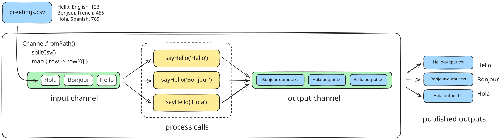
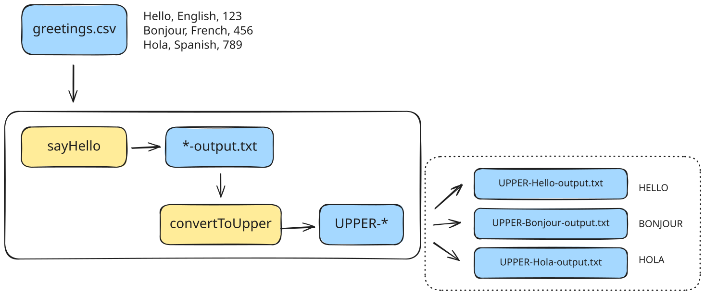
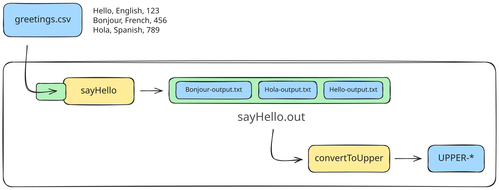
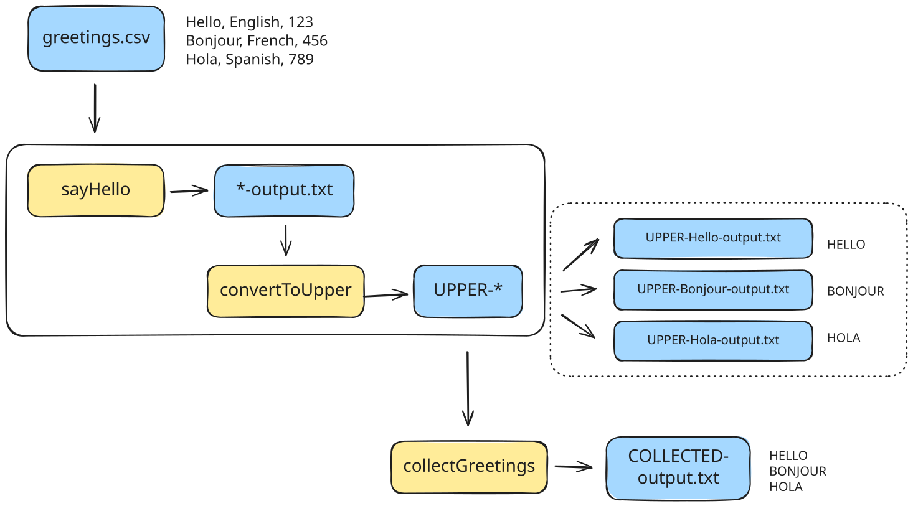
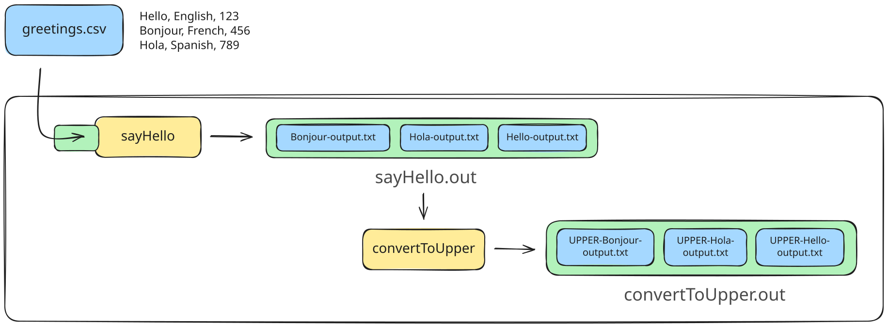
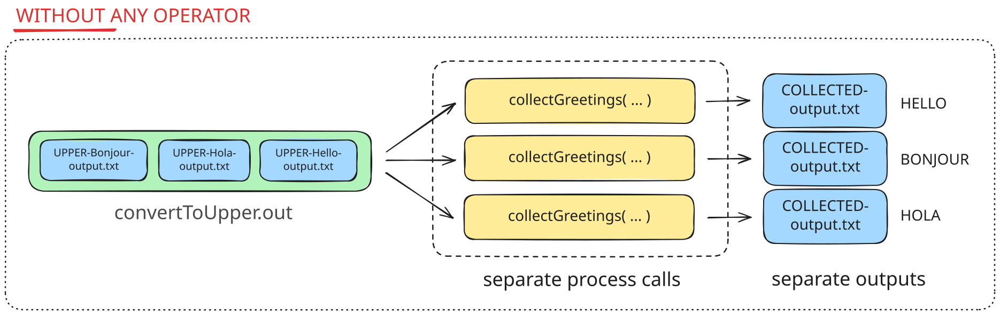
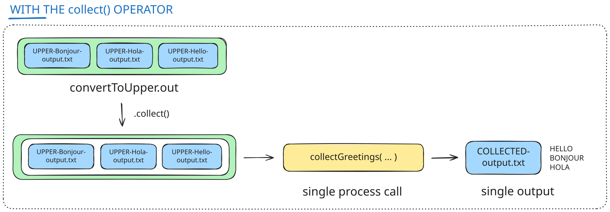
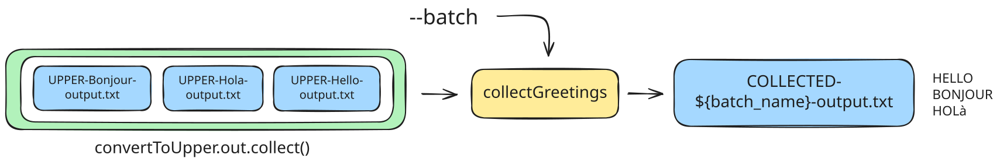
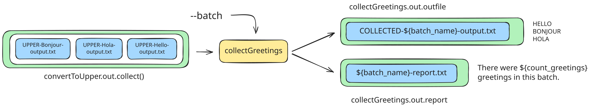
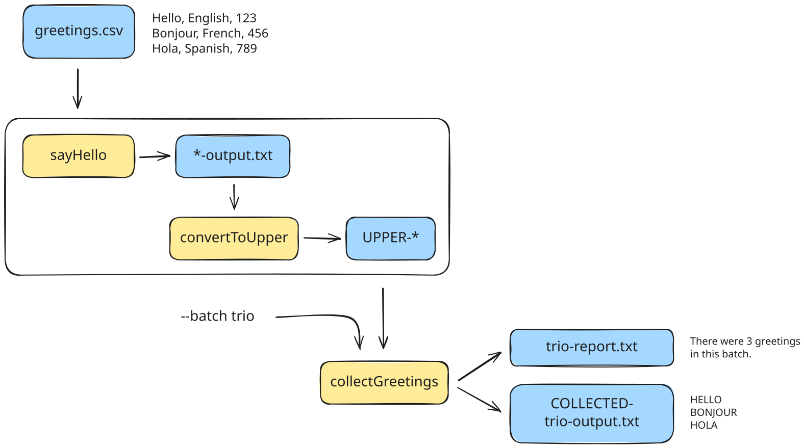

<span class="ai-translation-notice">Yapay zeka destekli çeviri - [daha fazla bilgi ve iyileştirme önerileri](https://github.com/nextflow-io/training/blob/master/TRANSLATING.md)</span>

<figure>
<div class="video-wrapper">
  <iframe width="560" height="315" src="https://www.youtube.com/embed/_aO56V3iXGI?si=y8lAedhEHWaTV4zd&amp;list=PLPZ8WHdZGxmWKozQuzr27jyMGqp9kElVK&amp;cc_load_policy=1" title="YouTube video player" frameborder="0" allow="accelerometer; autoplay; clipboard-write; encrypted-media; gyroscope; picture-in-picture; web-share" referrerpolicy="strict-origin-when-cross-origin" allowfullscreen></iframe>
</div>
<figcaption>

Nextflow YouTube kanalında [tüm oynatma listesini](https://youtube.com/playlist?list=PLPZ8WHdZGxmWKozQuzr27jyMGqp9kElVK&si=eF7cLR62goy-lc6n) izleyin.

📗 Video transkripti [burada](./transcripts/03_hello_workflow.mdx) mevcuttur.

</figcaption>
</figure>

Gerçek dünya iş akışlarının çoğu birden fazla adım içerir.
Bu eğitim modülünde, süreçleri çok adımlı bir iş akışında nasıl birbirine bağlayacağınızı öğreneceksiniz.

Bu, aşağıdakileri başarmanın Nextflow yolunu size öğretecek:

1. Verilerin bir süreçten diğerine akmasını sağlamak
2. Birden fazla süreç çağrısından gelen çıktıları tek bir süreç çağrısına toplamak
3. Bir sürece ek parametreler iletmek
4. Bir süreçten çıkan birden fazla çıktıyı işlemek

Göstermek için, 1. ve 2. Bölümlerden alan-bağımsız Hello World örneği üzerinde geliştirmeye devam edeceğiz.
Bu sefer, insanların gerçek iş akışlarını nasıl oluşturduğunu daha iyi yansıtmak için iş akışımızda aşağıdaki değişiklikleri yapacağız:

1. Selamlamayı büyük harfe dönüştüren ikinci bir adım eklemek.
2. Dönüştürülmüş tüm selamlamaları toparlayıp tek bir dosyaya yazan üçüncü bir adım eklemek.
3. Son çıktı dosyasını adlandırmak için bir parametre eklemek ve bunu toplama adımına ikincil bir girdi olarak iletmek.
4. Toplama adımının ayrıca işlenenler hakkında basit bir istatistik raporlamasını sağlamak.

<details class="info">
<summary>Bu bölümden nasıl başlanır</summary>

Bu kursun bu bölümü, [Hello Nextflow](./index.mdx) kursunun 1-2. Bölümlerini tamamladığınızı varsayar, ancak o bölümlerde ele alınan temel konulara hakimseniz, özel bir şey yapmadan buradan başlayabilirsiniz.

</details>

---

## 0. Isınma: `hello-workflow.nf` dosyasını çalıştırın

Başlangıç noktası olarak `hello-workflow.nf` iş akışı betiğini kullanacağız.
Bu betik, bu eğitim kursunun 2. Bölümünde üretilen betiğe eşdeğerdir; ancak `view()` ifadelerini kaldırdık ve çıktı hedefini değiştirdik:

```nextflow {3} title="hello-workflow.nf" showLineNumbers startLineNumber=37
output {
    first_output {
        path 'hello_workflow'
        mode 'copy'
    }
}
```

Bu diyagram, iş akışının mevcut işleyişini özetlemektedir.
Tanıdık gelmeli, ancak şimdi süreç çıktılarının bir kanala paketlendiğini, tıpkı girdiler gibi, açıkça gösteriyoruz.
Bu çıktı kanalını birazdan iyi bir şekilde kullanacağız.



Her şeyin çalıştığından emin olmak için, herhangi bir değişiklik yapmadan önce betiği bir kez çalıştırın:

```bash
nextflow run hello-workflow.nf
# [!output]
N E X T F L O W   ~  version 26.04.4

Launching `hello-workflow.nf` [admiring_lamarr] revision: 4d4053520d

executor >  local (3)
[b1/5826b5] sayHello (2) | 3 of 3 ✔

Outputs:

  /workspaces/training/hello-nextflow/results

  first_output:
    - hello_workflow/Bonjour-output.txt
    - hello_workflow/Hello-output.txt
    - hello_workflow/Hola-output.txt
```

Daha önce olduğu gibi, çıktı dosyalarını `output` bloğunda belirtilen konumda bulacaksınız.
Bu bölüm için, `results/hello_workflow/` altında.

<details class="abstract">
<summary>Dizin içeriği</summary>

```console
results/hello_workflow
├── Bonjour-output.txt
├── Hello-output.txt
└── Hola-output.txt
```

</details>

Bu sizin için çalıştıysa, çok adımlı bir iş akışı oluşturmayı öğrenmeye hazırsınız.

---

## 1. İş akışına ikinci bir adım ekleyin

Her selamlamayı büyük harfe dönüştürmek için bir adım ekleyeceğiz.



Bu amaçla, üç şey yapmamız gerekiyor:

- Büyük harf dönüşümü yapmak için kullanacağımız komutu tanımlamak.
- Büyük harf dönüşümü komutunu saran yeni bir süreç yazmak.
- İş akışı bloğunda yeni süreci çağırmak ve `sayHello()` sürecinin çıktısını girdi olarak alacak şekilde ayarlamak.

### 1.1. Büyük harf dönüşümü komutunu tanımlayın ve terminalde test edin

Selamlamaları büyük harfe dönüştürmek için, 'metin değiştirme' anlamına gelen `tr` adlı klasik bir UNIX aracını aşağıdaki sözdizimi ile kullanacağız:

```bash title="Syntax"
tr '[a-z]' '[A-Z]'
```

Bu, aksanlı harfleri dikkate almayan çok basit bir metin değiştirme tek satırıdır. Ancak Nextflow kavramlarını göstermek için yeterince iyi bir iş çıkaracaktır ve önemli olan da budur.

Test etmek için, `echo 'Hello World'` komutunu çalıştırabilir ve çıktısını `tr` komutuna yönlendirebiliriz:

```bash
echo 'Hello World' | tr '[a-z]' '[A-Z]' > UPPER-output.txt
```

Çıktı, `Hello World` dizesinin büyük harf versiyonunu içeren `UPPER-output.txt` adlı bir metin dosyasıdır.

<details class="abstract">
<summary>Dosya içeriği</summary>

```console title="UPPER-output.txt"
HELLO WORLD
```

</details>

Temel olarak iş akışımızla yapmaya çalışacağımız şey budur.

### 1.2. Büyük harf dönüşümü adımını bir Nextflow süreci olarak yazın

Aynı bileşenlerin tümünü kullanmak istediğimiz için yeni sürecimizi ilkine göre modelleyebiliriz.

Aşağıdaki süreç tanımını iş akışı betiğine, ilkinin hemen altına ekleyin:

```nextflow title="hello-workflow.nf" showLineNumbers startLineNumber=20
/*
 * Selamlamayı büyük harfe dönüştürmek için bir metin değiştirme aracı kullan
 */
process convertToUpper {

    input:
    path input_file

    output:
    path "UPPER-${input_file}"

    script:
    """
    cat ${input_file} | tr '[a-z]' '[A-Z]' > UPPER-${input_file}
    """
}
```

Bu süreçte, ilk sürecin çıktısı için orijinal olarak yaptığımıza benzer şekilde, ikinci çıktı dosya adını girdi dosya adına dayalı olarak oluşturuyoruz.

### 1.3. İş akışı bloğuna yeni süreç için bir çağrı ekleyin

Şimdi Nextflow'a az önce tanımladığımız süreci gerçekten çağırmasını söylememiz gerekiyor.

İş akışı bloğunda, aşağıdaki kod değişikliğini yapın:

<CodeWalkthrough>

```nextflow title="hello-workflow.nf" showLineNumbers startLineNumber=44 step="Önce"
workflow {

    main:
    // bir CSV dosyasından girdiler için bir kanal oluştur
    greeting_ch = channel.fromPath(params.input)
                        .splitCsv()
                        .map { line -> line[0] }
    // bir selamlama yayınla
    sayHello(greeting_ch)

    publish:
    first_output = sayHello.out
}
```

```nextflow {10-11} title="hello-workflow.nf" showLineNumbers startLineNumber=44 step="Sonra"
workflow {

    main:
    // bir CSV dosyasından girdiler için bir kanal oluştur
    greeting_ch = channel.fromPath(params.input)
                        .splitCsv()
                        .map { line -> line[0] }
    // bir selamlama yayınla
    sayHello(greeting_ch)
    // selamlamayı büyük harfe dönüştür
    convertToUpper()

    publish:
    first_output = sayHello.out
}
```

</CodeWalkthrough>

Bu henüz işlevsel değil çünkü `convertToUpper()` sürecine ne girilmesi gerektiğini belirtmedik.

### 1.4. İlk sürecin çıktısını ikinci sürece iletin

Şimdi `sayHello()` sürecinin çıktısını `convertToUpper()` sürecine akıtmamız gerekiyor.

Kullanışlı bir şekilde, Nextflow bir sürecin çıktısını otomatik olarak bir kanala paketler; bunu ısınma bölümündeki diyagramda gösterildiği gibi.
Bir sürecin çıktı kanalına `<process>.out` olarak atıfta bulunabiliriz.

Dolayısıyla `sayHello` sürecinin çıktısı `sayHello.out` adlı bir kanaldır ve bunu doğrudan `convertToUpper()` çağrısına bağlayabiliriz.



İş akışı bloğunda, aşağıdaki kod değişikliğini yapın:

<CodeWalkthrough>

```nextflow {2} title="hello-workflow.nf" showLineNumbers startLineNumber=53 step="Önce"
    // selamlamayı büyük harfe dönüştür
    convertToUpper()
```

```nextflow {2} title="hello-workflow.nf" showLineNumbers startLineNumber=53 step="Sonra"
    // selamlamayı büyük harfe dönüştür
    convertToUpper(sayHello.out)
```

</CodeWalkthrough>

Bunun gibi basit bir durum için (bir çıktıdan bir girdiye), iki süreci bağlamak için yapmamız gereken tek şey bu!

### 1.5. İş akışı çıktı yayınlamasını ayarlayın

Son olarak, ikinci süreçten gelen sonuçları da yayınlamak için iş akışı çıktılarını güncelleyelim.

#### 1.5.1. `workflow` bloğunun `publish:` bölümünü güncelleyin

`workflow` bloğunda, aşağıdaki kod değişikliğini yapın:

<CodeWalkthrough>

```nextflow title="hello-workflow.nf" showLineNumbers startLineNumber=56 step="Önce"
    publish:
    first_output = sayHello.out
}
```

```nextflow {3} title="hello-workflow.nf" showLineNumbers startLineNumber=56 step="Sonra"
    publish:
    first_output = sayHello.out
    uppercased = convertToUpper.out
}
```

</CodeWalkthrough>

Mantık daha önce olduğu gibi aynı.

#### 1.5.2. `output` bloğunu güncelleyin

`output` bloğunda, aşağıdaki kod değişikliğini yapın:

<CodeWalkthrough>

```nextflow title="hello-workflow.nf" showLineNumbers startLineNumber=61 step="Önce"
output {
    first_output {
        path 'hello_workflow'
        mode 'copy'
    }
}
```

```nextflow {6-9} title="hello-workflow.nf" showLineNumbers startLineNumber=61 step="Sonra"
output {
    first_output {
        path 'hello_workflow'
        mode 'copy'
    }
    uppercased {
        path 'hello_workflow'
        mode 'copy'
    }
}
```

</CodeWalkthrough>

Yine mantık daha önce olduğu gibi aynı.

Bu, çıktı ayarlarını her bir çıktı için çok ayrıntılı bir düzeyde kontrol edebileceğinizi gösterir.
Ne olduğunu görmek için süreçlerden birinin yollarını veya yayınlama modunu değiştirmeyi deneyebilirsiniz.

Tabii ki, bu burada bazı bilgileri tekrar ettiğimiz anlamına gelir; bu, tüm çıktıların konumunu aynı şekilde güncellemek istesek uygunsuz olabilir.
Kursun ilerleyen bölümlerinde, bu ayarları birden fazla çıktı için yapılandırılmış bir şekilde nasıl yapılandıracağınızı öğreneceksiniz.

### 1.6. İş akışını `-resume` ile çalıştırın

İş akışının ilk adımını zaten başarıyla çalıştırdığımız için, bunu `-resume` bayrağını kullanarak test edelim.

```bash
nextflow run hello-workflow.nf -resume
# [!output]
N E X T F L O W   ~  version 26.04.4

Launching `hello-workflow.nf` [high_cantor] revision: d746983511

executor >  local (3)
[ab/816321] sayHello (3)       | 3 of 3, cached: 3 ✔
[e0/ecf81b] convertToUpper (3) | 3 of 3 ✔

Outputs:

  /workspaces/training/hello-nextflow/results

  first_output:
    - hello_workflow/Hello-output.txt
    - hello_workflow/Hola-output.txt
    - hello_workflow/Bonjour-output.txt
  uppercased:
    - hello_workflow/UPPER-Hola-output.txt
    - hello_workflow/UPPER-Hello-output.txt
    - hello_workflow/UPPER-Bonjour-output.txt
```

Konsol çıktısında, az önce eklediğimiz yeni sürece karşılık gelen fazladan bir satır var.

Çıktıları `output` bloğunda ayarlandığı gibi `results/hello_workflow` dizininde bulacaksınız.

<details class="abstract">
<summary>Dizin içeriği</summary>

```console
results/hello_workflow/
├── Bonjour-output.txt
├── Hello-output.txt
├── Hola-output.txt
├── UPPER-Bonjour-output.txt
├── UPPER-Hello-output.txt
└── UPPER-Hola-output.txt
```

</details>

Bu kullanışlı! Ancak yine de ikinci sürece yapılan çağrılardan birinin work dizinine bakmaya değer.

<details class="abstract">
<summary>Dizin içeriği</summary>

```console
work/e0/ecf81b4cacc648b9b994218d5b29d7/
├── Hola-output.txt -> /workspaces/training/hello-nextflow/work/ab/81632178cd37e9e815959278808819/Hola-output.txt
└── UPPER-Hola-output.txt
```

</details>

İki `*-output` dosyası olduğunu fark edin: ilk sürecin çıktısı ve ikincinin çıktısı.

İlk sürecin çıktısı orada çünkü Nextflow, yürütme için gereken her şeyin aynı alt dizinde olması amacıyla onu oraya **hazırladı (staged)**.

Ancak, aslında ilk süreç çağrısının alt dizinindeki orijinal dosyaya işaret eden sembolik bir bağlantıdır.
Varsayılan olarak, burada yaptığımız gibi tek bir makinede çalışırken, Nextflow girdi ve ara dosyaları hazırlamak için kopyalar yerine sembolik bağlantılar kullanır.

Şimdi, devam etmeden önce, yaptığımız tek şeyin `sayHello`'nun çıktısını `convertToUpper`'ın girdisine bağlamak olduğunu ve iki sürecin seri olarak çalıştırılabildiğini düşünün.
Nextflow, bireysel girdi ve çıktı dosyalarını işleme ve bunları iki komut arasında iletme zorlu işini bizim için yaptı.

Bu, Nextflow kanallarının bu kadar güçlü olmasının nedenlerinden biridir: iş akışı adımlarını birbirine bağlamayla ilgili zahmetli işlerle ilgilenirler.

### Özetle

Bir adımın çıktısını bir sonraki adıma girdi olarak sağlayarak süreçleri nasıl zincirleme şeklinde bağlayacağınızı biliyorsunuz.

### Sırada ne var?

Toplu süreç çağrılarından çıktıları nasıl toplayıp tek bir sürece besleyeceğinizi öğrenin.

---

## 2. Tüm selamlamaları toplamak için üçüncü bir adım ekleyin

Burada birden fazla selamlamaya yaptığımız gibi, bir kanaldaki öğelerin her birine bir dönüşüm uygulamak için bir süreç kullandığımızda, bazen o sürecin çıktı kanalındaki öğeleri toplamak ve bunları bir tür analiz veya özetleme yapan başka bir sürece beslemek istiyoruz.

Göstermek için, pipeline'ımıza `convertToUpper` süreci tarafından üretilen tüm büyük harf selamlamaları toplayan ve bunları tek bir dosyaya yazan yeni bir adım ekleyeceğiz.



Sürprizi bozmak istemiyoruz, ama bu çok kullanışlı bir operatör içerecek.

### 2.1. Toplama komutunu tanımlayın ve terminalde test edin

İş akışımıza eklemek istediğimiz toplama adımı, birden fazla büyük harfli selamlamayı tek bir dosyada birleştirmek için `cat` komutunu kullanacak.

Daha önce yaptığımız gibi, beklenen şekilde çalıştığını doğrulamak için komutu terminalde tek başına çalıştıralım.

Terminalinizde aşağıdakileri çalıştırın:

```bash
echo 'Hello' | tr '[a-z]' '[A-Z]' > UPPER-Hello-output.txt
echo 'Bonjour' | tr '[a-z]' '[A-Z]' > UPPER-Bonjour-output.txt
echo 'Hola' | tr '[a-z]' '[A-Z]' > UPPER-Hola-output.txt
cat UPPER-Hello-output.txt UPPER-Bonjour-output.txt UPPER-Hola-output.txt > COLLECTED-output.txt
```

Çıktı, orijinal selamlamaların büyük harf versiyonlarını içeren `COLLECTED-output.txt` adlı bir metin dosyasıdır.

<details class="abstract">
<summary>Dosya içeriği</summary>

```console title="COLLECTED-output.txt"
HELLO
BONJOUR
HOLA
```

</details>

İş akışımızla elde etmek istediğimiz sonuç budur.

### 2.2. Toplama adımını yapmak için yeni bir süreç oluşturun

Yeni bir süreç oluşturalım ve buna `collectGreetings()` diyelim.
Daha önce gördüklerimize dayalı olarak yazmaya başlayabiliriz.

#### 2.2.1. Sürecin 'açık' kısımlarını yazın

Aşağıdaki süreç tanımını iş akışı betiğine ekleyin:

```nextflow title="hello-workflow.nf" showLineNumbers startLineNumber=37
/*
 * Büyük harfli selamlamaları tek bir çıktı dosyasında topla
 */
process collectGreetings {

    input:
    ???

    output:
    path "COLLECTED-output.txt"

    script:
    """
    cat ??? > 'COLLECTED-output.txt'
    """
}
```

Bu, şu ana kadar öğrendiklerinize dayalı olarak güvenle yazabileceğimiz şey.
Ama bu işlevsel değil!
Girdi tanımlarını ve script komutunun ilk yarısını dışarıda bırakıyor çünkü bunları nasıl yazacağımızı çözmemiz gerekiyor.

#### 2.2.2. `collectGreetings()` için girdileri tanımlayın

`convertToUpper()` sürecine yapılan tüm çağrılardan selamlamaları toplamamız gerekiyor.
İş akışındaki önceki adımdan ne alabileceğimizi biliyoruz?

`convertToUpper()` tarafından çıktı olarak verilen kanal, büyük harfli selamlamaları içeren bireysel dosyaların yollarını içerecektir.
Bu bir girdi slotuna eşit; basitlik için buna `input_files` diyelim.

Süreç bloğunda, aşağıdaki kod değişikliğini yapın:

<CodeWalkthrough>

```nextflow {2} title="hello-workflow.nf" showLineNumbers startLineNumber=42 step="Önce"
      input:
      ???
```

```nextflow {2} title="hello-workflow.nf" showLineNumbers startLineNumber=42 step="Sonra"
      input:
      path input_files
```

</CodeWalkthrough>

Birden fazla dosya beklememize rağmen `path` önekini kullandığımıza dikkat edin.

#### 2.2.3. Birleştirme komutunu oluşturun

İşler burada biraz karmaşık olabilir, çünkü rastgele sayıda girdi dosyasını işleyebilmemiz gerekiyor.
Özellikle, komutu önceden yazamayız, bu nedenle Nextflow'a sürece akan girdilere dayalı olarak çalışma zamanında nasıl oluşturacağını söylememiz gerekiyor.

Başka bir deyişle, `[file1.txt, file2.txt, file3.txt]` öğesini içeren bir girdi kanalımız varsa, Nextflow'un bunu `cat file1.txt file2.txt file3.txt`'ye dönüştürmesine ihtiyacımız var.

Neyse ki, script komutunda basitçe `cat ${input_files}` yazarsak Nextflow bunu bizim için yapmaktan mutluluk duyar.

Süreç bloğunda, aşağıdaki kod değişikliğini yapın:

<CodeWalkthrough>

```nextflow title="hello-workflow.nf" showLineNumbers startLineNumber=54 step="Önce"
    script:
    """
    cat ??? > 'COLLECTED-output.txt'
    """
```

```nextflow {3} title="hello-workflow.nf" showLineNumbers startLineNumber=54 step="Sonra"
    script:
    """
    cat ${input_files} > 'COLLECTED-output.txt'
    """
```

</CodeWalkthrough>

Teoride bu, rastgele sayıda girdi dosyasını işlemelidir.

:::tip[İpucu]
Bazı komut satırı araçları, her girdi dosyası için bir argüman (örneğin `-input`) sağlamayı gerektirir.
Bu durumda, komutu oluşturmak için biraz fazladan çalışma yapmamız gerekir.
Bunun bir örneğini [Genomik için Nextflow](../nf4_science/genomics/index.mdx) eğitim kursunda görebilirsiniz.
:::

### 2.3. Toplama adımını iş akışına ekleyin

Şimdi büyük harf dönüşümü adımının çıktısı üzerinde toplama sürecini çağırmamız yeterli olmalı.
Bu da `convertToUpper.out` adlı bir kanaldır.



#### 2.3.1. Süreç çağrılarını bağlayın

İş akışı bloğunda, aşağıdaki kod değişikliğini yapın:

<CodeWalkthrough>

```nextflow title="hello-workflow.nf" showLineNumbers startLineNumber=75 step="Önce"
    // selamlamayı büyük harfe dönüştür
    convertToUpper(sayHello.out)
}
```

```nextflow {4,5} title="hello-workflow.nf" showLineNumbers startLineNumber=75 step="Sonra"
    // selamlamayı büyük harfe dönüştür
    convertToUpper(sayHello.out)

    // tüm selamlamaları tek bir dosyada topla
    collectGreetings(convertToUpper.out)
}
```

</CodeWalkthrough>

Bu, `convertToUpper()`'ın çıktısını `collectGreetings()`'in girdisine bağlar.

#### 2.3.2. `publish:` bölümünü güncelleyin

`workflow` bloğunda, aşağıdaki kod değişikliğini yapın:

<CodeWalkthrough>

```nextflow title="hello-workflow.nf" showLineNumbers startLineNumber=76 step="Önce"
    publish:
    first_output = sayHello.out
    uppercased = convertToUpper.out
}
```

```nextflow {4} title="hello-workflow.nf" showLineNumbers startLineNumber=76 step="Sonra"
    publish:
    first_output = sayHello.out
    uppercased = convertToUpper.out
    collected = collectGreetings.out
}
```

</CodeWalkthrough>

#### 2.3.3. `output` bloğunu güncelleyin

`output` bloğunda, aşağıdaki kod değişikliğini yapın:

<CodeWalkthrough>

```nextflow title="hello-workflow.nf" showLineNumbers startLineNumber=82 step="Önce"
output {
    first_output {
        path 'hello_workflow'
        mode 'copy'
    }
    uppercased {
        path 'hello_workflow'
        mode 'copy'
    }
}
```

```nextflow {10-13} title="hello-workflow.nf" showLineNumbers startLineNumber=82 step="Sonra"
output {
    first_output {
        path 'hello_workflow'
        mode 'copy'
    }
    uppercased {
        path 'hello_workflow'
        mode 'copy'
    }
    collected {
        path 'hello_workflow'
        mode 'copy'
    }
}
```

</CodeWalkthrough>

#### 2.3.4. İş akışını `-resume` ile çalıştırın

Hadi deneyelim.

```bash
nextflow run hello-workflow.nf -resume
# [!output]
N E X T F L O W   ~  version 26.04.4

Launching `hello-workflow.nf` [mad_gilbert] revision: 6acfd5e28d

executor >  local (3)
[79/33b2f0] sayHello (2)         | 3 of 3, cached: 3 ✔
[99/79394f] convertToUpper (3)   | 3 of 3, cached: 3 ✔
[47/50fe4a] collectGreetings (1) | 3 of 3 ✔ # [!code highlight]

Outputs:

  /workspaces/training/hello-nextflow/results

  first_output:
    - hello_workflow/Hello-output.txt
    - hello_workflow/Bonjour-output.txt
    - hello_workflow/Hola-output.txt
  uppercased:
    - hello_workflow/UPPER-Hello-output.txt
    - hello_workflow/UPPER-Bonjour-output.txt
    - hello_workflow/UPPER-Hola-output.txt
  collected:
    - hello_workflow/COLLECTED-output.txt
    - hello_workflow/COLLECTED-output.txt
    - hello_workflow/COLLECTED-output.txt
```

Üçüncü adım dahil başarıyla çalışıyor.

Ancak, son satırdaki `collectGreetings()` için çağrı sayısına bakın.
Yalnızca bir tane bekliyorduk, ama üç tane var.

Şimdi son çıktı dosyasının içeriğine bakın.

<details class="abstract">
<summary>Dosya içeriği</summary>

```console title="results/hello_workflow/COLLECTED-output.txt"
HOLA
```

</details>

Hay aksi. Toplama adımı her selamlama için ayrı ayrı çalıştırıldı, bu istediğimiz şey DEĞİLDİ.



Nextflow'a, o üçüncü adımın `convertToUpper()` tarafından çıktı olarak verilen kanaldaki tüm öğeler üzerinde çalışmasını istediğimizi açıkça söylemek için bir şey yapmamız gerekiyor.

### 2.4. Selamlamaları tek bir girdide toplamak için bir operatör kullanın

Evet, bir kez daha sorunumuzun cevabı bir operatör.

Özellikle, uygun bir şekilde adlandırılmış [`collect()`](https://nextflow.io/docs/latest/reference/operator.html#collect) operatörünü kullanacağız.

#### 2.4.1. `collect()` operatörünü ekleyin

Bu sefer biraz farklı görünecek çünkü operatörü bir kanal fabrikası bağlamında eklemiyoruz; bir çıktı kanalına ekliyoruz.

`convertToUpper.out`'u alıp `collect()` operatörünü ekliyoruz, bu bize `convertToUpper.out.collect()` veriyor.
Bunu doğrudan `collectGreetings()` süreç çağrısına bağlayabiliriz.

İş akışı bloğunda, aşağıdaki kod değişikliğini yapın:

<CodeWalkthrough>

```nextflow {2} title="hello-workflow.nf" showLineNumbers startLineNumber=73 step="Önce"
    // tüm selamlamaları tek bir dosyada topla
    collectGreetings(convertToUpper.out)
}
```

```nextflow {2} title="hello-workflow.nf" showLineNumbers startLineNumber=73 step="Sonra"
    // tüm selamlamaları tek bir dosyada topla
    collectGreetings(convertToUpper.out.collect())
}
```

</CodeWalkthrough>

#### 2.4.2. Bazı `view()` ifadeleri ekleyin

Kanal içeriklerinin önceki ve sonraki durumlarını görselleştirmek için birkaç `view()` ifadesi de ekleyelim.

<CodeWalkthrough>

```nextflow title="hello-workflow.nf" showLineNumbers startLineNumber=73 step="Önce"
    // tüm selamlamaları tek bir dosyada topla
    collectGreetings(convertToUpper.out.collect())
}
```

```nextflow {4-6} title="hello-workflow.nf" showLineNumbers startLineNumber=73 step="Sonra"
    // tüm selamlamaları tek bir dosyada topla
    collectGreetings(convertToUpper.out.collect())

    // isteğe bağlı view ifadeleri
    convertToUpper.out.view { contents -> "Before collect: $contents" }
    convertToUpper.out.collect().view { contents -> "After collect: $contents" }
}
```

</CodeWalkthrough>

`view()` ifadeleri istediğiniz yere konabilir; okunabilirlik için çağrının hemen arkasına koyduk.

#### 2.4.3. İş akışını `-resume` ile tekrar çalıştırın

Hadi deneyelim:

```bash
nextflow run hello-workflow.nf -resume
# [!output]
N E X T F L O W   ~  version 26.04.4

Launching `hello-workflow.nf` [soggy_franklin] revision: bc8e1b2726

executor >  local (1)
[d6/cdf466] sayHello (1)       | 3 of 3, cached: 3 ✔
[99/79394f] convertToUpper (2) | 3 of 3, cached: 3 ✔
[1e/83586c] collectGreetings   | 1 of 1 ✔
Before collect: /workspaces/training/hello-nextflow/work/b3/d52708edba8b864024589285cb3445/UPPER-Bonjour-output.txt
Before collect: /workspaces/training/hello-nextflow/work/99/79394f549e3040dfc2440f69ede1fc/UPPER-Hello-output.txt
Before collect: /workspaces/training/hello-nextflow/work/aa/56bfe7cf00239dc5badc1d04b60ac4/UPPER-Hola-output.txt
After collect: [/workspaces/training/hello-nextflow/work/b3/d52708edba8b864024589285cb3445/UPPER-Bonjour-output.txt, /workspaces/training/hello-nextflow/work/99/79394f549e3040dfc2440f69ede1fc/UPPER-Hello-output.txt, /workspaces/training/hello-nextflow/work/aa/56bfe7cf00239dc5badc1d04b60ac4/UPPER-Hola-output.txt]

Outputs:

  /workspaces/training/hello-nextflow/results

  first_output:
    - hello_workflow/Hello-output.txt
    - hello_workflow/Bonjour-output.txt
    - hello_workflow/Hola-output.txt
  uppercased:
    - hello_workflow/UPPER-Bonjour-output.txt
    - hello_workflow/UPPER-Hello-output.txt
    - hello_workflow/UPPER-Hola-output.txt
  collected: hello_workflow/COLLECTED-output.txt
```

Başarıyla çalışıyor, ancak log çıktısı bundan biraz daha dağınık görünebilir (okunabilirlik için temizledik).

Bu sefer üçüncü adım yalnızca bir kez çağrıldı!
`view()` ifadelerinin çıktısına bakarak şunları görüyoruz:

- Her selamlama için bir tane olmak üzere üç `Before collect:` ifadesi: o noktada dosya yolları kanalda bireysel öğeler.
- Tek bir `After collect:` ifadesi: üç dosya yolu artık tek bir öğe içinde paketlenmiş.

Bunu şu diyagramla özetleyebiliriz:



Son olarak, her şeyin doğru çalıştığından emin olmak için çıktı dosyasının içeriğine bakabilirsiniz.

<details class="abstract">
<summary>Dosya içeriği</summary>

```console title="results/hello_workflow/COLLECTED-output.txt"
BONJOUR
HELLO
HOLA
```

</details>

Bu sefer son çıktı dosyasında üç selamlamamızın hepsi var. Başarılı!

:::note[Not]
Bunu `-resume` olmadan birkaç kez çalıştırırsanız, selamlamaların sırasının bir çalışmadan diğerine değiştiğini göreceksiniz.
Bu, öğelerin süreç çağrılarından geçme sırasının tutarlı olmasının garanti edilmediğini gösterir.
:::

#### 2.4.4. Okunabilirlik için `view()` ifadelerini kaldırın

Bir sonraki bölüme geçmeden önce, konsol çıktısını karmaşıklaştırmamak için `view()` ifadelerini silmenizi öneririz.

<CodeWalkthrough>

```nextflow {4-6} title="hello-workflow.nf" showLineNumbers startLineNumber=73 step="Önce"
    // tüm selamlamaları tek bir dosyada topla
    collectGreetings(convertToUpper.out.collect())

    // isteğe bağlı view ifadeleri
    convertToUpper.out.view { contents -> "Before collect: $contents" }
    convertToUpper.out.collect().view { contents -> "After collect: $contents" }
```

```nextflow title="hello-workflow.nf" showLineNumbers startLineNumber=73 step="Sonra"
    // tüm selamlamaları tek bir dosyada topla
    collectGreetings(convertToUpper.out.collect())
```

</CodeWalkthrough>

Bu temelde 2.4.2 noktasının ters işlemidir.

### Özetle

Toplu süreç çağrılarından çıktıları nasıl toplayıp ortak bir analiz veya özetleme adımına besleyeceğinizi biliyorsunuz.

Özetlemek gerekirse, şu ana kadar oluşturduğunuz şey bu:


### Sırada ne var?

Bir sürece birden fazla girdiyi nasıl ileteceğinizi öğrenin.

---

## 3. Bir sürece ek parametreler iletin

Son çıktı dosyasına belirli bir şey vermek istiyoruz ki sonraki selamlama gruplarını son sonuçların üzerine yazmadan işleyebilelim.

Bu amaçla, iş akışında aşağıdaki iyileştirmeleri yapacağız:

- Toplayıcı süreci, çıktı dosyası için kullanıcı tanımlı bir ad kabul edecek şekilde değiştirmek (`batch_name`)
- İş akışına bir komut satırı parametresi eklemek (`--batch`) ve bunu toplayıcı sürece iletmek



### 3.1. Toplayıcı sürecini değiştirin

Ek girdiyi tanımlamamız ve çıktı dosya adına entegre etmemiz gerekecek.

#### 3.1.1. Ek girdiyi tanımlayın

İyi haber: süreç tanımında istediğimiz kadar girdi değişkeni tanımlayabiliriz.
Buna `batch_name` diyelim.

Süreç bloğunda, aşağıdaki kod değişikliğini yapın:

<CodeWalkthrough>

```nextflow title="hello-workflow.nf" showLineNumbers startLineNumber=42 step="Önce"
    input:
    path input_files
```

```nextflow {3} title="hello-workflow.nf" showLineNumbers startLineNumber=42 step="Sonra"
    input:
    path input_files
    val batch_name
```

</CodeWalkthrough>

Süreçlerinizi istediğiniz kadar girdi bekleyecek şekilde ayarlayabilirsiniz.
Şu anda bunların hepsi zorunlu girdiler olarak ayarlanmış; iş akışının çalışması için bir değer sağlamalısınız.

Zorunlu ve isteğe bağlı girdileri nasıl yöneteceğinizi Nextflow yolculuğunuzda daha sonra öğreneceksiniz.

#### 3.1.2. `batch_name` değişkenini çıktı dosya adında kullanın

Değişkeni, daha önce dinamik dosya adları oluşturduğumuz şekilde çıktı dosya adına ekleyebiliriz.

Süreç bloğunda, aşağıdaki kod değişikliğini yapın:

<CodeWalkthrough>

```nextflow {2,6} title="hello-workflow.nf" showLineNumbers startLineNumber=46 step="Önce"
    output:
    path "COLLECTED-output.txt"

    script:
    """
    cat ${input_files} > 'COLLECTED-output.txt'
    """
```

```nextflow {2,6} title="hello-workflow.nf" showLineNumbers startLineNumber=46 step="Sonra"
    output:
    path "COLLECTED-${batch_name}-output.txt"

    script:
    """
    cat ${input_files} > 'COLLECTED-${batch_name}-output.txt'
    """
```

</CodeWalkthrough>

Bu, süreci iş akışının son çıktısı için belirli bir dosya adı oluşturmak üzere `batch_name` değerini kullanacak şekilde ayarlar.

### 3.2. Bir `batch` komut satırı parametresi ekleyin

Şimdi `batch_name` için değer sağlamanın ve bunu süreç çağrısına beslemenin bir yoluna ihtiyacımız var.

#### 3.2.1. Parametreyi ayarlamak için `params` kullanın

CLI parametrelerini tanımlamak için `params` sistemini nasıl kullanacağınızı zaten biliyorsunuz.
Hadi bunu bir `batch` parametresi tanımlamak için kullanalım (tembel olduğumuz için varsayılan bir değerle).

Pipeline parametreleri bölümünde, aşağıdaki kod değişikliklerini yapın:

<CodeWalkthrough>

```nextflow title="hello-workflow.nf" showLineNumbers startLineNumber=55 step="Önce"
/*
 * Pipeline parametreleri
 */
params {
    input: Path = 'data/greetings.csv'
}
```

```nextflow {6} title="hello-workflow.nf" showLineNumbers startLineNumber=55 step="Sonra"
/*
 * Pipeline parametreleri
 */
params {
    input: Path = 'data/greetings.csv'
    batch: String = 'batch'
}
```

</CodeWalkthrough>

`--input` için gösterdiğimiz gibi, komut satırında `--batch` ile bir değer belirterek bu varsayılan değeri geçersiz kılabilirsiniz.

#### 3.2.2. `batch` parametresini sürece iletin

Parametrenin değerini sürece sağlamak için, süreç çağrısına eklememiz gerekiyor.

İş akışı bloğunda, aşağıdaki kod değişikliğini yapın:

<CodeWalkthrough>

```nextflow {2} title="hello-workflow.nf" showLineNumbers startLineNumber=74 step="Önce"
    // tüm selamlamaları tek bir dosyada topla
    collectGreetings(convertToUpper.out.collect())
```

```nextflow {2} title="hello-workflow.nf" showLineNumbers startLineNumber=74 step="Sonra"
    // tüm selamlamaları tek bir dosyada topla
    collectGreetings(convertToUpper.out.collect(), params.batch)
```

</CodeWalkthrough>

Bir sürece birden fazla girdi sağlamak için, bunları çağrı parantezlerinde virgülle ayırarak listelemeniz yeterli.

:::caution[Uyarı]
Girdileri sürece, sürecin girdi tanım bloğunda listelendikleri AYNI SIRADA sağlamalısınız.
:::

### 3.3. İş akışını çalıştırın

Bunu komut satırında bir grup adıyla çalıştırmayı deneyelim.

```bash
nextflow run hello-workflow.nf -resume --batch trio
# [!output]
N E X T F L O W   ~  version 26.04.4

Launching `hello-workflow.nf` [confident_rutherford] revision: bc58af409c

executor >  local (1)
[79/33b2f0] sayHello (2)       | 3 of 3, cached: 3 ✔
[99/79394f] convertToUpper (2) | 3 of 3, cached: 3 ✔
[b5/f19efe] collectGreetings   | 1 of 1 ✔

Outputs:

  /workspaces/training/hello-nextflow/results

  first_output:
    - hello_workflow/Bonjour-output.txt
    - hello_workflow/Hello-output.txt
    - hello_workflow/Hola-output.txt
  uppercased:
    - hello_workflow/UPPER-Bonjour-output.txt
    - hello_workflow/UPPER-Hola-output.txt
    - hello_workflow/UPPER-Hello-output.txt
  collected: hello_workflow/COLLECTED-trio-output.txt
```

Başarıyla çalışıyor ve istenen çıktıyı üretiyor:

<details class="abstract">
<summary>Dosya içeriği</summary>

```console title="results/hello_workflow/COLLECTED-trio-output.txt"
HELLO
BONJOUR
HOLA
```

</details>

Artık parametreyi uygun şekilde belirttiğimiz sürece, diğer girdi grupları üzerindeki sonraki çalıştırmalar önceki sonuçları bozmayacak.

### Özetle

Bir sürece birden fazla girdi nasıl ileteceğinizi biliyorsunuz.

### Sırada ne var?

Birden fazla çıktıyı nasıl yayınlayıp uygun şekilde işleyeceğinizi öğrenin.

---

## 4. Toplayıcı adıma bir çıktı ekleyin

Şimdiye kadar her biri yalnızca bir çıktı üreten süreçler kullandık.
İlgili çıktılarına `<process>.out` sözdizimini kullanarak çok rahat bir şekilde eriştik; bunu hem bir çıktıyı sonraki sürece iletme bağlamında (örn. `convertToUpper(sayHello.out)`) hem de `publish:` bölümü bağlamında (örn. `first_output = sayHello.out`) kullandık.

Bir süreç birden fazla çıktı ürettiğinde ne olur?
Birden fazla çıktıyı nasıl işleriz?
Belirli bir çıktıyı seçip kullanabilir miyiz?

Hepsi mükemmel sorular ve kısa cevap evet, yapabiliriz!

Birden fazla çıktı ayrı kanallara paketlenecektir.
Bu çıktı kanallarına isimler vermeyi seçebiliriz, bu da daha sonra bunlara bireysel olarak atıfta bulunmayı kolaylaştırır; ya da bunlara indeks ile atıfta bulunabiliriz.

Bir örnekle inceleyelim.

Gösterim amaçlı olarak, belirli bir girdi grubu için toplanan selamlama sayısını saymak ve bunu bir dosyada raporlamak istediğimizi varsayalım.

### 4.1. Süreci selamlama sayısını sayacak ve çıktı olarak verecek şekilde değiştirin

Bu, süreç tanımında iki temel değişiklik gerektirecektir: selamlamaları saymanın ve bir rapor dosyası yazmanın bir yoluna ihtiyacımız var, sonra bu rapor dosyasını sürecin `output` bloğuna eklememiz gerekiyor.

#### 4.1.1. Toplanan selamlama sayısını sayın

Kullanışlı bir şekilde, Nextflow süreç tanımının `script:` bloğuna rastgele kod eklememize izin verir, bu da böyle şeyler yapmak için gerçekten kullanışlıdır.

Bu, `input_files` dizisindeki dosya sayısını almak için Nextflow'un yerleşik `size()` fonksiyonunu kullanabileceğimiz ve sonucu bir `echo` komutuyla dosyaya yazabileceğimiz anlamına gelir.

`collectGreetings` süreç bloğunda, aşağıdaki kod değişikliklerini yapın:

<CodeWalkthrough>

```nextflow title="hello-workflow.nf" showLineNumbers startLineNumber=55 step="Önce"
    script:
    """
    cat ${input_files} > 'COLLECTED-${batch_name}-output.txt'
    """
```

```nextflow {2,5} title="hello-workflow.nf" showLineNumbers startLineNumber=55 step="Sonra"
    script:
    count_greetings = input_files.size()
    """
    cat ${input_files} > 'COLLECTED-${batch_name}-output.txt'
    echo 'There were ${count_greetings} greetings in this batch.' > '${batch_name}-report.txt'
    """
```

</CodeWalkthrough>

`count_greetings` değişkeni çalışma zamanında hesaplanacaktır.

#### 4.1.2. Rapor dosyasını yayınlayın ve çıktıları adlandırın

Prensipte yapmamız gereken tek şey rapor dosyasını `output:` bloğuna eklemek.

Ancak, bu arada, çıktı tanımlarımıza bazı `emit:` etiketleri de ekleyeceğiz. Bunlar, konumsal indeksler kullanmak yerine çıktıları ada göre seçmemizi sağlayacak.

Süreç bloğunda, aşağıdaki kod değişikliğini yapın:

<CodeWalkthrough>

```nextflow title="hello-workflow.nf" showLineNumbers startLineNumber=46 step="Önce"
    output:
    path "COLLECTED-${batch_name}-output.txt"
```

```nextflow {2,3} title="hello-workflow.nf" showLineNumbers startLineNumber=46 step="Sonra"
    output:
    path "COLLECTED-${batch_name}-output.txt", emit: outfile
    path "${batch_name}-report.txt", emit: report
```

</CodeWalkthrough>

`emit:` etiketleri isteğe bağlıdır ve çıktılardan yalnızca birine bir etiket ekleyebilirdik.
Ama deyişte olduğu gibi, neden ikisi de olmasın?

:::tip[İpucu]
Bir sürecin çıktılarını `emit:` kullanarak adlandırmazsanız, bunlara yine de ilgili (sıfır tabanlı) indekslerini kullanarak ayrı ayrı erişebilirsiniz.
Örneğin, ilk çıktıyı almak için `<process>.out[0]`, ikinci çıktıyı almak için `<process>.out[1]` ve benzeri şekillerde kullanırsınız.

Çıktıları adlandırmayı tercih ediyoruz çünkü aksi takdirde, özellikle süreç çok sayıda çıktı ürettiğinde, yanlışlıkla yanlış indeksi almak çok kolay.
:::

### 4.2. İş akışı çıktılarını güncelleyin

Şimdi `collectGreetings` sürecinden iki çıktı geldiğine göre, `collectGreetings.out` çıktısı iki kanal içeriyor:

- `collectGreetings.out.outfile` son çıktı dosyasını içerir
- `collectGreetings.out.report` rapor dosyasını içerir



İş akışı çıktılarını buna göre güncellememiz gerekiyor.

#### 4.2.1. `publish:` bölümünü güncelleyin

`workflow` bloğunda, aşağıdaki kod değişikliğini yapın:

<CodeWalkthrough>

```nextflow {4} title="hello-workflow.nf" showLineNumbers startLineNumber=80 step="Önce"
    publish:
    first_output = sayHello.out
    uppercased = convertToUpper.out
    collected = collectGreetings.out
```

```nextflow {4,5} title="hello-workflow.nf" showLineNumbers startLineNumber=80 step="Sonra"
    publish:
    first_output = sayHello.out
    uppercased = convertToUpper.out
    collected = collectGreetings.out.outfile
    batch_report = collectGreetings.out.report
```

</CodeWalkthrough>

Gördüğünüz gibi, belirli süreç çıktılarına atıfta bulunmak artık önemsiz.
Bölüm 5'te (Konteynerler) pipeline'ımıza bir adım daha eklediğimizde, `collectGreetings.out.outfile`'a kolayca atıfta bulunabilecek ve yeni sürece verebileceğiz (spoiler: yeni sürecin adı `cowpy`).

Ama şimdilik, iş akışı düzeyindeki çıktıları güncellemeyi bitirelim.

#### 4.2.2. `output` bloğunu güncelleyin

`output` bloğunda, aşağıdaki kod değişikliğini yapın:

<CodeWalkthrough>

```nextflow title="hello-workflow.nf" showLineNumbers startLineNumber=80 step="Önce"
output {
    first_output {
        path 'hello_workflow'
        mode 'copy'
    }
    uppercased {
        path 'hello_workflow'
        mode 'copy'
    }
    collected {
        path 'hello_workflow'
        mode 'copy'
    }
}
```

```nextflow {14-17} title="hello-workflow.nf" showLineNumbers startLineNumber=86 step="Sonra"
output {
    first_output {
        path 'hello_workflow'
        mode 'copy'
    }
    uppercased {
        path 'hello_workflow'
        mode 'copy'
    }
    collected {
        path 'hello_workflow'
        mode 'copy'
    }
    batch_report {
        path 'hello_workflow'
        mode 'copy'
    }
}
```

</CodeWalkthrough>

Bu ad değişmediği için `collected` çıktı tanımını güncellememize gerek yok.
Sadece yeni çıktıyı eklememiz gerekiyor.

### 4.3. İş akışını çalıştırın

Bunu mevcut selamlama grubuyla çalıştırmayı deneyelim.

```bash
nextflow run hello-workflow.nf -resume --batch trio
# [!output]
N E X T F L O W   ~  version 26.04.4

Launching `hello-workflow.nf` [ecstatic_wilson] revision: c80285f8c8

executor >  local (1)
[c5/4c6ca9] sayHello (3)       | 3 of 3, cached: 3 ✔
[0e/6cbc59] convertToUpper (3) | 3 of 3, cached: 3 ✔
[02/61ead2] collectGreetings   | 1 of 1 ✔

Outputs:

  /workspaces/training/hello-nextflow/results

  first_output:
    - hello_workflow/Bonjour-output.txt
    - hello_workflow/Hello-output.txt
    - hello_workflow/Hola-output.txt
  uppercased:
    - hello_workflow/UPPER-Bonjour-output.txt
    - hello_workflow/UPPER-Hola-output.txt
    - hello_workflow/UPPER-Hello-output.txt
  collected: hello_workflow/COLLECTED-trio-output.txt
  batch_report: hello_workflow/trio-report.txt
```

`results/hello_workflow/` dizinine bakarsanız, yeni rapor dosyasını, `trio-report.txt`'yi bulacaksınız.
İş akışının işlenen selamlama sayısını doğru bir şekilde raporladığını doğrulamak için açın.

<details class="abstract">
<summary>Dosya içeriği</summary>

```txt title="trio-report.txt"
There were 3 greetings in this batch.
```

</details>



CSV'ye daha fazla selamlama eklemekten ve ne olduğunu test etmekten çekinmeyin.

### Özetle

Bir sürecin birden fazla adlandırılmış çıktı yayınlamasını nasıl sağlayacağınızı ve bunları iş akışı düzeyinde uygun şekilde nasıl işleyeceğinizi biliyorsunuz.

Daha genel olarak, süreçleri yaygın yollarla birbirine bağlamayla ilgili temel ilkeleri anlıyorsunuz.

### Sırada ne var?

Ekstra uzun bir mola verin, bunu hak ettiniz.

Hazır olduğunuzda, kodunuzu daha iyi sürdürülebilirlik ve kod verimliliği için nasıl modülerleştireceğinizi öğrenmek için [**Bölüm 4: Hello Modules**](./04_hello_modules.mdx)'e geçin.

---

## Quiz

<Quiz id="quiz-1">

İş akışı bloğunda bir sürecin çıktısına nasıl erişirsiniz?
- [ ] `process.output`
- [ ] `output.processName`
- [x] `processName.out`
- [ ] `get(processName)`

Daha fazla bilgi: [1.4. İlk sürecin çıktısını ikinci sürece iletin](#14-i̇lk-sürecin-çıktısını-ikinci-sürece-iletin)

</Quiz>

<Quiz id="quiz-2">

Nextflow'da süreç yürütme sırasını ne belirler?
- [ ] Süreçlerin iş akışı bloğunda yazıldıkları sıra
- [ ] Süreç adına göre alfabetik sıra
- [x] Süreçler arasındaki veri bağımlılıkları
- [ ] Paralel yürütme için rastgele sıra

Daha fazla bilgi: [1.4. İlk sürecin çıktısını ikinci sürece iletin](#14-i̇lk-sürecin-çıktısını-ikinci-sürece-iletin)

</Quiz>

<Quiz id="quiz-3">

Aşağı akış süreci için tüm çıktıları tek bir listede toplamak için `???` yerine hangi operatör gelmelidir?

```nextflow {4}
workflow {
    greetings_ch = Channel.of('Hello', 'Bonjour', 'Hola')
    SAYHELLO(greetings_ch)
    GATHER_ALL(SAYHELLO.out.???)
}
```

- [ ] `flatten()`
- [x] `collect()`
- [ ] `mix()`
- [ ] `join()`

Daha fazla bilgi: [2.4. Selamlamaları tek bir girdide toplamak için bir operatör kullanın](#24-selamlamaları-tek-bir-girdide-toplamak-için-bir-operatör-kullanın)

</Quiz>

<Quiz id="quiz-4">

`collect()` operatörünü ne zaman kullanmalısınız?
- [ ] Öğeleri paralel olarak işlemek istediğinizde
- [ ] Kanal içeriklerini filtrelemeniz gerektiğinde
- [x] Aşağı akış sürecinin yukarı akış sürecinden tüm öğelere ihtiyacı olduğunda
- [ ] Verileri birden fazla sürece bölmek istediğinizde

Daha fazla bilgi: [2.4. Selamlamaları tek bir girdide toplamak için bir operatör kullanın](#24-selamlamaları-tek-bir-girdide-toplamak-için-bir-operatör-kullanın)

</Quiz>

<Quiz id="quiz-5">

Bir süreçten adlandırılmış bir çıktıya nasıl erişirsiniz?
- [ ] `processName.outputName`
- [ ] `processName.get(outputName)`
- [x] `processName.out.outputName`
- [ ] `output.processName.outputName`

Daha fazla bilgi: [4.1.2. Rapor dosyasını yayınlayın ve çıktıları adlandırın](#412-rapor-dosyasını-yayınlayın-ve-çıktıları-adlandırın)

</Quiz>

<Quiz id="quiz-6">

Bir süreçte çıktıyı adlandırmak için doğru sözdizimi nedir?
- [ ] `name: outputName`
- [ ] `output: outputName`
- [x] `emit: outputName`
- [ ] `label: outputName`

Daha fazla bilgi: [4.1.2. Rapor dosyasını yayınlayın ve çıktıları adlandırın](#412-rapor-dosyasını-yayınlayın-ve-çıktıları-adlandırın)

</Quiz>

<Quiz id="quiz-7">

Bir sürece birden fazla girdi sağlarken ne doğru olmalıdır?
- [ ] Tüm girdiler aynı türde olmalıdır
- [ ] Girdiler alfabetik sırada sağlanmalıdır
- [x] Girdilerin sırası girdi bloğunda tanımlanan sırayla eşleşmelidir
- [ ] Aynı anda yalnızca iki girdi sağlanabilir

Daha fazla bilgi: [3. Bir sürece ek parametreler iletin](#3-bir-sürece-ek-parametreler-iletin)

</Quiz>
