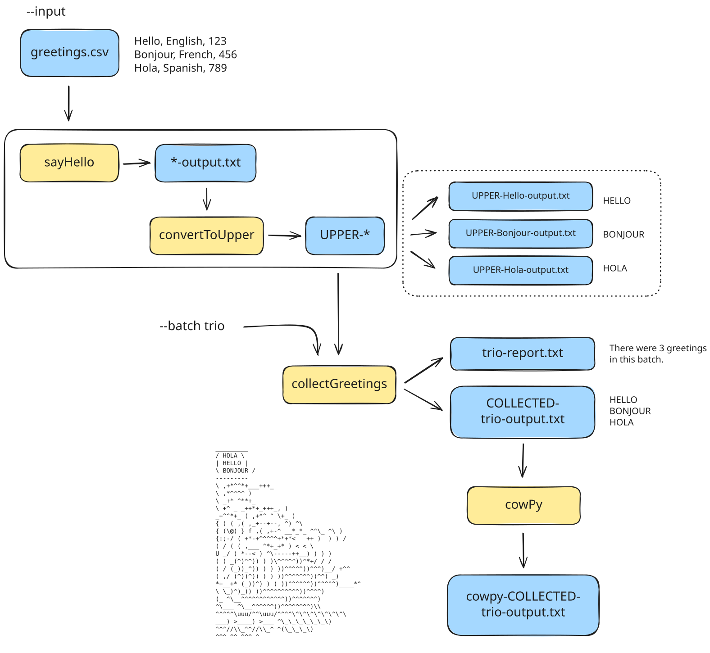

Yapay zeka destekli çeviri - [daha fazla bilgi ve iyileştirme önerileri](https://github.com/nextflow-io/training/blob/master/TRANSLATING.md)

Hello Nextflow eğitim kursunu tamamladığınız için tebrikler! 🎉

<figure>

  <iframe width="560" height="315" src="https://www.youtube.com/embed/wnmUAfDL01E?si=y8lAedhEHWaTV4zd&amp;list=PLPZ8WHdZGxmWKozQuzr27jyMGqp9kElVK&amp;cc_load_policy=1" title="YouTube video player" frameborder="0" allow="accelerometer; autoplay; clipboard-write; encrypted-media; gyroscope; picture-in-picture; web-share" referrerpolicy="strict-origin-when-cross-origin" allowfullscreen></iframe>

<figcaption>

[Tüm oynatma listesini Nextflow YouTube kanalında](https://youtube.com/playlist?list=PLPZ8WHdZGxmWKozQuzr27jyMGqp9kElVK&si=eF7cLR62goy-lc6n) izleyin.

📗 Video ile birlikte [video transkriptini](./transcripts/07_next_steps.mdx) okuyabilirsiniz.

</figcaption>
</figure>

## Yolculuğunuz

Sabit kodlanmış bir komut çalıştıran çok basit bir iş akışı ile başladınız.
Altı bölüm boyunca, bu basit iş akışını kanallar, operatörler, konteynerler için yerleşik destek ve yapılandırma seçenekleri dahil olmak üzere Nextflow'un temel özelliklerini kullanan modüler çok adımlı bir pipeline'a dönüştürdünüz.

### Ne inşa ettiniz

- Hello iş akışının son hali, metin selamlamaları içeren bir CSV dosyasını girdi olarak alır.
- Dört adım, ayrı modül dosyalarında saklanan Nextflow süreçleri (`sayHello`, `convertToUpper`, `collectGreetings` ve `cowpy`) olarak uygulanmıştır.
- Sonuçlar `results/` adlı bir dizine yayımlanır.
- Pipeline'ın son çıktısı, büyük harfli selamlamaları söyleyen bir karakterin ASCII sanatını içeren düz metin dosyasıdır.

1. **`sayHello`:** Her selamlamayı kendi çıktı dosyasına yazar (örn. "Hello-output.txt")
2. **`convertToUpper`:** Her selamlamayı büyük harfe dönüştürür (örn. "HELLO")
3. **`collectGreetings`:** Tüm büyük harfli selamlamaları tek bir toplu dosyada toplar
4. **`cowpy`:** `cowpy` aracını kullanarak ASCII sanatı oluşturur

İş akışı yapılandırması, girdileri ve parametreleri esnek ve tekrarlanabilir bir şekilde sağlamayı destekler.

### Edinilen beceriler

Bu uygulamalı kurs boyunca şunları öğrendiniz:

- Basit bir çok adımlı iş akışı oluşturmaya yetecek temel Nextflow bileşenlerini tanımlama ve kullanma
- Operatörler ve kanal fabrikaları gibi sonraki adım kavramlarını açıklama
- Nextflow iş akışını yerel olarak başlatma
- Nextflow tarafından oluşturulan çıktıları (sonuçlar) ve günlük dosyalarını bulma ve yorumlama
- Temel sorunları giderme

Artık Nextflow'da kendi pipeline'larınızı geliştirmeye başlamak için temel bilgilerle donatıldınız.

## Becerilerinizi geliştirmek için sonraki adımlar

Bundan sonra ne yapılacağına dair en iyi 3 önerimiz:

- [Nextflow for Science](../nf4_science/index.mdx) ile Nextflow'u bilimsel bir analiz kullanım durumuna uygulayın
- [Build with nf-core](../nfcore_build/index.mdx) ile nf-core'a başlayın
- [Side Quests](../side_quests/index.mdx) ile daha gelişmiş Nextflow özelliklerini keşfedin

Son olarak, Nextflow'un yaratıcıları tarafından geliştirilen, iş akışlarınızı başlatmayı ve yönetmeyi, verilerinizi yönetmeyi ve herhangi bir ortamda etkileşimli analizler çalıştırmayı daha da kolaylaştıran bulut tabanlı bir platform olan [**Seqera Platform**](https://seqera.io/)'a göz atmanızı öneririz.

## Geri bildirim anketi

Devam etmeden önce, lütfen kurs anketini tamamlamak için bir dakikanızı ayırın! Geri bildirimleriniz, eğitim materyallerimizi herkes için geliştirmemize yardımcı olur.

<LinkButton href="survey.mdx" variant="primary" icon="right-arrow">Ankete katılın</LinkButton>
