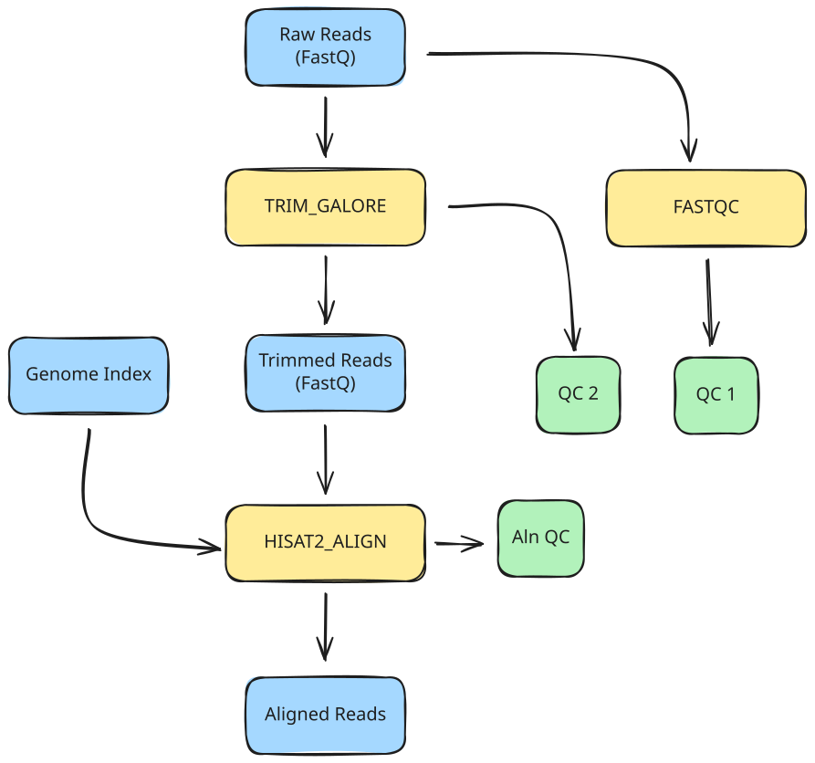

<span class="ai-translation-notice">Yapay zeka destekli çeviri - [daha fazla bilgi ve iyileştirme önerileri](https://github.com/nextflow-io/training/blob/master/TRANSLATING.md)</span>

Bu kursun bu bölümünde, Bölüm 1'de çalıştırdığımız tüm komutları otomatikleştirmek için mümkün olan en basit iş akışını yazacağız ve her seferinde yalnızca bir örneği işlemeyi hedefleyeceğiz.

:::caution[Ön Koşul]
Bu derse başlamadan önce [Bölüm 1: Yönteme genel bakış](./01_method.mdx) bölümünü tamamlamış olmanız gerekir.
Özellikle, 1.2.3 bölümünde çalışmak, bu dersteki hizalama adımı için gerekli olan genom dizin dosyasını (`data/genome_index.tar.gz`) oluşturur.
:::

## Görev

Bu kursun bu bölümünde, aşağıdakileri yapan bir iş akışı geliştireceğiz:

1. Girdi okumaları üzerinde kalite kontrolü çalıştırın (FastQC)
2. Adaptörleri kırpın ve kırpma sonrası kalite kontrolü çalıştırın (Trim Galore)
3. Kırpılmış okumaları bir referans genoma hizalayın (HISAT2)



Bu, [Bölüm 1: Yönteme genel bakış](./01_method.mdx#1-tek-örnekli-işleme) bölümünün ilk kısmındaki adımları otomatikleştirir; burada bu komutları konteynerlerinde manuel olarak çalıştırmıştınız.

Başlangıç noktası olarak, size iş akışının ana bölümlerini özetleyen bir iş akışı dosyası olan `rnaseq.nf` ve `modules/` dizininde her sürecin yapısını özetleyen dört modül dosyası (`fastqc.nf`, `trim_galore.nf`, `hisat2_align.nf` ve `multiqc.nf`) sağlıyoruz.

<details class="full-code">
<summary>İskelet dosyaları</summary>

```nextflow title="rnaseq.nf"
#!/usr/bin/env nextflow

// Modül INCLUDE ifadeleri

/*
 * Pipeline parametreleri
 */

// Birincil girdi

workflow {

    main:
    // Girdi kanalı oluştur

    // Süreçleri çağır

    publish:
    // Yayınlanacak çıktıları bildir
}

output {
    // Yayınlama hedeflerini yapılandır
}
```

```nextflow title="modules/fastqc.nf"
#!/usr/bin/env nextflow

/*
 * Girdi okumaları üzerinde FastQC çalıştır
 */
process FASTQC {

    container

    input:

    output:

    script:
    """

    """
}
```

```nextflow title="modules/trim_galore.nf"
#!/usr/bin/env nextflow

/*
 * Adaptörleri kırp ve kırpma sonrası kalite kontrolü çalıştır
 */
process TRIM_GALORE {

    container

    input:

    output:

    script:
    """

    """
}
```

```nextflow title="modules/hisat2_align.nf"
#!/usr/bin/env nextflow

/*
 * Okumaları bir referans genoma hizala
 */
process HISAT2_ALIGN {

    container

    input:

    output:

    script:
    """

    """
}
```

```nextflow title="modules/multiqc.nf"
#!/usr/bin/env nextflow

/*
 * MultiQC ile kalite kontrol raporlarını topla
 */
process MULTIQC {

    container

    input:

    output:

    script:
    """

    """
}
```

</details>

Bu dosyalar işlevsel değildir; amaçları yalnızca kodun ilginç kısımlarını doldurmanız için iskelet görevi görmektir.

## Ders planı

Geliştirme sürecini daha eğitici hale getirmek için bunu üç aşamaya ayırdık:

1. **İlk kalite kontrol adımını çalıştıran tek aşamalı bir iş akışı yazın.**
   Bu, bir CLI parametresi kurma, bir girdi kanalı oluşturma, bir süreç modülü yazma ve çıktı yayınlamayı yapılandırmayı kapsar.
2. **Adaptör kırpma ve kırpma sonrası kalite kontrolü ekleyin.**
   Bu, bir sürecin çıktısını diğerinin girdisine bağlayarak süreçleri zincirlemeyi tanıtır.
3. **Referans genoma hizalama ekleyin.**
   Bu, ek referans girdilerini işlemeyi ve sıkıştırılmış arşivlerle çalışmayı kapsar.

Her adım, iş akışı geliştirmenin belirli bir yönüne odaklanır.

:::tip[İpucu]
Doğru çalışma dizininde olduğunuzdan emin olun:
`cd /workspaces/training/nf4-science/rnaseq`
:::

---

## 1. İlk kalite kontrolünü çalıştıran tek aşamalı bir iş akışı yazın

Bu ilk adım temellere odaklanır: bir FASTQ dosyası yükleme ve üzerinde kalite kontrolü çalıştırma.

[Bölüm 1](01_method.mdx)'deki `fastqc` komutunu hatırlayın:

```bash
fastqc <reads>
```

Komut, girdi olarak bir FASTQ dosyası alır ve bir `.zip` arşivi ve bir `.html` özeti olarak bir kalite kontrol raporu üretir.
Konteyner URI'si `community.wave.seqera.io/library/trim-galore:0.6.10--1bf8ca4e1967cd18` idi.

Bu bilgiyi alacağız ve üç aşamada Nextflow'a saracağız:

1. Girdiyi ayarlayın
2. Kalite kontrol sürecini yazın ve iş akışında çağırın
3. Çıktı işlemeyi yapılandırın

### 1.1. Girdiyi ayarlayın

Bir girdi parametresi bildirmemiz, uygun bir varsayılan değer sağlamak için bir test profili oluşturmamız ve bir girdi kanalı oluşturmamız gerekiyor.

#### 1.1.1. Bir girdi parametresi bildirimi ekleyin

`rnaseq.nf` dosyasında, `Pipeline parametreleri` bölümü altında, `Path` türünde `reads` adlı bir parametre bildirin.

<CodeWalkthrough>

```nextflow title="rnaseq.nf" showLineNumbers startLineNumber=5 step="Önce"
/*
 * Pipeline parametreleri
 */

// Birincil girdi
```

```nextflow {4-7} title="rnaseq.nf" showLineNumbers startLineNumber=5 step="Sonra"
/*
 * Pipeline parametreleri
 */
params {
    // Birincil girdi
    input: Path
}
```

</CodeWalkthrough>

Bu, CLI parametresini ayarlar, ancak geliştirme sırasında iş akışını her çalıştırdığımızda dosya yolunu yazmak istemiyoruz.
Varsayılan bir değer sağlamak için birden fazla seçenek vardır; burada bir test profili kullanıyoruz.

#### 1.1.2. `nextflow.config` dosyasında varsayılan değere sahip bir test profili oluşturun

Bir test profili, komut satırında girdi belirtmeden bir iş akışını denemek için uygun varsayılan değerler sağlar.
Bu, Nextflow ekosisteminde yaygın bir kuraldır (daha fazla ayrıntı için [Hello Config](../../hello_nextflow/06_hello_config.mdx) bölümüne bakın).

`nextflow.config` dosyasına, `reads` parametresini test FASTQ dosyalarından birine ayarlayan bir `test` profili içeren bir `profiles` bloğu ekleyin.

<CodeWalkthrough>

```nextflow title="nextflow.config" showLineNumbers step="Önce"
docker.enabled = true
```

```nextflow {3-7} title="nextflow.config" showLineNumbers step="Sonra"
docker.enabled = true

profiles {
    test {
        params.input = "${projectDir}/data/reads/ENCSR000COQ1_1.fastq.gz"
    }
}
```

</CodeWalkthrough>

Burada, iş akışı betiğinin bulunduğu dizine işaret eden yerleşik bir Nextflow değişkeni olan `${projectDir}{:nextflow}` kullanıyoruz.
Bu, mutlak yolları sabit kodlamadan veri dosyalarına ve diğer kaynaklara başvurmayı kolaylaştırır.

Parametre artık uygun bir varsayılana sahip. Ardından, ondan bir kanal oluşturmamız gerekiyor.

#### 1.1.3. Girdi kanalını ayarlayın

İş akışı bloğunda, `.fromPath` kanal fabrikasını kullanarak parametre değerinden bir girdi kanalı oluşturun ([Hello Channels](../../hello_nextflow/02_hello_channels.mdx) bölümünde kullanıldığı gibi).

<CodeWalkthrough>

```nextflow title="rnaseq.nf" showLineNumbers startLineNumber=13 step="Önce"
workflow {

    main:
    // Girdi kanalı oluştur

    // Süreçleri çağır

    publish:
    // Yayınlanacak çıktıları bildir
}
```

```nextflow {4-5} title="rnaseq.nf" showLineNumbers startLineNumber=13 step="Sonra"
workflow {

    main:
    // Bir dosya yolundan girdi kanalı oluştur
    read_ch = channel.fromPath(params.input)

    // Süreçleri çağır

    publish:
    // Yayınlanacak çıktıları bildir
}
```

</CodeWalkthrough>

Ardından, bu girdi üzerinde kalite kontrolü çalıştırmak için süreci oluşturmamız gerekecek.

### 1.2. Kalite kontrol sürecini yazın ve iş akışında çağırın

Modül dosyasındaki süreç tanımını doldurmamız, bir include ifadesi kullanarak iş akışına aktarmamız ve girdi üzerinde çağırmamız gerekiyor.

#### 1.2.1. Kalite kontrol süreci için modülü doldurun

`modules/fastqc.nf` dosyasını açın ve süreç tanımının ana hatlarını inceleyin.
Ana yapısal öğeleri tanıyor olmalısınız; değilse, bir tazeleme için [Hello Nextflow](../../hello_nextflow/01_hello_world.mdx) bölümünü okumayı düşünün.

Devam edin ve yukarıda sağlanan bilgileri kullanarak süreç tanımını kendiniz doldurun, ardından çalışmanızı aşağıdaki "Sonra" sekmesindeki çözümle karşılaştırın.

<CodeWalkthrough>

```nextflow title="modules/fastqc.nf" showLineNumbers step="Önce"
#!/usr/bin/env nextflow

/*
 * Girdi okumaları üzerinde FastQC çalıştır
 */
process FASTQC {

    container

    input:

    output:

    script:
    """

    """
}
```

```nextflow {8,11,14,15,19} title="modules/fastqc.nf" showLineNumbers step="Sonra"
#!/usr/bin/env nextflow

/*
 * Girdi okumaları üzerinde FastQC çalıştır
 */
process FASTQC {

    container "community.wave.seqera.io/library/trim-galore:0.6.10--1bf8ca4e1967cd18"

    input:
    path reads

    output:
    path "${reads.simpleName}_fastqc.zip", emit: zip
    path "${reads.simpleName}_fastqc.html", emit: html

    script:
    """
    fastqc ${reads}
    """
}
```

</CodeWalkthrough>

`simpleName` erişimcisi, dosya adından tüm uzantıları çıkarır; böylece `ENCSR000COQ1_1.fastq.gz`, `ENCSR000COQ1_1` olur.
Her çıktı kanalına isim atamak için `emit:` sözdizimini kullanıyoruz; bu, çıktıları publish bloğuna bağlamak için yararlı olacaktır.

Bunu tamamladığınızda, süreç tamamlanmış olur.
İş akışında kullanmak için modülü içe aktarmanız ve bir süreç çağrısı eklemeniz gerekir.

#### 1.2.2. Modülü dahil edin

`rnaseq.nf` dosyasında, süreci iş akışı için kullanılabilir hale getirmek için bir `include` ifadesi ekleyin:

<CodeWalkthrough>

```nextflow title="rnaseq.nf" showLineNumbers startLineNumber=3 step="Önce"
// Modül INCLUDE ifadeleri
```

```nextflow {2} title="rnaseq.nf" showLineNumbers startLineNumber=3 step="Sonra"
// Modül INCLUDE ifadeleri
include { FASTQC } from './modules/fastqc.nf'
```

</CodeWalkthrough>

Süreç artık iş akışı kapsamında kullanılabilir.

#### 1.2.3. Girdi üzerinde kalite kontrol sürecini çağırın

İş akışı bloğuna, girdi kanalını argüman olarak ileten bir `FASTQC` çağrısı ekleyin.

<CodeWalkthrough>

```nextflow title="rnaseq.nf" showLineNumbers startLineNumber=14 step="Önce"
workflow {

    main:
    // Bir dosya yolundan girdi kanalı oluştur
    read_ch = channel.fromPath(params.input)

    // Süreçleri çağır

    publish:
    // Yayınlanacak çıktıları bildir
}
```

```nextflow {7-8} title="rnaseq.nf" showLineNumbers startLineNumber=14 step="Sonra"
workflow {

    main:
    // Bir dosya yolundan girdi kanalı oluştur
    read_ch = channel.fromPath(params.input)

    // İlk kalite kontrolü
    FASTQC(read_ch)

    publish:
    // Yayınlanacak çıktıları bildir
}
```

</CodeWalkthrough>

İş akışı artık girdiyi yükler ve üzerinde kalite kontrol sürecini çalıştırır.
Ardından, çıktının nasıl yayınlanacağını yapılandırmamız gerekiyor.

### 1.3. Çıktı işlemeyi yapılandırın

Hangi süreç çıktılarının yayınlanacağını bildirmemiz ve nereye gitmesi gerektiğini belirtmemiz gerekiyor.

#### 1.3.1. `publish:` bölümünde çıktıları bildirin

İş akışı bloğu içindeki `publish:` bölümü, hangi süreç çıktılarının yayınlanması gerektiğini bildirir.
`FASTQC` çıktılarını adlandırılmış hedeflere atayın.

<CodeWalkthrough>

```nextflow title="rnaseq.nf" showLineNumbers startLineNumber=23 step="Önce"
    publish:
    // Yayınlanacak çıktıları bildir
}
```

```nextflow {2-3} title="rnaseq.nf" showLineNumbers startLineNumber=23 step="Sonra"
    publish:
    fastqc_zip = FASTQC.out.zip
    fastqc_html = FASTQC.out.html
}
```

</CodeWalkthrough>

Ardından, Nextflow'a yayınlanan çıktıları nereye koyacağını söylememiz gerekecek.

#### 1.3.2. `output {}` bloğunda çıktı hedeflerini yapılandırın

`output {}` bloğu iş akışının dışında yer alır ve her adlandırılmış hedefin nerede yayınlandığını belirtir.
Her iki hedefi de bir `fastqc/` alt dizinine yayınlayacak şekilde yapılandırın.

<CodeWalkthrough>

```nextflow title="rnaseq.nf" showLineNumbers startLineNumber=28 step="Önce"
output {
    // Yayınlama hedeflerini yapılandır
}
```

```nextflow {2-7} title="rnaseq.nf" showLineNumbers startLineNumber=28 step="Sonra"
output {
    fastqc_zip {
        path 'fastqc'
    }
    fastqc_html {
        path 'fastqc'
    }
}
```

</CodeWalkthrough>

:::note[Not]
Varsayılan olarak, Nextflow çıktı dosyalarını sembolik bağlantılar olarak yayınlar; bu, gereksiz çoğaltmayı önler.
Burada kullandığımız veri dosyaları çok küçük olsa da, genomik alanında çok büyük olabilirler.
Sembolik bağlantılar, `work` dizininizi temizlediğinizde bozulur; bu nedenle üretim iş akışları için varsayılan yayınlama modunu `'copy'` olarak geçersiz kılmak isteyebilirsiniz.
:::

### 1.4. İş akışını çalıştırın

Bu noktada, tamamen işlevsel olması gereken tek adımlı bir kalite kontrol iş akışımız var.

Test profilinde ayarlanan varsayılan değeri kullanmak için `-profile test` ile çalıştırıyoruz; bu, komut satırına yolu yazma ihtiyacını ortadan kaldırır.

```bash
nextflow run rnaseq.nf -profile test
# [!output]
 N E X T F L O W   ~  version 26.04.4

Launching `rnaseq.nf` [fabulous_engelbart] revision: 859d80cde8

executor >  local (1)
[4e/36fb3d] FASTQC (1) | 1 of 1 ✔

Outputs:

  /workspaces/training/nf4-science/rnaseq/results

  fastqc_zip:
    - fastqc/ENCSR000COQ1_1_fastqc.zip

  fastqc_html:
    - fastqc/ENCSR000COQ1_1_fastqc.html
```

Bölüm 1'de çalıştıysanız ve konteyneri zaten çektiyseniz bu çok hızlı çalışmalıdır.
Eğer atladıysanız, Nextflow konteyneri sizin için çekecektir; bunun gerçekleşmesi için herhangi bir şey yapmanıza gerek yok, ancak bir dakikaya kadar beklemeniz gerekebilir.

Çıktıları sonuçlar dizininde kontrol edebilirsiniz.

```bash
ls results/fastqc
```

```console title="Output"
ENCSR000COQ1_1_fastqc.html  ENCSR000COQ1_1_fastqc.zip
```

Örnek için kalite kontrol raporları artık `fastqc/` alt dizininde yayınlanmıştır.

### Özetle

Bir süreç içeren bir modül oluşturmayı, onu bir iş akışına aktarmayı, bir girdi kanalıyla çağırmayı ve iş akışı düzeyinde çıktı bloğunu kullanarak sonuçları yayınlamayı biliyorsunuz.

### Sırada ne var?

İş akışında ikinci bir adım olarak kırpma sonrası kalite kontrolü ile adaptör kırpma ekleyin.

---

## 2. Adaptör kırpma ve kırpma sonrası kalite kontrolü ekleyin

Artık ilk kalite kontrolü yerinde olduğuna göre, yerleşik kırpma sonrası kalite kontrolü ile adaptör kırpma adımını ekleyebiliriz.

[Bölüm 1](01_method.mdx)'deki `trim_galore` komutunu hatırlayın:

```bash
trim_galore --fastqc <reads>
```

Komut, bir FASTQ dosyasından adaptörleri kırpar ve kırpılmış çıktı üzerinde FastQC çalıştırır.
Kırpılmış okumalar, bir kırpma raporu ve kırpılmış okumalar için FastQC raporları üretir.
Konteyner URI'si `community.wave.seqera.io/library/trim-galore:0.6.10--1bf8ca4e1967cd18` idi.

Sadece süreç tanımını yazmamız, içe aktarmamız, iş akışında çağırmamız ve çıktı işlemeyi güncellememiz gerekiyor.

### 2.1. Kırpma sürecini yazın ve iş akışında çağırın

Daha önce olduğu gibi, süreç tanımını doldurmamız, modülü içe aktarmamız ve süreç çağrısını eklememiz gerekiyor.

#### 2.1.1. Kırpma süreci için modülü doldurun

`modules/trim_galore.nf` dosyasını açın ve süreç tanımının ana hatlarını inceleyin.

Devam edin ve yukarıda sağlanan bilgileri kullanarak süreç tanımını kendiniz doldurun, ardından çalışmanızı aşağıdaki "Sonra" sekmesindeki çözümle karşılaştırın.

<CodeWalkthrough>

```nextflow title="modules/trim_galore.nf" showLineNumbers step="Önce"
#!/usr/bin/env nextflow

/*
 * Adaptörleri kırp ve kırpma sonrası kalite kontrolü çalıştır
 */
process TRIM_GALORE {

    container

    input:

    output:

    script:
    """

    """
}
```

```nextflow {8,11,14,15,16,20} title="modules/trim_galore.nf" showLineNumbers step="Sonra"
#!/usr/bin/env nextflow

/*
 * Adaptörleri kırp ve kırpma sonrası kalite kontrolü çalıştır
 */
process TRIM_GALORE {

    container "community.wave.seqera.io/library/trim-galore:0.6.10--1bf8ca4e1967cd18"

    input:
    path reads

    output:
    path "${reads.simpleName}_trimmed.fq.gz", emit: trimmed_reads
    path "${reads}_trimming_report.txt", emit: trimming_reports
    path "${reads.simpleName}_trimmed_fastqc.{zip,html}", emit: fastqc_reports

    script:
    """
    trim_galore --fastqc ${reads}
    """
}
```

</CodeWalkthrough>

Bu sürecin üç adlandırılmış çıktısı vardır: hizalama adımına beslenen kırpılmış okumalar, kırpma raporu ve kırpma sonrası FastQC raporları.
`--fastqc` bayrağı, Trim Galore'a kırpılmış çıktı üzerinde otomatik olarak FastQC çalıştırmasını söyler.

#### 2.1.2. Modülü dahil edin

Yeni modülü içe aktarmak için `rnaseq.nf` dosyasını güncelleyin:

<CodeWalkthrough>

```nextflow title="rnaseq.nf" showLineNumbers startLineNumber=3 step="Önce"
// Modül INCLUDE ifadeleri
include { FASTQC } from './modules/fastqc.nf'
```

```nextflow {3} title="rnaseq.nf" showLineNumbers startLineNumber=3 step="Sonra"
// Modül INCLUDE ifadeleri
include { FASTQC } from './modules/fastqc.nf'
include { TRIM_GALORE } from './modules/trim_galore.nf'
```

</CodeWalkthrough>

Ardından, iş akışına süreç çağrısını ekleyeceğiz.

#### 2.1.3. Girdi üzerinde kırpma sürecini çağırın

İş akışı bloğuna süreç çağrısını ekleyin:

<CodeWalkthrough>

```nextflow title="rnaseq.nf" showLineNumbers startLineNumber=15 step="Önce"
workflow {

    main:
    // Bir dosya yolundan girdi kanalı oluştur
    read_ch = channel.fromPath(params.input)

    // İlk kalite kontrolü
    FASTQC(read_ch)

    publish:
    fastqc_zip = FASTQC.out.zip
    fastqc_html = FASTQC.out.html
}
```

```nextflow {10-11} title="rnaseq.nf" showLineNumbers startLineNumber=15 step="Sonra"
workflow {

    main:
    // Bir dosya yolundan girdi kanalı oluştur
    read_ch = channel.fromPath(params.input)

    // İlk kalite kontrolü
    FASTQC(read_ch)

    // Adaptör kırpma ve kırpma sonrası kalite kontrolü
    TRIM_GALORE(read_ch)

    publish:
    fastqc_zip = FASTQC.out.zip
    fastqc_html = FASTQC.out.html
}
```

</CodeWalkthrough>

Kırpma süreci artık iş akışına bağlanmıştır.

### 2.2. Çıktı işlemeyi güncelleyin

Kırpma çıktılarını yayınlama bildirimine eklememiz ve nereye gideceklerini yapılandırmamız gerekiyor.

#### 2.2.1. Kırpma çıktıları için yayınlama hedefleri ekleyin

Kırpma çıktılarını `publish:` bölümüne ekleyin:

<CodeWalkthrough>

```nextflow title="rnaseq.nf" showLineNumbers startLineNumber=27 step="Önce"
    publish:
    fastqc_zip = FASTQC.out.zip
    fastqc_html = FASTQC.out.html
}
```

```nextflow {4-6} title="rnaseq.nf" showLineNumbers startLineNumber=27 step="Sonra"
    publish:
    fastqc_zip = FASTQC.out.zip
    fastqc_html = FASTQC.out.html
    trimmed_reads = TRIM_GALORE.out.trimmed_reads
    trimming_reports = TRIM_GALORE.out.trimming_reports
    trimming_fastqc = TRIM_GALORE.out.fastqc_reports
}
```

</CodeWalkthrough>

Ardından, Nextflow'a bu çıktıları nereye koyacağını söylememiz gerekecek.

#### 2.2.2. Yeni çıktı hedeflerini yapılandırın

`output {}` bloğunda kırpma hedefleri için girdiler ekleyin ve bunları bir `trimming/` alt dizinine yayınlayın:

<CodeWalkthrough>

```nextflow title="rnaseq.nf" showLineNumbers startLineNumber=35 step="Önce"
output {
    fastqc_zip {
        path 'fastqc'
    }
    fastqc_html {
        path 'fastqc'
    }
}
```

```nextflow {8-16} title="rnaseq.nf" showLineNumbers startLineNumber=35 step="Sonra"
output {
    fastqc_zip {
        path 'fastqc'
    }
    fastqc_html {
        path 'fastqc'
    }
    trimmed_reads {
        path 'trimming'
    }
    trimming_reports {
        path 'trimming'
    }
    trimming_fastqc {
        path 'trimming'
    }
}
```

</CodeWalkthrough>

Çıktı yapılandırması tamamlandı.

### 2.3. İş akışını çalıştırın

İş akışı artık hem ilk kalite kontrolünü hem de adaptör kırpmayı içeriyor.

```bash
nextflow run rnaseq.nf -profile test
# [!output]
 N E X T F L O W   ~  version 26.04.4

Launching `rnaseq.nf` [stupefied_volhard] revision: faaf310b2f

executor >  local (2)
[a3/ac9284] FASTQC (1)      | 1 of 1 ✔
[55/c4d983] TRIM_GALORE (1) | 1 of 1 ✔

Outputs:

  /workspaces/training/nf4-science/rnaseq/results

  fastqc_zip:
    - fastqc/ENCSR000COQ1_1_fastqc.zip

  fastqc_html:
    - fastqc/ENCSR000COQ1_1_fastqc.html

  trimmed_reads:
    - trimming/ENCSR000COQ1_1_trimmed.fq.gz

  trimming_reports:
    - trimming/ENCSR000COQ1_1.fastq.gz_trimming_report.txt

  trimming_fastqc:
    - [trimming/ENCSR000COQ1_1_trimmed_fastqc.html, trimming/ENCSR000COQ1_1_trimmed_fastqc.zip]
```

Bu da çok hızlı çalışmalıdır, çünkü çok küçük bir girdi dosyası üzerinde çalışıyoruz.

Kırpma çıktılarını sonuçlar dizininde bulabilirsiniz.

```bash
ls results/trimming
```

```console title="Output"
ENCSR000COQ1_1.fastq.gz_trimming_report.txt  ENCSR000COQ1_1_trimmed_fastqc.zip
ENCSR000COQ1_1_trimmed_fastqc.html           ENCSR000COQ1_1_trimmed.fq.gz
```

Kırpma çıktıları ve kırpma sonrası kalite kontrol raporları artık `trimming/` alt dizinindedir.

### Özetle

Aynı girdi üzerinde bağımsız olarak çalışan ve birden fazla adlandırılmış çıktı üreten ikinci bir işleme adımını nasıl ekleyeceğinizi biliyorsunuz.

### Sırada ne var?

Kırpılmış okumalar çıktısından zincirlenen hizalama adımını ekleyin.

---

## 3. Referans genoma hizalama ekleyin

Son olarak HISAT2 kullanarak genom hizalama adımını ekleyebiliriz.

[Bölüm 1](01_method.mdx)'deki hizalama komutunu hatırlayın:

```bash
hisat2 -x <genome_index> -U <reads> \
    --new-summary --summary-file <reads>.hisat2.log | \
    samtools view -bS -o <reads>.bam
```

Komut, okumaları bir referans genoma hizalar ve çıktıyı BAM formatına dönüştürür.
Önceden oluşturulmuş bir genom dizin arşivi gerektirir ve bir BAM dosyası ile bir hizalama özet günlüğü üretir.
Konteyner URI'si `community.wave.seqera.io/library/hisat2_samtools:5e49f68a37dc010e` idi.

Bu süreç ek bir girdi (genom dizin arşivi) gerektirir; bu yüzden önce onu ayarlamamız, ardından süreci yazmamız ve bağlamamız gerekiyor.

### 3.1. Girdileri ayarlayın

Genom dizin arşivi için bir parametre bildirmemiz gerekiyor.

#### 3.1.1. Genom dizini için bir parametre ekleyin

`rnaseq.nf` dosyasına genom dizin arşivi için bir parametre bildirimi ekleyin:

<CodeWalkthrough>

```nextflow title="rnaseq.nf" showLineNumbers startLineNumber=11 step="Önce"
params {
    // Birincil girdi
    input: Path
}
```

```nextflow {5-6} title="rnaseq.nf" showLineNumbers startLineNumber=11 step="Sonra"
params {
    // Birincil girdi
    input: Path

    // Referans genom arşivi
    hisat2_index_zip: Path
}
```

</CodeWalkthrough>

#### 3.1.2. Test profiline genom dizini varsayılanını ekleyin

Bölüm 1.1.2'de `input` için yaptığımız gibi, `nextflow.config` dosyasındaki test profiline genom dizini için bir varsayılan değer ekleyin:

<CodeWalkthrough>

```nextflow title="nextflow.config" showLineNumbers step="Önce"
docker.enabled = true

profiles {
    test {
        params.input = "${projectDir}/data/reads/ENCSR000COQ1_1.fastq.gz"
    }
}
```

```nextflow {6} title="nextflow.config" showLineNumbers step="Sonra"
docker.enabled = true

profiles {
    test {
        params.input = "${projectDir}/data/reads/ENCSR000COQ1_1.fastq.gz"
        params.hisat2_index_zip = "${projectDir}/data/genome_index.tar.gz"
    }
}
```

</CodeWalkthrough>

Parametre hazır; şimdi hizalama sürecini oluşturabiliriz.

### 3.2. Hizalama sürecini yazın ve iş akışında çağırın

Daha önce olduğu gibi, süreç tanımını doldurmamız, modülü içe aktarmamız ve süreç çağrısını eklememiz gerekiyor.

#### 3.2.1. Hizalama süreci için modülü doldurun

`modules/hisat2_align.nf` dosyasını açın ve süreç tanımının ana hatlarını inceleyin.

Devam edin ve yukarıda sağlanan bilgileri kullanarak süreç tanımını kendiniz doldurun, ardından çalışmanızı aşağıdaki "Sonra" sekmesindeki çözümle karşılaştırın.

<CodeWalkthrough>

```nextflow title="modules/hisat2_align.nf" showLineNumbers step="Önce"
#!/usr/bin/env nextflow

/*
 * Okumaları bir referans genoma hizala
 */
process HISAT2_ALIGN {

    container

    input:

    output:

    script:
    """

    """
}
```

```nextflow {8,11,12,15,16,20,21,22,23} title="modules/hisat2_align.nf" showLineNumbers step="Sonra"
#!/usr/bin/env nextflow

/*
 * Okumaları bir referans genoma hizala
 */
process HISAT2_ALIGN {

    container "community.wave.seqera.io/library/hisat2_samtools:5e49f68a37dc010e"

    input:
    path reads
    path index_zip

    output:
    path "${reads.simpleName}.bam", emit: bam
    path "${reads.simpleName}.hisat2.log", emit: log

    script:
    """
    tar -xzvf ${index_zip}
    hisat2 -x ${index_zip.simpleName} -U ${reads} \
        --new-summary --summary-file ${reads.simpleName}.hisat2.log | \
        samtools view -bS -o ${reads.simpleName}.bam
    """
}
```

</CodeWalkthrough>

Bu süreç iki girdi alır: okumalar ve genom dizin arşivi.
Betik bloğu önce dizini arşivden çıkarır, ardından çıktıyı BAM formatına dönüştürmek için `samtools view`'a yönlendirilen HISAT2 hizalamasını çalıştırır.
`index_zip` üzerindeki `simpleName` erişimcisi, dizin öneki olarak kullanılacak arşivin temel adını (`genome_index`) çıkarır.

#### 3.2.2. Modülü dahil edin

Yeni modülü içe aktarmak için `rnaseq.nf` dosyasını güncelleyin:

<CodeWalkthrough>

```nextflow title="rnaseq.nf" showLineNumbers startLineNumber=3 step="Önce"
// Modül INCLUDE ifadeleri
include { FASTQC } from './modules/fastqc.nf'
include { TRIM_GALORE } from './modules/trim_galore.nf'
```

```nextflow {4} title="rnaseq.nf" showLineNumbers startLineNumber=3 step="Sonra"
// Modül INCLUDE ifadeleri
include { FASTQC } from './modules/fastqc.nf'
include { TRIM_GALORE } from './modules/trim_galore.nf'
include { HISAT2_ALIGN } from './modules/hisat2_align.nf'
```

</CodeWalkthrough>

Ardından, iş akışına süreç çağrısını ekleyeceğiz.

#### 3.2.3. Hizalama sürecini çağırın

Kırpılmış okumalar, önceki adım tarafından çıktılanan `TRIM_GALORE.out.trimmed_reads` kanalındadır.
Genom dizin arşivini sağlamak için `file(params.hisat2_index_zip){:nextflow}` kullanıyoruz.

<CodeWalkthrough>

```nextflow title="rnaseq.nf" showLineNumbers startLineNumber=19 step="Önce"
workflow {

    main:
    // Bir dosya yolundan girdi kanalı oluştur
    read_ch = channel.fromPath(params.input)

    // İlk kalite kontrolü
    FASTQC(read_ch)

    // Adaptör kırpma ve kırpma sonrası kalite kontrolü
    TRIM_GALORE(read_ch)
```

```nextflow {13-14} title="rnaseq.nf" showLineNumbers startLineNumber=19 step="Sonra"
workflow {

    main:
    // Bir dosya yolundan girdi kanalı oluştur
    read_ch = channel.fromPath(params.input)

    // İlk kalite kontrolü
    FASTQC(read_ch)

    // Adaptör kırpma ve kırpma sonrası kalite kontrolü
    TRIM_GALORE(read_ch)

    // Referans genoma hizalama
    HISAT2_ALIGN(TRIM_GALORE.out.trimmed_reads, file(params.hisat2_index_zip))
```

</CodeWalkthrough>

Hizalama süreci artık iş akışına bağlanmıştır.

### 3.3. Çıktı işlemeyi güncelleyin

Hizalama çıktılarını yayınlama bildirimine eklememiz ve nereye gideceklerini yapılandırmamız gerekiyor.

#### 3.3.1. Hizalama çıktıları için yayınlama hedefleri ekleyin

Hizalama çıktılarını `publish:` bölümüne ekleyin:

<CodeWalkthrough>

```nextflow title="rnaseq.nf" showLineNumbers startLineNumber=34 step="Önce"
    publish:
    fastqc_zip = FASTQC.out.zip
    fastqc_html = FASTQC.out.html
    trimmed_reads = TRIM_GALORE.out.trimmed_reads
    trimming_reports = TRIM_GALORE.out.trimming_reports
    trimming_fastqc = TRIM_GALORE.out.fastqc_reports
}
```

```nextflow {7-8} title="rnaseq.nf" showLineNumbers startLineNumber=34 step="Sonra"
    publish:
    fastqc_zip = FASTQC.out.zip
    fastqc_html = FASTQC.out.html
    trimmed_reads = TRIM_GALORE.out.trimmed_reads
    trimming_reports = TRIM_GALORE.out.trimming_reports
    trimming_fastqc = TRIM_GALORE.out.fastqc_reports
    bam = HISAT2_ALIGN.out.bam
    align_log = HISAT2_ALIGN.out.log
}
```

</CodeWalkthrough>

Ardından, Nextflow'a bu çıktıları nereye koyacağını söylememiz gerekecek.

#### 3.3.2. Yeni çıktı hedeflerini yapılandırın

`output {}` bloğunda hizalama hedefleri için girdiler ekleyin ve bunları bir `align/` alt dizinine yayınlayın:

<CodeWalkthrough>

```nextflow title="rnaseq.nf" showLineNumbers startLineNumber=44 step="Önce"
output {
    fastqc_zip {
        path 'fastqc'
    }
    fastqc_html {
        path 'fastqc'
    }
    trimmed_reads {
        path 'trimming'
    }
    trimming_reports {
        path 'trimming'
    }
    trimming_fastqc {
        path 'trimming'
    }
}
```

```nextflow {17-22} title="rnaseq.nf" showLineNumbers startLineNumber=44 step="Sonra"
output {
    fastqc_zip {
        path 'fastqc'
    }
    fastqc_html {
        path 'fastqc'
    }
    trimmed_reads {
        path 'trimming'
    }
    trimming_reports {
        path 'trimming'
    }
    trimming_fastqc {
        path 'trimming'
    }
    bam {
        path 'align'
    }
    align_log {
        path 'align'
    }
}
```

</CodeWalkthrough>

Çıktı yapılandırması tamamlandı.

### 3.4. İş akışını çalıştırın

İş akışı artık üç işleme adımını da içeriyor: kalite kontrolü, kırpma ve hizalama.

```bash
nextflow run rnaseq.nf -profile test
# [!output]
 N E X T F L O W   ~  version 26.04.4

Launching `rnaseq.nf` [nauseous_allen] revision: 45d77a9709

executor >  local (3)
[57/b3c2cb] FASTQC (1)       | 1 of 1 ✔
[98/451aef] TRIM_GALORE (1)  | 1 of 1 ✔
[78/7cf2c3] HISAT2_ALIGN (1) | 1 of 1 ✔

Outputs:

  /workspaces/training/nf4-science/rnaseq/results

  fastqc_zip:
    - fastqc/ENCSR000COQ1_1_fastqc.zip

  fastqc_html:
    - fastqc/ENCSR000COQ1_1_fastqc.html

  trimmed_reads:
    - trimming/ENCSR000COQ1_1_trimmed.fq.gz

  trimming_reports:
    - trimming/ENCSR000COQ1_1.fastq.gz_trimming_report.txt

  trimming_fastqc:
    - [trimming/ENCSR000COQ1_1_trimmed_fastqc.html, trimming/ENCSR000COQ1_1_trimmed_fastqc.zip]

  bam:
    - align/ENCSR000COQ1_1_trimmed.bam

  align_log:
    - align/ENCSR000COQ1_1_trimmed.hisat2.log
```

Hizalama çıktılarını sonuçlar dizininde bulabilirsiniz.

```bash
ls results/align
```

```console title="Output"
ENCSR000COQ1_1_trimmed.bam  ENCSR000COQ1_1_trimmed.hisat2.log
```

Bu, her örneğe uygulamamız gereken temel işlemi tamamlar.

_İş akışını aynı anda birden fazla örneği kabul edecek şekilde değiştirdikten sonra, Bölüm 3'te MultiQC rapor toplama işlemini ekleyeceğiz._

---

### Özetle

Tek uçlu RNAseq örneklerini ayrı ayrı işlemek için tüm temel adımları nasıl saracağınızı biliyorsunuz.

### Sırada ne var?

Bir mola verin! Bu çok şeydi.

Kendinizi tazelenmiş hissettiğinizde, [Bölüm 3](./03_multi-sample.mdx)'e geçin; burada iş akışını birden fazla örneği paralel olarak işleyecek şekilde nasıl değiştireceğinizi, tüm örnekler için tüm adımlarda kalite kontrol raporlarını nasıl toplayacağınızı ve iş akışının çift uçlu RNAseq verileri üzerinde çalışmasını nasıl etkinleştireceğinizi öğreneceksiniz.
