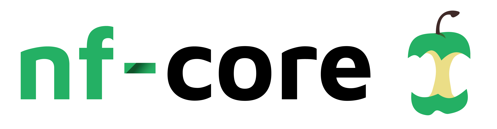
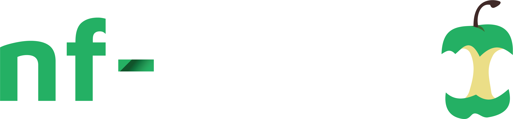

Yapay zeka destekli çeviri - [daha fazla bilgi ve iyileştirme önerileri](https://github.com/nextflow-io/training/blob/master/TRANSLATING.md)

**Build with nf-core, nf-core kaynaklarını ve en iyi uygulamalarını kullanmaya yönelik uygulamalı bir giriştir.**

Pratik örnekler ve rehberli alıştırmalar üzerinden çalışarak, nf-core uyumlu modüller ve pipeline'lar kullanmayı ve geliştirmeyi, ayrıca nf-core araçlarını etkili bir şekilde kullanmayı öğreneceksiniz.

nf-core en iyi uygulamalarına göre pipeline geliştirmeye başlamak için gereken becerileri ve özgüveni kazanacaksınız.

<CourseInfo frontmatter={frontmatter} />

## Kursa genel bakış

Bu kurs, bilgileri kademeli olarak tanıtmak üzere yapılandırılmış, hedefe yönelik alıştırmalar içeren, uygulamalı bir şekilde tasarlanmıştır.

Nextflow kullanılarak oluşturulmuş, özenle seçilmiş bir bilimsel pipeline koleksiyonu geliştirmek ve sürdürmek için bir topluluk girişimi olan [**nf-core**](https://nf-co.re/) ile tanışacaksınız. Bunun yanı sıra, açık geliştirmeyi, test etmeyi ve akran değerlendirmesini teşvik eden ilgili araçlar ve yönergelerle de tanışacaksınız ([Nat Biotechnol 38, 276–278 (2020)](https://www.nature.com/articles/s41587-020-0439-x), [Genome Biol 26, 228 (2025)](https://genomebiology.biomedcentral.com/articles/10.1186/s13059-025-03673-9)).

nf-core topluluğu tarafından geliştirilen pipeline'lar modüler, ölçeklenebilir ve taşınabilir olacak şekilde tasarlanmıştır; bu da araştırmacıların kendi verilerini ve hesaplama kaynaklarını kullanarak bunları kolayca uyarlayıp çalıştırmalarına olanak tanır.
Proje tarafından uygulanan en iyi uygulama yönergeleri, pipeline'ların sağlam, iyi belgelenmiş ve gerçek dünya veri setlerine karşı doğrulanmış olmasını sağlar.
Bu, bilimsel analizlerin güvenilirliğini ve tekrarlanabilirliğini artırmaya yardımcı olur ve sonuçta araştırmacıların bilimsel keşiflerini hızlandırmasını sağlar.

Bu kursta nf-core pipeline'ları hakkında bilmeniz gereken her şeyi ele almayacağız; zira nf-core, topluluk tarafından yıllar içinde geliştirilen birçok özellik ve konvansiyonu kapsar.
Bunun yerine, başlamanıza ve nf-core'un nasıl çalıştığını anlamanıza yardımcı olacak temel kavramlara odaklanacağız.

### Ders planı

Bunu, nf-core kaynaklarını kullanmanın belirli yönlerine odaklanan dört bölüme ayırdık.

| Kurs bölümü                                                           | Özet                                                                                                                                                                     | Tahmini süre |
| --------------------------------------------------------------------- | ------------------------------------------------------------------------------------------------------------------------------------------------------------------------ | ------------ |
| [Bölüm 1: Hello'yu nf-core için yeniden yazma](./01_rewrite_hello.mdx) | Hello Nextflow kursunda üretilen basit iş akışından başlayarak, mevcut bir iş akışını nf-core şablon iskeletine uyarlayın ([Hello Nextflow](../hello_nextflow/index.mdx)) | 60 dakika    |
| [Bölüm 2: nf-core modülü kullanma](./02_use_module.mdx)                | Topluluk modülleri kütüphanesini keşfedin ve yaygın biyoinformatik araçlarını sarmalayan önceden oluşturulmuş, test edilmiş modülleri entegre etmeyi öğrenin             | 30 dakika    |
| [Bölüm 3: nf-core modülü oluşturma](./03_make_module.mdx)              | nf-core tarafından belirlenen belirli yapı, adlandırma konvansiyonları ve metadata gereksinimlerini kullanarak kendi nf-core tarzı modülünüzü oluşturun                  | 30 dakika    |
| [Bölüm 4: Girdi doğrulama ekleme](./04_input_validation.mdx)           | nf-schema kullanarak hem komut satırı parametreleri hem de girdi veri dosyaları için girdi doğrulaması uygulayın                                                         | 30 dakika    |

Bu kursun sonunda, nf-core projesi tarafından sunulan muazzam kaynak zenginliğinden yararlanabileceksiniz.

Kursa başlamaya hazır mısınız?

<LinkButton href="00_orientation.mdx" variant="primary" icon="right-arrow">Öğrenmeye başlayın</LinkButton>
