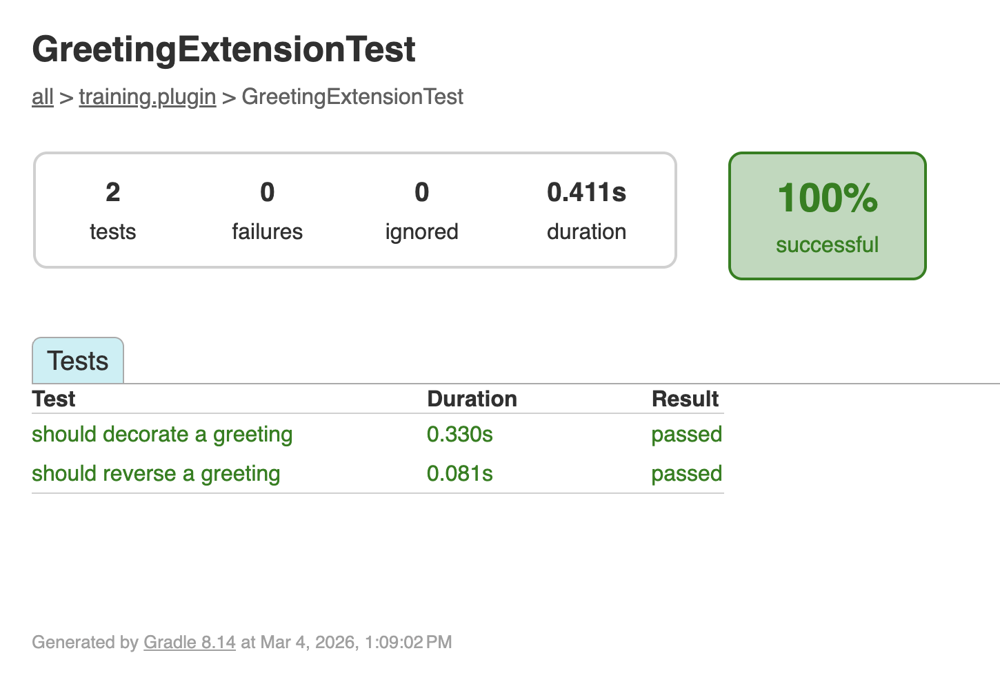

<span class="ai-translation-notice">Yapay zeka destekli çeviri - [daha fazla bilgi ve iyileştirme önerileri](https://github.com/nextflow-io/training/blob/master/TRANSLATING.md)</span>

Plugin'ler, pipeline geliştiricilerinin güvenmesi gereken bağımsız yazılımlardır.
Her özelliği bağımsız olarak, bir pipeline dışında test etmek, plugin'in herhangi biri tarafından bir iş akışına entegre edilmeden önce doğru çalıştığından emin olmanızı sağlar.
Bu bölümde, Spock test çerçevesini kullanarak testler yazacak ve çalıştıracaksınız.

:::tip[Buradan mı başlıyorsunuz?]
Bu bölüme doğrudan katılıyorsanız, başlangıç noktası olarak kullanmak üzere Bölüm 3'ün çözümünü kopyalayın:

```bash
cp -r solutions/3-custom-functions/* .
```

Ardından plugin dizinine geçin:

```bash
cd nf-greeting
```
:::

Plugin dizininde olduğunuzdan emin olun:

```bash
cd nf-greeting
```

---

## 1. Neden test etmeli?

Başarılı bir derleme, kodun derlendiği anlamına gelir; ancak beklenen şekilde çalışıp çalışmadığını kontrol etmez.
Birim testleri, fonksiyonlarınızın belirli bir girdi için doğru çıktı üretip üretmediğini otomatik olarak kontrol eden küçük kod parçalarıdır.
Örneğin, bir test `reverseGreeting("Hello"){:nextflow}` ifadesinin `"olleH"` döndürüp döndürmediğini kontrol edebilir.

Testler şu nedenlerle değerlidir:

- Hataları kullanıcılardan önce yakalarlar
- Bir şeyleri bozmadan değişiklik yapma konusunda size güven verirler
- Fonksiyonların nasıl kullanılması gerektiğini gösteren belgeler işlevi görürler

---

## 2. Spock testlerini anlamak

Plugin şablonu, Groovy için bir test çerçevesi olan [Spock](https://spockframework.org/)'u kullanır.
Spock, projede (`build.gradle` aracılığıyla) zaten yapılandırılmıştır; dolayısıyla herhangi bir şey eklemeniz gerekmez.

Daha önce test araçları kullandıysanız (Python'da `pytest` veya R'da `testthat` gibi), Spock aynı rolü üstlenir: kodunuzu bilinen girdilerle çağıran ve çıktıları kontrol eden küçük fonksiyonlar yazarsınız.
Fark şudur: Spock, bir Nextflow süreci veya iş akışına benzer şekilde etiketli bloklar (`given:`, `expect:`, `when:`, `then:`) kullanır.

Temel yapı şöyledir:

```groovy
def 'should reverse a greeting'() {   // [!annotate] **Tırnak içinde test adı**: Testin neyi kontrol ettiğini açıklar. Sade bir dil kullanın.
    given:                             // [!annotate] **`given:` bloğu**: Test için ihtiyacınız olanları hazırlayın (nesneler oluşturun, veri hazırlayın)
    def ext = new GreetingExtension()

    expect:                            // [!annotate] **`expect:` bloğu**: Gerçek kontroller. Testin geçmesi için her satırın `true` olması gerekir
    ext.reverseGreeting('Hello') == 'olleH'
}
```

Bu yapı testleri okunabilir kılar: "Bir extension nesnesi verildiğinde, `reverseGreeting('Hello')` ifadesinin `'olleH'`'e eşit olması beklenir."

---

## 3. Testleri yazın

Bölüm 3'te oluşturduğunuz iki fonksiyon için testler yazın: `reverseGreeting` ve `decorateGreeting`.

### 3.1. Test sınıfını oluşturun

```bash
touch src/test/groovy/training/plugin/GreetingExtensionTest.groovy
```

Dosyayı düzenleyicinizde açın ve boş test sınıfı iskeletini ekleyin:

```groovy title="src/test/groovy/training/plugin/GreetingExtensionTest.groovy" showLineNumbers
package training.plugin

import spock.lang.Specification

/**
 * Selamlama extension fonksiyonları için testler
 */
class GreetingExtensionTest extends Specification {  // [!annotate] Tüm Spock test sınıfları `Specification`'ı genişletir. Bu, herhangi bir Spock test dosyasının başlangıç noktasıdır.

}
```

### 3.2. reverseGreeting'i test edin

Sınıf gövdesinin içine bir test metodu ekleyin.
`given:` bloğu bir `GreetingExtension` örneği oluşturur; `expect:` bloğu ise `reverseGreeting`'in iki farklı girdiyi doğru şekilde tersine çevirip çevirmediğini kontrol eder.
Bu, fonksiyonu doğrudan, bir pipeline çalıştırmadan test eder.

<CodeWalkthrough>

```groovy title="GreetingExtensionTest.groovy" showLineNumbers step="Önce"
package training.plugin

import spock.lang.Specification

/**
 * Selamlama extension fonksiyonları için testler
 */
class GreetingExtensionTest extends Specification {

}
```

```groovy {10-17} title="GreetingExtensionTest.groovy" showLineNumbers step="Sonra"
package training.plugin

import spock.lang.Specification

/**
 * Selamlama extension fonksiyonları için testler
 */
class GreetingExtensionTest extends Specification {

    def 'should reverse a greeting'() {
        given:
        def ext = new GreetingExtension()            // [!annotate] Bir pipeline çalıştırmadan doğrudan test etmek için extension'ınızın bir örneğini oluşturun

        expect:
        ext.reverseGreeting('Hello') == 'olleH'     // [!annotate] `expect:` bloğundaki her satır bir doğrulamadır; test yalnızca tümü `true` olduğunda geçer
        ext.reverseGreeting('Bonjour') == 'ruojnoB'
    }
}
```

</CodeWalkthrough>

### 3.3. decorateGreeting'i test edin

İlk testin ardından ikinci bir test metodu ekleyin.
Bu test, `decorateGreeting`'in girdi dizesini her iki tarafına `***` ekleyerek sardığını doğrular.

<CodeWalkthrough>

```groovy {18} title="GreetingExtensionTest.groovy" showLineNumbers step="Önce"
package training.plugin

import spock.lang.Specification

/**
 * Selamlama extension fonksiyonları için testler
 */
class GreetingExtensionTest extends Specification {

    def 'should reverse a greeting'() {
        given:
        def ext = new GreetingExtension()

        expect:
        ext.reverseGreeting('Hello') == 'olleH'
        ext.reverseGreeting('Bonjour') == 'ruojnoB'
    }
}
```

```groovy {18-25} title="GreetingExtensionTest.groovy" showLineNumbers step="Sonra"
package training.plugin

import spock.lang.Specification

/**
 * Selamlama extension fonksiyonları için testler
 */
class GreetingExtensionTest extends Specification {

    def 'should reverse a greeting'() {
        given:
        def ext = new GreetingExtension()

        expect:
        ext.reverseGreeting('Hello') == 'olleH'
        ext.reverseGreeting('Bonjour') == 'ruojnoB'
    }

    def 'should decorate a greeting'() {
        given:
        def ext = new GreetingExtension()

        expect:
        ext.decorateGreeting('Hello') == '*** Hello ***'
    }
}
```

</CodeWalkthrough>

---

## 4. Testleri çalıştırın

```bash
make test
```

<details class="example">
<summary>Test çıktısı</summary>

```console
BUILD SUCCESSFUL in 5s
7 actionable tasks: 7 executed
```

**Test sonuçları nerede?** Gradle, tüm testler geçtiğinde ayrıntılı çıktıyı gizler.
"BUILD SUCCESSFUL" mesajı her şeyin çalıştığı anlamına gelir.
Herhangi bir test başarısız olursa ayrıntılı hata mesajları göreceksiniz.

</details>

<details class="exercise">
<summary>Sınır durumu testi ekleyin</summary>

`reverseGreeting`'in boş bir dizeyi işleyip işlemediğini kontrol eden bir test ekleyin.
`reverseGreeting('')` ne döndürmelidir?
Testi ekleyin, `make test` komutunu çalıştırın ve testin geçtiğini doğrulayın.

<details class="solution">
<summary>Çözüm</summary>

`GreetingExtensionTest.groovy` dosyasına şu test metodunu ekleyin:

```groovy
def 'should handle empty string'() {
    given:
    def ext = new GreetingExtension()

    expect:
    ext.reverseGreeting('') == ''
}
```

Boş bir dize tersine çevrildiğinde yine boş bir dize olur.

</details>

</details>

---

## 5. Test raporunu görüntüleyin

Gradle, her test için ayrıntılı sonuçlar içeren bir HTML test raporu oluşturur.
Rapor dizininde bir web sunucusu başlatın:

```bash
pushd build/reports/tests/test
python -m http.server
```

VS Code, uygulamayı tarayıcınızda açmanızı isteyecektir.
Bireysel test sonuçlarını görmek için test sınıfınıza tıklayın:



Rapor, her test metodunu ve başarılı ya da başarısız olduğunu gösterir.

Sunucuyu durdurmak için <kbd>Ctrl</kbd>+<kbd>C</kbd> tuşlarına basın, ardından önceki dizine dönün:

```bash
popd
```

Ana proje dizinine geri dönün:

```bash
cd ..
```

---

## Özetle

Şunları öğrendiniz:

- Spock testleri okunabilir bir `given:`/`expect:` yapısı kullanır
- Testleri çalıştırmak için `make test`, HTML raporu için `build/reports/tests/test/` kullanılır
- Testler davranışı doğrular ve fonksiyonların nasıl kullanılması gerektiğine dair belgeler işlevi görür

---

## Sırada ne var?

Şimdiye kadar plugin'iniz, pipeline'ların çağırabileceği özel fonksiyonlar ekledi.
Plugin'ler aynı zamanda trace observer'lar kullanarak iş akışı olaylarına da tepki verebilir (bir görevin tamamlanması, bir dosyanın yayımlanması, pipeline'ın bitmesi gibi).
Bir sonraki bölümde, tamamlanan görevleri sayan ve pipeline bittiğinde bir özet yazdıran bir observer oluşturacaksınız.

<LinkButton href="05_observers.mdx" variant="primary" icon="right-arrow">Bölüm 5'e devam edin</LinkButton>
